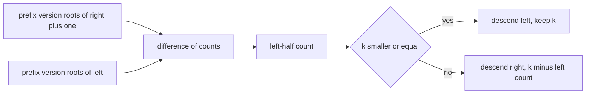
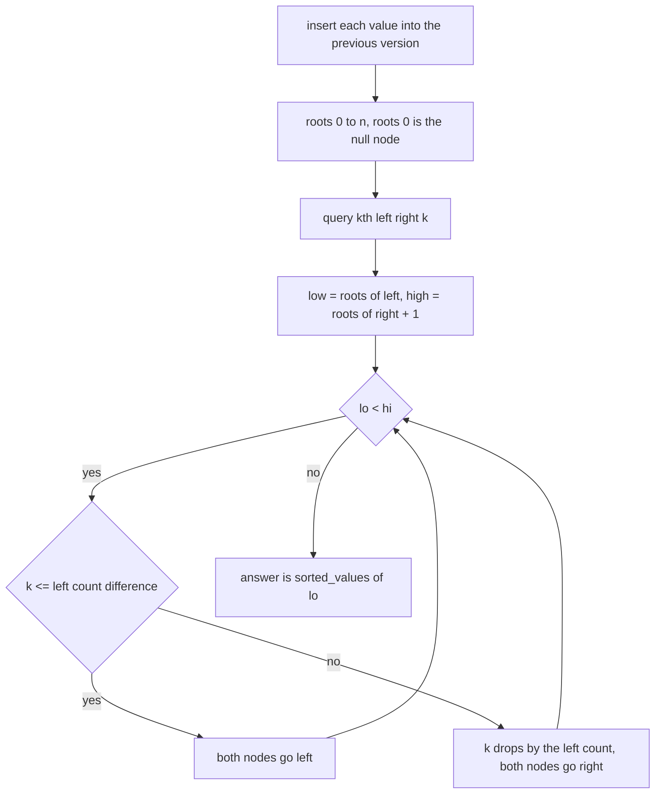
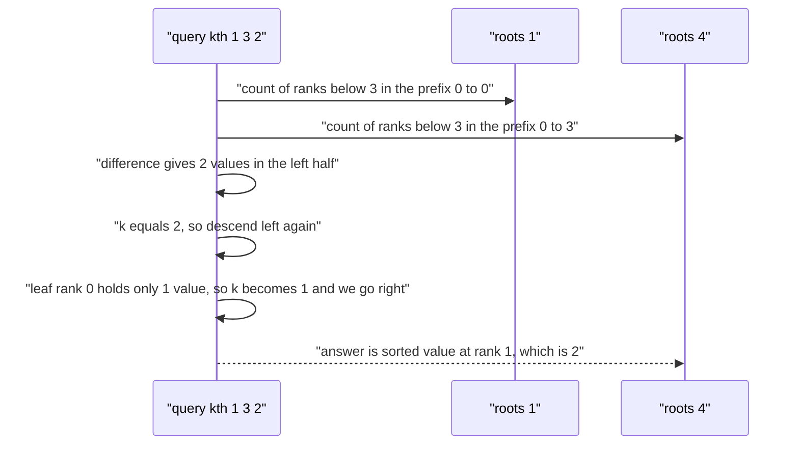

# 429 — Implement range kth order statistic using a persistent segment tree.

> **Tier:** Advanced · **CTCI chapter:** Beyond — Advanced Data Structures & Algorithms
> **Task spec:** [429-implement-range-kth-order-statistic-using-persistent-segtree.md](../../../tasks/advanced/429-implement-range-kth-order-statistic-using-persistent-segtree.md)
> **Solutions:** [Python](../../../solutions/python/advanced/429-implement-range-kth-order-statistic-using-persistent-segtree/solution.py) ·
> [Java](../../../solutions/java/advanced/429-implement-range-kth-order-statistic-using-persistent-segtree/Solution.java) ·
> [JavaScript](../../../solutions/javascript/advanced/429-implement-range-kth-order-statistic-using-persistent-segtree/solution.js) ·
> [C#](../../../solutions/csharp/advanced/429-implement-range-kth-order-statistic-using-persistent-segtree/Solution.cs)

## 1. Problem restatement

**Input:** an array `values` of `n` integers, built once, then queries `kth(left, right, k)` on the
**sub-array** `values[left..right]` inclusive.

**Output:** the `k`-th smallest value in that sub-array, with `k` counted from `1`. Duplicates are
counted individually: the 2nd smallest of `[2, 2]` is `2`.

The assertions in the four solution files, for `values = [5, 1, 4, 2, 3]`:

| Query | Result | Which sub-array |
| --- | --- | --- |
| `kth(0, 4, 1..5)` | `1, 2, 3, 4, 5` | the whole array, sorted |
| `kth(1, 3, 1)` / `kth(1, 3, 2)` / `kth(1, 3, 3)` | `1` / `2` / `4` | `[1, 4, 2]` sorted is `[1, 2, 4]` |
| `kth(2, 2, 1)` | `4` | a single element |
| `kth(4, 4, 1)` | `3` | a single element |
| `kth(0, 0, 1)` | `5` | the first element |

Duplicate-heavy and negative inputs are covered too: `[2, 2, 2]` answers `2` for every `k` and every
range, and `[-3, 7, -3, 0]` answers `-3, -3, 0, 7` over the whole array and `-3, 7` over `[1, 2]`.
The randomized part runs three seeds (`429`, `12345`, `54321`) with `n = 1 + seed % 40`, forty
random range/`k` queries each, and compares against sorting the slice.

## 2. Intuition

The direct answer to a range order statistic is "sort the slice and index it" — `O(len log len)`
per query, `O(log len)` with an order-statistics tree but no persistence across arbitrary ranges.

The persistent segment tree replaces per-query sorting with a **difference of two prefix versions**.
Build one version per prefix of the array:

- `roots[i]` is the root of a segment tree that counts how often each value occurs in `values[0..i)`.
- Ranks are compressed: the leaves of the tree are the *distinct* values in sorted order, so the
  domain is `m = number of distinct values`, not the numeric range.
- `roots[0]` is the null node `0`, i.e. an all-zero counting tree.

Then the multiset of `values[left..right]` is exactly the difference `roots[right + 1] - roots[left]`:
the descent subtracts the counts of one version from the other at every step, so it "sees" the
sub-array's histogram without materialising it.

Descending is a single root-to-leaf walk. At each node the count of values in the left half of the
domain is `count[leftChild(high)] - count[leftChild(low)]`; if `k` is at most that number, the
answer lies leftwards, otherwise it lies rightwards and `k` is reduced by that count. Either way the
descent shrinks the candidate domain by half.



Because every version shares the untouched nodes, `n + 1` versions cost `O(n log m)` nodes in total
rather than `O(n * m)`, which is the same structural-sharing argument as a persistent point-update
segment tree.

## 3. Algorithm

1. Compress values: `sorted_values = sorted(set(values))`, and `ranks[value]` its index; the domain
   is `[0, m - 1]` with `m = len(sorted_values)`.
2. Start with the null node `0` (`left = right = 0`, `count = 0`) and `roots = [0]`.
3. For every value in order, `insert` it into the last root and append the new root to `roots`:
   1. At a leaf, return a new node whose count is the old count `+ 1`.
   2. Otherwise rebuild only the child that receives the insertion, reusing the other child's index.
4. `kth(left, right, k)`: take `low = roots[left]` and `high = roots[right + 1]`; walk down while the
   domain has more than one value, comparing `count[left[high]] - count[left[low]]` with `k`; return
   `sorted_values[lo]` at the leaf.

```text
procedure build(values)
    sorted_values ← distinct values of values in increasing order
    ranks ← map from value to its index in sorted_values
    left ← [0]
    right ← [0]
    count ← [0]
    roots ← [0]
    root ← 0
    for value in values do
        root ← insert(root, 0, length(sorted_values) - 1, ranks[value])
        push_back(roots, root)
    end
end

function insert(node, lo, hi, position)
    if lo = hi then return new_node(0, 0, count[node] + 1) end
    mid ← floor((lo + hi) / 2)
    if position &lt;= mid then
        left_child ← insert(left[node], lo, mid, position)
        right_child ← right[node]
    else
        left_child ← left[node]
        right_child ← insert(right[node], mid + 1, hi, position)
    end
    return new_node(left_child, right_child, count[left_child] + count[right_child])
end

function kth(left_bound, right_bound, k)
    low ← roots[left_bound]
    high ← roots[right_bound + 1]
    lo ← 0
    hi ← length(sorted_values) - 1
    while lo &lt; hi do
        mid ← floor((lo + hi) / 2)
        left_count ← count[left[high]] - count[left[low]]
        if k &lt;= left_count then
            low ← left[low]
            high ← left[high]
            hi ← mid
        else
            k ← k - left_count
            low ← right[low]
            high ← right[high]
            lo ← mid + 1
        end
    end
    return sorted_values[lo]
end
```

The oracle uses no persistence at all: sort a copy of the slice and index it.

```text
function brute_kth(values, left_bound, right_bound, k)
    segment ← sorted copy of values[left_bound..right_bound]
    return segment[k - 1]
end
```



## 4. Worked example

Build the structure for `values = [5, 1, 4, 2, 3]`. The distinct values sorted are
`sorted_values = [1, 2, 3, 4, 5]`, so `m = 5` and `ranks = {1: 0, 2: 1, 3: 2, 4: 3, 5: 4}`. Inserting
the values in order gives one version per prefix:

| Version | Inserted | Prefix covered | Counts per rank |
| --- | --- | --- | --- |
| `roots[0]` | — | empty | all zero |
| `roots[1]` | `5` | `values[0..0]` | rank 4 → 1 |
| `roots[2]` | `1` | `values[0..1]` | ranks 4, 0 → 1 each |
| `roots[3]` | `4` | `values[0..2]` | ranks 4, 0, 3 → 1 each |
| `roots[4]` | `2` | `values[0..3]` | ranks 4, 0, 3, 1 → 1 each |
| `roots[5]` | `3` | `values[0..4]` | all five ranks → 1 each |

Now `kth(1, 3, 2)`, i.e. the 2nd smallest of `values[1..3] = [1, 4, 2]`, whose ranks are
`{0, 3, 1}`. The query uses `low = roots[1]` and `high = roots[4]`, so the difference is exactly
those three ranks:

| Descent step | Domain `[lo, hi]` | `left_count` = count of ranks in the left half | `k` | Decision |
| --- | --- | --- | --- | --- |
| 1 | `[0, 4]`, `mid = 2` | ranks `0, 1` present → `2` | `2` | `k <= 2`, descend left into `[0, 2]` |
| 2 | `[0, 2]`, `mid = 1` | left child covers `[0, 1]`, ranks `0, 1` → `2` | `2` | `k <= 2`, descend left into `[0, 1]` |
| 3 | `[0, 1]`, `mid = 0` | left child covers rank `0`, present → `1` | `2` | `k > 1`, so `k = 1` and descend right into `[1, 1]` |
| 4 | `[1, 1]` | leaf | — | answer `sorted_values[1] = 2` |

The result `2` matches the assertion. The same structure answers `kth(4, 4, 1)`: `low = roots[4]`,
`high = roots[5]`, the difference is the single rank `2`, and the descent lands on
`sorted_values[2] = 3`.

Duplicates behave the same way because counts, not existence flags, are compared: for
`values = [2, 2, 2]` the domain has a single value, `lo == hi` immediately, and every query returns
`sorted_values[0] = 2` — including `kth(0, 2, 3)`, where the left-count logic never runs at all.



## 5. Complexity

Let `n` be the length of the array and `m` the number of distinct values.

| Bound | Value | Why |
| --- | --- | --- |
| Build | `O(n log m)` time and nodes | one root-to-leaf path per insertion, everything else shared |
| `kth(left, right, k)` | `O(log m)` | a single descent to a leaf |
| Space | `O(n log m)` | `n + 1` versions, each adding `O(log m)` nodes |
| Sorting the slice per query | `O(len log len)` per query | the oracle's approach |

The persistence is what makes the difference of two prefix histograms available at all; without it,
each version would need its own full tree of `O(m)` nodes. The three randomized seeds use `n` up to
`40`, so the structure is small, but the bound is the same for large inputs, and the tests exercise
duplicates and negative values, which are the two cases a rank-compression bug typically breaks.

## 6. Pitfalls and edge cases

- **`k` is 1-based.** `k = 1` is the minimum of the range; the files never query `k = 0`, and the
  descent assumes `1 <= k <= len(range)`.
- **Duplicates.** Counts are compared, not booleans, so `[2, 2, 2]` answers `2` for `k = 1, 2, 3`;
  a set-based implementation would answer the same but with no way to distinguish the k-th copy.
- **Negative values.** Rank compression sorts actual values, so `[-3, 7, -3, 0]` works unchanged;
  `kth(0, 3, 1)` and `kth(0, 3, 2)` both return `-3`.
- **Single-element ranges.** `left == right` is legal: `kth(2, 2, 1) = 4` and `kth(4, 4, 1) = 3`.
- **The null node.** `roots[0] = 0` must behave as an all-zero tree, which is what makes
  `kth(0, r, k)` work without a special case for "no prefix".
- **Domain size one.** If all values are equal, `m = 1` and the loop never runs; the answer is
  `sorted_values[0]` regardless of the range.
- **Off-by-one on the right boundary.** The version for `right` inclusive is `roots[right + 1]`; using
  `roots[right]` silently drops the last element of the range.
- **Overflow of counts.** Counts are bounded by `n`, so ordinary integers suffice; the answer is a
  value from `sorted_values`, never an index.
- **Sorting direction.** `sorted_values` must be ascending — the descent's "left half means smaller
  ranks" convention depends on it.

## 7. Variants and follow-ups

- **Persistent tree without compression.** Keeping the tree over the numeric value domain works when
  the range of values is small; compression is what makes it independent of that range:
  [421 — persistent segment tree](421-implement-persistent-segment-tree-versioned.md).
- **Counting distinct values in a range.** The same prefix-difference trick with presence bits
  answers "how many distinct values", and the tree version of that with merging is
  [431 — suffix automaton for distinct substring queries](431-implement-suffix-automaton-for-distinct-substring-queries.md)
  in the string setting.
- **Dynamic order statistics with deletion.** When the array also changes, persistence is no longer
  enough and a balanced order-statistics structure is needed:
  [432 — dynamic median with an order-statistics structure](432-implement-data-structure-for-dynamic-median-order-statistics-tre.md).
- **Offline queries of the same flavour.** Mo's algorithm answers range queries with a sliding window
  instead of a persistent structure, including on trees:
  [430 — Mo's algorithm on trees](430-implement-mo-s-algorithm-on-trees-euler-tour-mo.md).

## 8. Check yourself

<details><summary>Show answer</summary>

**Q1.** Why is the sub-array multiset the difference of two prefix versions?

`roots[i]` counts occurrences in `values[0..i)`. Subtracting the counts of `roots[left]` from those of
`roots[right + 1]` leaves exactly the occurrences of `values[left..right]`, because the prefixes are
nested and the earlier one is contained in the later one.

</details>

<details><summary>Show answer</summary>

**Q2.** In the worked example, why does `k` become `1` at the third step of `kth(1, 3, 2)`?

At that step the left child covers only rank `0` and holds one value, while `k = 2`; the answer is
therefore in the right half, and the `k`-th smallest of the whole range is the `2 - 1 = 1`-st
smallest of the right half. The subtraction is exactly what this step encodes.

</details>

<details><summary>Show answer</summary>

**Q3.** How many nodes does the structure allocate for `n = 40` with `m = 20` distinct values?

`roots` holds `n + 1 = 41` versions, and each insertion adds one node per level, so about
`n * ceil(log2 m) = 40 * 5 = 200` nodes plus the null node — against `41 * (2m - 1) = 41 * 39`
nodes if every version were materialised separately.

</details>

<details><summary>Show answer</summary>

**Q4.** What changes if the query is "k-th **largest** instead of smallest"?

Either descend right-first by swapping the branch test, or answer the `(len - k + 1)`-th smallest,
which requires the length of the range, i.e. `right - left + 1`. Both are `O(log m)`.

</details>

<details><summary>Show answer</summary>

**Q5.** Why does a single-element range need no special handling?

`left == right` means `roots[right + 1] == roots[left + 1]` is one version ahead of `roots[left]`, so
the difference contains exactly that one value; the descent simply follows the non-empty branch,
and with `k = 1` it lands on that value's rank.

</details>
