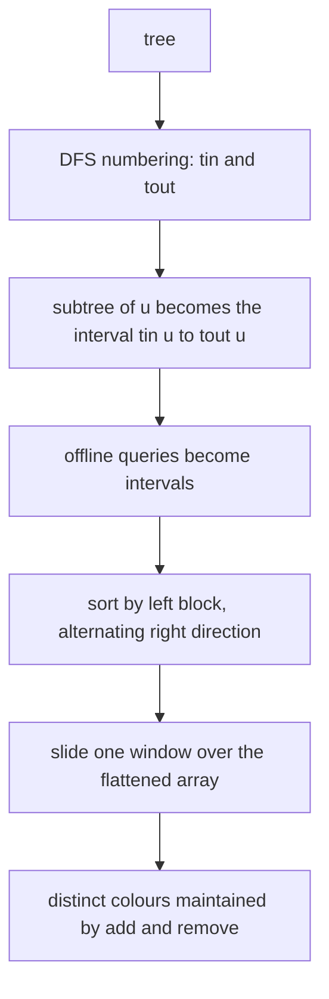
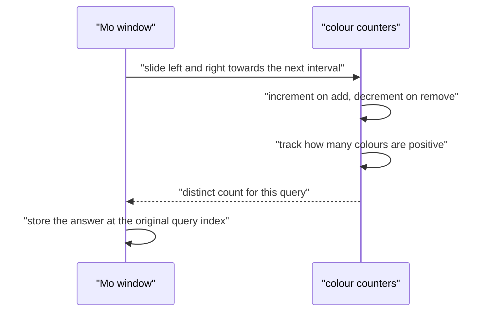
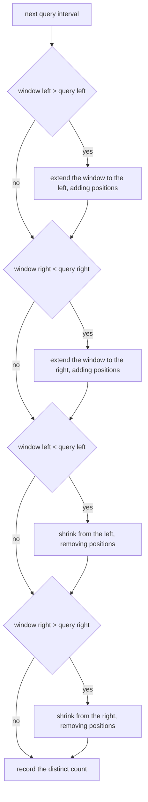

# 430 — Implement Mo's algorithm on trees (Euler tour + Mo).

> **Tier:** Advanced · **CTCI chapter:** Ch 4 — Trees and Graphs
> **Task spec:** [430-implement-mo-s-algorithm-on-trees-euler-tour-mo.md](../../../tasks/advanced/430-implement-mo-s-algorithm-on-trees-euler-tour-mo.md)
> **Solutions:** [Python](../../../solutions/python/advanced/430-implement-mo-s-algorithm-on-trees-euler-tour-mo/solution.py) ·
> [Java](../../../solutions/java/advanced/430-implement-mo-s-algorithm-on-trees-euler-tour-mo/Solution.java) ·
> [JavaScript](../../../solutions/javascript/advanced/430-implement-mo-s-algorithm-on-trees-euler-tour-mo/solution.js) ·
> [C#](../../../solutions/csharp/advanced/430-implement-mo-s-algorithm-on-trees-euler-tour-mo/Solution.cs)

## 1. Problem restatement

**Input:** a tree with `n` vertices rooted at `0`, a colour `colors[v]` per vertex, and a list of
offline queries, each naming a vertex `u`.

**Output:** for every query, the number of **distinct colours in the subtree of `u`**.

The assertions in the four solution files, for the tree `0-1, 0-2, 1-3` with
`colors = [0, 1, 0, 1]`:

| Queries | Answers | Why |
| --- | --- | --- |
| `[0, 1, 2, 3]` | `[2, 1, 1, 1]` | the whole tree has colours `0` and `1`; each other subtree is monochrome |
| `[3, 2, 1, 0]` | `[1, 1, 1, 2]` | the same answers in the reverse query order |
| `[2, 0, 2, 0]` | `[1, 2, 1, 2]` | repeated queries must give repeated answers |
| `[0, 1, 2, 3]` with all colours `5` | `[1, 1, 1, 1]` | one colour everywhere |
| `n = 1`, query `[0]` | `[1]` | a single vertex has one colour |

The randomized part uses seeds `430`, `24680` and `13579`, fifteen trees each with
`n = 2 + local % 49`, colours modulo `2 + seed % 6`, queries `0..n-1` plus twelve random vertices,
and compares every answer against a naive DFS recount. A final block repeats the checks with a
nearly unique palette (colours modulo `1000`), where almost every subtree is fully distinct.

**Scope note.** The Euler tour used here maps each *subtree* to a contiguous interval, which is the
standard way to apply Mo's algorithm to subtree queries. Counting colours on an arbitrary **path**
would need the two-pass Euler array of `2n` enter/leave events plus an LCA query, which this task
does not implement.

## 2. Intuition

The naive way to answer one subtree query is a DFS collecting colours: `O(size)` per query, `O(n * q)`
in total. Two independent ideas combine to remove that factor.

1. **Flatten the tree.** A DFS that numbers vertices on entry — `tin[u]` on the way in, `tout[u]` after
   the last descendant — makes every subtree a contiguous interval `[tin[u], tout[u]]` of the
   flattened array `euler`, where `euler[tin[v]] = v`. That is the standard Euler tour property: a
   subtree is exactly the region between the entry number of its root and the entry number of the
   last vertex visited inside it.
2. **Sort the queries cleverly and slide a window.** Once the queries are intervals, Mo's algorithm
   answers them with a single window `[current_left, current_right]` that moves from one query to the
   next, adding or removing one element at a time. Ordering queries by *block of the left endpoint*,
   alternating the right endpoint's direction inside each block, bounds the total movement at
   `O((n + q) * sqrt(n))` — far less than restarting the count per query.

The alternating direction matters: within one block of left endpoints, the right pointer sweeps
monotonically (once left-to-right, once right-to-left), so it never travels back across the whole
array between two consecutive queries in the same block.

Maintaining the distinct count is a one-line trick: keep a counter per colour and track how many
colours currently have a positive count. Adding a colour that was at zero increments the answer;
removing a colour that drops to zero decrements it.



## 3. Algorithm

1. Root the tree at `0` with a DFS, filling `tin[u]`, `tout[u]` and `euler[tin[u]] = u`; also record
   the child lists (used only by the naive oracle).
2. Choose the block size `block = max(1, floor(sqrt(n)))`.
3. Sort the query indices with the key
   `(tin[query] / block, tout[query] if block index is even else -tout[query])`.
4. Walk the sorted queries with a window `[current_left, current_right]`, initially empty
   (`current_left = 0`, `current_right = -1`) and a colour counter:
   - move `current_left` left / `current_right` right and **add** the entered positions;
   - move `current_left` right / `current_right` left and **remove** the left positions;
   - when the window equals the query interval, store the current distinct count.
5. Return the answers in the original query order.

```text
procedure euler_tour(n, edges)
    adjacency ← build from edges
    timer ← 0
    dfs(0, no parent):
        tin[vertex] ← timer
        euler[timer] ← vertex
        timer ← timer + 1
        for child in unvisited neighbours of vertex do
            dfs(child, vertex)
        tout[vertex] ← timer - 1
end

function answer_queries(n, edges, colors, queries)
    tin, tout, euler ← euler_tour(n, edges)
    block ← max(1, floor(square root of n))
    sort the query indices: first by tin[queries[index]] divided by block,
        then by tout[queries[index]] ascending for even blocks and descending for odd blocks
    counts ← empty counter
    distinct ← 0
    current_left ← 0
    current_right ← -1
    answers ← array of zeroes with one slot per query
    for index in the sorted order do
        left ← tin[queries[index]]
        right ← tout[queries[index]]
        while current_left &gt; left do
            current_left ← current_left - 1
            add position current_left
        end
        while current_right &lt; right do
            current_right ← current_right + 1
            add position current_right
        end
        while current_left &lt; left do
            remove position current_left
            current_left ← current_left + 1
        end
        while current_right &gt; right do
            remove position current_right
            current_right ← current_right - 1
        end
        answers[index] ← distinct
    end
    return answers
end

procedure add(position)
    color ← colors[euler[position]]
    counts[color] ← counts[color] + 1
    if counts[color] = 1 then distinct ← distinct + 1 end
end

procedure remove(position)
    color ← colors[euler[position]]
    counts[color] ← counts[color] - 1
    if counts[color] = 0 then distinct ← distinct - 1 end
end
```

The oracle recomputes each answer from scratch:

```text
function naive_subtree_distinct(n, edges, colors, queries)
    children ← rooted child lists
    answers ← empty list
    for u in queries do
        seen ← empty set
        stack ← [u]
        while stack is not empty do
            node ← pop(stack)
            add colors[node] to seen
            push every child of node onto stack
        end
        push_back(answers, size of seen)
    end
    return answers
end
```



## 4. Worked example

Take the tree `0-1, 0-2, 1-3` with `colors = [0, 1, 0, 1]` and the queries `[0, 1, 2, 3]`. The DFS
from `0` visits `0, 1, 3, 2`, so `euler = [0, 1, 3, 2]` and the intervals are:

| Vertex | `tin` | `tout` | Interval | Colours in the interval | Distinct |
| --- | --- | --- | --- | --- | --- |
| 0 | 0 | 3 | `[0, 3]` | `0, 1, 1, 0` | `2` |
| 1 | 1 | 2 | `[1, 2]` | `1, 1` | `1` |
| 2 | 3 | 3 | `[3, 3]` | `0` | `1` |
| 3 | 2 | 2 | `[2, 2]` | `1` | `1` |

With `block = max(1, floor(sqrt 4)) = 2`, the sort keys are `(0, 3)` for query `0`, `(0, 2)` for
query `1`, `(1, -3)` for query `2` and `(1, -2)` for query `3`, so the processing order is
`1, 0, 3, 2`:

| Processed query | Interval | Window moves | Counter after the move | Colours present | Answer |
| --- | --- | --- | --- | --- | --- |
| `1` | `[1, 2]` | add `0`, `1`, `2`; then remove `0` | `{1: 2}` | `1` | `1` |
| `0` | `[0, 3]` | add `0`; add `3` | `{0: 2, 1: 2}` | `0, 1` | `2` |
| `3` | `[2, 2]` | remove `0`, `1`; remove `3` | `{1: 1}` | `1` | `1` |
| `2` | `[3, 3]` | add `3`; remove `2` | `{0: 1}` | `0` | `1` |

Stored back into the original order, the answers are `[2, 1, 1, 1]` — the first assertion. Note how
the window never resets between queries: each query adjusts the previous window by a few positions
and the counters are updated in place, which is what amortises the work when both `n` and `q` grow.

The repeated-query case `[2, 0, 2, 0]` is a useful check for the other direction: the window ends the
first `2` with counters for vertex `2`'s colour, expands to the whole tree for `0`, then shrinks back
to vertex `2` and expands again, and the two pairs of answers agree.



## 5. Complexity

Let `n` be the number of vertices and `q` the number of queries, with block size
`B = floor(sqrt(n))`.

| Bound | Value | Why |
| --- | --- | --- |
| Euler tour | `O(n)` time and space | one DFS visiting every vertex once |
| Sorting the queries | `O(q log q)` | the Mo key is computed in `O(1)` per query |
| Window movement | `O((n + q) * sqrt(n))` | `O(n)` movement per left block, `O(q * B)` movement from block to block |
| Space | `O(n + q)` | `euler`, `tin`, `tout`, the colour counter and the answer array |
| Naive DFS per query | `O(n)` worst case per query, `O(n * q)` total | each query recollects its subtree |

The classic bound is usually written as `O((n + q) sqrt n)`: the right pointer travels at most `n`
positions per left block, and there are `n / B` blocks, giving `O(n^2 / B) = O(n sqrt n)`; the left
pointer moves at most `B` per query, giving `O(q B) = O(q sqrt n)`. Add/remove are `O(1)` each, so
the total is dominated by those movements. The alternating right direction is what keeps the right
pointer from bouncing: without it, each query inside a block would cost a full sweep.

## 6. Pitfalls and edge cases

- **Rooting and the interval convention.** `tin`/`tout` must come from a DFS that numbers on entry and
  closes after the last descendant, so that `[tin[u], tout[u]]` is exactly `u`'s subtree. Numbering on
  exit gives a different (also useful, but not here) interval.
- **Empty window.** The window starts at `current_left = 0`, `current_right = -1`; the add loops run
  before the remove loops, so no position is removed before it was added.
- **Repeat queries.** The same vertex may appear several times; the stored answers must be indexed by
  the *original* query position, which the `[2, 0, 2, 0]` case checks.
- **Single vertex.** `n = 1` gives `tin = tout = 0`, one query, and the answer `1`.
- **All colours equal.** The distinct count stays `1` no matter how the window moves, because the
  counter only reaches `1` for that colour.
- **Nearly unique palette.** With colours modulo `1000` and `n` below `50`, almost every subtree is
  fully distinct; that case exercises the "colour reaches zero" branch of `remove`.
- **Block size for small `n`.** `floor(sqrt(1)) = 1`, and the `max(1, ...)` guard keeps the divisor
  non-zero.
- **Path queries are out of scope.** The single-visit Euler tour here maps trees to intervals for
  subtree queries only; path queries need the `2n`-event tour and an LCA, which the files do not
  implement and the header documents as an Euler-tour-based Mo variant.
- **Answer order.** The natural output of the sweep is in sorted order; the answers must be written
  back by index, which is why `answers[index]` uses the query's own position.

## 7. Variants and follow-ups

- **Mo on the two-visit Euler tour.** Using both the enter and leave events (plus an LCA query) makes
  arbitrary path queries answerable with the same sliding window; the LCA preprocessing is
  [428 — binary lifting](428-implement-binary-lifting-for-lca-and-ancestor-queries.md).
- **Subtree queries without Mo.** Small-to-large merging answers the same questions in `O(n log n)`
  with no sorting at all — better when `q` is large relative to `n`:
  [424 — small-to-large merging on trees](424-implement-small-to-large-merging-on-trees-for-frequency-queries.md).
- **Mo with updates.** Adding a modification time dimension (three-dimensional Mo) handles point
  updates between queries, at the cost of one extra factor of `n^(2/3)`.
- **Range queries without Mo.** For k-th order statistics over a range, a persistent structure answers
  a single query in `O(log n)` instead of amortising over many:
  [429 — range k-th order statistic](429-implement-range-kth-order-statistic-using-persistent-segtree.md).

## 8. Check yourself

<details><summary>Show answer</summary>

**Q1.** What property of a DFS numbering makes subtrees contiguous intervals?

The DFS numbers a vertex on entry and finishes its entire subtree before returning, so the entry
numbers of `u` and of all its descendants form a contiguous block starting at `tin[u]`. The last one
is `tout[u]`, and every vertex with an entry number in `[tin[u], tout[u]]` is a descendant.

</details>

<details><summary>Show answer</summary>

**Q2.** Why is the right endpoint sorted in alternating directions inside consecutive blocks?

Because the right pointer movement dominates the cost. If the right endpoint always increased within
a block, moving to the next block would require a full sweep back across the array; reversing the
direction makes that transition cheap, so each block's right pointer travels monotonically across
`O(n)` positions.

</details>

<details><summary>Show answer</summary>

**Q3.** In the worked example, why does the first processed query add position `0` and then remove it
again?

Because the window starts empty at `[0, -1]` and the add loops run before the remove loops. Extending
the right end from `-1` to `2` passes position `0`, and the subsequent left shrink removes it to
reach `[1, 2]`. That "add first, trim afterwards" order is exactly why the four loops are written in
that sequence — reversing it would remove a position that was never added.

</details>

<details><summary>Show answer</summary>

**Q4.** How is the distinct count maintained, and what exactly does `distinct` count?

A dictionary maps each colour to its count inside the window, and `distinct` counts the colours whose
count is positive. `add` increments it only when a colour's count becomes `1`; `remove` decrements it
only when a count reaches `0`.

</details>

<details><summary>Show answer</summary>

**Q5.** Why does the ordering of the queries not affect the answers?

The sweep stores each result under the query's original index, and the window invariant — the
counters describe exactly the current interval — is re-established before each answer is read. So the
answer for a query depends only on its interval, not on when it was processed.

</details>
