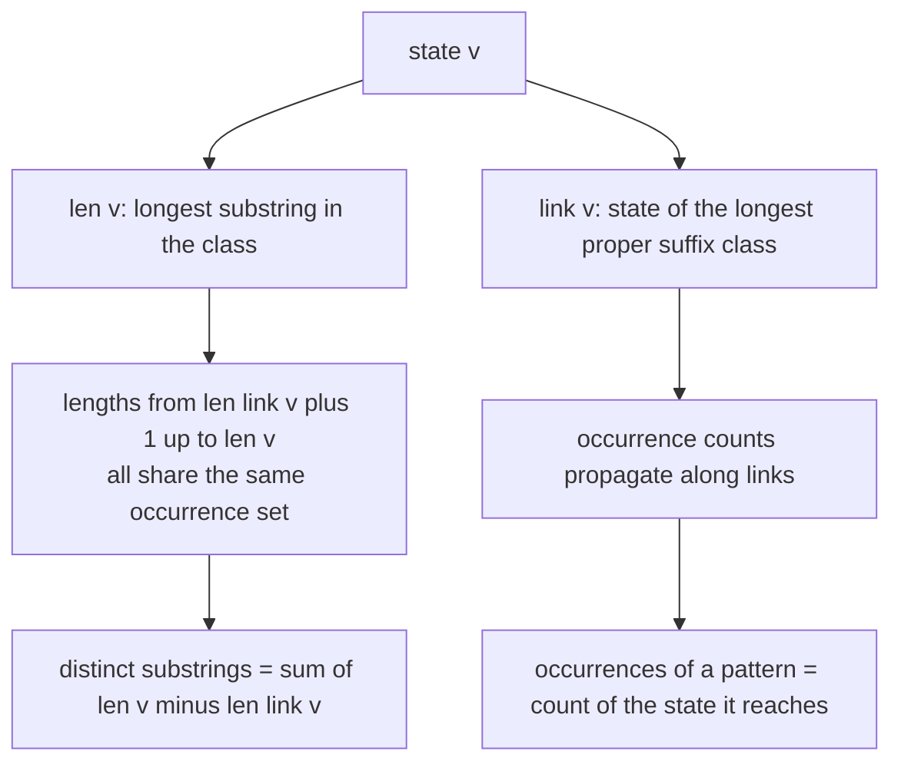
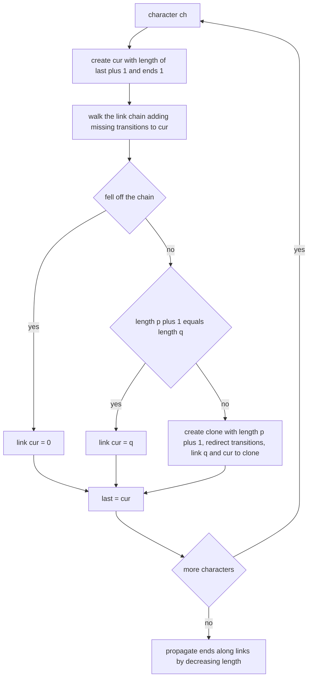
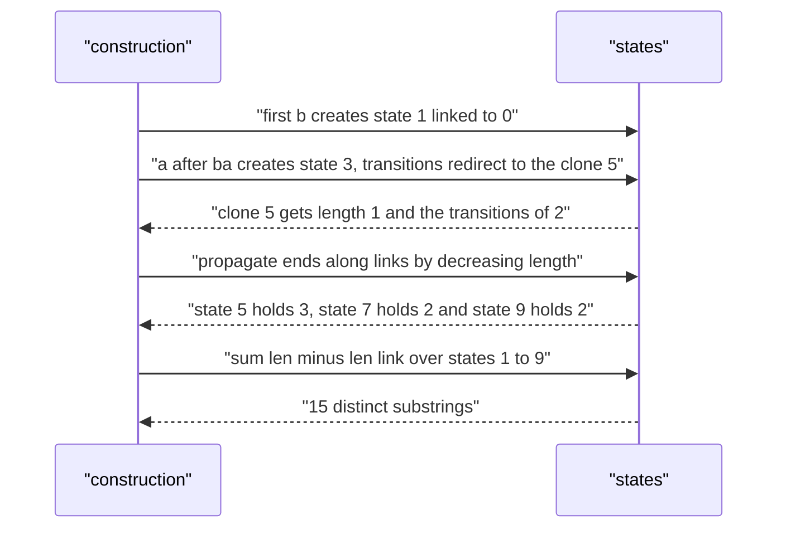

# 431 — Implement suffix automaton for distinct substring queries.

> **Tier:** Advanced · **CTCI chapter:** Beyond — Advanced Data Structures & Algorithms
> **Task spec:** [431-implement-suffix-automaton-for-distinct-substring-queries.md](../../../tasks/advanced/431-implement-suffix-automaton-for-distinct-substring-queries.md)
> **Solutions:** [Python](../../../solutions/python/advanced/431-implement-suffix-automaton-for-distinct-substring-queries/solution.py) ·
> [Java](../../../solutions/java/advanced/431-implement-suffix-automaton-for-distinct-substring-queries/Solution.java) ·
> [JavaScript](../../../solutions/javascript/advanced/431-implement-suffix-automaton-for-distinct-substring-queries/solution.js) ·
> [C#](../../../solutions/csharp/advanced/431-implement-suffix-automaton-for-distinct-substring-queries/Solution.cs)

## 1. Problem restatement

**Input:** a string `text`, processed once, then queries against the automaton built from it.

**Output:** three operations, exactly as the solution headers define them:

| Operation | Result |
| --- | --- |
| `distinct_substrings()` | the number of distinct substrings of `text`, i.e. `sum(len[v] - len[link[v]])` over all non-initial states |
| `is_substring(pattern)` | whether `pattern` occurs in `text` |
| `occurrences(pattern)` | how many times `pattern` occurs in `text` (patterns are non-empty; an absent pattern gives `0`) |

The assertions in the four solution files:

| Text | `distinct_substrings()` | Notes |
| --- | --- | --- |
| `""` | `0` | nothing to count |
| `"a"` | `1` | `a` |
| `"abab"` | `7` | `a, b, ab, ba, aba, bab, abab` |
| `"aaaa"` | `4` | `a, aa, aaa, aaaa` |
| `"abc"` | `6` | all `C(4, 2) = 6` substrings are distinct |
| `"ababa"` | `9` | the overlapping structure reduces the count |
| `"banana"` | `15` | asserted alongside six membership queries |

Occurrence assertions: on `"banana"`, `occurrences("an") == 2`, `occurrences("ana") == 2`,
`occurrences("na") == 2`, `occurrences("x") == 0`; on `"abab"`, `occurrences("ab") == 2`,
`occurrences("ba") == 1`, `occurrences("abab") == 1`; on `"aaaa"`, `occurrences("a") == 4`,
`occurrences("aa") == 3`, `occurrences("aaa") == 2`, `occurrences("aaaa") == 1`. Membership is also
checked negatively: `bn` and `bananas` are not substrings of `banana`.

The randomized part builds 40 LCG strings over the alphabet `abc` with lengths `1 + seed % 40`,
compares `distinct_substrings` against a brute-force set of every substring, verifies every substring
of length up to 5 with its brute-force occurrence count, and checks four mutations (`"d"`, `"bd"`,
`"abz"`, `text + "d"`) that must either be absent or match the brute-force count.

## 2. Intuition

Storing all `O(n^2)` substrings is the naive route to these queries. The suffix automaton stores the
same information in `O(n)` states by grouping substrings that always behave identically.

The construction keeps, for the whole prefix processed so far, one state per **equivalence class of
substrings ending at the current position**: two substrings are equivalent when they occur at exactly
the same set of end positions. Every state `v` then holds a whole range of lengths, from
`len[link[v]] + 1` up to `len[v]`, and all those lengths correspond to distinct substrings with the
same occurrence set. Two consequences fall out:

- **Distinct substrings.** The ranges of different states are disjoint and cover every distinct
  substring exactly once, so the answer is `sum(len[v] - len[link[v]])` over all states except the
  initial one. No hashing, no suffix array.
- **Occurrences.** Every state carries a count of "end positions": states created for a new prefix
  count `1`, cloned states count `0`. Because the suffix-link chain of a state lists the classes of
  its suffixes, propagating counts along links in decreasing-length order gives, for each state, the
  number of end positions of the longest substring it represents — exactly its occurrence count.

Membership is just a walk: follow the transition for each character of the pattern and check that it
does not fail.



Cloning is the price of `O(n)` states. When a new transition forces a split of an existing class —
because the newly reachable state represents substrings that are longer than `len[p] + 1` — a clone
is created with the shorter length, the old state's transitions, and no end positions of its own.

## 3. Algorithm

1. Start with state `0`: `len = 0`, `link = -1`, no transitions, `ends = 0`. Keep `last = 0`.
2. For each character `ch` of the text:
   1. Create `cur` with `len[cur] = len[last] + 1`, `link` unset, `ends[cur] = 1`.
   2. Walk `p = last` up the link chain, adding `next[p][ch] = cur` while that transition is
      missing.
   3. If the walk falls off the chain (`p = -1`), set `link[cur] = 0`.
   4. Otherwise let `q = next[p][ch]`. If `len[p] + 1 == len[q]`, set `link[cur] = q`.
   5. Otherwise **clone**: create `clone` with `len[clone] = len[p] + 1`, `link[clone] = link[q]`,
      `ends[clone] = 0`, and a copy of `q`'s transitions; redirect every `next[·][ch]` that pointed to
      `q` along the chain to `clone`; then `link[q] = clone` and `link[cur] = clone`.
   6. Set `last = cur`.
3. Sort states by `len` descending and add each state's `ends` to its link's `ends`. (Skip the
   initial state.)
4. `distinct_substrings()` sums `len[v] - len[link[v]]` over states `1..m-1`.
5. `walk(pattern)` follows transitions from state `0`, returning `-1` on the first missing one;
   `is_substring` tests `walk != -1` and `occurrences` returns `ends[walk]` (or `0`).

```text
procedure build(text)
    length ← [0]
    link ← [-1]
    next ← [empty map]
    ends ← [0]
    last ← 0
    for ch in text do
        cur ← new state with length of last plus 1, ends 1
        p ← last
        while p != -1 and ch is not in next[p] do
            next[p][ch] ← cur
            p ← link[p]
        end
        if p = -1 then
            link[cur] ← 0
        else
            q ← next[p][ch]
            if length[p] + 1 = length[q] then
                link[cur] ← q
            else
                clone ← new state with length of p plus 1,
                        link of q, a copy of the transitions of q, ends 0
                while p != -1 and next[p][ch] = q do
                    next[p][ch] ← clone
                    p ← link[p]
                end
                link[q] ← clone
                link[cur] ← clone
            end
        end
        last ← cur
    end
    for state in states other than 0, ordered by decreasing length do
        ends[link[state]] ← ends[link[state]] + ends[state]
    end
end

function distinct_substrings()
    total ← 0
    for v from 1 to number of states - 1 do
        total ← total + length[v] - length[link[v]]
    end
    return total
end

function walk(pattern)
    state ← 0
    for ch in pattern do
        if ch is not in next[state] then return -1 end
        state ← next[state][ch]
    end
    return state
end

function occurrences(pattern)
    state ← walk(pattern)
    if state = -1 then return 0 end
    return ends[state]
end
```



## 4. Worked example

Build the automaton for `"banana"`. The construction produces ten states; the interesting one is
state `5`, a **clone** created while processing the second `a`:

| State | `len` | `link` | `ends` (initial) | Transitions |
| --- | --- | --- | --- | --- |
| 0 | 0 | -1 | 0 | `b → 1`, `a → 5`, `n → 7` |
| 1 | 1 | 0 | 1 | `a → 2` |
| 2 | 2 | 5 | 1 | `n → 3` |
| 3 | 3 | 7 | 1 | `a → 4` |
| 4 | 4 | 9 | 1 | `n → 6` |
| 5 | 1 | 0 | 3 | `n → 7` |
| 6 | 5 | 7 | 1 | `a → 8` |
| 7 | 2 | 0 | 2 | `a → 9` |
| 8 | 6 | 9 | 1 | — |
| 9 | 3 | 5 | 2 | `n → 6` |

After `ends` propagation, state `5` holds `3` end positions (it represents the single character `a`,
which occurs three times in `banana`), state `0` holds `6`, state `7` holds `2` and state `9` holds
`2`. The distinct-substring sum is a plain loop over states `1..9`:

| State | `len[v]` | `len[link[v]]` | Contribution |
| --- | --- | --- | --- |
| 1 | 1 | 0 | 1 |
| 2 | 2 | 1 | 1 |
| 3 | 3 | 2 | 1 |
| 4 | 4 | 3 | 1 |
| 5 | 1 | 0 | 1 |
| 6 | 5 | 2 | 3 |
| 7 | 2 | 0 | 2 |
| 8 | 6 | 3 | 3 |
| 9 | 3 | 1 | 2 |

Total `15`, the asserted number. Membership and occurrence queries are single walks:

| Query | Walk | State reached | Answer |
| --- | --- | --- | --- |
| `is_substring("ban")` | `0 → 1 → 2 → 3` | `3` | `true` |
| `is_substring("bn")` | `0 → 1`, then `n` is missing from `1` | — | `false` |
| `occurrences("an")` | `a → 5`, then `n → 7` | `7` (ends `2`) | `2` |
| `occurrences("ana")` | `a → 5`, `n → 7`, `a → 9` | `9` (ends `2`) | `2` |
| `occurrences("nan")` | `n → 7`, `a → 9`, `n → 6` | `6` (ends `1`) | `1` |
| `occurrences("x")` | `x` is missing from `0` | — | `0` |

Note that a cloned state is exactly why the counts work out: state `5` was created with `ends = 0`
and received its `3` end positions only through the propagation step, while the original state `2`
kept its own single end position.



## 5. Complexity

Let `n` be the length of the text and `p` the length of a pattern.

| Bound | Value | Why |
| --- | --- | --- |
| Build | `O(n)` amortized states and transitions | at most `2n - 1` states and `3n - 4` transitions for `n >= 3`, with the link-walk amortization paying for the clones |
| `distinct_substrings()` | `O(n)` | one term per state |
| `is_substring` / `occurrences` | `O(p)` | a single transition walk |
| Space | `O(n * alphabet)` transitions in the map-based representation | one transition map per state |
| Brute force over all substrings | `O(n^2)` substrings to enumerate and store | the randomized oracle does this for every test string |

The state and transition bounds are the classic suffix-automaton result: the amortized construction
adds a constant number of states and transitions per character, and the link walks telescope. The
occurrence propagation is a single sort of at most `2n - 1` states plus one pass over the links.

## 6. Pitfalls and edge cases

- **Empty text.** No states beyond the initial one: `distinct_substrings()` is `0`, and every pattern
  except the empty one is rejected by a missing transition from state `0`.
- **Single character.** `"a"` has two states, contributing `1 - 0 = 1`.
- **Highly repetitive text.** `"aaaa"` gives `4` distinct substrings and occurrence counts `4, 3, 2, 1`
  for `a, aa, aaa, aaaa` — the case where a naive "count suffixes" approach over-counts.
- **Clones.** A clone must start with `ends = 0` and copy the transitions of the state it splits from;
  redirecting the incoming transitions is what keeps the automaton correct. Forgetting the redirect
  leaves states reachable through stale transitions.
- **Link of the clone.** `len[clone] = len[p] + 1` and `link[clone] = link[q]` are not
  interchangeable with `q`'s values; using `q`'s length would produce a class covering the wrong
  length range and a wrong distinct-substring sum.
- **Empty pattern.** `walk("")` returns state `0`, whose `ends` after propagation counts the whole
  text — so an empty pattern would report `n`. The files document that patterns passed to
  `occurrences` are non-empty.
- **State `0` is excluded.** The distinct-substring sum and the propagation loop both skip the
  initial state, which has `link = -1` and no meaningful length range.
- **Alphabet.** Transition maps are keyed by characters, so unicode or arbitrary alphabets work
  without changes; the tests use `abc`.
- **Occurrence of the whole text.** `occurrences(text) == 1` is asserted for all LCG strings, which
  checks that exactly one state carries the full-length class.

## 7. Variants and follow-ups

- **Counting distinct substrings of many strings.** Running the automaton over a generalized suffix
  automaton answers the same question for a set of strings; the string-side counterpart of
  [407 — generalized suffix array](../../../tasks/advanced/407-implement-generalized-suffix-array-for-multiple-strings.md)
  is the other way to organise that.
- **Longest common substring.** Walking two automata or one generalized automaton finds the longest
  common substring in linear time, the standard follow-up exercise.
- **Occurrence queries as a data structure.** When counts change with edits, the automaton is no
  longer enough; keeping versioned prefix counts is the persistent approach of
  [429 — range k-th order statistic](429-implement-range-kth-order-statistic-using-persistent-segtree.md).
- **Substring queries on trees of strings.** Applying the same automaton to an LCA-annotated tree of
  strings is how suffix-automaton statistics interact with
  [428 — binary lifting](428-implement-binary-lifting-for-lca-and-ancestor-queries.md).

## 8. Check yourself

<details><summary>Show answer</summary>

**Q1.** Why does `sum(len[v] - len[link[v]])` count distinct substrings exactly once each?

Every distinct substring belongs to exactly one equivalence class, namely the class of its end-position
set. Within state `v`, the classes are represented by lengths `len[link[v]] + 1` through `len[v]`, and
those ranges are disjoint across states, so the sum counts each distinct substring exactly once.

</details>

<details><summary>Show answer</summary>

**Q2.** What does a clone represent, and why does it start with `ends = 0`?

A clone represents a class of substrings that the new prefix has split off from `q`: the same
end-position set as part of `q`'s class, but with shorter lengths. Its end positions come from the
states that link to it, so it must start at `0`; only the states created for the prefixes themselves
start at `1`.

</details>

<details><summary>Show answer</summary>

**Q3.** For `"aaaa"`, give the four occurrence counts and explain them.

`a` occurs 4 times, `aa` 3 times, `aaa` 2 times, `aaaa` 1 time — the counts drop because each longer
run fits in fewer starting positions. The states on the `a`-chain have lengths `1, 2, 3, 4` and their
`ends` values are exactly those counts after propagation.

</details>

<details><summary>Show answer</summary>

**Q4.** Why is the propagation order "decreasing length" and not "any order"?

`ends[v]` must be complete before it is added to `link[v]`. A state's link always has a smaller
length, so processing states by decreasing length guarantees every contribution arrives before the
target is itself processed. An arbitrary order can add a partial count and produce counts that are
too small.

</details>

<details><summary>Show answer</summary>

**Q5.** What is the cost of answering the query "how many distinct substrings does `text` have" with
this structure, versus enumeration?

Enumeration touches `O(n^2)` substrings and needs a set to deduplicate them; the automaton answers the
query by summing one term per state, i.e. `O(n)` for a structure that itself costs `O(n)` amortized to
build.

</details>
