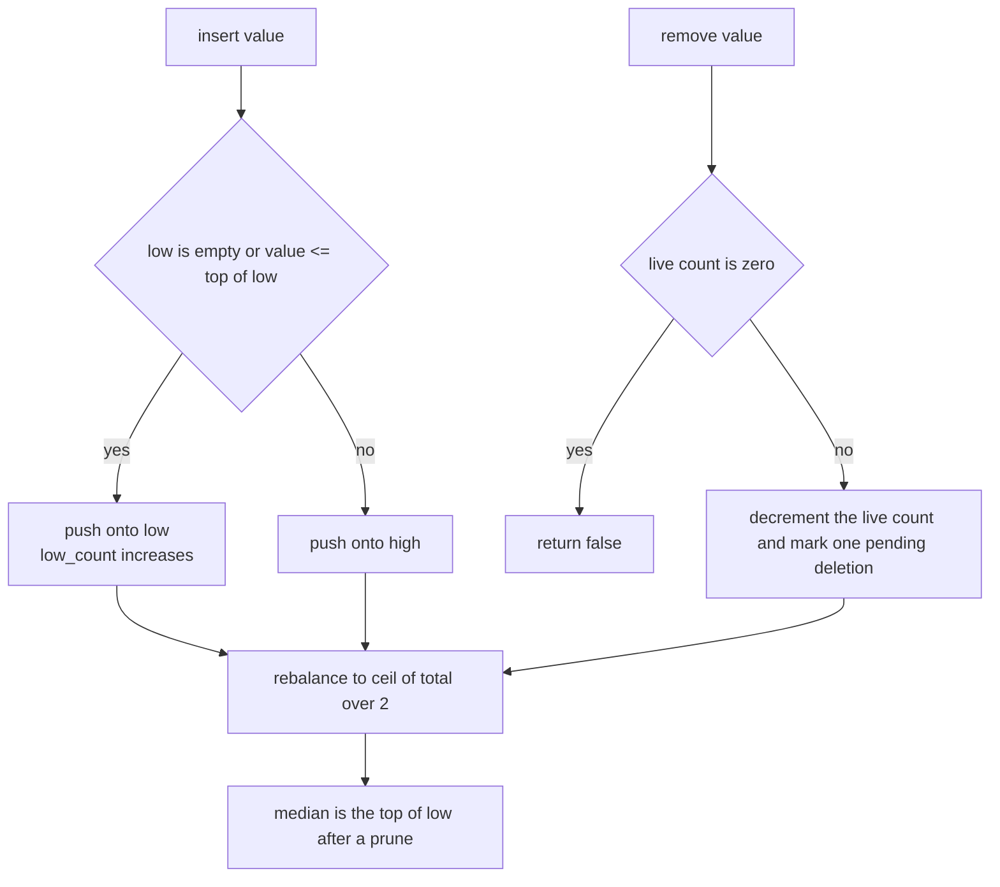
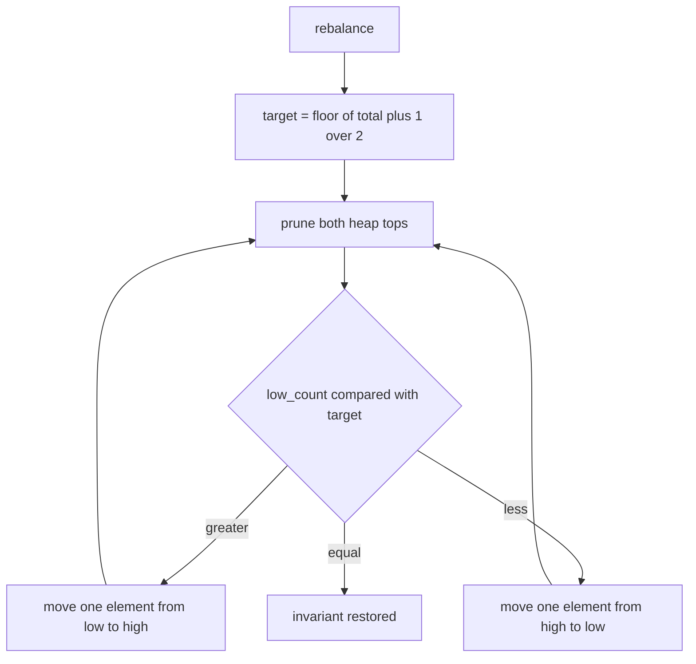
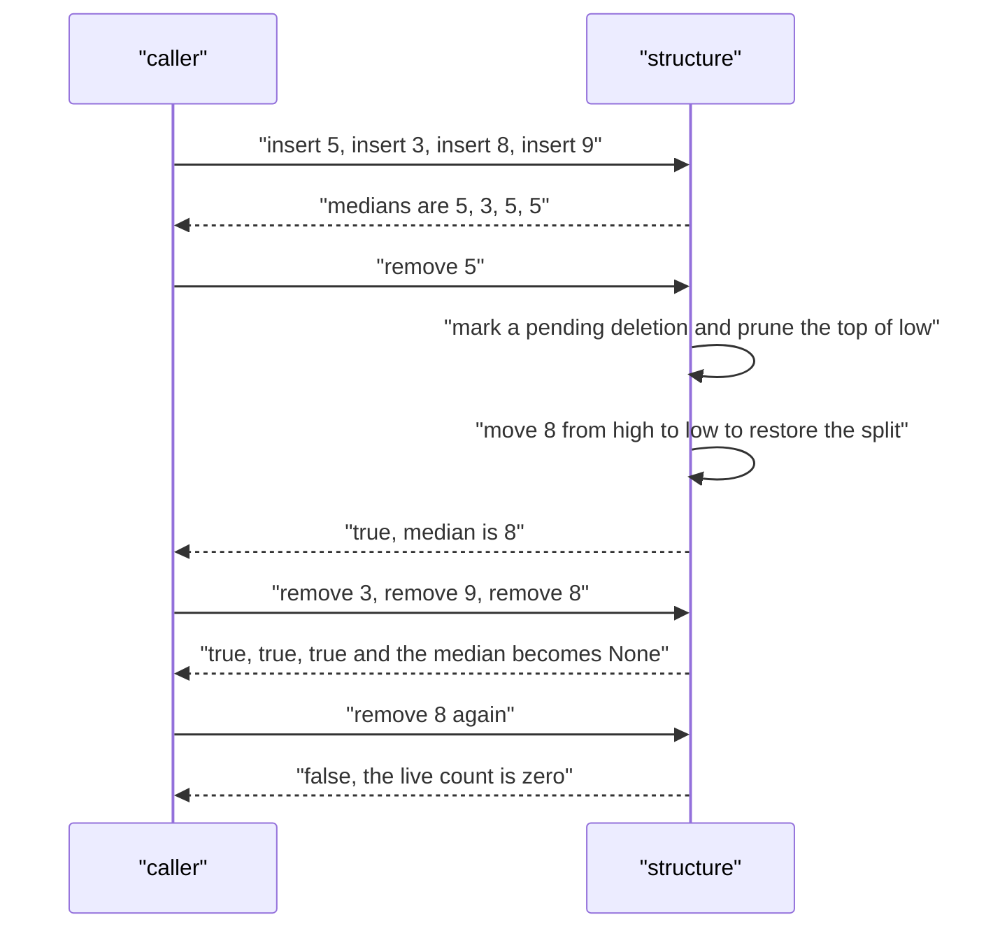

# 432 — Implement data structure for dynamic median (order-statistics structure).

> **Tier:** Advanced · **CTCI chapter:** Beyond — Advanced Data Structures & Algorithms
> **Task spec:** [432-implement-data-structure-for-dynamic-median-order-statistics-tre.md](../../../tasks/advanced/432-implement-data-structure-for-dynamic-median-order-statistics-tre.md)
> **Solutions:** [Python](../../../solutions/python/advanced/432-implement-data-structure-for-dynamic-median-order-statistics-tre/solution.py) ·
> [Java](../../../solutions/java/advanced/432-implement-data-structure-for-dynamic-median-order-statistics-tre/Solution.java) ·
> [JavaScript](../../../solutions/javascript/advanced/432-implement-data-structure-for-dynamic-median-order-statistics-tre/solution.js) ·
> [C#](../../../solutions/csharp/advanced/432-implement-data-structure-for-dynamic-median-order-statistics-tre/Solution.cs)

## 1. Problem restatement

**Input:** a multiset of integers undergoing three operations:

| Operation | Meaning |
| --- | --- |
| `insert(value)` | add one copy of `value` |
| `remove(value)` | delete one copy; returns `false` when no live copy exists |
| `median()` | the **lower median**: the live element at 0-based index `(size - 1) / 2` in sorted order, or `None` when the multiset is empty |
| `size()` | the number of live elements |

**Output:** `median()` and `remove()` return their answers; every operation costs `O(log n)` amortized.

The assertions in the four solution files:

| Sequence | `median()` after each step |
| --- | --- |
| empty structure | `None`; `remove(0)` is `false` |
| insert `5`, `3`, `8`, `9` | `5`, `3`, `5`, `5` |
| `remove(5)`, `remove(3)`, `remove(9)`, `remove(8)` | `8`, `8`, `8`, `None` |
| `remove(8)` again on the empty structure | `false`, size `0` |
| insert `7`, `remove(7)` | `7`, then `None` |
| insert `3` three times, then remove them one by one | `3`, `3`, `3`, then `None` after the last removal |

A second script inserts `1..10` and removes them in the order `10, 1, 9, 2, 8, 3, 7, 4, 6, 5`,
checking `median()` against a sorted-list oracle at every step. The randomized part runs 400
operations with `op = seed % 4`: insert (or insert when the oracle is empty), delete a random live
value, or attempt to remove a value from `100` to `109` that was never inserted, verifying both the
boolean result and the median after every step.

## 2. Intuition

A sorted list gives `O(1)` medians and `O(n)` insertion. A balanced order-statistics tree gives
`O(log n)` for everything, at the cost of a lot of rotation code. The two-heap arrangement — a
max-heap of the smaller half and a min-heap of the larger half — gives the same `O(log n)` bounds with
heaps that the standard library already provides.

Keep the invariant:

- `low` is a max-heap holding the `ceil(size / 2)` smallest **live** values,
- `high` is a min-heap holding the rest,
- every live value in `low` is `<=` every live value in `high`.

Then the lower median is simply the largest value in `low`, i.e. the top of the max-heap, readable in
`O(1)`. Deletion is the interesting part: heaps cannot remove an interior element, so the structure
uses **lazy deletion**. `remove(value)` does not search the heaps at all; it decrements a per-value
live counter and records one pending deletion for whichever heap should contain that value. The
physical removal happens later, when a marked value surfaces at the top of its heap — a procedure
called *prune*.

Two counters keep this honest: `total` is the number of live values, and `low_count` is the number of
live values that `low` physically owns. After every operation, `rebalance` restores
`low_count == ceil(total / 2)` by moving one element across at a time, pruning before each decision so
that marked values never take part in a move.



The pending-deletion map is the trick that keeps `remove` cheap: a value may be marked many times
before it ever reaches a heap top, and each marking is just a dictionary increment. Every marked copy
is popped at most once, so the prune work is amortized `O(1)` per removal — the heaps themselves
still cost `O(log n)` per push and pop.

## 3. Algorithm

State: `low` (max-heap via negated values), `high` (min-heap), `pending_low`, `pending_high`
(value → number of lazily deleted copies sitting in that heap), `counts` (value → live multiplicity),
`total`, `low_count`.

1. `prune()`: while the top of `low` has a pending count, pop it and decrement the pending count;
   the same for `high`. This removes physically-present but logically-deleted values from the tops.
2. `median()`: return `None` when `total == 0`; otherwise `prune()` and return the negated top of
   `low`.
3. `insert(value)`: `prune()`; increment `counts[value]`; push onto `high` when `low` is non-empty and
   `value > top(low)`, otherwise push onto `low` and increment `low_count`; increment `total`;
   `rebalance()`.
4. `remove(value)`: return `false` when `counts[value]` is zero; decrement or delete the live count;
   `prune()`; then, if `low` is non-empty and `value <= top(low)`, record a pending deletion in
   `pending_low` and decrement `low_count`, otherwise record it in `pending_high`; decrement `total`;
   `rebalance()`; return `true`.
5. `rebalance()`: `target = (total + 1) / 2`; loop: `prune()`; while `low_count > target` pop the top
   of `low` and push it onto `high`; while `low_count < target` pop the top of `high` and push its
   negation onto `low`; stop when `low_count == target`.

```text
procedure prune()
    while low is not empty and pending_low[top of low] &gt; 0 do
        value ← pop the top of low
        pending_low[value] ← pending_low[value] - 1
    end
    while high is not empty and pending_high[top of high] &gt; 0 do
        value ← pop the top of high
        pending_high[value] ← pending_high[value] - 1
    end
end

procedure insert(value)
    prune()
    counts[value] ← counts[value] + 1
    if low is not empty and value &gt; top of low then
        push value onto high
    else
        push -value onto low
        low_count ← low_count + 1
    end
    total ← total + 1
    rebalance()
end

function remove(value)
    live ← counts[value]
    if live = 0 then return false end
    if live = 1 then delete counts[value]
    else counts[value] ← live - 1
    end
    prune()
    if low is not empty and value &lt;= top of low then
        pending_low[value] ← pending_low[value] + 1
        low_count ← low_count - 1
    else
        pending_high[value] ← pending_high[value] + 1
    end
    total ← total - 1
    rebalance()
    return true
end

procedure rebalance()
    target ← floor((total + 1) / 2)
    loop
        prune()
        if low_count &gt; target then
            value ← pop the top of low
            low_count ← low_count - 1
            push value onto high
        else if low_count &lt; target then
            value ← pop the top of high
            low_count ← low_count + 1
            push -value onto low
        else
            break
        end
    end
end

function median()
    if total = 0 then return no value end
    prune()
    return -top of low
end
```

The oracle keeps a sorted list and reads `(len - 1) / 2` from it:

```text
function oracle_median(sorted_values)
    if sorted_values is empty then return no value end
    return sorted_values[floor((length(sorted_values) - 1) / 2)]
end
```



## 4. Worked example

Insert `5, 3, 8, 9` and then remove all four, the first hand case in every solution file. `low` is
shown as a max-heap of real values, `high` as a min-heap.

| Step | Action | Effect | `low` | `high` | `median()` |
| --- | --- | --- | --- | --- | --- |
| 1 | `insert(5)` | `low` empty, so push onto `low`; `target = 1` | `{5}` | `{}` | `5` |
| 2 | `insert(3)` | `3 <= top(low) = 5`, push onto `low`; `low_count = 2 > target = 1` | `{3}` | `{5}` | `3` |
| 3 | `insert(8)` | `8 > top(low) = 3`, push onto `high`; `low_count = 1 < target = 2` | `{3, 5}` | `{8}` | `5` |
| 4 | `insert(9)` | `9 > top(low) = 5`, push onto `high`; `target = 2` already met | `{3, 5}` | `{8, 9}` | `5` |
| 5 | `remove(5)` | `5 <= top(low) = 5`, so mark `pending_low[5] = 1`, `low_count = 1`, `total = 3`; rebalance prunes the marked `5` and moves `8` down | `{3, 8}` | `{9}` | `8` |
| 6 | `remove(3)` | `3 <= top(low) = 8`, mark `pending_low[3] = 1`, `low_count = 1`, `total = 2`; `target = 1` already met, `3` stays buried | `{3, 8}` | `{9}` | `8` |
| 7 | `remove(9)` | `9 <= 8` is false, mark `pending_high[9] = 1`, `total = 1`; prune pops the marked `9`; `high` empty | `{3, 8}` | `{}` | `8` |
| 8 | `remove(8)` | `8 <= 8`, mark `pending_low[8] = 1`, `low_count = 0`, `total = 0`; prune pops `8`; the buried `3` is still physically present but its live count is `0` | `{}` | `{}` | `None` |

Step 5 is the interesting one: the removed value `5` was the top of `low`, so the prune inside
`rebalance` discarded it and the rebalance then moved `8` from `high` to `low` to restore
`low_count == target`. Step 8 shows why `total`, not the heap sizes, decides emptiness: a pending
deletion is still sitting in `low` at the moment `median()` is asked, but `total` is `0`.



The duplicate case is the other important scenario: after three `insert(3)` calls the live count is
`3`, and the first two `remove(3)` calls decrement it to `2` and `1` without marking any pending
deletion at all — only the last one, where the live count reaches `0`, records a pending deletion and
lets the heap physically drop the value. That is exactly what the files assert with
`remove(3)` twice followed by a `median()` that is still `3`.

## 5. Complexity

Let `n` be the number of live elements and `m` the number of operations performed so far.

| Bound | Value | Why |
| --- | --- | --- |
| `insert` | `O(log n)` amortized | one heap push plus a constant number of rebalance moves |
| `remove` | `O(log n)` amortized | one dictionary update plus a constant number of moves; physical pops are amortized over all removals |
| `median` | `O(1)` amortized | one prune pass, itself amortized, then a heap-top read |
| `size` | `O(1)` | a stored counter |
| Space | `O(n + distinct values)` | the two heaps plus the live-count and pending-deletion dictionaries |
| Sorted-list oracle | `O(n)` insertion, `O(1)` median | the baseline the tests compare against |

The amortization argument for the lazy deletion is simple: every physically popped element was
pushed once, so across `m` operations the total number of pops is at most the total number of pushes,
i.e. `O(m)`. Prune therefore adds `O(1)` amortized per operation, and the rebalance loop performs at
most one move per unit of drift in `low_count`, which is itself bounded by the number of pushes. The
lower-median convention is what lets `median()` return a stored value instead of the average of two
middle elements, so no floating point appears anywhere.

## 6. Pitfalls and edge cases

- **Empty multiset.** `median()` returns `None` and `remove(x)` returns `false`; the size is `0`.
  Emptiness is decided by `total`, never by the heap sizes, because pending deletions may still sit
  in the heaps.
- **Lower median, not the average.** For an even size the answer is the element at index
  `(size - 1) / 2`, i.e. the top of `low`, which is a real stored value — not a float average.
- **Duplicate values.** Live multiplicity is tracked per value: three copies of `3` require three
  removals before the value leaves the structure, and the pending deletion is recorded only when the
  live count reaches zero.
- **Removing an absent value.** `remove(100..109)` on data that never contained it must return
  `false` and leave both the median and the size untouched — the randomized script asserts both.
- **Order inside `remove`.** The live count is decremented, then `prune` runs, then the value is
  classified as belonging to `low` or `high` by comparing it with the (pruned) top of `low`. Classifying
  before pruning can put the pending deletion in the wrong heap, where it may never surface.
- **Burying.** A marked value that never reaches a heap top stays physically present; that is
  expected and harmless, because `total` and `low_count` already exclude it.
- **`low_count` bookkeeping.** It tracks only live elements that `low` owns: incremented on every
  push onto `low`, decremented on every marked removal from `low` and on every move to `high`. A drift
  here shows up as a wrong median after a removal.
- **Rebalancing after both operations.** `insert` and `remove` both call `rebalance`; skipping it in
  `remove` leaves empty or over-full halves and a wrong median.
- **Random scripts that empty the structure.** The generator forces an insert when the oracle is
  empty, so the median query never needs a value from an empty structure mid-script.

## 7. Variants and follow-ups

- **Order-statistics tree instead of heaps.** Supporting arbitrary rank queries (`k`-th smallest, not
  just the median) needs a balanced BST with subtree sizes, or the static version of
  [429 — range k-th order statistic](429-implement-range-kth-order-statistic-using-persistent-segtree.md).
- **Persistent medians.** Asking for the median at any *past* time needs a versioned structure such as
  [421 — persistent segment tree](421-implement-persistent-segment-tree-versioned.md) instead of live
  heaps.
- **Windowed medians.** A median over a sliding window uses the same two-heap or order-statistics idea
  with a bound on the window size; the monotone-deque counterpart for a `min` aggregate is
  [417 — DP with monotone queue optimization](417-implement-dp-with-monotone-queue-optimization.md).
- **Sketch-based alternatives.** When exactness can be traded for bounded memory, quantile sketches
  answer median queries approximately over streams.

## 8. Check yourself

<details><summary>Show answer</summary>

**Q1.** Why is the median the top of `low` rather than a value from `high`?

`low` holds the `ceil(size / 2)` smallest live values, so its maximum — the top of the max-heap, i.e.
the negated minimum of the negation heap — is the live element at index `ceil(size / 2) - 1`. For the
lower-median convention that index is `(size - 1) / 2`, so the top of `low` is exactly the answer,
for both parities.

</details>

<details><summary>Show answer</summary>

**Q2.** What does `remove` actually do, and when does the heap physically lose the value?

It decrements the live count of the value, prunes both heap tops, records one pending deletion in the
heap that should own the value, decrements `total`, and rebalances. The heap only loses the value
physically when it reaches a heap top during a prune — possibly much later, or never within that
run.

</details>

<details><summary>Show answer</summary>

**Q3.** In the worked example, why does the median become `8` after `remove(5)` when `low` had held
`{3, 5}`?

Removing `5` marks it, and the prune inside `rebalance` pops it from the top of `low`. The rebalance
then finds `low_count = 1` against `target = 2` and moves the smallest value of `high`, which is `8`,
into `low`. `low` is now `{3, 8}` and its top is `8` — the correct median of `{3, 8, 9}`.

</details>

<details><summary>Show answer</summary>

**Q4.** Why does emptying the structure not require emptying the heaps?

`total` is maintained exactly and both heaps may still contain values whose pending deletions have
never surfaced. `median()` checks `total == 0` first and returns `None` without inspecting the heaps,
and any later prune discards stale values as they reach the tops.

</details>

<details><summary>Show answer</summary>

**Q5.** Why is the amortized bound `O(log n)` rather than `O(n)` for a removal that triggers many
pops?

Because every popped element was pushed exactly once, so the total number of pops across the whole run
is bounded by the number of pushes. A single removal may pop many marked values, but the average over
all operations stays `O(1)` for the prune part, leaving only the `O(log n)` heap push and the constant
number of rebalancing moves.

</details>
