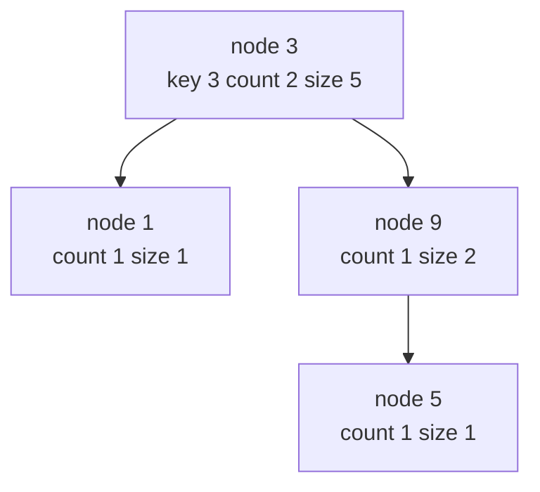
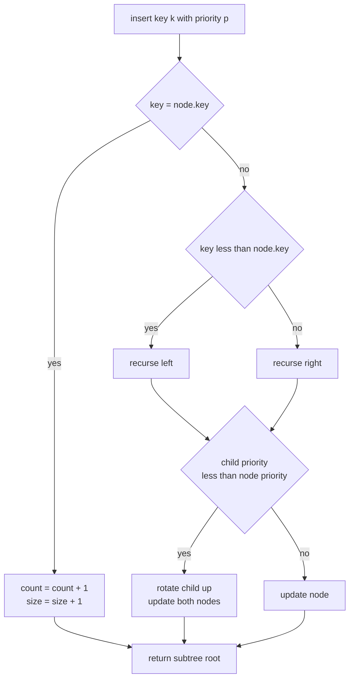
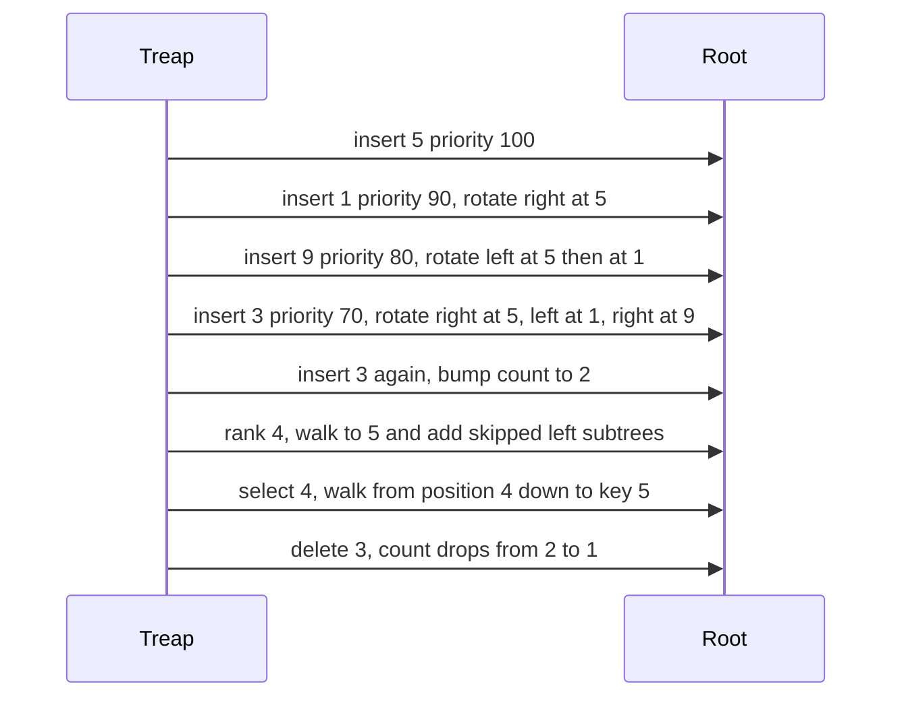

# 433 — Implement order statistics tree using balanced BST (rank/select).

> **Tier:** Advanced · **CTCI chapter:** Beyond — Advanced Data Structures & Algorithms
> **Task spec:** [433-implement-order-statistics-tree-using-balanced-bst-rank-select.md](../../../tasks/advanced/433-implement-order-statistics-tree-using-balanced-bst-rank-select.md)
> **Solutions:** [Python](../../../solutions/python/advanced/433-implement-order-statistics-tree-using-balanced-bst-rank-select/solution.py) ·
> [Java](../../../solutions/java/advanced/433-implement-order-statistics-tree-using-balanced-bst-rank-select/Solution.java) ·
> [JavaScript](../../../solutions/javascript/advanced/433-implement-order-statistics-tree-using-balanced-bst-rank-select/solution.js) ·
> [C#](../../../solutions/csharp/advanced/433-implement-order-statistics-tree-using-balanced-bst-rank-select/Solution.cs)

## 1. Problem restatement

The task is to build a **multiset** that answers order-statistic questions. The four solution
files expose exactly the same surface:

| Operation | Meaning |
| --- | --- |
| `insert(key, priority)` | add one copy of `key`; the caller supplies the treap priority |
| `delete(key)` | remove one copy, return whether anything was removed |
| `rank(key)` | number of stored elements **strictly below** `key` |
| `select(k)` | the `k`-th smallest element, 1-based, counting multiplicities |
| `count_of(key)` | multiplicity of `key` (0 when absent) |
| `size()` | total number of stored elements, multiplicities included |
| `inorder()` | every stored element in ascending order, with repetitions |
| `validate()` | re-check BST order, heap order and the cached subtree sizes |

`select` raises on an out-of-range index — `IndexError` in Python, `IndexOutOfBoundsException`
in Java, `RangeError` in JavaScript, `IndexOutOfRangeException` in C# — and `delete` of an
absent key is a no-op that returns `false`. The concrete contract is pinned by the assertions in
`main`/`Main`, which all four files reproduce:

| Call | Result | Why |
| --- | --- | --- |
| `insert 5,1,9,3,3` (priorities 100, 90, 80, 70, 110) | `inorder = [1, 3, 3, 5, 9]` | the third insert repeats key 3 |
| `select(1..5)` | `1, 3, 3, 5, 9` | repetitions are separate positions |
| `rank(1)`, `rank(3)`, `rank(4)`, `rank(9)` | `0, 1, 3, 4` | `rank(4)` counts the duplicated 3 twice |
| `count_of(3)`, `count_of(4)` | `2, 0` | multiplicity, not membership |
| `delete(3)` then `select(3)` | `true`, `5` | one copy leaves, the second stays |

Beyond the hand-written cases the files run a 400-step pseudo-random script. A shared LCG
generator (`seed ← (seed · 75 + 74) mod 65537`, started at seed `4331`) produces the operation
kind and the keys (modulo 60) and also the priorities, so the tree shape — and therefore every
assertion — is fully deterministic across the four languages. A `bisect`-maintained sorted list
acts as the oracle for `inorder`, `rank`, `select` and `count_of`; the invariant validator runs
every 25 steps.

## 2. Intuition

A sorted array answers `rank` in one binary search, but `insert` and `delete` shift `O(n)`
elements. A plain binary search tree gives fast inserts but no way to jump to the `k`-th
smallest element: the position of a key is not known until the whole left side has been counted.

The key insight is that **the size of a subtree is enough to turn "which key sits at position k"
into a single root-to-leaf walk**. Store at every node how many elements live in its subtree
(`size`), and how many copies of its own key it holds (`count`). Walking down from the root you
know, at each node, how many elements are strictly smaller:



Counted left to right the whole tree walks the multiset `1, 3, 3, 5, 9`: `size` on the root is
5, and the rank of the root key is `size(left) = 1`.

Caching sizes only pays off if the tree stays shallow, because a degenerate chain makes every
walk `O(n)`. The solutions use a **treap**: the keys obey BST order while the caller-supplied
priorities obey min-heap order. Every insert is a normal BST insert followed by at most a few
rotations that lift the new node above children with a larger priority; every delete of an
internal node is the reverse — merge the two subtrees by repeatedly promoting the child with the
smaller priority. Rotations preserve inorder, so the multiset never changes shape, only the tree
does.

The prices of that bargain are honest: the bound is **expected** `O(log n)`, not worst-case,
because a monotone priority stream would build a chain; and the priorities must arrive with the
key, which is why `insert` takes two arguments here.

## 3. Algorithm

1. A node holds `key`, `priority`, `count`, `size`, `left`, `right`; a fresh node has
   `count = size = 1`.
2. `size_of(nil)` is 0, and `update(node)` sets `node.size` to
   `size_of(left) + count + size_of(right)`.
3. `rotate_right(node)` lifts `node.left`; `rotate_left(node)` lifts `node.right`. Each rotation
   re-links the inner subtree and calls `update` on the two nodes it touched, child last.
4. `insert(node, key, priority)`: descend by key; if the key matches, `count += 1` and
   `size += 1`; otherwise recurse into the correct child and, if that child now has a **smaller**
   priority than the node, rotate it up. Then `update` and return the subtree root.
5. `delete(node, key)`: descend by key. On a match with `count > 1`, decrement `count` and
   `size`. On a match with `count == 1`, return `merge(left, right)` — the node disappears.
   Otherwise recurse, `update`, and return.
6. `merge(left, right)`: if either side is nil return the other one; if
   `left.priority <= right.priority`, keep `left` as root and merge `right` into `left.right`,
   else keep `right` and merge `left` into `right.left`.
7. `rank(node, key)`: if `key <= node.key`, the answer lies left, recurse there. Otherwise the
   whole left subtree plus this node's copies are below the key, so add
   `size_of(left) + count` and recurse right.
8. `select(node, k)`: let `left = size_of(node.left)`. If `k <= left`, descend left with `k`.
   If `k <= left + count`, return `node.key`. Otherwise descend right with `k - left - count`.
9. `count_of` is a plain BST search. `validate` re-walks with `(-inf, +inf)` bounds, checks
   `size == left_size + count + right_size`, checks both children's priorities, and finally that
   the root size equals the element total.

```text
procedure insert(node, key, priority)
    if node is nil then
        return new node with key, priority, count = 1, size = 1
    end
    if key = node.key then
        node.count ← node.count + 1
        node.size ← node.size + 1
        return node
    end
    if key < node.key then
        node.left ← insert(node.left, key, priority)
        if node.left.priority < node.priority then
            return rotate_right(node)
        end
    else
        node.right ← insert(node.right, key, priority)
        if node.right.priority < node.priority then
            return rotate_left(node)
        end
    end
    update(node)
    return node
end
```

```text
procedure rank(node, key)
    if node is nil then
        return 0
    end
    if key <= node.key then
        return rank(node.left, key)
    end
    return size_of(node.left) + node.count + rank(node.right, key)
end

procedure select(node, k)
    left ← size_of(node.left)
    if k <= left then
        return select(node.left, k)
    end
    if k <= left + node.count then
        return node.key
    end
    return select(node.right, k - left - node.count)
end
```

`select` and `rank` are mirror images: `rank` follows the path to the key and **adds** what it
skips on the right, `select` follows the path to a position and **subtracts** what it skips on
the left.



## 4. Worked example

The five asserted inserts, with the priorities exactly as the Python driver passes them:
`(5, 100)`, `(1, 90)`, `(9, 80)`, `(3, 70)`, `(3, 110)`.

| Step | Insert | Descent | Rotation triggered | Tree after |
| --- | --- | --- | --- | --- |
| start | — | — | — | `nil`, total 0 |
| 1 | key 5, p 100 | empty | none | `5` |
| 2 | key 1, p 90 | left of 5 | `rotate_right(5)`: 1 rises | `1` → right `5` |
| 3 | key 9, p 80 | right of 1, right of 5 | `rotate_left(5)` then `rotate_left(1)`: 9 becomes the root | `9` → left `1` → right `5` |
| 4 | key 3, p 70 | left of 9, right of 1, left of 5 | `rotate_right(5)` then `rotate_left(1)` then `rotate_right(9)`: 3 becomes the root | `3` → left `1`, right `9` → left `5` |
| 5 | key 3, p 110 | matches the root | none, `count` becomes 2 | unchanged shape, `size` 5 |

The heap invariant is what drives step 4: priority 70 is smaller than every priority on the
descent path (80, 90, 100), so key 3 bubbles all the way to the root through three rotations,
each of which preserves the inorder sequence.

After step 5 the root `3` has `count = 2` and `size = 1 + 2 + 2 = 5`; node `9` has `size = 2`
and node `5` has `size = 1`. The remaining assertions read straight off that shape:

| Query | Walk | Result |
| --- | --- | --- |
| `select(3)` | root 3, `left = 1`, `3 <= 1 + 2` | `3` |
| `select(4)` | root 3, `4 > 3`, descend right with `k = 1`; at 9 `left = 1`, hit the left child | `5` |
| `rank(4)` | at 3 `4 > 3`, add `1 + 2`, then at 9 `4 <= 9` descend left, at 5 `4 <= 5` descend left | `3` |
| `rank(3)` | at 3 `3 <= 3` descend left, at 1 `3 > 1` add `0 + 1` | `1` |
| `count_of(3)` | root key matches | `2` |
| `delete(3)` | `count = 2 > 1`, so decrement only | `true`, `inorder = [1, 3, 5, 9]` |
| `select(3)` after delete | root 3, `left = 1`, `3 > 1 + 1`, descend right with `k = 1`, at 9 descend left | `5` |
| `delete(100)` | key absent, no node visited matches | `false` |



Deleting the *last* copy of a key takes the other branch: for example removing key 9 at that
point would call `merge(node 5, nil)`, which returns node 5 unchanged. Removing an internal node
with two children instead splices by priority — `merge(left, right)` keeps promoting the child
with the smaller priority until one side runs out, and every promoted step updates the `size` on
the way back up.

## 5. Complexity

Let `n` be the number of stored elements and `h` the tree height.

| Measure | Bound | Why it holds |
| --- | --- | --- |
| Time, best | O(1) | `size`, `count_of` on a hit at the root, `select` at the root |
| Time, average | O(log n) | treap height is `O(log n)` with high probability for the LCG priorities, and every operation is one root-to-leaf walk plus a bounded number of rotations per level |
| Time, worst | O(n) | a monotone priority stream makes a chain; then every walk is linear |
| Space | O(n) | one node per key with a `count`, so duplicates cost nothing extra |
| `inorder` | O(n) | it must emit every stored element, multiplicities included |
| `validate` | O(n) | it touches every node once |
| Sorted-array alternative | rank O(log n), insert/delete O(n) | shifting `n/2` elements per update |
| Plain unbalanced BST alternative | rank/select O(n) | no cached counts, so the whole tree must be traversed |

The expected bound is the load-bearing claim here. It comes from the priorities being drawn from
the same LCG stream as the operations, not from any worst-case guarantee: the implementation is
a randomised treap, and the `validate` call can only confirm the invariants, not the height.

## 6. Pitfalls and edge cases

- **Empty tree.** `size()` is 0, `rank(x)` is 0 for every `x`, `count_of(x)` is 0, `delete(x)`
  returns `false`, `inorder()` is empty and `validate()` reports 0 == 0. `select(k)` on an empty
  tree raises, because `1 <= k <= 0` is false.
- **Out-of-range `select`.** The guard is `not 1 <= k <= total`; it runs *before* the recursive
  helper, so a bad index never dereferences `nil`/`null`. Watch the exception type per language.
- **Duplicates.** They are not stored as separate nodes. Key 3 appears twice in the example and
  only one node holds both copies, which is what keeps `size` equal to the element total rather
  than the node count.
- **`rank` is `bisect_left`, not `bisect_right`.** It counts elements *strictly* below the key,
  so `rank(4) == 3` even though 4 is absent, and `rank(9)` is 4 rather than 5. The oracle in each
  driver is `bisect_left(oracle, key)` / `lowerBound`, so the two must agree exactly.
- **`select` is 1-based.** `select(1)` is the minimum. An off-by-one here makes `select(1)` raise
  while the oracle returns `oracle[0]`.
- **Tie-breaking in `merge`.** The merge uses `left.priority <= right.priority`, i.e. equal
  priorities prefer the left root. Flipping the comparison still produces a valid treap, but it
  changes the shape and therefore would break shape-sensitive expectations — the assertions
  depend on the deterministic shape, so the comparison direction is part of the contract.
- **Recursion depth.** Both `insert` and `delete` recurse along the descent path; with an
  `O(log n)` height and 60 distinct keys in the random script this is far inside every language's
  default stack.
- **`validate` sentinels.** The bounds walk starts at `(-inf, +inf)` (Python and JavaScript use
  numeric infinities, Java and C# use their `long`/`long` extremes via the shared driver), so a
  key of `INT_MIN` would still validate.

## 7. Variants and follow-ups

- **Without priorities, with a plain BST.** [249-implement-treap-bst-heap-insert-delete.md](../../../tasks/intermediate/249-implement-treap-bst-heap-insert-delete.md)
  builds the same key/priority treap but stops at insert and delete — no cached subtree size, so
  it cannot answer rank/select at all.
- **Order statistics over a running stream.** [432-implement-data-structure-for-dynamic-median-order-statistics-tre.md](../../../tasks/advanced/432-implement-data-structure-for-dynamic-median-order-statistics-tre.md)
  is the median-flavoured sibling: the same tree, queried with two `select` calls instead of one.
- **Range order statistics.** [429-implement-range-kth-order-statistic-using-persistent-segtree.md](../../../tasks/advanced/429-implement-range-kth-order-statistic-using-persistent-segtree.md)
  answers `select` on a *subarray* by subtracting two persistent segment-tree roots — the same
  "cached count per node" idea lifted onto an immutable version chain.
- **Smaller alphabets, different index.** [180-implement-binary-indexed-tree-fenwick-basic-point-update-prefix.md](../../../tasks/beginner/180-implement-binary-indexed-tree-fenwick-basic-point-update-prefix.md)
  and [183-implement-iterative-segment-tree.md](../../../tasks/beginner/183-implement-iterative-segment-tree.md)
  get rank with an implicit key space and a bitmask walk; they are faster constants but need a
  bounded universe.
- **Building a balanced tree from sorted data.** [144-convert-sorted-array-to-balanced-bst.md](../../../tasks/beginner/144-convert-sorted-array-to-balanced-bst.md)
  shows the divide-and-conquer alternative when the whole multiset is known up front.

## 8. Check yourself

1. Why does `rank` add `size_of(node.left) + node.count` only when it descends **right**?

<details><summary>Show answer</summary>

Because everything in the left subtree plus the node's own copies is strictly smaller than the
key being ranked. When the walk goes left, the node and its right subtree are all `>= key`, so
they contribute nothing.

</details>

2. What is `rank(9)` on the five-element example, and what would `bisect_right` have returned?

<details><summary>Show answer</summary>

`rank(9) == 4` — the elements `1, 3, 3, 5` are strictly below 9. `bisect_right` would return 5,
counting the single copy of 9 itself. The drivers compare against the lower bound, so the
strictly-below reading is the required one.

</details>

3. Why is `insert` given a priority instead of drawing one internally?

<details><summary>Show answer</summary>

Because all four drivers must produce the *same* tree shape for the assertions to be comparable
across languages. Drawing priorities from the shared LCG stream outside the data structure makes
the shape reproducible; an internal `random()` would make the tests non-deterministic.

</details>

4. How many rotations does the whole five-insert example perform, and what does each preserve?

<details><summary>Show answer</summary>

Six rotations: one after the second insert, two after the third, and three after the fourth. Each
rotation preserves the inorder sequence (the multiset) and restores min-heap order along the path
the new priority travelled, which is why `inorder()` is still `[1, 3, 3, 5, 9]` afterwards.

</details>

5. `delete(3)` returns `true` twice on the example tree and `false` only on the third call. Why?

<details><summary>Show answer</summary>

The node for key 3 has `count = 2`, so the first two deletions decrement the count and the node
survives; only when the count would reach zero does the code call `merge(left, right)` and unlink
the node. The third call finds no node with key 3, descends to `nil` and reports `false`.

</details>
