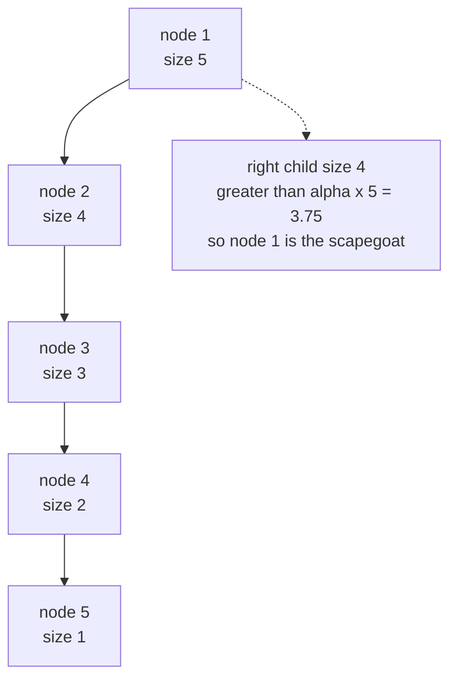
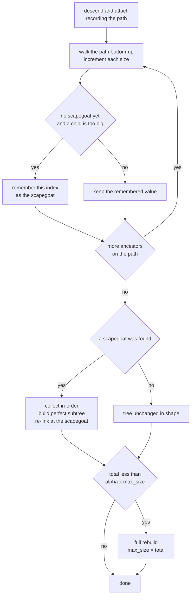
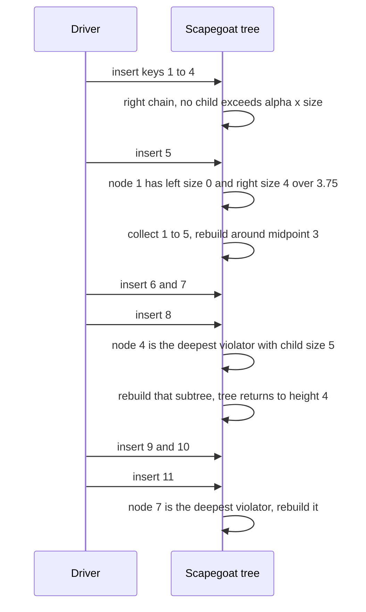

# 434 — Implement scapegoat tree basics (rebuild heuristic).

> **Tier:** Advanced · **CTCI chapter:** Beyond — Advanced Data Structures & Algorithms
> **Task spec:** [434-implement-scapegoat-tree-basics-rebuild-heuristic.md](../../../tasks/advanced/434-implement-scapegoat-tree-basics-rebuild-heuristic.md)
> **Solutions:** [Python](../../../solutions/python/advanced/434-implement-scapegoat-tree-basics-rebuild-heuristic/solution.py) ·
> [Java](../../../solutions/java/advanced/434-implement-scapegoat-tree-basics-rebuild-heuristic/Solution.java) ·
> [JavaScript](../../../solutions/javascript/advanced/434-implement-scapegoat-tree-basics-rebuild-heuristic/solution.js) ·
> [C#](../../../solutions/csharp/advanced/434-implement-scapegoat-tree-basics-rebuild-heuristic/Solution.cs)

## 1. Problem restatement

The task is a **scapegoat tree**: a plain BST with cached subtree sizes that stays near-balanced
by rebuilding whole subtrees instead of rotating. The four solutions expose the same API and the
same documented constants:

| Item | Value |
| --- | --- |
| balance factor `alpha` | `0.75`, fixed in the constructor |
| key policy | **unique**; a duplicate insert is a no-op that returns `false` |
| insert trigger | after the insert, walk the descent path bottom-up and rebuild the *deepest* node whose left or right child size exceeds `alpha · size` |
| delete trigger | physical delete, then if `total < alpha · max_size` rebuild the whole tree and reset `max_size` |
| rebuild shape | perfectly balanced half-split built from the in-order key list |

The API is `size()`, `contains(key)`, `insert(key) -> bool`, `delete(key) -> bool`, `inorder()`,
`height()`, `validate()` and a `rebuilds` counter. `insert` returns `true` only when a new key was
added, `delete` returns `true` only when a key was actually removed; the assertions agree across
all four languages:

| Call | Result | Why |
| --- | --- | --- |
| insert `10, 5, 15, 3` | all `true` | four distinct keys |
| insert `10` again | `false` | keys are unique, the tree is untouched |
| `inorder()` | `[3, 5, 10, 15]` | BST order |
| delete `5` twice | `true`, then `false` | physical removal, second call finds nothing |

The random script uses the shared LCG (`seed ← (seed · 75 + 74) mod 65537`, start `4340`):
400 steps of `op = seed mod 3` (`0` inserts, `1` and `2` delete) on `key = seed mod 100`, with a
sorted list as oracle. `insert` must return `key not in oracle`, `delete` must return
`key in oracle`; `inorder`/`validate` are re-checked every 25 steps.

## 2. Intuition

A treap keeps balance probabilistically, an AVL tree keeps it with rotations, and a red-black
tree buys balance with colour bookkeeping. All three pay on **every** update. The scapegoat tree
takes the opposite bet: let the tree drift out of balance, and when some subtree gets too fat
relative to its own node, throw it away and rebuild it perfectly.

The rule is one inequality. A node of size `s` may not have a child subtree larger than
`alpha · s`, with `alpha = 0.75`. Insert a key, walk back up the search path, and the first
violating ancestor you meet (searching from the bottom) is the **scapegoat** — the deepest
ancestor whose child grew too large. Its whole subtree is replaced by the perfect tree built from
the same keys in sorted order, so the multiset is unchanged and only the shape improves.



The scheme works because the deepest violator is chosen deliberately — rebuilding a small subtree
near the leaves is cheap and cancels the violations above it — and because the rebuild is paid
for by the insertions that made the subtree unbalanced, so the cost amortises.

Deletion needs its own trigger: it shrinks the tree and can never create a too-large-child
violation. A **max_size** high-water mark is kept instead, and after any update with
`total < alpha · max_size` the whole tree is rebuilt and `max_size` drops to the current total.

## 3. Algorithm

1. `insert(key)`: if the tree is empty, install the key as the root, set `total = max_size = 1`
   and return `true`.
2. Otherwise descend from the root, pushing every visited node onto a `path`; an exact key match
   returns `false` immediately (unique keys). Attach the new node at the first empty child slot.
3. Walk `path` from the last element to the first: add 1 to each node's `size`, and while no
   scapegoat has been recorded yet, test both children against `alpha · size`; record the index
   of the deepest violator found so far.
4. `total += 1`, `max_size = max(max_size, total)`.
5. If a scapegoat index was recorded, collect its subtree in-order, build a perfectly balanced
   tree around the midpoint, re-link it in place (or as the root when the index is 0), and
   increment `rebuilds`.
6. `delete(key)`: if `contains(key)` is false, return `false`. Otherwise remove the node
   physically — splice out a node with at most one child, or overwrite the key with its in-order
   successor and recursively delete the successor from the right subtree — repairing every
   `size` on the way back up. Decrement `total`.
7. If `total < alpha · max_size`, rebuild the whole tree from its in-order list, set
   `max_size = total` and increment `rebuilds`.
8. `contains` is an iterative BST search; `inorder` an iterative in-order walk; `height` the
   recursive depth; `validate` re-checks BST order and `size == 1 + left_size + right_size`.

```text
procedure insert(key)
    if root is nil then
        root ← new node with key
        total ← 1
        max_size ← 1
        return true
    end
    path ← empty list
    node ← root
    while true do
        append node to path
        if key = node.key then
            return false
        end
        if key < node.key then
            if node.left is nil then
                node.left ← new node with key
                stop the loop
            end
            node ← node.left
        else
            if node.right is nil then
                node.right ← new node with key
                stop the loop
            end
            node ← node.right
        end
    end
    scapegoat ← -1
    for i from length(path) - 1 down to 0 do
        current ← path[i]
        current.size ← current.size + 1
        if scapegoat = -1 then
            left_size ← size of current.left or 0
            right_size ← size of current.right or 0
            if left_size > alpha * current.size or right_size > alpha * current.size then
                scapegoat ← i
            end
        end
    end
    total ← total + 1
    max_size ← maximum of max_size and total
    if scapegoat >= 0 then
        rebuild_at(path, scapegoat)
    end
    return true
end
```

```text
procedure rebuild_at(path, index)
    node ← path[index]
    rebuilt ← build(collect(node), 0, node.size - 1)
    if index = 0 then
        root ← rebuilt
    else
        parent ← path[index - 1]
        if parent.left is node then
            parent.left ← rebuilt
        else
            parent.right ← rebuilt
        end
    end
    rebuilds ← rebuilds + 1
end

procedure build(keys, lo, hi)
    if lo > hi then
        return nil
    end
    mid ← floor of (lo + hi) / 2
    node ← new node with keys[mid]
    node.left ← build(keys, lo, mid - 1)
    node.right ← build(keys, mid + 1, hi)
    node.size ← 1 + size of node.left + size of node.right
    return node
end
```

`build` is the classic "sorted array to balanced BST" recursion: the midpoint becomes the root,
which makes the rebuilt subtree perfectly balanced and gives it height
`ceil(log2(size + 1)) - 1`. Because `collect` walks in-order, the rebuilt subtree holds exactly
the same keys in exactly the same sorted order.



## 4. Worked example

Start with the small hand case asserted by every solution, `alpha = 0.75`:

| Insert | Descent path | Violation test on the way back | Result |
| --- | --- | --- | --- |
| `10` | empty | — | root `10`, `total = 1` |
| `5` | `10` | `10`: left 1 vs `0.75 · 2 = 1.5`, fine | root `10`, left `5` |
| `15` | `10` | `10`: left 1, right 1 vs `2.25`, fine | root `10` with both children |
| `3` | `10 → 5` | `5`: left 1 vs `1.5`; `10`: left 2 vs `3.75` | no rebuild, `inorder = [3, 5, 10, 15]` |
| delete `5` | `10 → 5` | node has only a left child, so `3` is spliced up; `10.size` becomes 3 | `total = 3`, `3 < 0.75 · 4 = 3` is false, no rebuild |

Now the adversarial case: inserting `1, 2, 3, ..., 12` in ascending order. Each insert walks the
path of the right spine, so the tree is a chain until a rebuild fires. Instrumenting the shipped
Python implementation on exactly this input prints three rebuilds:

| Insert | Tree before | Scapegoat found | Subtree size | Tree after (root, height) |
| --- | --- | --- | --- | --- |
| `1..4` | right chain of depth 4 | none (no child exceeds `0.75 · size`) | — | root `1`, height 4 |
| `5` | chain `1→2→3→4→5` | depth 0, node `1` | 5 | root `3`, height 3, `rebuilds = 1` |
| `6`, `7` | balanced top, growing right side | none | — | root `3`, height 5 |
| `8` | right child of node `4` grew to 5 | depth 1, node `4` | 5 | root `3`, height 4, `rebuilds = 2` |
| `9`, `10` | — | none | — | root `3`, height 6 |
| `11` | right child of node `7` grew to 5 | depth 2, node `7` | 5 | root `3`, height 5, `rebuilds = 3` |

Every rebuild collapses a degenerate chain of size `s` into a perfect tree of height
`ceil(log2(s + 1)) - 1`, and the keys themselves are untouched — `inorder()` on the instrumented
run still equals `1, 2, ..., 12`.



The 200-key variant of the same input is what the spec asserts: inserting `1..200` ascending
produces **88 rebuilds**, ends with `height = 11`, and satisfies the documented sanity bound
`3 · ceil(log2(201)) + 3 = 27`. Deleting every even key and then every odd key drains the tree to
`size = 0` while `validate()` keeps passing, because each shrink below `0.75 · max_size` rebuilds.
Instrumenting the shipped Python file on exactly these inputs is where every number in this
section and the tables above comes from.

## 5. Complexity

Let `n` be the current number of keys and `h` the height.

| Measure | Bound | Why it holds |
| --- | --- | --- |
| Time, best / average | O(1) best, O(log n) amortised | a lookup can hit the root immediately; a rebuild of a size-`s` subtree is charged to the insertions since that subtree last became balanced, and with `alpha = 0.75` those charge at least a constant fraction each |
| Time, worst (single op) | O(n) | one insert can trigger a rebuild at the root — the `1..5` case above |
| Space | O(n) | one node per key, plus a temporary key list and the recursion stack during a rebuild |
| Height | O(log n) | the assert in the drivers uses the slack bound `3 · ceil(log2(size + 1)) + 3` to avoid pinning an exact value |
| Rotation-based alternatives (AVL, treap) | O(log n) worst / expected per update | they pay a small cost on every update instead of an occasional O(s) rebuild |

The two constants set the trade-off: an `alpha` closer to 0.5 rebuilds sooner and keeps the tree
tighter but bills more rebuild work; `0.75` is the value the task fixes, and the 88 rebuilds for
`1..200` is the concrete price at that setting. The amortised argument is the load-bearing claim —
the driver's height assertion is a sanity bound, not a proof.

## 6. Pitfalls and edge cases

- **Empty tree.** `size()` is 0, `inorder()` is empty, `validate()` is `true` and `delete(x)`
  returns `false`; inserting into an empty tree bypasses the scapegoat search entirely.
- **Duplicate keys.** Uniqueness is part of the contract: a duplicate insert returns `false`
  immediately, *before* the path sizes are incremented and before any rebuild check. Dropping
  that early return would corrupt the size counters and the oracle comparison.
- **Strict inequality.** The test is `child_size > alpha * size`, so a child exactly at
  `0.75 · size` is allowed. Sizes such as 4 (`0.75 · 4 = 3.0`) are compared in floating point,
  and the hand case shows a threshold that is *just* missed: the delete leaves
  `3 < 0.75 · 4 = 3` false, so no rebuild happens.
- **The delete trigger uses `max_size`, not `total`.** `max_size` is the peak size since the last
  rebuild and only drops when a rebuild happens. Comparing against `total` instead would rebuild
  far more often — every deletion would look suspicious.
- **Physical deletion with a successor.** The two-child case copies the in-order successor's key
  into the node and deletes the successor from the right subtree; a bug there duplicates a key.
  A one-child node is spliced out directly, and `_update` repairs sizes on the way back.
- **`rebuild_at` bounds and root special case.** The rebuilt subtree spans `build(keys, 0,
  node.size - 1)` — the *cached* size, which is why the path walk must increment sizes **before**
  the rebuild runs. When the scapegoat is the root (index 0) there is no parent to re-link, so the
  result is assigned to `self.root`; that is exactly the rebuild that fires on insert `5` of the
  ascending run.
- **`height()` is O(n).** It is a full recursive depth computation, fine for tests but not for
  production hot paths; the height assertion exists to catch a variant that degenerates.

## 7. Variants and follow-ups

- **Rotations instead of rebuilds.** [247-implement-avl-tree-insert-rotations-balance.md](../../../tasks/intermediate/247-implement-avl-tree-insert-rotations-balance.md)
  keeps a height-difference invariant and rebalances locally; [249-implement-treap-bst-heap-insert-delete.md](../../../tasks/intermediate/249-implement-treap-bst-heap-insert-delete.md)
  randomises its way to the same goal.
- **The recipe inside the rebuild.** [144-convert-sorted-array-to-balanced-bst.md](../../../tasks/beginner/144-convert-sorted-array-to-balanced-bst.md)
  is exactly the `build(keys, lo, hi)` recursion used here, written as a standalone problem.
- **Weight-balanced trees with counts.** [433-implement-order-statistics-tree-using-balanced-bst-rank-select.md](../../../tasks/advanced/433-implement-order-statistics-tree-using-balanced-bst-rank-select.md)
  caches the same `size` field for rank/select queries but supports duplicates with a `count`.
- **Deletion-heavy workloads.** [251-implement-skip-list-insert-search-delete.md](../../../tasks/intermediate/251-implement-skip-list-insert-search-delete.md)
  and [248-implement-red-black-tree-insert-basic-conceptual.md](../../../tasks/intermediate/248-implement-red-black-tree-insert-basic-conceptual.md)
  show the alternatives when the `max_size` high-water mark is unattractive.

## 8. Check yourself

1. Why does the insert need a path, when a normal BST insert does not?

<details><summary>Show answer</summary>

Because after attaching the leaf the algorithm has to walk back to the root to (a) add one to
every cached `size` on the search path and (b) find the deepest ancestor whose child exceeds
`alpha · size`. Without the recorded path there is no parent pointer to walk back through.

</details>

2. Inserting `1..5` ascending rebuilds the root, but inserting `1..4` does not. Why?

<details><summary>Show answer</summary>

At size 4 the root has a right subtree of size 3 and `0.75 · 4 = 3.0`, and the test is strict
(`3 > 3` is false), so no violation. At size 5 the right subtree has size 4 and
`0.75 · 5 = 3.75`, so node `1` — the deepest and only violator — becomes the scapegoat and its
subtree of 5 keys is rebuilt around the midpoint `3`.

</details>

3. What is `max_size` for, and when does it change?

<details><summary>Show answer</summary>

It is the peak element count since the last rebuild, used only by the delete trigger
`total < alpha · max_size`. It rises on every successful insert and drops to the current `total`
whenever a rebuild happens — either the full rebuild after a delete or the scapegoat rebuild
after an insert.

</details>

4. Why does ascending input `1..200` end up at height 11 despite 88 rebuilds?

<details><summary>Show answer</summary>

Because ascending insertion is the worst case for a BST: every extra key lands on the right
spine, so violations keep appearing and each one is repaired by a rebuild. The rebuilds are not
cosmetic — without them the tree would be a 200-node chain, and the drivers' sanity bound
`3 · ceil(log2(201)) + 3 = 27` is what documents the height that is actually achieved.

</details>
