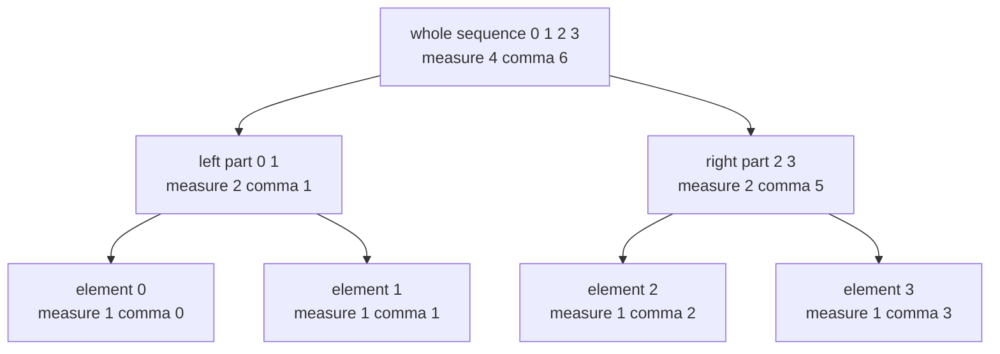
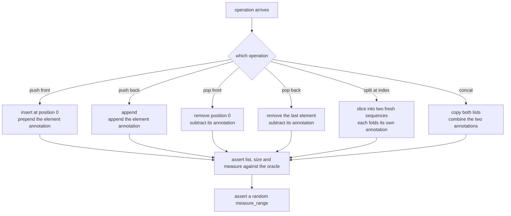
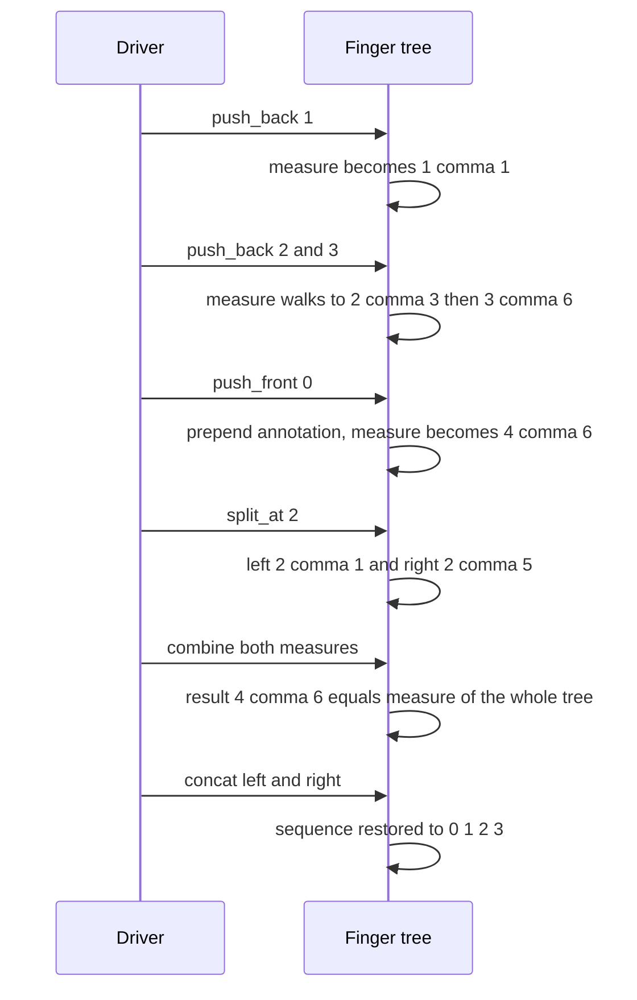

# 435 — Implement finger tree (sequence operations) concept.

> **Tier:** Advanced · **CTCI chapter:** Beyond — Advanced Data Structures & Algorithms
> **Task spec:** [435-implement-finger-tree-sequence-operations-concept.md](../../../tasks/advanced/435-implement-finger-tree-sequence-operations-concept.md)
> **Solutions:** [Python](../../../solutions/python/advanced/435-implement-finger-tree-sequence-operations-concept/solution.py) ·
> [Java](../../../solutions/java/advanced/435-implement-finger-tree-sequence-operations-concept/Solution.java) ·
> [JavaScript](../../../solutions/javascript/advanced/435-implement-finger-tree-sequence-operations-concept/solution.js) ·
> [C#](../../../solutions/csharp/advanced/435-implement-finger-tree-sequence-operations-concept/Solution.cs)

## 1. Problem restatement

This is the **concept** version of a finger tree. A finger tree is a sequence whose every subtree
caches a summary of the elements below it, so that "what is the summary of this range" or "where
does this summary first exceed a threshold" can be answered by descending the spine instead of
scanning. The task builds the part that makes that possible — an exact, cached **annotation** —
and simulates the spine operations over a plain sequence.

The annotation monoid is `M = (count, sum)`:

| Monoid law | Instance here |
| --- | --- |
| identity | `(0, 0)` |
| element annotation | a value `v` annotates as `(1, v)` |
| combine | `combine((c1, s1), (c2, s2)) = (c1 + c2, s1 + s2)` |
| associativity | componentwise addition, so nesting order never matters |

The API is `size()`, `measure()`, `measure_range(lo, hi)`, `front()`, `back()`, `push_front(v)`,
`push_back(v)`, `pop_front()`, `pop_back()`, `concat(other)`, `split_at(index)` and `to_list()`.
The assertions shared by all four solutions fix the contract:

| Call | Result | Why |
| --- | --- | --- |
| `push_back 1, 2, 3` then `push_front 0` | list `[0, 1, 2, 3]`, `measure = (4, 6)` | annotation of the whole sequence: 4 elements summing to 6 |
| `split_at(2)` | left `[0, 1]` with `(2, 1)`, right `[2, 3]` with `(2, 5)` | the two partial summaries |
| `combine(left.measure(), right.measure())` | `(4, 6)` | equals `measure()` of the unsplit tree — the monoid law |
| `measure_range(1, 3)` | `(2, 3)` | elements `1` and `2`, half-open range |
| `measure_range(2, 2)` | `(0, 0)` | ranges may be empty, and the identity is the answer |
| `front()`, `back()` on empty | `None` / `null` | no exception for reading |
| `pop_front()`, `pop_back()` on empty | `None` / `null` | no exception for popping either |
| `measure_range(5, 2)` | raises `IndexError` | a malformed range is a bug, and is reported |

The scripted part uses the shared LCG (`seed ← (seed · 75 + 74) mod 65537`, start `4350`) for 400
steps with `op = seed mod 5`: `0` push_back, `1` push_front, `2` pop_front, `3` pop_back, and `4`
split-then-concat at a random index. Values are `seed mod 50 - 25`, i.e. in `[-25, 24]`, so the
sum component really does go negative. After every step the driver asserts the list, the size, the
cached measure `(len(oracle), sum(oracle))`, the ends, a random `measure_range`, and — in the
split case — the monoid law.

## 2. Intuition

Storing the sum of a sequence is not the hard part; recomputing it after every update is. The
finger tree's trick is that a summary is **associative**, so the summary of a concatenation is the
combine of the summaries, and a node can cache the combine of its children instead of rescanning
its leaves. Descending such a tree with the annotation in hand is what turns range queries into a
`O(log n)` walk in a real finger tree.

Here the same cached annotation is kept, but the sequence is a plain list:



Read bottom-up, the diagram is the `combine` rule: `(1, 0) + (1, 1) = (2, 1)`,
`(1, 2) + (1, 3) = (2, 5)`, and `(2, 1) + (2, 5) = (4, 6)`. Read top-down, it is the point of the
data structure: a query can start at the root annotation and only descend into the parts whose
summary could contain the answer.

Two consequences shape the implementation. First, every mutation must update the annotation
**incrementally**: a front push prepends the annotation of the new element (`combine((1, v),
measure)`), a back push appends it, and a pop subtracts it (`combine((-1, -v), measure)`).
Second, split and concat do not need to compute anything new at all — split produces two
sequences whose annotations are each recomputed from their own elements, and concat simply
combines the two annotations it is given.

The honest limitation, documented in every solution header, is that the *spine work* is a
simulation: `push_front` and `pop_front` shift the whole list, and `concat`/`split_at` copy it.
The annotations are exact and the monoid law always holds, but no finger-tree `O(log n)`
worst-case bound is claimed for this concept version.

## 3. Algorithm

1. A sequence is a list plus a cached annotation; constructing from items folds the element
   annotations `(1, v)` with `combine`, starting from the identity.
2. `push_front(v)`: insert `v` at position 0, then set the annotation to
   `combine((1, v), annotation)` — the new element is the prefix.
3. `push_back(v)`: append `v`, then set the annotation to `combine(annotation, (1, v))`.
4. `pop_front()`: return `None`/`null` for an empty sequence. Otherwise remove position 0 and set
   the annotation to `combine((-1, -v), annotation)`, where `v` is the removed value.
5. `pop_back()`: symmetric, removing the last element and subtracting its annotation from the
   right.
6. `front()` / `back()`: read the ends, `None`/`null` when empty. No annotation change.
7. `split_at(index)`: reject `index` outside `[0, size]`, then build two fresh sequences from the
   two slices, each recomputing its own annotation. The original is left untouched.
8. `concat(other)`: build a new sequence from this sequence's items, append the other sequence's
   items, and set the annotation to `combine(this.measure, other.measure)`.
9. `measure_range(lo, hi)`: reject ranges that violate `0 <= lo <= hi <= size`, then fold
   `combine` from the identity over the elements in `[lo, hi)`.

```text
procedure combine(left, right)
    return a pair whose parts are left plus right, component by component
end

procedure push_front(value)
    insert value at position 0 of items
    measurement ← combine(pair of 1 and value, measurement)
    return self
end

procedure pop_back()
    if items is empty then
        return nothing
    end
    value ← remove the last element of items
    measurement ← combine(measurement, pair of -1 and minus value)
    return value
end

procedure split_at(index)
    if index < 0 or index > number of items then
        raise an out-of-bounds error
    end
    left ← new sequence from items before index
    right ← new sequence from items from index on
    return left, right
end

procedure measure_range(lo, hi)
    if lo < 0 or lo > hi or hi > number of items then
        raise an out-of-bounds error
    end
    total ← identity
    for i from lo to hi - 1 do
        total ← combine(total, pair of 1 and items[i])
    end
    return total
end
```

`measure_range` deliberately folds the elements again instead of trying to subtract annotations,
because subtraction is not a monoid operation: it only works for the invertible `(count, sum)`
pair and would break for a search annotation such as `max` or "first element greater than `x`".



## 4. Worked example

Trace the hand-asserted build: `push_back(1)`, `push_back(2)`, `push_back(3)`, `push_front(0)`.

| Step | Operation | `items` | Annotation before | Annotation after |
| --- | --- | --- | --- | --- |
| start | construct empty | `[]` | — | `(0, 0)` |
| 1 | `push_back(1)` | `[1]` | `(0, 0)` | `combine((0,0),(1,1)) = (1, 1)` |
| 2 | `push_back(2)` | `[1, 2]` | `(1, 1)` | `combine((1,1),(1,2)) = (2, 3)` |
| 3 | `push_back(3)` | `[1, 2, 3]` | `(2, 3)` | `combine((2,3),(1,3)) = (3, 6)` |
| 4 | `push_front(0)` | `[0, 1, 2, 3]` | `(3, 6)` | `combine((1,0),(3,6)) = (4, 6)` |

`size()` is 4, `measure()` is `(4, 6)`, `front()` is 0 and `back()` is 3. Note that the front push
is the only one that places the new annotation on the left; `(count, sum)` happens to be
commutative, but the implementation still preserves order so that the same code shapes would work
for a non-commutative monoid such as string concatenation.

Now the split family on the same sequence:

| Call | Left | Left measure | Right | Right measure | Law check |
| --- | --- | --- | --- | --- | --- |
| `split_at(0)` | `[]` | `(0, 0)` | `[0, 1, 2, 3]` | `(4, 6)` | `(0,0) + (4,6) = (4, 6)` |
| `split_at(4)` | `[0, 1, 2, 3]` | `(4, 6)` | `[]` | `(0, 0)` | `(4,6) + (0,0) = (4, 6)` |
| `split_at(2)` | `[0, 1]` | `(2, 1)` | `[2, 3]` | `(2, 5)` | `(2,1) + (2,5) = (4, 6)` |

The boundary cases are what make the identity worth having: splitting at 0 or at the size yields
an empty side whose annotation is exactly `(0, 0)`, so the combine still reproduces the whole
sequence's annotation.



`measure_range(1, 3)` then folds the elements at indices 1 and 2: starting from `(0, 0)`,
`combine((0,0),(1,1)) = (1,1)`, then `combine((1,1),(1,2)) = (2, 3)`. `measure_range(2, 2)` folds
nothing and returns `(0, 0)` — an empty range is legitimate, and its summary is the identity.

The random script exercises the same machinery with values from `-25` to `24`. After a
`push_back(-7)`, for instance, the annotation goes from `(c, s)` to `(c + 1, s - 7)`; the count
component stays non-negative while the sum component can be anything, which is exactly why the
driver compares the measure against `(len(oracle), sum(oracle))` rather than against any
monotone quantity.

## 5. Complexity

Let `n` be the sequence length and `k = hi - lo` the width of a queried range.

| Measure | Bound | Why it holds |
| --- | --- | --- |
| `measure`, `size`, `front`, `back` | O(1) | the annotation is cached; length and the two ends of the list are constant-time |
| `push_back`, `pop_back` | O(1) amortised | appending and removing at the end is amortised constant in all four languages, plus one `combine` |
| `push_front`, `pop_front` | O(n) | the list must shift every element: `insert(0, …)`, `unshift`/`shift`, `ArrayList.add(0, …)`, `List.Insert(0, …)` |
| `measure_range(lo, hi)` | O(k) | it folds the `k` elements of the slice |
| `split_at` | O(n) | two slices plus two annotation folds |
| `concat` | O(n) | both lists are copied; the annotation itself is one `combine` |
| Space | O(n) | the stored sequence; split and concat allocate new sequences rather than sharing nodes |
| A real finger tree | O(log n) amortised for push/pop/split/concat | the spine stores subtrees with cached annotations, so no copying is needed |

The last row is the honest comparison promised by the task title: the *annotation discipline* is
implemented for real, the *spine* is simulated. What the solutions guarantee is exactness — the
cached measure always equals the fold of the elements — not an asymptotic improvement.

## 6. Pitfalls and edge cases

- **Empty sequence.** `measure()` is `(0, 0)`, `to_list()` is empty, and `front()`, `back()`,
  `pop_front()`, `pop_back()` all return `None`/`null` rather than raising. Only the range and
  split bounds checks raise.
- **Half-open ranges.** `measure_range(lo, hi)` covers `lo .. hi - 1`, so `measure_range(2, 2)`
  is the empty range and answers the identity, while `measure_range(1, 3)` covers two elements.
- **Direction of the front update.** A front push must prepend the new element's annotation
  (`combine(element, measure)`), a back push must append it (`combine(measure, element)`). With
  `(count, sum)` the two orders give the same numbers, so a swapped implementation still passes
  every assertion here — and would silently break the moment the monoid is non-commutative.
- **Subtraction on pop.** The pop path reuses `combine` with the negated element annotation
  `(-1, -v)`. This is only valid because `(count, sum)` is invertible; there is no `inverse`
  function in the implementation, just a hard-coded negation.
- **Malformed ranges.** `measure_range(5, 2)` and `split_at(-1)` or `split_at(n + 1)` raise. The
  check is `not 0 <= lo <= hi <= size`, so `lo == hi` is legal and a reversed pair is not.
- **Negative and zero values.** Values range over `[-25, 24]` in the script, so the count
  component is the only reliable notion of progress, and a range of zeros still measures
  `(k, 0)`.
- **Split and concat allocate.** `split_at` returns brand-new sequences and the driver reassembles
  with `tree = left.concat(right)`; anyone who splits a tree and keeps using the original is
  using a stale copy. `concat` on a sequence with itself (`tree.concat(tree)`) is legal and
  duplicates the elements, as the assertions show.
- **`concat` recomputes as well as combines.** All four implementations build the joined sequence
  from the items (which recomputes a measure) and then overwrite it with
  `combine(a.measure, b.measure)`. Both paths must agree; the monoid law assertion is what pins
  that down.

## 7. Variants and follow-ups

- **The real thing.** [436-implement-rope-with-concatenation-and-split-in-o-log-n.md](../../../tasks/advanced/436-implement-rope-with-concatenation-and-split-in-o-log-n.md)
  is the sibling task that actually implements `O(log n)` concatenation and split, and
  [413-implement-data-structure-for-dynamic-string-operations-rope.md](../../../tasks/advanced/413-implement-data-structure-for-dynamic-string-operations-rope.md)
  builds the string-rope version of the same idea.
- **Annotation as a prefix-sum structure.** [180-implement-binary-indexed-tree-fenwick-basic-point-update-prefix.md](../../../tasks/beginner/180-implement-binary-indexed-tree-fenwick-basic-point-update-prefix.md)
  and [182-implement-segment-tree-for-range-sum-build-query-update.md](../../../tasks/beginner/182-implement-segment-tree-for-range-sum-build-query-update.md)
  cache the same associative summary, but in a static index tree.
- **Annotation-guided descent.** [429-implement-range-kth-order-statistic-using-persistent-segtree.md](../../../tasks/advanced/429-implement-range-kth-order-statistic-using-persistent-segtree.md)
  and [433-implement-order-statistics-tree-using-balanced-bst-rank-select.md](../../../tasks/advanced/433-implement-order-statistics-tree-using-balanced-bst-rank-select.md)
  show the payoff: with a cached count per node you can walk to the `k`-th element instead of
  scanning.
- **Monotone predicates over a sequence.** [417-implement-dp-with-monotone-queue-optimization.md](../../../tasks/advanced/417-implement-dp-with-monotone-queue-optimization.md)
  is a different use of monotonicity, where the invariant lives in a deque rather than in a tree
  annotation.
- **Sequence splits with structural sharing.** [251-implement-skip-list-insert-search-delete.md](../../../tasks/intermediate/251-implement-skip-list-insert-search-delete.md)
  and [421-implement-persistent-segment-tree-versioned.md](../../../tasks/advanced/421-implement-persistent-segment-tree-versioned.md)
  both avoid copying when a sequence is modified — the property this concept version documents
  but does not implement.

## 8. Check yourself

1. `push_front(0)` on `[1, 2, 3]` gives `measure = (4, 6)`. Compute the same sequence's measure
   if the new element's annotation had been combined in the wrong order.

<details><summary>Show answer</summary>

The answer would still be `(4, 6)`, because componentwise addition is commutative:
`combine((1,0),(3,6))` and `combine((3,6),(1,0))` are the same pair. The order in the source is
still correct behaviour — it matters for a non-commutative monoid such as string concatenation or
"first element greater than `x`".

</details>

2. Why does `measure_range` fold the elements from the identity instead of subtracting the
   annotation of the prefix?

<details><summary>Show answer</summary>

Subtraction only exists for an invertible monoid. The general finger-tree contract is that the
annotation is any associative summary (`max`, "first element satisfying `p`", a count of odd
values), and those have no inverse. Folding the range is the honest general answer; the solutions
only subtract in the pop paths, where the element being removed is known exactly.

</details>

3. Which operations are `O(1)` amortised and which are `O(n)` in this concept version, and why is
   that acceptable here?

<details><summary>Show answer</summary>

`measure`, `size`, `front`, `back` are `O(1)`; `push_back` and `pop_back` are `O(1)` amortised;
`push_front`, `pop_front`, `split_at` and `concat` are `O(n)` because the underlying list must
shift or copy its elements. It is acceptable because the task is the *concept* version: the
header documents the honest `O(n)` internals and claims no finger-tree worst-case bound, while
the cached annotation — the actual subject — stays exact.

</details>

4. The driver asserts `combine(left.measure(), right.measure()) == tree.measure()` right after a
   split. What would a buggy `split_at` have to do to fail only this assertion and not the list
   comparison?

<details><summary>Show answer</summary>

It would have to split at the right place but compute the annotations incorrectly — for example
by storing the identity for the right half, or by dropping the count component while keeping the
sum. The list comparison would still pass (`left.to_list() == oracle[:index]`), so only the
monoid-law assertion would fire, which is precisely the failure the extra check is there to
catch.

</details>
