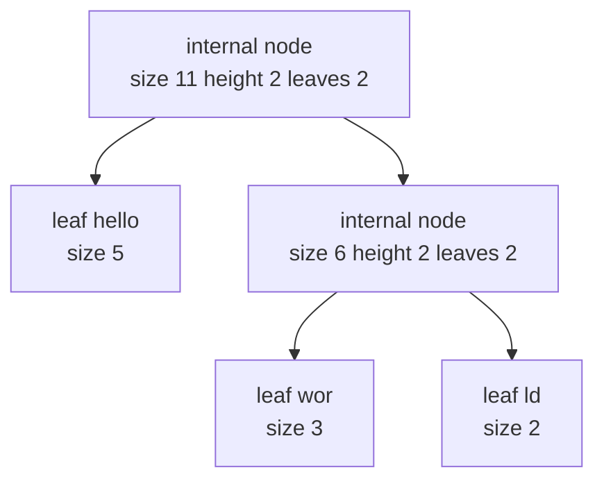
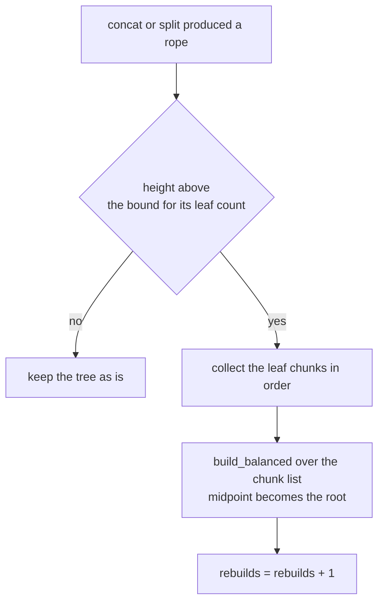
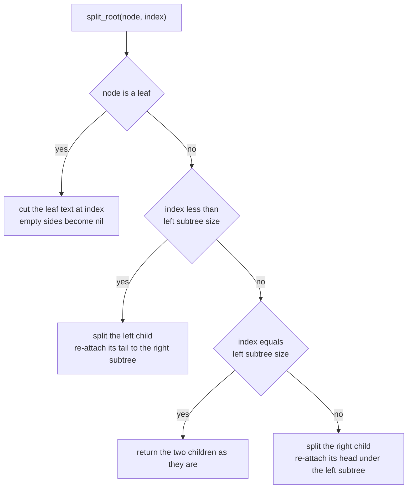
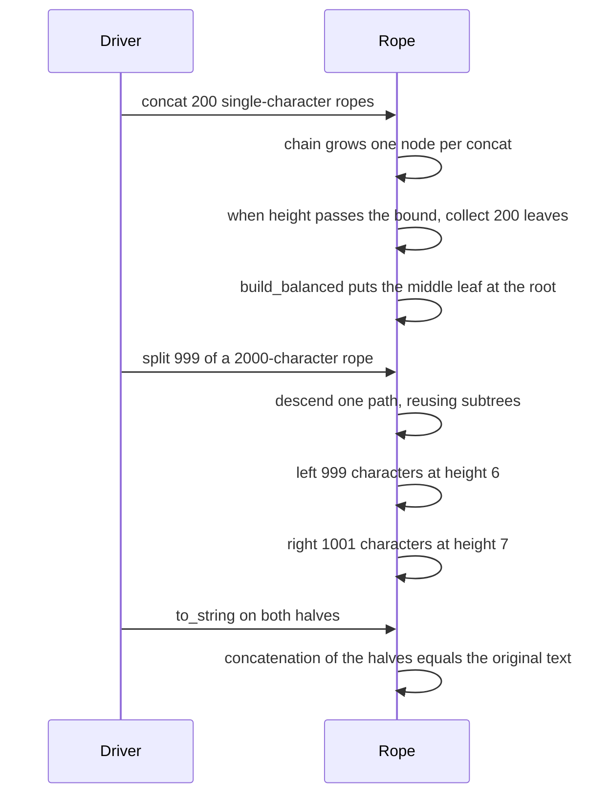

# 436 — Implement rope with concatenation and split in O(log n).

> **Tier:** Advanced · **CTCI chapter:** Beyond — Advanced Data Structures & Algorithms
> **Task spec:** [436-implement-rope-with-concatenation-and-split-in-o-log-n.md](../../../tasks/advanced/436-implement-rope-with-concatenation-and-split-in-o-log-n.md)
> **Solutions:** [Python](../../../solutions/python/advanced/436-implement-rope-with-concatenation-and-split-in-o-log-n/solution.py) ·
> [Java](../../../solutions/java/advanced/436-implement-rope-with-concatenation-and-split-in-o-log-n/Solution.java) ·
> [JavaScript](../../../solutions/javascript/advanced/436-implement-rope-with-concatenation-and-split-in-o-log-n/solution.js) ·
> [C#](../../../solutions/csharp/advanced/436-implement-rope-with-concatenation-and-split-in-o-log-n/Solution.cs)

## 1. Problem restatement

A rope stores text as a **balanced binary tree of chunks** instead of one contiguous string, so
that concatenation and splitting do not copy the whole text. The task fixes two documented
thresholds and one counter:

| Item | Value |
| --- | --- |
| `LEAF_LIMIT` | `32` characters per leaf; a longer input string is pre-split into such leaves |
| height bound | `2 · ceil(log2(#leaves + 1)) + 1` |
| rebalance rule | after a concat or a split, if a result's height exceeds the bound, rebuild it from its leaves into a perfectly balanced tree |
| `rebuilds` | counter, incremented once per rebuild and propagated from the operands of `concat` |

Every node caches `size` (characters below it), `height` and `leaves` (leaf count below it), so
all three are `O(1)` reads at the root. The API is `size()`, `height()`, `leaf_count()`,
`to_string()`, `leaf_texts()`, `validate()`, `concat(other)` and `split(index)`.

| Call | Result | Why |
| --- | --- | --- |
| `Rope("hello world")` | `size 11`, `leaf_count 1`, `height 1` | 11 characters fit in one leaf |
| `split(5)` on it | `"hello"` and `" world"` | the leaf itself is cut in two |
| `split(0)` / `split(11)` | `""` and the whole text, then the whole text and `""` | both ends are legal split points |
| `left.concat(right)` | `"hello world"` | the two halves rejoin |
| `Rope(data)` with 2000 characters | 63 leaves, height 7, bound 13, no leaf longer than 32 | see section 4 |
| 200 single-character concats | `size 200`, `height 14`, `rebuilds 24` (asserted `>= 1`) | see section 4 |
| `split(-1)` or `split(n + 1)` | raises an out-of-bounds error | the index must be in `[0, size]` |

The scripted part uses the shared LCG (`seed ← (seed · 75 + 74) mod 65537`, start `4360`): 100
steps over the 64-character base text, with `op = seed mod 4` — `0` split at a random index and
then re-concatenate either as `first.concat(second)` or as `second.concat(first)` (rotating the
oracle), `1` keep only the prefix, `2` keep only the suffix, `3` append a random
`seed mod 20`-character string. After every step the driver checks `to_string()`, `size()`, the
height bound, `validate()`, and that joining `leaf_texts()` reproduces the oracle.

## 2. Intuition

The naive text structure is one array of characters: concatenation copies `n + m` characters and
splitting copies `n`. A rope avoids the copy by making the text a tree — an internal node means
"left text followed by right text" — and by keeping the tree shallow enough that walking to a
position costs `O(log n)`.

Two pieces of cached metadata make that practical:



`size` is what turns a character index into a descent direction: walking down, subtract the left
subtree's size before entering the right subtree. `leaves` and `height` exist only for the
rebalance gate, which checks `height <= 2 · ceil(log2(leaves + 1)) + 1` and rebuilds the node's
leaves into a perfectly balanced tree when the rope has grown lopsided.



The gate is an amortised device, not a strict invariant: between rebuilds the tree may be taller
than the bound, and a query on such a tree is slower but still correct. The bound is deliberately
slack — twice the ideal `log2` height plus one — so that a single unlucky concat does not trigger
a full rebuild.

Splitting is the one operation that must recurse, because the cut point can fall anywhere inside
a leaf:



Note what split does *not* do: it never re-balances on the way down. It builds a chain of
`raw_concat` nodes along one root-to-leaf path, and only afterwards are the two resulting roots
put through the height gate.

## 3. Algorithm

1. `Rope(text)` cuts `text` into chunks of at most `LEAF_LIMIT` characters and builds a perfectly
   balanced tree over them with `build_balanced`, whose recursion makes the midpoint the root.
2. A leaf node stores its text with `size = length`, `height = 1`, `leaves = 1`. An internal node
   stores `size = left.size + right.size`, `height = 1 + max(left.height, right.height)` and
   `leaves = left.leaves + right.leaves`.
3. `concat(other)`: if either side is an empty rope, return the other root (adding both rebuild
   counters). Otherwise link the two roots under a fresh internal node with `raw_concat`, then
   pass the result through `_balanced`.
4. `_balanced(root)`: return `(root, 0)` when the rope is empty or
   `root.height <= height_bound(root.leaves)`. Otherwise collect the leaf chunks in left-to-right
   order, run `build_balanced` over them, and return `(rebuilt, 1)`.
5. `split(index)`: reject indices outside `[0, size]`; then call `split_root` on the root and run
   both results through `_balanced`, propagating the counters.
6. `split_root(node, index)`: on a leaf, cut the text at `index` (`head` and `tail`, each dropped
   when empty). On an internal node, compare `index` with `node.left.size`: less means "split the
   left child and re-attach its tail to the right subtree" with `raw_concat`; equal means the
   children are already the answer; greater means "split the right child at `index - left_size`
   and re-attach its head under the left subtree".
7. `to_string()` and `leaf_texts()` are iterative pre-order walks that push the right child before
   the left so the stack pops them in text order — `leaf_texts()` is exactly the leaf list that
   `_balanced` would rebuild from.
8. `validate()` re-checks every leaf (`1 <= length <= LEAF_LIMIT`) and every internal node's
   cached `size`, `height` and `leaves` against its children, then confirms the root's three
   numbers match the accessors.

```text
procedure concat(left_rope, right_rope)
    if left_rope.root is nil then
        return rope over right_rope.root with combined rebuild counts
    end
    if right_rope.root is nil then
        return rope over left_rope.root with combined rebuild counts
    end
    merged ← raw_concat(left_rope.root, right_rope.root)
    root, rebuilt ← balanced(merged)
    return rope over root with combined rebuild counts plus rebuilt
end

procedure balanced(root)
    if root is nil or root.height <= height_bound(root.leaves) then
        return root, 0
    end
    chunks ← leaves of root in text order
    return build_balanced(chunks, 0, length(chunks) - 1), 1
end

procedure split_root(node, index)
    if node is nil then
        return nil, nil
    end
    if node is a leaf then
        head ← first index characters of node.text
        tail ← remaining characters of node.text
        return (new leaf over head unless head is empty), (new leaf over tail unless tail is empty)
    end
    left_size ← node.left.size
    if index < left_size then
        first, second ← split_root(node.left, index)
        return first, raw_concat(second, node.right)
    end
    if index = left_size then
        return node.left, node.right
    end
    first, second ← split_root(node.right, index - left_size)
    return raw_concat(node.left, first), second
end
```

`split_root` allocates `O(log n)` new internal nodes along the path and reuses every subtree it
does not need to cut, which is what keeps the split itself `O(log n)` — the expected cost of a
real rope. The catch is that the re-attached pieces come from the old tree with their old heights,
so the two outputs can be tall and lopsided, and that is exactly what the following `_balanced`
call is for.

## 4. Worked example

Start with the hand-asserted small case, `Rope("hello world")`: one leaf of 11 characters, so
`size = 11`, `leaf_count = 1`, `height = 1` and the bound is `2 · ceil(log2(2)) + 1 = 3`.

| Call | Result | Shape afterwards |
| --- | --- | --- |
| `split(0)` | `""` and `"hello world"` | left leaf empty → `nil`, right is the original leaf |
| `split(11)` | `"hello world"` and `""` | the mirror image |
| `split(5)` | `"hello"` and `" world"` | the leaf is cut: two leaves of 5 and 6 characters |
| `"hello".concat(" world")` | `"hello world"` | a new internal node with the two leaves as children |

The middle case is the one worth reading twice: splitting inside a single leaf does not keep the
original leaf — it *replaces* it with two smaller leaves, and `leaf_count` for each half becomes
1. The height bound still holds for both halves (`1 <= 3`), so no rebuild is triggered and both
`rebuilds` counters stay 0.

Now the larger asserted cases, measured by instrumenting the shipped Python implementation:

| Input | Result |
| --- | --- |
| `Rope(2000 characters)` | 63 leaves, `height 7`, bound `2 · ceil(log2(64)) + 1 = 13`, leaf lengths only 32 and 16 |
| `split(999)` of that rope | 999 and 1001 characters, heights 6 and 7, no extra rebuilds (both inside the bound) |
| 200 single-character ropes concatenated one at a time | `size 200`, `height 14`, `leaves 200`, bound `17`, `rebuilds 24` |

The last row is the amortisation story in numbers. Each `concat` adds exactly one internal node,
which makes the accumulated rope a *left-leaning chain* of depth equal to the number of concats;
every so often the height gate fires and flattens the whole thing. 24 rebuilds for 200 concats is
roughly one rebuild per 8 concatenations, and the rope never grows past height 14 while the bound
is 17 — the header's claim that "building a 200-character rope by 200 single-character concats
triggers at least one rebalance" is the weaker form of this observation.



The scripted part stresses the same code with rotation: when `op = 0` and the low bit of the seed
is odd, the driver does `second.concat(first)`, so the oracle becomes `oracle[index:] +
oracle[:index]`. That is a `O(log n)` way to rotate a text, and it only works because the split
and the concat are exact.

## 5. Complexity

Let `n` be the character count and `l` the leaf count.

| Measure | Bound | Why it holds |
| --- | --- | --- |
| `size`, `height`, `leaf_count` | O(1) | cached at the root |
| `concat` | O(1) conceptually, O(l) when the gate fires | `raw_concat` allocates one node; the rebuild collects and re-splits all leaves |
| `concat`, amortised | O(log n) | the bound is slack by a factor of two, so a long run of concats is repaired by one rebuild, exactly as the 24 rebuilds for 200 concats show |
| `split` | O(log n) plus the same amortised rebuild | `split_root` walks one root-to-leaf path allocating `O(log n)` nodes, then `_balanced` may rebuild |
| `to_string` | O(n) | every character must be materialised into the result string |
| `validate` | O(n) | it visits every node |
| Space | O(n + l) | the characters live once in the leaves; `concat` and `split` share subtrees, so nothing is copied except the `O(log n)` path nodes |
| Plain string alternative | O(n + m) per concat, O(n) per split | an array copy of the whole text |

The `O(log n)` claims are for the *tree operations*; materialising the text with `to_string()` is
always `O(n)`, and the drivers lean on that in every assertion. The rebuild counter is the honest
record of how often the amortised promise was actually paid.

## 6. Pitfalls and edge cases

- **Empty rope.** `Rope()` has `root = nil`, so `size`, `height` and `leaf_count` are all 0 and
  `to_string()` is `""`. `concat` short-circuits on an empty side and returns the other root
  rather than building a node with a `nil` child — a node whose child is `nil` would break
  `size`, `height` and `leaves` arithmetic.
- **Split at the ends.** `split(0)` and `split(size)` are legal and produce one empty rope; that
  is why `split_root` drops empty `head`/`tail` pieces instead of creating zero-length leaves
  (and why `validate` rejects a leaf of length 0).
- **Split out of bounds.** `split(-1)` or `split(size + 1)` raises. The guard is
  `not 0 <= index <= size`, so `index == size` is allowed.
- **The leaf limit is an invariant, not a hint.** `validate` fails any leaf longer than
  `LEAF_LIMIT`; leaves are only ever created from `leaves_of`, from a `split_root` cut of an
  existing leaf (never longer), or from `build_balanced` over such chunks.
- **Split does not merge leaves.** Splitting and re-concatenating the same text leaves *more*
  leaves than before, because concat does not merge adjacent small leaves. The documented
  consequence is that `leaf_count` can drift upward while `size` stays fixed.
- **The height bound is slack on purpose.** `2 · ceil(log2(l + 1)) + 1` is not the ideal height;
  for 63 leaves the ideal is 6 and the measured height after `build_balanced` is 7, still far
  inside the bound of 13. Replacing the bound with an exact one would rebuild far more often.
- **Rebuild counters propagate.** `concat` and `split` add the operands' counters plus their own
  rebuild flag; a rope produced by splitting an old rope inherits the old count, which is why the
  two halves of the 2000-character rope report the same `rebuilds` value.
- **Rotation is not a primitive.** The `second.concat(first)` branch of the script is how a text
  rotation is expressed; it is two `O(log n)` operations, not a special case in the data
  structure.
- **`validate` is the real oracle for shape.** The drivers compare text against a plain-string
  oracle and shape against the height bound plus `validate`, so a rope that answers correctly but
  keeps stale metadata cannot pass.

## 7. Variants and follow-ups

- **The concept version.** [435-implement-finger-tree-sequence-operations-concept.md](../../../tasks/advanced/435-implement-finger-tree-sequence-operations-concept.md)
  keeps the same "sequence with cached annotations" idea but simulates the spine over a plain
  list; it documents the `O(n)` internals that this task replaces with real `O(log n)` structure.
- **Rope as a text editor primitive.** [413-implement-data-structure-for-dynamic-string-operations-rope.md](../../../tasks/advanced/413-implement-data-structure-for-dynamic-string-operations-rope.md)
  is the same data structure framed around editor operations (insert, delete, substring).
- **Rebuilding for balance.** [144-convert-sorted-array-to-balanced-bst.md](../../../tasks/beginner/144-convert-sorted-array-to-balanced-bst.md)
  is precisely the `build_balanced` recursion used here, and
  [434-implement-scapegoat-tree-basics-rebuild-heuristic.md](../../../tasks/advanced/434-implement-scapegoat-tree-basics-rebuild-heuristic.md)
  applies the same "let it drift, then rebuild" gate to a BST.
- **Sharing instead of copying.** [421-implement-persistent-segment-tree-versioned.md](../../../tasks/advanced/421-implement-persistent-segment-tree-versioned.md)
  shows the path-copying discipline that `split_root` relies on: only the nodes on the touched
  path are new.
- **Text indexes over a rope.** [401-implement-suffix-array-sa-is-or-doubling-for-medium-n.md](../../../tasks/advanced/401-implement-suffix-array-sa-is-or-doubling-for-medium-n.md)
  is what you build once a large text is stored; rope plus suffix array is the classic
  edit-text-search combination.

## 8. Check yourself

1. Why does `concat` not simply re-balance every time, and what would that cost?

<details><summary>Show answer</summary>

Re-balancing means collecting every leaf chunk and rebuilding the tree, which is `O(l)` per
concat — more expensive than copying the text for small edits, and it would erase the `O(1)`
linking step that makes ropes attractive. The height gate fires only when the tree is actually
too tall, which amortises the `O(l)` work over many concatenations (24 rebuilds for 200 concats).

</details>

2. `split_root` reaches a leaf and cuts it. What does that do to `leaf_count`, and is the result
   still valid?

<details><summary>Show answer</summary>

The leaf is replaced by two leaves (or one, if the cut is at an end), so `leaf_count` grows by
one for an interior cut. The result is still valid because each half is shorter than the original
leaf and therefore still within `LEAF_LIMIT`, and `validate` recomputes `size`, `height` and
`leaves` for every ancestor.

</details>

3. After 200 single-character concats the rope has height 14 and `rebuilds 24`. Why is the height
   not what a perfectly balanced rope of 200 leaves would have?

<details><summary>Show answer</summary>

Because the rebuild only fires when the height exceeds
`2 · ceil(log2(leaves + 1)) + 1 = 17`; between rebuilds the structure accumulates a lopsided
chain of freshly concatenated nodes. 14 is inside the bound, so it is a legitimate state — the
bound trades a little height for far fewer rebuilds.

</details>

4. Why does the driver compare `"".join(leaf_texts())` with the oracle on every step?

<details><summary>Show answer</summary>

Because `to_string()` and `leaf_texts()` are two different walks of the tree: the first
concatenates the text, the second exposes exactly the chunks `_balanced` would rebuild from. If a
split or concat linked subtrees in the wrong order, `leaf_texts()` would reveal which pieces went
where, while a text comparison alone could still pass by luck on a short input.

</details>
