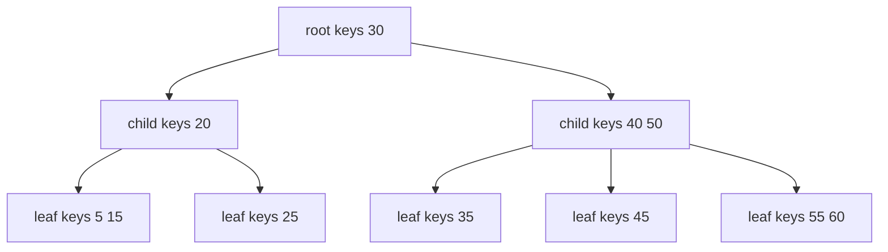
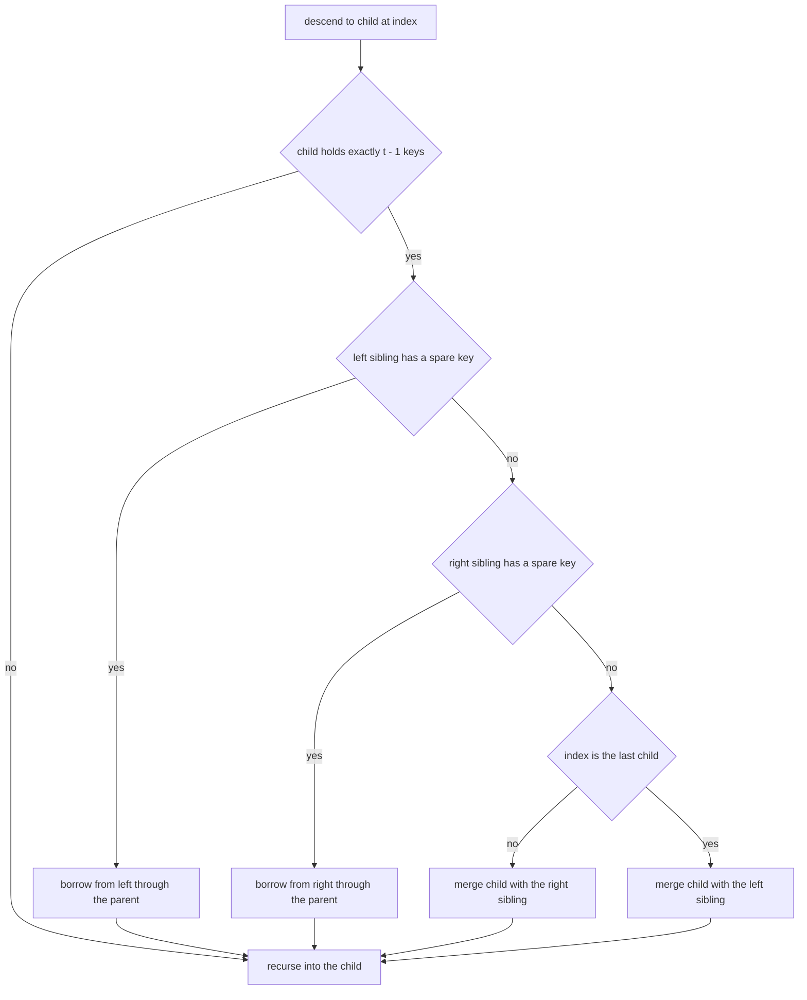
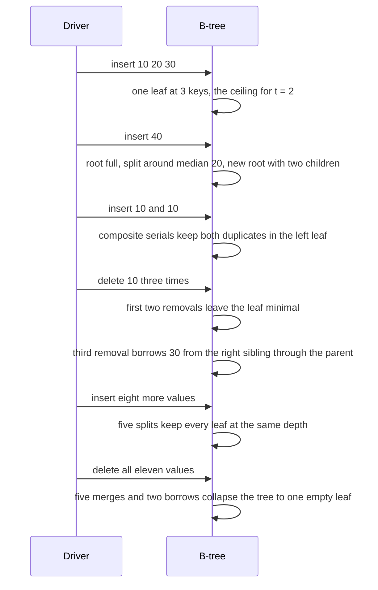

# 437 — Implement B-tree node insert/delete basics.

> **Tier:** Advanced · **CTCI chapter:** Ch 14 — Databases
> **Task spec:** [437-implement-b-tree-node-insert-delete-basics.md](../../../tasks/advanced/437-implement-b-tree-node-insert-delete-basics.md)
> **Solutions:** [Python](../../../solutions/python/advanced/437-implement-b-tree-node-insert-delete-basics/solution.py) ·
> [Java](../../../solutions/java/advanced/437-implement-b-tree-node-insert-delete-basics/Solution.java) ·
> [JavaScript](../../../solutions/javascript/advanced/437-implement-b-tree-node-insert-delete-basics/solution.js) ·
> [C#](../../../solutions/csharp/advanced/437-implement-b-tree-node-insert-delete-basics/Solution.cs)

## 1. Problem restatement

The task is a B-tree of **order `m = 4`**, i.e. minimum degree `t = 2`, with the shape invariants
of the textbook definition:

| Invariant | Value for `t = 2` |
| --- | --- |
| keys per node | at most `2t - 1 = 3` |
| keys in a non-root node | at least `t - 1 = 1` |
| children of an internal node | between `2` and `4`, always `keys + 1` |
| leaf depth | identical for every leaf |
| key order | strictly increasing inside each node, and in-order traversal is globally sorted |

Duplicate values are supported through **composite keys**: an insertion stores
`key = (value << 20) | serial` with a fresh `serial`, so the textbook rules for unique keys apply
unchanged while the sorted traversal still produces a sorted *multiset* of values. The API is
`insert(value)`, `delete(value)`, `contains(value)`, `inorder_values()`, `validate()`, a `size`
field, and three documented counters: `splits`, `merges` and `borrows`.

| Call | Result | Why |
| --- | --- | --- |
| `inorder_values()` on an empty tree, `delete(5)` | `[]`, `false` | an empty tree is a single empty leaf |
| insert `10, 20, 30, 40` | `splits >= 1`, order `[10, 20, 30, 40]`, `size 4` | the fourth key forces a root split |
| insert `10, 10` | `[10, 10, 10, 20, 30, 40]` | duplicates exist side by side as distinct composite keys |
| delete `10` three times | `true, true, true`, then `false` | each call removes exactly one copy |
| `contains(30)` / `contains(35)` | `true` / `false` | a lower-bound search plus a value comparison |
| insert `35, 25, 15, 5, 45, 50, 55, 60` | `[5, 15, 20, 25, 30, 35, 40, 45, 50, 55, 60]` | splits keep the tree balanced |
| delete all eleven values | `[]`, `size 0`, `validate()` true | merges collapse the tree back to one leaf |

The scripted part uses the shared LCG (`seed ← (seed · 75 + 74) mod 65537`, start `4370`): 300
steps with `op = seed mod 4` — `0` and `1` insert `seed mod 30`, `2` deletes a random element of
the oracle **twice** (the second call must return whether another copy is still present), and `3`
tries to delete `100 + seed mod 5`, which must return `false`. After every step the driver checks
`size` against the oracle, and every 20 steps checks the full sorted multiset, `validate()`, and
finally that `splits > 0` and `merges > 0`.

## 2. Intuition

A binary search tree spends one comparison per level; a B-tree puts up to `2t - 1` sorted keys in
a single node and up to `2t` children below it, so the height drops to `log_t n`. That is exactly
what a database page wants: one page read per level instead of one pointer chase per key.



Inserting into that structure has one classic difficulty: a full node has no room. Rather than
inserting and then repairing upwards, the implementation uses the **preemptive split** rule —
before descending into a child that already holds `2t - 1 = 3` keys, split it around its median.
The median rises into the parent, which by construction is never full at that moment (it was
split before the descent reached it), and the upper half becomes a fresh right sibling.

Deleting is the mirror image and the harder half. A key can disappear from a leaf, or an internal
key must be replaced by its in-order predecessor or successor before being removed from that leaf.
Either way the descent may reach a child holding the minimum `t - 1 = 1` key, which cannot give
one away. So before descending, such a child is **repaired**: borrow a key from a left or right
sibling through a rotation with the parent (`borrows`), or, if both siblings are minimal, merge
the child with a sibling and pull the separating parent key down (`merges`). Merging shortens the
parent, which is why the root can end up empty with a single child — in that case the child
becomes the new root, and the tree gets shorter.

The two counters are not decoration: they are the evidence that the repair paths actually ran.
The hand sequence below ends with `merges 5, borrows 2`, and the random workload ends with
`36 splits, 28 merges, 36 borrows`.

## 3. Algorithm

1. `insert(value)`: build `key = (value << 20) | serial` and bump `serial`.
2. If the root holds `2t - 1` keys, create a new root whose only child is the old root and split
   that child at index 0. The tree only grows at the root, which is what keeps every leaf at the
   same depth.
3. `_insert_nonfull(node, key)`: find `index = lower_bound(node.keys, key)`. If the node is
   internal, split the child at `index` when it is full, and **re-compare** — after the split the
   median sits at `node.keys[index]`, so if `key` is greater than it, descend into `index + 1`.
   Otherwise descend into the child. On a leaf, insert the key at `index`.
4. `_split_child(parent, index)`: the child's median moves up into `parent.keys[index]`, the child
   keeps its lower `t - 1` keys, and a new right sibling takes the upper keys (and the matching
   upper children when the child is internal). `splits += 1`.
5. `delete(value)`: find the smallest composite key with `key >> 20 == value` using a lower-bound
   descent; if it does not exist or decodes to a different value, return `false`. Otherwise delete
   that exact key from the tree.
6. `_delete(node, key)`: if the key sits in this node and the node is a leaf, remove it there. If
   the node is internal, delegate to `_delete_internal`.
7. `_delete_internal(node, index)`: if the left child has more than `t - 1` keys, replace the key
   with its in-order predecessor and delete the predecessor from the left child; else if the right
   child has more than `t - 1` keys, do the same with the successor; else merge the two children
   with the key in between and continue deleting from the merged node.
8. Before descending into child `index`, if that child holds exactly `t - 1` keys, call `_fill`:
   borrow from the left sibling through the parent if it has a spare key, else borrow from the
   right sibling, else merge with the right sibling (or the left one when `index` is the last
   child).
9. After a delete, if the root has no keys but does have children, promote `root.children[0]` —
   this is the only place the tree shrinks in height.
10. `validate()` walks the tree checking key order, `2t - 1` as the ceiling, `t` as the child
    floor, `children == keys + 1`, and that all leaves report the same depth.

```text
procedure split_child(parent, index)
    node ← parent.children[index]
    right ← new empty node
    median ← node.keys[t - 1]
    right.keys ← node.keys from position t onward
    node.keys ← node.keys before position t - 1
    if node has children then
        right.children ← node.children from position t onward
        node.children ← node.children before position t
    end
    insert median into parent.keys at position index
    insert right into parent.children at position index + 1
    splits ← splits + 1
end

procedure insert_nonfull(node, key)
    index ← lower_bound(node.keys, key)
    if node has children then
        if number of keys in node.children[index] equals 2t - 1 then
            split_child(node, index)
            if key > node.keys[index] then
                index ← index + 1
            end
        end
        insert_nonfull(node.children[index], key)
    else
        insert key into node.keys at position index
    end
end
```

```text
procedure fill(node, index)
    if index > 0 and left sibling has more than t - 1 keys then
        borrow_from_left(node, index)
    else if index < number of keys and right sibling has more than t - 1 keys then
        borrow_from_right(node, index)
    else if index < number of keys then
        merge(node, index)
    else
        merge(node, index - 1)
    end
end

procedure borrow_from_right(node, index)
    child ← node.children[index]
    right ← node.children[index + 1]
    append node.keys[index] to child.keys
    node.keys[index] ← remove the first key of right.keys
    if right has children then
        append the first child of right to child.children
    end
    borrows ← borrows + 1
end

procedure merge(node, index)
    left ← node.children[index]
    right ← node.children[index + 1]
    append the key removed from node at position index to left.keys
    append every key and child of right to left
    remove node.children[index + 1]
    merges ← merges + 1
end
```



## 4. Worked example

The trace below is the hand-asserted sequence, instrumented on the shipped Python implementation.

| Step | Operation | Tree (root first, then children) | Counters |
| --- | --- | --- | --- |
| 1 | insert `10, 20, 30` | `[10, 20, 30]` — one leaf at capacity | splits 0 |
| 2 | insert `40` | root is full, so split it: `[20]` with children `[10]` and `[30, 40]` | splits 1 |
| 3 | insert `10, 10` | `[20]` with children `[10, 10, 10]` and `[30, 40]` | splits 1, merges 0 |
| 4 | delete `10` | `[20]` with children `[10, 10]` and `[30, 40]`; order `[10, 10, 20, 30, 40]` | borrows 0 |
| 5 | delete `10` | the left child is now minimal, so it borrows: the parent key `20` moves down, `30` rises from the right sibling | borrows 1 |
| 6 | delete `10` | order `[20, 30, 40]`; the tree is `[30]` with children `[20]` and `[40]` | borrows 1 |
| 7 | delete `10` | no copy left → `false` | — |
| 8 | insert `35, 25, 15, 5, 45, 50, 55, 60` | `[30]` under it `[20]` and `[40, 50]`, leaves `[5, 15] [25] [35] [45] [55, 60]` | splits 5, borrows 1 |
| 9 | delete `30, 5, 60, 20, 45, 15, 55, 25, 35, 50, 40` | one empty leaf; `size 0`; `validate()` true | merges 5, borrows 2 |

Step 5 is the one to study: the child that must give up its last `10` holds exactly `t - 1 = 1`
key, so `_fill` looks right, finds a sibling with two keys, and performs the rotation — the
parent's separator `20` moves into the child, the sibling's smallest key `30` becomes the new
separator, and the sibling keeps `[40]`. Only then is `10` deleted from the repaired child.



The random workload stresses the same paths for a longer run: 300 LCG operations on values
`0..29` end with a tree holding 20 elements over 13 distinct values, **36 splits, 28 merges and
36 borrows**, a uniform leaf depth of 2, and `validate()` passing — which is exactly what the
final `splits > 0 and merges > 0` assertion is checking.

## 5. Complexity

Let `n` be the number of stored composite keys, `m = 4` the order and `t = 2`.

| Measure | Bound | Why it holds |
| --- | --- | --- |
| Height | `O(log_t n)` | every node except the root has at least `t - 1` keys, so each level multiplies the capacity by at least `t` |
| `insert` | `O(t · log_t n)` | one descent; the preemptive split makes the pass single-directional, and splitting a node is `O(t)` |
| `delete` | `O(t · log_t n)` | one descent; borrow and merge are `O(t)` node operations |
| `contains` | `O(t · log_t n)` | one lower-bound descent plus one key comparison |
| `inorder_values` | `O(n)` | it emits every stored key |
| `validate` | `O(n)` | it visits every node and checks every key |
| Space | `O(n)` | keys live once, in the leaves and internal nodes |
| Plain BST comparison | height `O(log n)` expected but `O(n)` worst | a B-tree's height bound is worst-case, and each level costs `O(t)` comparisons but a single node/page read |

The `t` factor is the price of fat nodes and is exactly what a page-oriented store wants: one node
visit per level instead of one key comparison per level. `validate`'s uniform-leaf-depth check is
what proves the tree is a B-tree and not merely a multi-way search tree.

## 6. Pitfalls and edge cases

- **Empty tree.** There is no "no nodes" state: an empty B-tree is *one empty leaf*, so
  `validate()` is true and `inorder_values()` is `[]`; `delete` returns `false` without touching
  the structure.
- **Duplicates need the serial.** Without the `(value << 20) | serial` encoding, a second equal
  key would collide with the first and the delete paths would have to count multiplicities. With
  it, each copy is a distinct ordering key, `lower_bound` finds the *smallest* copy of a value,
  and `key >> 20 == value` verifies that the found key really belongs to the requested value.
- **Key width.** The encoding packs the value into the upper bits and the serial into the low 20,
  so in the 32-bit key types used by Java, JavaScript and C# values must stay below `2^11` for the
  ordering to survive. The tests use values below 100.
- **Split before descending, not after.** A split performed on the way *back up* requires the
  parent to have room, which means a second pass; the preemptive rule only ever splits a child the
  descent is about to enter, and that parent is guaranteed non-full at that moment.
- **Re-compare after a split.** After splitting child `index`, the median now occupies
  `node.keys[index]`. If the new key is greater than the median it must go into `index + 1` — the
  `if key > node.keys[index]` step. Skipping it sends keys into the wrong half and breaks sorted
  order.
- **Index adjustment after `_fill`.** `_delete` remembers whether the searched key was past the
  end of the node (`flag`) and, after a merge removed a parent key, may decrement `index`. This is
  the sub-case where a merge with the *left* sibling shifts every child index.
- **Root collapse.** Deleting may leave the root with zero keys and one child; promoting
  `root.children[0]` is the only way the tree loses height, and without it `validate` would see a
  root with no keys but a child.
- **Counters are asserted.** `splits`, `merges` and `borrows` are the evidence that the delete
  repair machinery ran at all; the hand sequence ends at `merges 5, borrows 2`, and the final
  assertion demands `splits > 0 and merges > 0`.
- **Uniform depth is the real invariant.** A deletion that drops a key without repairing the
  child can leave leaves at different depths; `validate` checks that every leaf reports the same
  depth and that interior occupancy stays inside `[t - 1, 2t - 1]`.

## 7. Variants and follow-ups

- **Range queries over the leaves.** [477-implement-b-tree-leaf-range-query-and-insert-basics.md](../../../tasks/advanced/477-implement-b-tree-leaf-range-query-and-insert-basics.md)
  adds the operation a database actually wants on top of this node machinery — scanning a sorted
  range across leaves.
- **Versioned pages.** [614-implement-persistent-b-tree-for-versioned-db-index.md](../../../tasks/expert/614-implement-persistent-b-tree-for-versioned-db-index.md)
  turns the same node layout into a copy-on-write index, which is the reason B-trees survive as
  database indexes at all.
- **Concurrency on fat nodes.** [774-implement-concurrent-b-tree-with-latch-free-readers-reader-write.md](../../../tasks/expert/774-implement-concurrent-b-tree-with-latch-free-readers-reader-write.md)
  and [776-implement-optimistic-b-tree-rebalancing-algorithm-sketch.md](../../../tasks/expert/776-implement-optimistic-b-tree-rebalancing-algorithm-sketch.md)
  are what happens when many threads descend those same nodes.
- **Where the tree comes from.** [144-convert-sorted-array-to-balanced-bst.md](../../../tasks/beginner/144-convert-sorted-array-to-balanced-bst.md)
  builds a balanced tree bottom-up from sorted data, which is the bulk-loading counterpart of
  insert-by-insert construction.
- **Alternative balancing in RAM.** [249-implement-treap-bst-heap-insert-delete.md](../../../tasks/intermediate/249-implement-treap-bst-heap-insert-delete.md)
  and [434-implement-scapegoat-tree-basics-rebuild-heuristic.md](../../../tasks/advanced/434-implement-scapegoat-tree-basics-rebuild-heuristic.md)
  show randomised and rebuild-based balance for the in-memory case where fat nodes buy nothing.

## 8. Check yourself

1. Why does `insert` split a full child *before* descending into it?

<details><summary>Show answer</summary>

Because splitting on the way down guarantees the parent has room for the median: the parent was
itself split before the descent entered it, so it holds at most `2t - 2` keys at that moment.
Splitting on the way back up would require the parent to be non-full, which is not guaranteed,
and would force a second corrective pass up the tree.

</details>

2. In the trace, the tree after step 4 is `[20]` with children `[10, 10]` and `[30, 40]`. What
   does the next `delete(10)` have to do before removing the key, and why?

<details><summary>Show answer</summary>

The child holding the `10` has exactly `t - 1 = 1` key after the deletion, so it cannot give a key
away. `_fill` finds the right sibling with two keys, borrows through the parent: the separator
`20` moves down into the child and the sibling's `30` rises to become the new separator. Only
after that repair is `10` removed — and that single borrow is what the `borrows 1` counter shows.

</details>

3. The drivers assert `splits > 0 and merges > 0` at the end of the random workload. Why is the
   `merges` half not redundant?

<details><summary>Show answer</summary>

Insert-only workloads never merge. The LCG script mixes insertions and deletions and ends at
`28 merges` (with `36 splits` and `36 borrows`), which proves the deletion repair paths were
exercised, and a merge only happens when a child is minimal and both neighbours are minimal too.
`validate` complements this by checking the shape: ceiling `2t - 1` keys, floor `t - 1` keys per
non-root node, `children == keys + 1`, and one common leaf depth.

</details>
