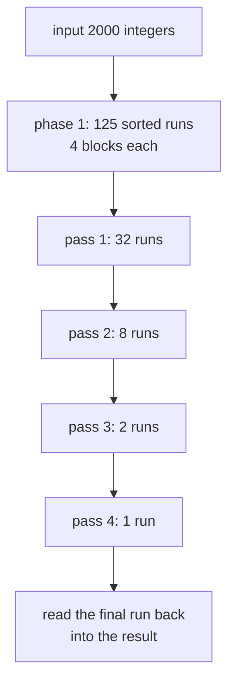
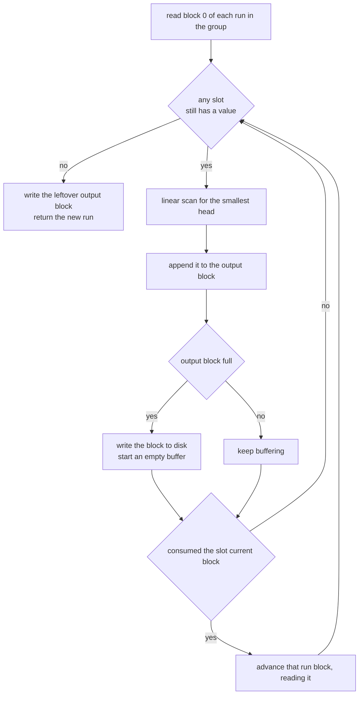
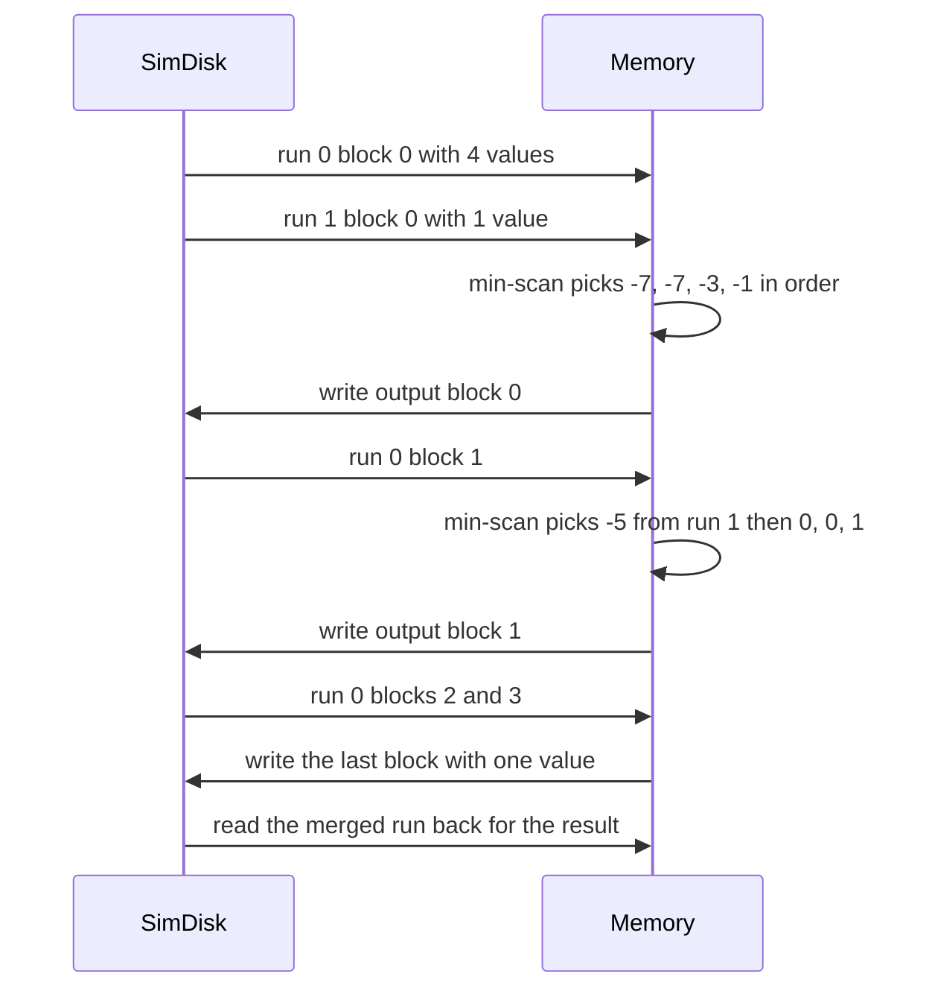

# 438 — Implement external-memory sort outline (multiway merge).

> **Tier:** Advanced · **CTCI chapter:** Ch 10 — Sorting and Searching
> **Task spec:** [438-implement-external-memory-sort-outline-multiway-merge.md](../../../tasks/advanced/438-implement-external-memory-sort-outline-multiway-merge.md)
> **Solutions:** [Python](../../../solutions/python/advanced/438-implement-external-memory-sort-outline-multiway-merge/solution.py) ·
> [Java](../../../solutions/java/advanced/438-implement-external-memory-sort-outline-multiway-merge/Solution.java) ·
> [JavaScript](../../../solutions/javascript/advanced/438-implement-external-memory-sort-outline-multiway-merge/solution.js) ·
> [C#](../../../solutions/csharp/advanced/438-implement-external-memory-sort-outline-multiway-merge/Solution.cs)

## 1. Problem restatement

The task is a simulated **external merge sort**: sort `n` integers that do not necessarily fit in
memory, by sorting as much as fits, writing that back to a simulated disk, and then merging the
sorted pieces. Three parameters are documented in every header:

| Parameter | Value | Meaning |
| --- | --- | --- |
| `BLOCK_SIZE` | `4` | integers per disk block |
| `MEMORY_BLOCKS` | `4` | blocks of RAM, i.e. `16` integers per initial run |
| `FAN_IN` | `4` | runs merged per group in a merge pass |

A simulated disk (`SimDisk`) stores numbered runs as lists of blocks, counts every `read_block`
and `append_block`, and exposes `io_ops()`, `total_items()` and `blocks_sized_ok()`. The
documented I/O bound is

```text
io_bound(n, passes) = 2 · ceil(n / BLOCK_SIZE) · (1 + passes)
```

— one initial write pass, two transfers per block per merge pass, and one final read pass. The
hand-written assertions fix the behaviour:

| Input | Result | Passes | I/O |
| --- | --- | --- | --- |
| `[]` | `[]` | 0 | `io_ops() == 0` |
| `[7]` | `[7]` | 0 | `reads == 1`, `writes == 1` |
| 10 distinct values | sorted | 0 (fits in one memory load) | `io_ops() <= io_bound(10, 0)`, `total_items == 10` |
| 17 values with duplicates | sorted | 1 | `io_ops() <= io_bound(17, 1)`, `total_items == 34` |
| 2000 LCG values (`seed 4380`, `seed % 1000`) | equals `sorted(data)` | 4 | measured below |
| `range(199, -1, -1)` | sorted | `> 0` | `io_ops() <= io_bound(200, passes)` |

`blocks_sized_ok()` is asserted after every run: each stored block must hold between 1 and
`BLOCK_SIZE` integers, and a full block must hold exactly `BLOCK_SIZE` (the 2000-element case
asserts the maximum block length is exactly 4). `total_items() == n · (passes + 1)` is the
correctness-of-accounting check — the disk keeps every intermediate run, so a dropped or
duplicated element would show up as a wrong total.

## 2. Intuition

An in-memory sort can afford to look at the whole array; an external sort cannot even *hold* it.
The only currency it has is block transfers between disk and RAM, so the whole design is about
turning a comparison sort into a sequence of streaming passes.

Phase 1 exploits the fact that a chunk of memory-sized data sorts trivially in RAM: load up to
`MEMORY_BLOCKS · BLOCK_SIZE = 16` integers, sort them, and write the sorted piece back as one
"run" of up to 4 full blocks. Phase 2 repeatedly merges groups of up to `FAN_IN = 4` runs into
longer runs. Each pass reduces the run count by a factor of `FAN_IN`, so the number of passes is
`ceil(log_FAN_IN(#initial runs))` — for 2000 elements that is 125 initial runs → 32 → 8 → 2 → 1,
i.e. four merge passes.



An in-memory merge of `k` streams usually uses a heap. Here `FAN_IN` is only 4, so the merge
buffer does a **linear min-scan** over at most four current heads: four comparisons per element,
no heap bookkeeping, and no allocation per element. The header documents the trade-off — a heap
"would take over for larger fan-in", where `k` comparisons per element would become the
bottleneck.

The memory budget during a merge pass is one block per input run (`FAN_IN` blocks) plus one output
block. When a run's current block is exhausted, the next block is read in — which is what makes
the pass cost exactly one read per input block and one write per output block.

## 3. Algorithm

1. Phase 1: walk the input in chunks of `capacity = MEMORY_BLOCKS · BLOCK_SIZE = 16`, sort each
   chunk in RAM, create a disk run, and append the chunk as `BLOCK_SIZE`-sized blocks.
2. Phase 2 entry: `passes = 0`; while more than one run remains, increment `passes` and merge the
   runs in groups of at most `FAN_IN`, producing one new output run per group.
3. `_merge_group(group)`: read block 0 of every run in the group into memory and track, for each
   slot, the current block index and the position inside that block.
4. Repeatedly scan the slots with remaining data, pick the slot whose current value is smallest,
   and append that value to the output buffer.
5. When the output buffer reaches `BLOCK_SIZE` values, write it as a block and start a new buffer;
   a leftover partial buffer at the end is written as a short block.
6. When a slot consumes its whole block, advance to the next block of that run (reading it) and
   reset the position; when a run has no blocks left, the slot is empty forever.
7. When all slots are empty, return the output run id.
8. After the final pass one run is left; read its blocks in order into the result list.

```text
procedure external_sort(data)
    disk ← new simulated disk
    capacity ← MEMORY_BLOCKS * BLOCK_SIZE
    runs ← empty list
    for start from 0 to size of data step capacity do
        chunk ← sorted slice of data starting at start of length capacity
        run_id ← disk.create_run()
        for index from 0 to size of chunk step BLOCK_SIZE do
            disk.append_block(run_id, slice of chunk starting at index of length BLOCK_SIZE)
        end
        append run_id to runs
    end
    passes ← 0
    while number of runs > 1 do
        passes ← passes + 1
        merged ← empty list
        for start from 0 to number of runs step FAN_IN do
            append merge_group(disk, runs from start up to FAN_IN runs) to merged
        end
        runs ← merged
    end
    result ← empty list
    if runs is not empty then
        for index from 0 to number of blocks in runs[0] do
            extend result with disk.read_block(runs[0], index)
        end
    end
    return result, disk, passes
end
```

```text
procedure merge_group(disk, group)
    out_id ← disk.create_run()
    blocks ← the first block of every run in group
    positions ← zero for every run in group
    indices ← zero for every run in group
    out_block ← empty list
    while true do
        best ← -1
        for slot from 0 to number of runs in group - 1 do
            if indices[slot] < length of blocks[slot] then
                if best = -1 or blocks[slot][indices[slot]] < blocks[best][indices[best]] then
                    best ← slot
                end
            end
        end
        if best = -1 then
            stop the loop
        end
        append blocks[best][indices[best]] to out_block
        indices[best] ← indices[best] + 1
        if length of out_block = BLOCK_SIZE then
            disk.append_block(out_id, out_block)
            out_block ← empty list
        end
        if indices[best] = length of blocks[best] then
            positions[best] ← positions[best] + 1
            if positions[best] < disk.block_count(group[best]) then
                blocks[best] ← disk.read_block(group[best], positions[best])
                indices[best] ← 0
            end
        end
    end
    if out_block is not empty then
        disk.append_block(out_id, out_block)
    end
    return out_id
end
```

The `best = -1` sentinel is the single stopping condition: it becomes true only when no slot has
any value left, which is exactly when the group is fully merged. Duplicates are handled for free —
ties simply keep the first slot found, and all copies are emitted because equal values never
terminate a slot early.



## 4. Worked example

Take the 17-element case with duplicates —
`[-3, 5, 5, 1, 0, -7, 3, 3, 3, -7, 9, 0, -1, 2, 2, 8, -5]`. Memory holds 16 integers, so phase 1
produces two runs: the first 16 values sorted, and the leftover single value `-5`.

| Phase | Action | Runs on disk | Cumulative I/O |
| --- | --- | --- | --- |
| 1 | sort the first 16 values, write 4 blocks | run 0 = `[-7, -7, -3, -1, 0, 0, 1, 2, 2, 3, 3, 3, 5, 5, 8, 9]` | 4 writes |
| 1 | write the leftover value as one short block | run 1 = `[-5]` | 5 writes |
| 2, pass 1 | merge run 0 and run 1 with the min-scan | run 2 = the 17 sorted values in 5 blocks (4 + 4 + 4 + 4 + 1) | +5 reads, +5 writes |
| 2, finish | one run remains, so read it back | result = the full sorted list | +5 reads |

The totals are the asserted ones: `passes == 1`, `reads == 10`, `writes == 10`, `io_ops() == 20`,
and `io_bound(17, 1) = 2 · ceil(17/4) · 2 = 20` — the transfer count *meets* the documented bound
exactly rather than merely staying under it. `total_items() == 17 · 2 = 34` confirms both the
original two blocks-worth of runs and the merged copy are still on the simulated disk.



The larger asserted cases behave the same way, measured on the shipped Python implementation:

| Input | Initial runs | Passes | Runs created in total | reads | writes | `io_ops()` | bound |
| --- | --- | --- | --- | --- | --- | --- | --- |
| 10 values | 1 | 0 | 1 | 3 | 3 | 6 | 6 |
| 17 values | 2 | 1 | 3 | 10 | 10 | 20 | 20 |
| 200 values, descending | 13 | 2 | 18 | 150 | 150 | 300 | 300 |
| 2000 values | 125 | 4 | 168 | 2500 | 2500 | 5000 | 5000 |

The run-count column is the pass structure made visible: 125 → 32 → 8 → 2 → 1 for 2000 elements,
and 13 → 4 → 1 for 200. Note that the 10-element case needs **zero** merge passes: it fits in one
memory load, so the "sort" is one in-RAM sort plus one write pass and one read pass.

## 5. Complexity

Let `n` be the element count, `B = BLOCK_SIZE`, `F = FAN_IN` and `p` the number of merge passes.

| Measure | Bound | Why it holds |
| --- | --- | --- |
| Passes `p` | `ceil(log_F(ceil(n / (MEMORY_BLOCKS · B))))` | each pass divides the run count by at most `F`; for `n = 2000` this is `ceil(log4 125) = 4` |
| Block transfers | `2 · ceil(n / B) · (1 + p)` | one write pass in phase 1, one read plus one write per block per merge pass, one final read pass |
| Comparisons per element | `O(F)` | the linear min-scan over at most `F = 4` heads, per element emitted |
| Merge-pass memory | `O(F · B)` | one block per input run plus one output block |
| Phase-1 memory | `O(MEMORY_BLOCKS · B)` | one memory-worth of integers, sorted in place by the standard comparison sort |
| Total CPU | `O(n · F · p)` | every element is compared once per pass against each active head |
| Space on disk | `O(n · (p + 1))` | every intermediate run is kept, which is what `total_items` verifies |
| Heap-based k-way merge | `O(n · log F)` comparisons per pass | better for large `F`, but the repository deliberately uses a linear scan at `FAN_IN = 4` |

Two of these numbers are asserted, not estimated: the transfer bound is compared against the
measured `io_ops()` in every case, and the pass count is pinned for the 2000-element input
(`passes == 4`). The measured runs show the bound being met exactly, which is the sign that the
simulation is honest about how many blocks it touches.

## 6. Pitfalls and edge cases

- **Empty input.** No runs are created, no passes run, and `io_ops()` is 0 — the assertions demand
  exactly that rather than a single empty run.
- **One element.** There is still a write pass and a read pass: `reads == 1` and `writes == 1`. The
  algorithm does not shortcut small inputs; it treats them as a one-block external problem.
- **A single initial run.** When the data fits in memory, `passes == 0` and the result comes from
  the final read pass only. The 10-element case shows the transfer count is then exactly
  `2 · ceil(n / B)`.
- **Partial last block.** The final block of a run may hold fewer than `BLOCK_SIZE` values, and
  the leftover output buffer at the end of a merge is flushed as a short block. `blocks_sized_ok`
  requires `1 <= block <= BLOCK_SIZE`, so zero-length blocks are forbidden — an empty flush would
  fail the invariant.
- **Odd run counts.** `ceil(n / 16) = 125` is not divisible by 4, so the last group of a pass may
  contain fewer than `FAN_IN` runs, and the very last group may contain exactly one. The group
  merge handles any group size between 1 and 4, which is why the run count after pass 1 is
  `ceil(125 / 4) = 32` rather than 31.
- **Duplicates.** Equal values are compared with a strict `<`, so ties keep the earliest slot.
  Multiplicities are preserved (`[-7, -7]`, `[3, 3, 3]` in the example) and no element is dropped:
  that is what `total_items() == n · (passes + 1)` guards.
- **Stability is not claimed.** The initial runs are sorted by value and the merge picks the first
  minimal slot, so equal elements may come from any run. Nothing in the task or the assertions
  promises a stable sort.
- **Reads happen exactly once per block per pass.** The merge group reads block 0 eagerly and
  every later block only when its predecessor is exhausted — reading a block twice would break the
  `io_ops() <= io_bound(...)` assertion at the documented fan-in.
- **The accounting is per-object, not per-element.** `SimDisk` counts transfers, not comparisons;
  `total_items()` sums the values held in *all* runs ever written, so it grows by `n` per pass.
- **`passes` is the merge count, not the pass count in the header's prose.** Phase 1 is called a
  "write pass" in the bound but is not included in the returned `passes`; the `1 + passes` in
  `io_bound` is what accounts for it.

## 7. Variants and follow-ups

- **The in-memory core.** [087-implement-merge-and-count-inversions-using-merge-sort.md](../../../tasks/beginner/087-implement-merge-and-count-inversions-using-merge-sort.md)
  is the two-way merge that phase 1 and the linear scan generalise.
- **Larger fan-in.** [262-merge-k-sorted-lists-heap.md](../../../tasks/intermediate/262-merge-k-sorted-lists-heap.md)
  and [263-merge-k-sorted-arrays-divide-conquer.md](../../../tasks/intermediate/263-merge-k-sorted-arrays-divide-conquer.md)
  are exactly what this outline defers: replacing the linear min-scan with a heap or with
  divide-and-conquer as `FAN_IN` grows.
- **External-memory structures beyond sorting.** [607-implement-external-memory-suffix-array-construction-disk-based.md](../../../tasks/expert/607-implement-external-memory-suffix-array-construction-disk-based.md)
  and [946-implement-high-performance-external-memory-graph-traversal-with.md](../../../tasks/master/946-implement-high-performance-external-memory-graph-traversal-with.md)
  apply the same block-counting discipline to much harder problems.
- **Where sorted runs come from.** [650-implement-online-aggregation-progressive-estimator.md](../../../tasks/expert/650-implement-online-aggregation-progressive-estimator.md)
  and [642-implement-join-algorithms-nested-loop-hash-join-sort-merge-join.md](../../../tasks/expert/642-implement-join-algorithms-nested-loop-hash-join-sort-merge-join.md)
  use external sort as a building block for streaming and for sort-merge joins.
- The chapter walkthrough in [Sorting and Searching](../../ctci/10-sorting-and-searching.md) puts
  merge sort, the k-way merge and external sorting in one progression.

## 8. Check yourself

1. Why does the 2000-element input need four merge passes, and what would change with
   `FAN_IN = 8`?

<details><summary>Show answer</summary>

Phase 1 produces `ceil(2000 / 16) = 125` runs. Each pass divides the run count by at most
`FAN_IN = 4`: 125 → 32 → 8 → 2 → 1, so `ceil(log4 125) = 4` passes. With `FAN_IN = 8` the pass
count would be `ceil(log8 125) = 3`, at the cost of up to eight comparisons per element in the
linear scan — which is exactly when the header says a heap should take over.

</details>

2. The measured `io_ops()` equals `io_bound(n, passes)` exactly in all three asserted workloads.
   Why is that expected rather than surprising?

<details><summary>Show answer</summary>

Because the bound counts precisely the transfers the algorithm must make: every block of the
input is written once in phase 1, every block of every run is read once and written once per merge
pass, and the final run's blocks are read once at the end. The implementation never re-reads a
block, so the two sides agree exactly; the assertion is written as `<=` to leave room for a
variant that pre-fetches fewer blocks.

</details>

3. What does `total_items() == n · (passes + 1)` actually detect?

<details><summary>Show answer</summary>

It detects accounting errors in the merge: the simulated disk keeps the initial runs plus one run
per merge pass, so the sum of all values ever stored should be `n` per level. A merge that drops a
value, or that writes one twice, changes the total even if the final output happens to look right,
so this assertion catches corruption that the value comparison alone could miss. The min-scan's
strict `<` matters here too: ties are taken from the earliest slot, so equal values all flow out
rather than one head shadowing another.

</details>
