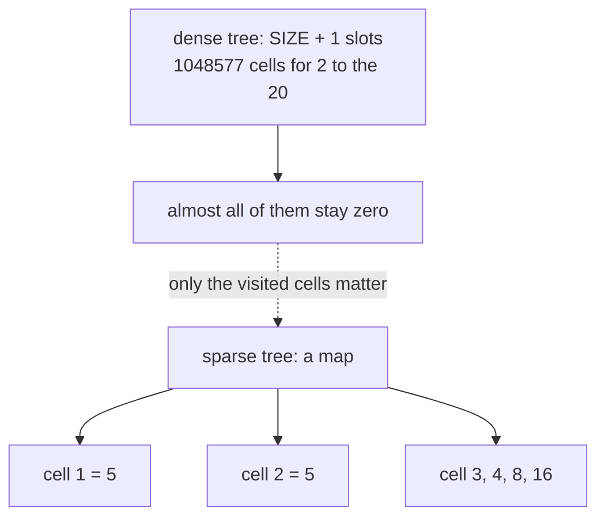
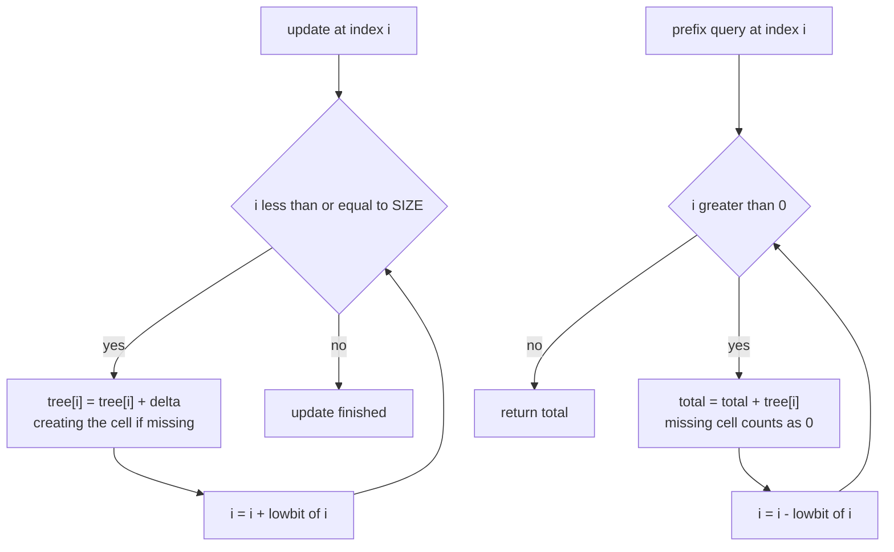
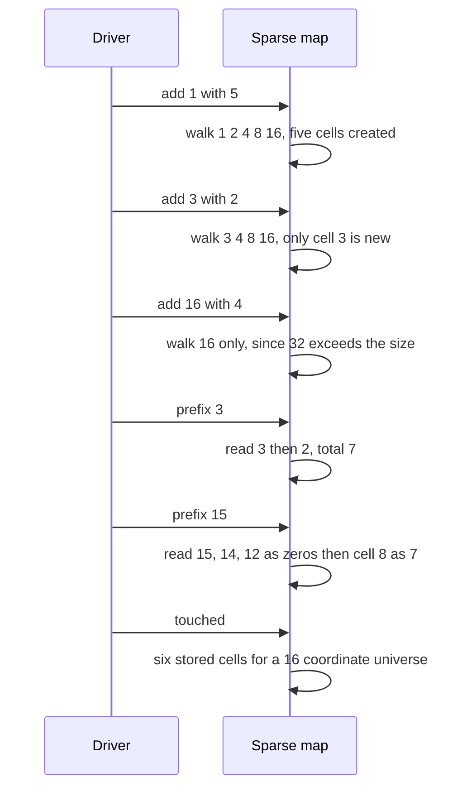

# 439 — Implement compressed Fenwick / sparse Fenwick idea.

> **Tier:** Advanced · **CTCI chapter:** Beyond — Advanced Data Structures & Algorithms
> **Task spec:** [439-implement-compressed-fenwick-sparse-fenwick-idea.md](../../../tasks/advanced/439-implement-compressed-fenwick-sparse-fenwick-idea.md)
> **Solutions:** [Python](../../../solutions/python/advanced/439-implement-compressed-fenwick-sparse-fenwick-idea/solution.py) ·
> [Java](../../../solutions/java/advanced/439-implement-compressed-fenwick-sparse-fenwick-idea/Solution.java) ·
> [JavaScript](../../../solutions/javascript/advanced/439-implement-compressed-fenwick-sparse-fenwick-idea/solution.js) ·
> [C#](../../../solutions/csharp/advanced/439-implement-compressed-fenwick-sparse-fenwick-idea/Solution.cs)

## 1. Problem restatement

A Fenwick tree (binary indexed tree) answers prefix sums over a coordinate space with `O(log n)`
update and query walks. The dense version allocates one cell per coordinate. When only a few
coordinates are ever touched, that array is mostly zeros, and the **sparse** version replaces it
with a map holding only the cells an update actually visits.

The documented setup is a large universe and a fixed API:

| Item | Value |
| --- | --- |
| `SIZE` | `2^20 = 1048576`, the coordinate space |
| coordinates | `1 .. SIZE`, 1-based |
| update walk | `i = index; while i <= SIZE: tree[i] += delta; i += i & -i` |
| query walk | `i = index; while i > 0: total += tree[i]; i -= i & -i` |
| missing cells | read as `0`; a sparse map returns its default |
| `touched()` | number of cells currently stored |

Both the sparse and the dense class expose `add(index, delta)` and `prefix(index)`. The dense tree
is the oracle, and the drivers add a third opinion by brute-forcing the recorded updates.

| Call | Result | Why |
| --- | --- | --- |
| `prefix(0)` | `0` | the query walk stops immediately |
| `add(1, 5)`, `add(3, 2)`, `add(16, 4)` on size 16 | `touched() == 6` | the three walks create exactly cells `1, 2, 3, 4, 8, 16` |
| `prefix(1)`, `prefix(2)` | `5`, `5` | only the coordinate 1 contributes |
| `prefix(3)`, `prefix(15)`, `prefix(16)` | `7`, `7`, `11` | sums of the updated coordinates at or below the query |
| every `prefix(i)` for `i` in `0..16` | equals the dense tree | the sparse walk must agree exactly |
| empty sparse tree of size `2^20` | `prefix(0) == prefix(SIZE) == 0`, `touched() == 0` | no allocation at all until an update |

The scripted part uses the shared LCG (`seed ← (seed · 75 + 74) mod 65537`, start `4390`): 800
steps, two draws to pick `coord = 1 + (seed · 1024 + (seed >> 4)) mod (SIZE - 1)` and one more for
`delta = seed mod 21 - 10` (so deltas range over `-10 .. 10`). Even steps update both trees, odd
steps compare `prefix(coord)` against the dense tree — exactly **400 updates and 400 queries**,
which the drivers assert. Five fixed coordinates (`1`, `12345`, `SIZE/2`, `SIZE - 1`, `SIZE`) are
then checked against both the dense tree and the brute-force sum, and the final assertions demand

```text
touched() >= 1
touched() <= 21 * updates      (at most log2(SIZE) = 20 visited cells per update, plus slack)
touched() <  SIZE / 100        (the compressed representation is far smaller than the dense one)
prefix(SIZE) == sum of all recorded deltas
```

## 2. Intuition

The Fenwick tree stores, in cell `i`, the sum of a range of exactly `lowbit(i)` coordinates ending
at `i`. Two walks make that work: updating coordinate `p` touches `p, p + lowbit(p), ...` up to
`SIZE`, and querying prefix `p` reads `p, p - lowbit(p), ...` down to 0. Both walks visit at most
`log2(SIZE) + 1 = 21` cells, no matter how large the universe is.



That is the whole idea: **the cell indices a walk visits are data-independent**. They depend only
on the coordinate and the lowbit arithmetic, never on the values, so a map can store exactly those
cells and treat the rest as zero. Nothing about the answer changes — a prefix query that reads a
missing cell adds 0 to the total, which is the same thing the dense array would have contributed.

The payoff is memory proportional to the number of distinct cells touched rather than to `SIZE`.
In the measured workload, 400 updates over a `2^20` universe create **2494** cells: a dense tree
would hold 1,048,577 slots for the same answers. The cost is that each cell access is a hash lookup
instead of an array index, and that the map itself has overhead per entry — which is why this is a
*compressed* representation, not a universally better one.



The two loops are mirror images: the update walk adds lowbits and climbs towards `SIZE`, the query
walk subtracts lowbits and descends to 0. Note that the update walk starts at the coordinate and
the query walk also starts at the coordinate — a Fenwick cell belongs to both walks, which is
precisely why the same map serves both.

## 3. Algorithm

1. Construct with the universe size; the map starts empty, so an untouched tree costs nothing.
2. `add(index, delta)`: set `i = index`; while `i <= size`, add `delta` to `tree[i]` (creating the
   cell when it is absent) and advance `i += i & -i`.
3. `prefix(index)`: set `total = 0` and `i = index`; while `i > 0`, add `tree` at `i` (or 0 when
   absent) to `total` and move to `i -= i & -i`.
4. `touched()` returns the number of stored cells — the measurement that proves the representation
   is compressed.
5. The dense reference class performs the same two walks over a full array of `size + 1` slots,
   which is what makes it a usable oracle.

```text
procedure add(index, delta)
    i ← index
    while i <= size do
        tree[i] ← value stored at i plus delta, or delta when absent
        i ← i + (i AND minus i)
    end
end

procedure prefix(index)
    total ← 0
    i ← index
    while i > 0 do
        total ← total + value stored at i, or 0 when absent
        i ← i - (i AND minus i)
    end
    return total
end
```

`i AND (-i)` is the *lowbit*: for `i = 12 = 1100₂` it is `4`, for `i = 16` it is `16`. The update
walk therefore visits cells whose ranges cover the coordinate, and the query walk collects a
disjoint set of ranges covering `1..index`. Both properties are inherited unchanged from the dense
tree; only the storage differs.

## 4. Worked example

The hand-asserted size-16 case, traced cell by cell. Cells are shown as `index: value`; a cell that
is not in the map is zero.

| Step | Operation | Cells written | Map after | `touched()` |
| --- | --- | --- | --- | --- |
| start | — | — | empty | 0 |
| 1 | `add(1, 5)` | `1, 2, 4, 8, 16` | `1:5, 2:5, 4:5, 8:5, 16:5` | 5 |
| 2 | `add(3, 2)` | `3, 4, 8, 16` | adds `3:2`, bumps `4:7, 8:7, 16:7` | 6 |
| 3 | `add(16, 4)` | `16` | `16:11`, everything else unchanged | 6 |

The walk in step 1 explains the shape: `1 → 2 → 4 → 8 → 16` doubles because the lowbit of a power
of two is the number itself. Step 2 starts at `3`, adds 1 to reach `4`, and then follows the same
doubling chain — it creates only one new cell, `3`, and reuses `4, 8, 16`. Step 3 starts at `16`,
whose lowbit is 16, so the next index `32` is already past the size and the walk stops after a
single cell.

Queries then read a subset of those cells:

| Query | Cells read | Total |
| --- | --- | --- |
| `prefix(0)` | none | 0 |
| `prefix(1)` | `1:5` | 5 |
| `prefix(2)` | `2:5` | 5 |
| `prefix(3)` | `3:2`, `2:5` | 7 |
| `prefix(15)` | `15:0`, `14:0`, `12:0`, `8:7` | 7 |
| `prefix(16)` | `16:11` | 11 |



The large-universe workload gives the same picture with numbers that matter:

| Quantity | Measured value |
| --- | --- |
| updates / queries | 400 / 400 over `SIZE = 1048576` |
| distinct updated coordinates | 400 (all distinct in this script) |
| coordinate range actually hit | 6145 to 1044381 |
| cells stored, `touched()` | 2494 |
| documented bound `21 * updates` | 8400 |
| dense array slots for the same answers | 1048577 |

`touched()` is roughly 6.2 cells per update — the walks overlap heavily, so many visited cells are
written by several updates and counted once. That is a 400× smaller footprint than the dense tree,
and it is what the `touched() <= 21 * updates` and `touched() < SIZE / 100` assertions document.

## 5. Complexity

Let `u` be the number of updates performed and `U = SIZE` the universe size.

| Measure | Bound | Why it holds |
| --- | --- | --- |
| `add` | `O(log U)` — at most 21 cells | the walk adds a strictly increasing lowbit each step, so it reaches `U` in `log2(U)` steps |
| `prefix` | `O(log U)` — at most 21 cells | each step clears the lowest set bit of `i` |
| `touched()` | `O(1)` | it is the size of the map (a stored counter in Java and C#) |
| Space | `O(min(U, u · log U))` | at most `log U` cells per update, and never more than the dense array |
| Space of the dense tree | `O(U)` | 1,048,577 slots for `SIZE = 2^20`, whatever the workload |
| Constant factor | map lookup per cell | an array index is cheaper; the map wins only when `u · log U << U` |
| Brute-force oracle | `O(u)` per query | scan every recorded update — used only in tests |

The measured workload sits squarely in the regime the idea targets: 2494 cells against 1,048,577
slots. If the workload had touched a large fraction of the universe, the map would lose to the
array on both memory and speed, which is the honest limit of the "sparse" trick.

## 6. Pitfalls and edge cases

- **1-based coordinates.** The walk relies on `i > 0` as its stopping condition for queries and on
  `i & -i` for updates. An update at coordinate `0` would loop forever (`0 & -0` is `0`), so
  coordinates must start at 1 — the drivers only ever generate `1 .. SIZE - 1`.
- **`prefix(0)` is the identity.** It must return 0 without reading any cell; both implementations
  do, because the loop body never runs.
- **Missing cells are zero, not an error.** Reading `tree` with a default is the entire point; an
  implementation that raises on a missing index (or that returns `nil`) breaks `prefix` at the
  first untouched cell — which is exactly the `prefix(15)` case above, where three of the four
  visited cells are absent.
- **No bounds validation.** Neither the sparse nor the dense class checks `index <= size`; a query
  beyond the universe would walk cells that can never be written and silently return a partial sum.
  The drivers stay inside `1 .. SIZE`.
- **A non-power-of-two `SIZE` still works.** Correctness only needs the lowbit walks; the `log`
  bound is cleanest for powers of two, which is why the task fixes `2^20`. The hand case uses
  size 16, also a power of two.
- **Repeated coordinates share cells.** `touched()` counts *distinct* cells, so a workload that
  updates the same coordinate repeatedly adds nothing to the footprint. The measured 2494 cells
  for 400 updates is the overlapping-walk effect, not one cell per update.
- **Negative deltas.** The script uses deltas from `-10` to `10`, so cells can go below zero and
  prefix sums can be negative. Nothing in the structure assumes monotonicity — it is a difference
  array, not a counter.
- **`touched()` is a diagnostic, not an invariant.** The assertion is an upper bound
  (`<= 21 * updates`), not an equality: an implementation that stores a few extra cells is still
  correct, just less compressed.
- **The third opinion matters.** Comparing the sparse tree only against the dense one would not
  catch a bug shared by both; the five fixed coordinates are additionally checked against the
  brute-force scan of the recorded updates, which is independent of the Fenwick arithmetic.

## 7. Variants and follow-ups

- **The dense original.** [180-implement-binary-indexed-tree-fenwick-basic-point-update-prefix.md](../../../tasks/beginner/180-implement-binary-indexed-tree-fenwick-basic-point-update-prefix.md)
  builds exactly the array this task replaces with a map, and
  [181-range-update-point-query-with-fenwick-tree.md](../../../tasks/beginner/181-range-update-point-query-with-fenwick-tree.md)
  shows the inverted interpretation of the same cells.
- **Two dimensions of sparsity.** [443-implement-2d-fenwick-tree-for-rectangle-sum-update.md](../../../tasks/advanced/443-implement-2d-fenwick-tree-for-rectangle-sum-update.md)
  stores a Fenwick tree per row; combining it with a map per row gives the sparse 2D version.
- **Sparse coordinate lists.** [177-implement-basic-sparse-matrix-storage-coordinate-list.md](../../../tasks/beginner/177-implement-basic-sparse-matrix-storage-coordinate-list.md)
  is the same trade-off for matrices — store only the non-zeros, pay a lookup per access.
- **Where compressed indexes show up on purpose.** [604-implement-compressed-suffix-array-csa-advanced.md](../../../tasks/expert/604-implement-compressed-suffix-array-csa-advanced.md)
  and [609-implement-advanced-compressed-bitvectors-rrr-and-rank-select.md](../../../tasks/expert/609-implement-advanced-compressed-bitvectors-rrr-and-rank-select.md)
  compress large index structures deliberately rather than opportunistically.

## 8. Check yourself

1. Why can a missing cell be treated as 0 without changing any answer?

<details><summary>Show answer</summary>

Because a Fenwick cell `i` only ever holds a value when some update walked through `i`. The set of
cells an update touches is determined by the coordinate and the lowbit chain, not by the data, so
a cell that is absent has never received a delta and its true value *is* zero. Reading the default
is therefore reading the dense array's content, not approximating it.

</details>

2. `prefix(15)` returns 7 on the example tree while visiting four cells, three of which were never
   written. Which cells are read, and why is that not a bug?

<details><summary>Show answer</summary>

The walk is `15 → 14 → 12 → 8`. The first three are absent and contribute 0; cell 8 holds 7,
which covers coordinates 1 through 8. Together the walk covers `1..15` — the query is correct
precisely because the absent cells contribute nothing.

</details>

3. In the measured workload `touched() == 2494` for 400 updates, but `21 * updates = 8400`. Why is
   the actual count so much lower, and what would make it higher?

<details><summary>Show answer</summary>

Because many visited cells are revisited by later updates, and the map counts distinct cells, not
visits. Cells high up the tree (large lowbits, like indices near `SIZE`) are covered by nearly
every coordinate, so they are shared. The count would approach the bound only if the updates
touched coordinates whose walk-up paths barely intersected — for instance coordinates spread so
that each update brings in about 20 previously unseen cells.

</details>

4. When is the sparse version the *wrong* choice?

<details><summary>Show answer</summary>

When the workload touches a large fraction of the universe: `u · log U` then approaches or exceeds
`U`, so the map uses at least as much memory as the array while making every access a hash lookup
instead of an index. The dense tree's `O(U)` memory is a fixed cost that amortises perfectly once
most coordinates are live; the sparse tree only wins while `u` stays small relative to `U`.

</details>
