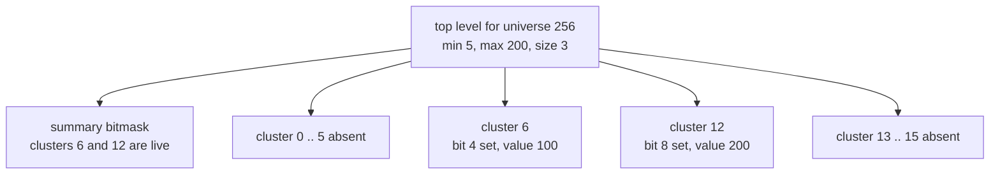
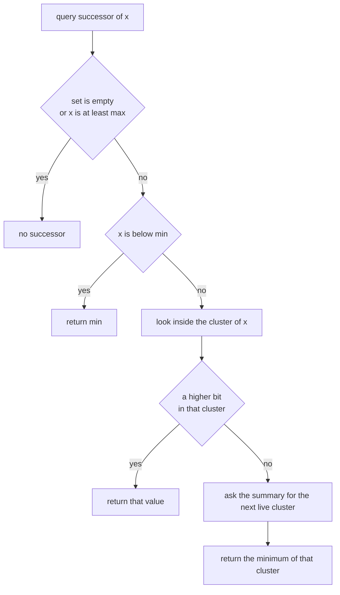
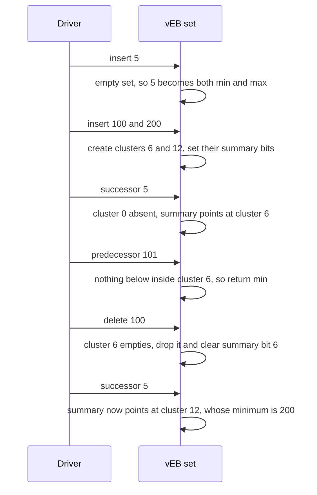

# 440 — Implement integer set with van Emde Boas (conceptual small universe).

> **Tier:** Advanced · **CTCI chapter:** Beyond — Advanced Data Structures & Algorithms
> **Task spec:** [440-implement-integer-set-with-van-emde-boas-conceptual-small-univer.md](../../../tasks/advanced/440-implement-integer-set-with-van-emde-boas-conceptual-small-univer.md)
> **Solutions:** [Python](../../../solutions/python/advanced/440-implement-integer-set-with-van-emde-boas-conceptual-small-univer/solution.py) ·
> [Java](../../../solutions/java/advanced/440-implement-integer-set-with-van-emde-boas-conceptual-small-univer/Solution.java) ·
> [JavaScript](../../../solutions/javascript/advanced/440-implement-integer-set-with-van-emde-boas-conceptual-small-univer/solution.js) ·
> [C#](../../../solutions/csharp/advanced/440-implement-integer-set-with-van-emde-boas-conceptual-small-univer/Solution.cs)

## 1. Problem restatement

The task is a **van Emde Boas set** on the small universe `U = 256 = 16 × 16`, with one documented
simplification: the recursion stops at the second level. The top level holds `min`, `max`, a
16-entry **summary** of cluster occupancy, and 16 lazily created **clusters**; below that, the base
case is a `BitSet16` — a single 16-bit member mask whose bit scans replace the recursive structure.
The header is explicit that the decisive vEB trick is kept: **the minimum is stored outside the
clusters**, so deleting it promotes its stored successor.

| Operation | Contract |
| --- | --- |
| `member(value)` | true when the value is in the set |
| `insert(value)` | adds it; inserting a present value is a no-op |
| `delete(value)` | removes it, returning whether it was present |
| `successor(value)` | smallest stored value strictly greater than `value`, or none |
| `predecessor(value)` | largest stored value strictly less than `value`, or none |
| `size()` | element count |

| Call | Result | Why |
| --- | --- | --- |
| empty set: `member(0)`, `successor(0)`, `predecessor(255)`, `delete(0)` | `false`, `None`, `None`, `false` | an empty structure must not raise |
| `insert(200)` then `successor(5)` / `predecessor(255)` | `200` / `200` | the single stored value is reachable from either end |
| `insert(5)`, `insert(100)`, `insert(200)` then `successor(5)`, `predecessor(101)` | `100`, `100` | queries across cluster boundaries |
| `delete(100)` then `successor(5)` | `200` | cluster 6 empties and leaves the summary |
| `insert(0, 15, 16, 17, 255)` then `successor(15)` | `16` | the boundary between clusters 0 and 1 |
| delete every value in the `0, 15, 16, 17, 255` set | `min` walks `15 → 17 → 255`, `max` becomes `255` | `delete(min)` promotes the successor from the clusters |

The scripted part uses the shared LCG (`seed ← (seed · 75 + 74) mod 65537`, start `4400`): 600
steps with `op = seed mod 5` — `0` and `1` insert `seed mod 256`, `2` deletes and must return
whether the value was present, `3` checks `member`, and `4` checks `successor` **and**
`predecessor` against a linear scan of the sorted oracle. Every 50 steps the driver sweeps all 256
possible values and compares `member` for each, and after the loop it repeats the sweep for
`member`, `successor` and `predecessor`.

## 2. Intuition

A balanced BST answers predecessor and successor in `O(log n)` comparisons. The van Emde Boas
structure answers them in `O(log log U)` because its branching is not binary but `√U`: split the
universe into `√U` clusters of size `√U`, keep a summary set that says which clusters are
non-empty, and recurse. For `U = 256` that recursion has exactly one step — a summary of 16 bits
over 16 clusters of 16 bits — which is why the task documents it as the conceptual version.



Two design decisions carry the whole structure. First, **clusters are created lazily**: an insert
into cluster 6 allocates it and sets the summary bit in one step, so an empty set costs nothing
but `min`, `max` and one 16-bit mask. Second, **`min` lives outside the clusters**: the set stores
its smallest element only in the top-level `min` field and never duplicates it inside cluster 0.
That is what makes `successor` and `predecessor` fast — a query below `min` or above `max` is
answered directly, without touching a cluster — and it is why deleting the minimum is a promotion
rather than a plain removal.



The `member` check has a matching shape: `value == min or value == max` is answered from the top
level, and everything else is one bit test in `clusters[value >> 4]`. That single bit test is the
`s = member` operation of the textbook vEB, collapsed into a shift and a mask.

## 3. Algorithm

1. A `BitSet16` wraps a 16-bit mask with `insert`, `remove`, `member`, `empty`, `minimum`,
   `maximum`, `successor` and `predecessor`, all implemented by bit scans (`lowest_bit`,
   `highest_bit`).
2. The set starts with `min = max = None`, `count = 0`, an empty summary mask and 16 empty cluster
   slots.
3. `member(value)`: true if `value == min` or `value == max`; otherwise look up
   `clusters[value >> 4]` and test bit `value & 15` (false when the cluster does not exist).
4. `insert(value)`: no-op when already a member. Into an empty set, store it as both `min` and
   `max` and set `count = 1`. Otherwise, if the new value is below `min`, swap them (the old `min`
   now has to be inserted normally), and if it is above `max`, update `max`. Then create the
   cluster if necessary (setting the summary bit) and set the member bit. `count += 1`.
5. `delete(value)`: return `false` when not a member. If it was the only element, clear `min`,
   `max`, the summary and all clusters, and set `count = 0`. If it is the `min`, compute its
   *stored* successor — the value is in a cluster only if it was inserted there — promote that
   successor to `min`, and delete it from its cluster; the value itself needs no bit clearing.
   Otherwise delete the ordinary way.
6. `_delete_stored(value)`: clear the member bit; if the cluster becomes empty, clear the summary
   bit and drop the cluster. `count -= 1`, and if the removed value was the `max`, recompute `max`
   as `min` when no cluster remains, otherwise the maximum of the highest live cluster.
7. `successor(value)`: none when empty or `value >= max`; `min` when `value < min`; otherwise try
   inside the cluster and, failing that, take the next live cluster from the summary and return its
   minimum.
8. `predecessor(value)`: none when empty or `value <= min`; `max` when `value > max`; otherwise try
   inside the cluster and, failing that, take the previous live cluster from the summary and
   return its maximum — or `min` when no previous cluster exists.

```text
procedure insert(value)
    if member(value) then
        return
    end
    if min is nothing then
        min ← value
        max ← value
        count ← 1
        return
    end
    if value < min then
        swap value and min
    end
    if value > max then
        max ← value
    end
    high ← value divided by 16
    low ← value modulo 16
    if cluster at high is absent then
        create an empty cluster at high
        insert high into the summary
    end
    insert low into the cluster at high
    count ← count + 1
end

procedure delete(value)
    if not member(value) then
        return false
    end
    if count = 1 then
        clear min, max, the summary and every cluster
        count ← 0
        return true
    end
    if value = min then
        successor ← the stored successor of value from the clusters
        min ← successor
        delete_stored(successor)
        return true
    end
    delete_stored(value)
    return true
end
```

```text
procedure successor(value)
    if min is nothing or value >= max then
        return nothing
    end
    if value < min then
        return min
    end
    high ← value divided by 16
    low ← value modulo 16
    cluster ← cluster at high
    if cluster exists and low < 15 then
        within ← successor of low inside cluster
        if within is not nothing then
            return high * 16 + within
        end
    end
    next_high ← successor of high in the summary
    if next_high is nothing then
        return nothing
    end
    return next_high * 16 + minimum of the cluster at next_high
end
```

## 4. Worked example

Trace the asserted `5, 100, 200` sequence. Values are written as `value = cluster * 16 + bit`.

| Step | Operation | Top level | Clusters | Notes |
| --- | --- | --- | --- | --- |
| 1 | `insert(5)` | `min = max = 5`, `count = 1` | none | the only element lives in `min`/`max` |
| 2 | `insert(100)` | `min = 5`, `max = 100` | cluster 6, bit 4 | 100 is not below `min`, so it goes to a cluster |
| 3 | `insert(200)` | `min = 5`, `max = 200` | clusters 6 and 12 | summary mask has bits 6 and 12 set |
| 4 | `successor(5)` | — | cluster 0 absent, next live 6 | returns `6 * 16 + 4 = 100` |
| 5 | `predecessor(101)` | — | within cluster 6, no lower bit | falls back to the summary, which finds nothing below 6, so `min = 5` |
| 6 | `delete(100)` | `min = 5`, `max = 200`, `count = 2` | cluster 6 removed, cluster 12 only | cluster 6 emptied, so the summary bit is cleared |
| 7 | `successor(5)` | — | cluster 12 | returns `12 * 16 + 8 = 200` |
| 8 | `predecessor(200)` | — | no previous cluster | returns `min = 5` |

Steps 4 and 7 are the summary doing its job: `successor` inside cluster 0 finds nothing, so the
answer comes from the next live cluster in the summary mask. Step 5 is the same logic mirrored:
the value 101 has no lower neighbour inside cluster 6 and no previous live cluster at all, so the
answer falls back to the top-level `min`.



The boundary sequence shows the `min` promotion. Inserting `0, 15, 16, 17, 255` puts `0` in `min`
and leaves clusters 0 (bits 15), 1 (bits 0 and 1) and 15 (bit 15) live:

| Step | Operation | `min` | `max` | Effect |
| --- | --- | --- | --- | --- |
| 1..5 | insert `0, 15, 16, 17, 255` | `0` | `255` | clusters 0, 1, 15; bits 15 / 0,1 / 15 |
| 6 | `successor(15)` | `0` | `255` | cluster 0 has no bit above 15, so the summary finds cluster 1 with minimum `16` |
| 7 | `delete(0)` | `15` | `255` | `0` was only in `min`, so it is promoted from cluster 0 bit 15 |
| 8 | `delete(15)` then `delete(17)` | `17`, then `255` | `255` | each deletion promotes the stored successor; the last value stays in `min` |

Steps 8 and 9 are the vEB signature: deleting the minimum costs one lookup of the stored successor
plus one ordinary deletion, and the minimum itself is never a bit that has to be cleared.

The scripted workload exercises everything at scale: 600 operations amount to **256 inserts, 112
deletes, 109 member probes and 123 successor/predecessor probes**, with 12 full 256-value sweeps.
It ends with `size() == 134`, `min == 1`, `max == 255`, and **all 16 clusters live** (the summary
mask holds 16 set bits) — a dense occupancy that still answers with the same two-level walk.

## 5. Complexity

Let `U = 256` be the universe, `√U = 16` the cluster count and `n` the element count.

| Measure | Bound | Why it holds |
| --- | --- | --- |
| `member` | `O(1)` | one `min`/`max` comparison and one bit test |
| `insert` | `O(1)` amortised | one cluster allocation, one bit set, one summary bit |
| `delete` | `O(1)` amortised | one bit clear plus the `min`/`max` repair, which reads at most one summary scan |
| `successor`, `predecessor` | `O(1)` bit work at this scale | one in-cluster scan plus one summary scan, each over 16 bits |
| `minimum`, `maximum` | `O(1)` | they are `min` and `max` fields |
| Space | `O(√U)` masks plus one per live cluster | 16 cluster slots, allocated only when used |
| General vEB | `O(log log U)` per operation | the same two-step walk recursed `log log U` levels |
| Balanced BST alternative | `O(log n)` per operation | comparison-based, so no bit tricks, but it needs no fixed universe |

The header's claim is that the operations "match a full recursive vEB (`O(1)` bit work at this
two-level scale)" — with `U = 256` the recursion has collapsed entirely, so there is nothing left
to recurse into. The cost that survives is the `O(√U)` shape of the summary and cluster arrays.

## 6. Pitfalls and edge cases

- **Empty set.** `member` is false, `successor` and `predecessor` return `None`/`null`, `size()` is
  0 and `delete` returns `false`. None of them raises, and the hand assertions check all four.
- **The minimum is not inside a cluster.** `insert(5)` into an empty set stores 5 in `min` and
  `max` and creates *no* cluster. Any implementation that also sets a bit for the minimum ends up
  counting it twice, and `successor(min)` would then return `min` instead of the next value.
- **`delete(min)` promotes.** The value is only guaranteed to exist in a cluster if it was
  inserted there, so the delete path computes the stored successor, writes it into `min`, and
  removes *that* value from its cluster. The hand sequence's `min` walk `15 → 17 → 255` is exactly
  this mechanism, asserted field by field.
- **`max` is repaired on deletion.** When the deleted value was the `max`, the new `max` is the
  maximum of the highest live cluster, or `min` when the summary is empty. Skipping that repair
  makes the `value >= max` early exit of `successor` return the wrong answer.
- **Lazy clusters must be dropped.** When a cluster's mask reaches zero the implementation clears
  the summary bit *and* sets the slot back to absent. Leaving a zeroed cluster in place still
  answers correctly, but it breaks the "live cluster" reading of the summary and wastes slots.
- **Boundary bits and the universe top.** `low < 15` and `low > 0` guard the in-cluster scans: value
  15 has no higher bit inside cluster 0, and value 0 has no lower bit inside cluster 1. Likewise
  `successor(255)` returns `None` through the `value >= max` check, which the sweep over all 256
  values relies on.
- **Inserting an existing value.** `insert` returns immediately when `member` is true, so a
  duplicate insert neither changes `size()` nor shuffles `min`/`max`. The workload inserts 256
  times but only ever reaches 134 live elements, so duplicates are the common case.
- **Deleting an absent value, and the oracle.** `delete` returns `false` and changes nothing —
  including in the single-element case, which is why the `count == 1` reset branch is reached only
  after the membership check has passed. `successor` and `predecessor` are checked against a linear
  scan of the sorted list rather than a reference implementation, so a shared bug would still be
  caught.

## 7. Variants and follow-ups

- **Sets as bitmasks.** [374-implement-bitset-operations-for-small-universe-set-fast-ops.md](../../../tasks/intermediate/374-implement-bitset-operations-for-small-universe-set-fast-ops.md)
  is the flat version of the same idea — one mask for the whole universe — and
  [652-implement-bitmap-index-and-fast-and-or-operations.md](../../../tasks/expert/652-implement-bitmap-index-and-fast-and-or-operations.md)
  scales bitmaps up to index-sized universes.
- **Bitmask iteration and large bitmaps.** [298-bitmask-iterate-subsets-of-mask.md](../../../tasks/intermediate/298-bitmask-iterate-subsets-of-mask.md)
  is the other place 16-bit scans show up (enumeration rather than sets), while
  [652-implement-bitmap-index-and-fast-and-or-operations.md](../../../tasks/expert/652-implement-bitmap-index-and-fast-and-or-operations.md)
  scales the same idea to index-sized universes.
- **Predecessor/successor without a fixed universe.** [249-implement-treap-bst-heap-insert-delete.md](../../../tasks/intermediate/249-implement-treap-bst-heap-insert-delete.md)
  and [433-implement-order-statistics-tree-using-balanced-bst-rank-select.md](../../../tasks/advanced/433-implement-order-statistics-tree-using-balanced-bst-rank-select.md)
  answer neighbouring-key queries for arbitrary keys in `O(log n)`, the trade the small-universe
  version refuses to make.
- **Universe-sized bitset over a large domain.** [439-implement-compressed-fenwick-sparse-fenwick-idea.md](../../../tasks/advanced/439-implement-compressed-fenwick-sparse-fenwick-idea.md)
  shows what to do when the universe is huge and the live set is tiny: compress the storage instead
  of storing one bit per possible value.
- The chapter walkthrough in [Bit Manipulation](../../ctci/05-bit-manipulation.md) covers the mask
  arithmetic (`>>`, `&`, lowest-bit and highest-bit scans) this structure is built from.

## 8. Check yourself

1. Why is the minimum stored outside the clusters, and what would break otherwise?

<details><summary>Show answer</summary>

Because `successor(x)` and `predecessor(x)` for `x` outside the live range must be answerable
without touching a cluster: below `min` the successor is simply `min`, above `max` the predecessor
is simply `max`. Storing the minimum inside cluster 0 as well would make `successor(min)` find the
minimum itself, and would force every query near the bottom of the universe to scan a cluster.

</details>

2. After `insert(5)`, `insert(100)`, `insert(200)`, how many clusters exist and which bits does the
   summary hold?

<details><summary>Show answer</summary>

Two clusters, numbered 6 and 12 (value 100 is `6 * 16 + 4`, value 200 is `12 * 16 + 8`). The
summary mask has bits 6 and 12 set. Value 5 created no cluster at all — it is the `min`/`max`
element — which is why the assertion `veb.size() == 3` passes with only two clusters.

</details>

3. `delete(min)` is not implemented as an ordinary removal. Walk through the `15 → 17 → 255` `min`
   chain from the hand sequence.

<details><summary>Show answer</summary>

After the boundary inserts, `min = 0` lives only in the top-level field, with cluster 0 bit 15
holding 15. Deleting 0 computes its stored successor — 15 — sets `min = 15`, and then deletes 15
from cluster 0 as an ordinary element. That deletion promotes `min` to 17 (cluster 1 bit 0), and
deleting 17 promotes `min` to the maximum of cluster 15, which is 255. Each step is asserted
exactly (`veb.min == 15`, then `17`, then `255 == veb.max`), and the values themselves are never
cleared from any bit mask on the promotion path.

</details>
