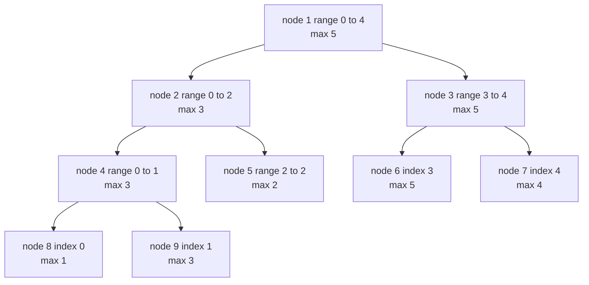
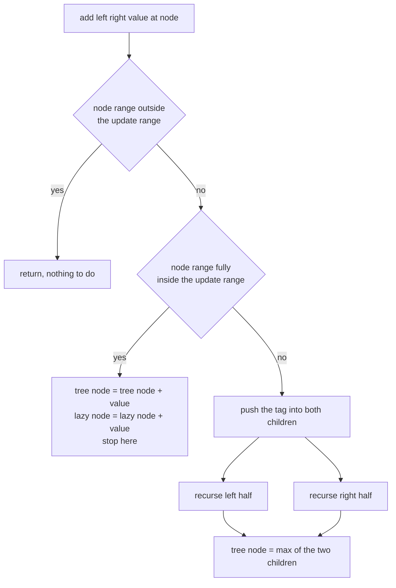
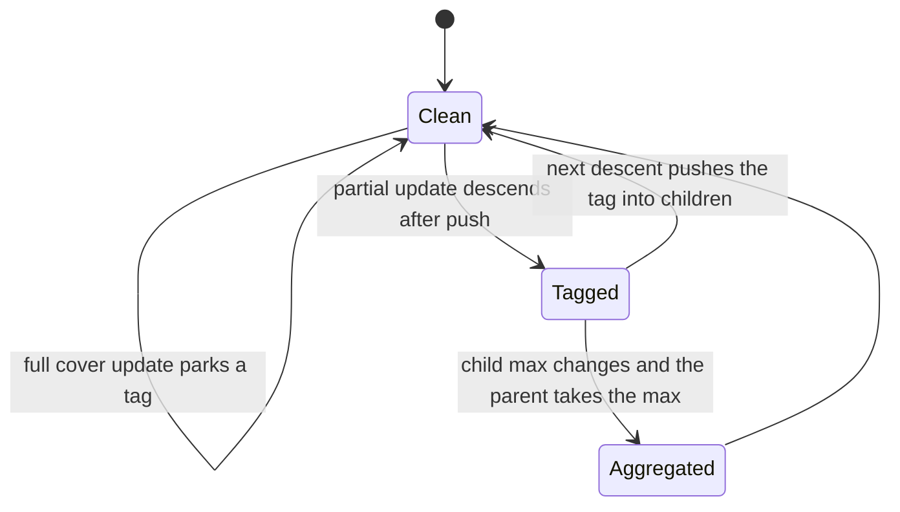
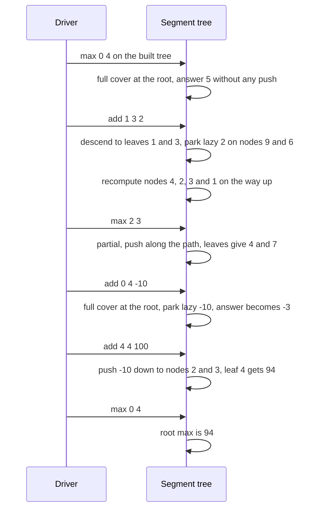

# 441 — Implement range add range max with lazy propagation segment tree.

> **Tier:** Advanced · **CTCI chapter:** Ch 4 — Trees and Graphs
> **Task spec:** [441-implement-range-add-range-max-with-lazy-propagation-segment-tree.md](../../../tasks/advanced/441-implement-range-add-range-max-with-lazy-propagation-segment-tree.md)
> **Solutions:** [Python](../../../solutions/python/advanced/441-implement-range-add-range-max-with-lazy-propagation-segment-tree/solution.py) ·
> [Java](../../../solutions/java/advanced/441-implement-range-add-range-max-with-lazy-propagation-segment-tree/Solution.java) ·
> [JavaScript](../../../solutions/javascript/advanced/441-implement-range-add-range-max-with-lazy-propagation-segment-tree/solution.js) ·
> [C#](../../../solutions/csharp/advanced/441-implement-range-add-range-max-with-lazy-propagation-segment-tree/Solution.cs)

## 1. Problem restatement

The task is a segment tree over an array that supports two range operations in `O(log n)`:

| Operation | Meaning |
| --- | --- |
| `add(left, right, value)` | add `value` to every element in the inclusive index range `[left, right]` |
| `max(left, right)` | the maximum over the inclusive range `[left, right]` |

The implementation is the classic recursive form: a `tree` array of `4 · n` maxima, a `lazy` array
of the same size holding pending adds, and a `_push` that hands a parked delta to both children
only when the recursion actually needs to descend. `RangeAddRangeMax(values)` builds the tree from
the initial array; an empty array is tolerated by the allocation (`4 · max(1, n)`) but no queries
are defined on it.

| Call on `[1, 3, 2, 5, 4]` | Result | Why |
| --- | --- | --- |
| `max(0, 4)` | `5` | the whole array |
| `max(3, 3)` | `5` | a single position reads the element itself |
| `add(1, 3, 2)` then `max(0, 4)` | `7` | positions 1, 2, 3 became 5, 4, 7 |
| `max(1, 1)` after that add | `5` | the tagged leaf remembers `3 + 2` |
| `max(2, 3)` after that add | `7` | the max over the two updated positions |
| `add(0, 4, -10)` then `max(0, 4)` | `-3` | `7 + (-10)` on the whole range |
| `add(4, 4, 100)` then `max(0, 4)` | `94` | only position 4 moves |

The scripted part builds a 16-element tree from the LCG (`seed 1234`, `seed mod 50 - 25`, so values
range over `-25 .. 24`) and then applies 200 LCG-generated operations (`seed 777`): each operation
draws `lo = seed mod n`, `hi = lo + seed mod (n - lo)` (so the range is non-empty and inside
bounds), `kind = seed mod 2`, and `value = seed mod 21 - 10`. `kind == 0` performs a range add on a
brute-force array as well; `kind == 1` asserts `max(lo, hi)` against `max(brute[lo:hi + 1])`. That
brute-force mirror is the only correctness oracle — the tree is checked against the same operations
applied element by element.

## 2. Intuition

A segment tree stores, in each node, the answer for one index range; the root covers everything and
each node's answer is the max of its two children. A range query decomposes into `O(log n)` nodes
that are fully covered, so it never visits every element.

Range updates are the problem: touching every leaf of a range would be `O(n)`. **Lazy
propagation** fixes that by noticing that adding a constant to a whole node's range is a one-line
operation on the node's cached max — the max shifts by exactly the same constant. So the update
parks the delta in a `lazy` tag and stops; the subtree below keeps its old values until somebody
actually needs them.



The tag is only a promise. `_push(node)` adds the parked delta to both children's maxima and to
both children's tags, then clears the parent's tag. It is called on exactly the two occasions where
the recursion must look below a node:

1. **during a partial update**, before descending into children so they see the pending value;
2. **during a partial query**, for the same reason — a node whose max already includes the parked
   delta cannot answer for a *sub-range* without passing it down.

A full-cover update and a full-cover query both stop at the node and never push, which is what
keeps a whole-array add at `O(1)` on the first level and the total cost at `O(log n)`.



`_push` deliberately does nothing when the tag is zero, so the common case of an untagged descent
costs one comparison. Note also that the tag is *accumulated* (`lazy[child] += delta`), because a
child may already be waiting for its own pending adds.

## 3. Algorithm

1. Allocate `tree` and `lazy` of size `4 · max(1, n)`; build recursively when the array is not
   empty.
2. `_build(node, lo, hi, values)`: a leaf stores `values[lo]`; an internal node stores the maximum
   of its two children.
3. `_push(node)`: if `lazy[node]` is non-zero, add it to `tree` and `lazy` of both children and
   reset `lazy[node]` to 0.
4. `_add(node, lo, hi, left, right, value)`: return immediately when the node's range is disjoint
   from `[left, right]`; when the node's range is fully inside, add `value` to `tree[node]` and
   `lazy[node]` and stop; otherwise push, recurse into both halves, and recompute
   `tree[node]` as the max of the children.
5. `_max(node, lo, hi, left, right)`: return `tree[node]` when the node's range is fully inside;
   otherwise push, and fold the answers of the children whose ranges intersect the query. The
   implementation only descends into a child when `left <= mid` or `right > mid`, and starts the
   fold from negative infinity.
6. `add` and `max` are thin wrappers that start the recursion at node 1 covering `[0, n - 1]`.

```text
procedure add(node, lo, hi, left, right, value)
    if right < lo or hi < left then
        return
    end
    if left <= lo and hi <= right then
        tree[node] ← tree[node] + value
        lazy[node] ← lazy[node] + value
        return
    end
    push(node)
    mid ← floor of (lo + hi) / 2
    add(2 * node, lo, mid, left, right, value)
    add(2 * node + 1, mid + 1, hi, left, right, value)
    tree[node] ← maximum of tree[2 * node] and tree[2 * node + 1]
end

procedure push(node)
    delta ← lazy[node]
    if delta is not zero then
        for child in 2 * node and 2 * node + 1 do
            tree[child] ← tree[child] + delta
            lazy[child] ← lazy[child] + delta
        end
        lazy[node] ← 0
    end
end
```

```text
procedure query_max(node, lo, hi, left, right)
    if left <= lo and hi <= right then
        return tree[node]
    end
    push(node)
    mid ← floor of (lo + hi) / 2
    best ← negative infinity
    if left <= mid then
        best ← maximum of best and query_max(2 * node, lo, mid, left, right)
    end
    if right > mid then
        best ← maximum of best and query_max(2 * node + 1, mid + 1, hi, left, right)
    end
    return best
end
```

The disjoint-case early return of `add` is what allows the update to recurse into both children
unconditionally: a child that does not intersect the range answers instantly with the empty update.
The query instead *chooses* its children up front, which is why it needs the `left <= mid` and
`right > mid` guards — and why the fold must start from negative infinity rather than from the
node's own value.



## 4. Worked example

Build the tree for `[1, 3, 2, 5, 4]`, then run `add(1, 3, 2)`. Node ranges are inclusive.

| Node | Range | Built max | After `add(1, 3, 2)` | `lazy` |
| --- | --- | --- | --- | --- |
| 1 | 0..4 | 5 | **7** | 0 |
| 2 | 0..2 | 3 | **5** | 0 |
| 3 | 3..4 | 5 | **7** | 0 |
| 4 | 0..1 | 3 | **5** | 0 |
| 5 | 2..2 | 2 | **4** | 2 |
| 6 | 3..3 | 5 | **7** | 2 |
| 7 | 4..4 | 4 | 4 | 0 |
| 8 | 0..0 | 1 | 1 | 0 |
| 9 | 1..1 | 3 | **5** | 2 |

The descent is: `add(1, 3, 2)` at node 1 is partial, so nothing is parked there; the left half
`[0, 2]` is still partial, so it recurses into node 4 `[0, 1]`, where the left child `[0, 0]` is
disjoint (index 0 is outside `[1, 3]`) and the right child node 9 `[1, 1]` is fully covered — the
delta is parked there as `tree 5, lazy 2`. The right half of node 1 lands on node 3 `[3, 4]`, which
is partial: node 6 `[3, 3]` is fully covered (`tree 7, lazy 2`) and node 7 `[4, 4]` is disjoint.
Only the nodes read on the way back up change: node 4 becomes `max(1, 5) = 5`, node 2 becomes
`max(5, 4) = 5`, node 3 becomes `max(7, 4) = 7`, and the root becomes `max(5, 7) = 7`.



Two of the asserted queries show the tag at work. `max(1, 1)` must read through node 9, whose
stored max is already `5` — no push is needed because the node's range *is* the query range.
`max(2, 3)` spans node 5 (parked `2`) and node 6 (parked `2`), pushing along the path only where
the recursion has to look lower; the fold returns `max(4, 7) = 7`.

The last two operations demonstrate the two extremes of the tag's life:

| Operation | What happens to the tags | Result |
| --- | --- | --- |
| `add(0, 4, -10)` | full cover at the root, so `tree[1] = -3`, `lazy[1] = -10`, children untouched | `max(0, 4) == -3` |
| `add(4, 4, 100)` | partial, so the root tag is pushed: `tree[2] = -5` and `tree[3] = -3` with `lazy = -10` each; on the right path the tag moves again to nodes 6 and 7; leaf 7 becomes `-6 + 100 = 94` with `lazy 90` | `max(0, 4) == 94` |

Note that after `add(0, 4, -10)` the whole tree still stores its old values and only the root's
max and tag are correct — a query on any sub-range would have pushed the tag first, which is what
makes the parked representation safe. The 16-element scripted run over `n = 16` uses the same
machinery for 200 operations against a brute-force mirror; the tree depth there is
`ceil(log2 16) = 4`, so every operation touches at most a handful of levels.

## 5. Complexity

Let `n` be the array length.

| Measure | Bound | Why it holds |
| --- | --- | --- |
| Build | O(n) | every node is visited once and `4n` slots are allocated |
| `add`, best | O(1) | a full-cover update of the root range parks one tag |
| `add`, average / worst | O(log n) | the recursion splits at each level and only boundary paths descend, so `O(log n)` nodes are visited and at most `O(log n)` tags are pushed |
| `max`, best | O(1) | a full-cover query of the root range reads one cell |
| `max`, worst | O(log n) | the same boundary argument, with two partial paths per level |
| Space | O(n) | two arrays of `4n` slots — as many as `8n` values in all four languages |
| Naive array alternative | O(n) per update and per query | adding to a range or scanning a range costs every element |
| Fenwick alternative | O(log n) per range add and point query | prefix-style queries are cheaper, but a range *max* is not expressible that way |

The `4n` allocation is the standard safe bound for the recursive layout: the tree is not complete,
and `2n` slots are not guaranteed to be enough for every recursion shape. The two `O(log n)`
bounds are the load-bearing claim, and the 200-operation scripted run is what exercises them
against the brute-force oracle.

## 6. Pitfalls and edge cases

- **Inclusive ranges everywhere.** `add(left, right, value)` and `max(left, right)` both include
  `right`, and the drivers generate `hi = lo + seed mod (n - lo)`, so `hi >= lo` always and the
  range never exceeds the array. An exclusive upper bound here would silently drop one element.
- **The query fold starts at negative infinity.** `_max` cannot initialise `best` from
  `tree[node]`, because that value covers the node's *whole* range rather than the queried
  sub-range. Starting from `-inf` and folding only the intersecting children is what makes the
  piecewise decomposition correct.
- **Push before descending, never after.** Both `_add` and `_max` push before recursing into a
  partial range; skipping the push leaves children operating on stale maxima and produces answers
  that are wrong by exactly the parked delta.
- **Full-cover updates do not push.** Parking the delta at the node and stopping is the entire
  point of laziness — the whole-array `add(0, 4, -10)` case would otherwise cost `O(n)`.
- **Tags accumulate.** `lazy[child] += delta` rather than `= delta`, because a child may already
  hold a pending tag from an earlier update; the leaf 7 case ends with `lazy == 90` after
  `+100` on top of `-10`.
- **Recompute on the way up.** After a partial update, the node's max must be recomputed from its
  children — the parked tag only covers the node's own full-range add, not the two sub-updates.
- **Zero-length array.** `4 · max(1, n)` keeps the allocation valid for `n = 0`, but no query or
  update is defined on it: with `lo = 0, hi = -1` the recursion would immediately treat the range
  as disjoint. The drivers never build an empty tree.
- **No argument validation.** Neither wrapper checks `left <= right` or `right < n`; out-of-range
  indices would recurse on bogus ranges. The LCG generator is what guarantees well-formed
  arguments, not the data structure.
- **Recursion depth.** Depth is `O(log n)` so nothing overflows, but the recursions are
  function-call heavy: both operations call themselves twice per level on the boundary paths.
- **Negative values and overflow.** The scripted values are in `-25 .. 24` and deltas in
  `-10 .. 10`, so nothing overflows; a real caller adding large deltas repeatedly would need the
  wider accumulator type that the Java and C# versions already use for their arrays.

## 7. Variants and follow-ups

- **The non-lazy base case.** [182-implement-segment-tree-for-range-sum-build-query-update.md](../../../tasks/beginner/182-implement-segment-tree-for-range-sum-build-query-update.md)
  builds the same recursive tree with point updates and range queries, and
  [183-implement-iterative-segment-tree.md](../../../tasks/beginner/183-implement-iterative-segment-tree.md)
  lays the same levels out in a flat array.
- **The other lazy operation set.** [181-range-update-point-query-with-fenwick-tree.md](../../../tasks/beginner/181-range-update-point-query-with-fenwick-tree.md)
  handles range-add with a difference Fenwick tree, which is cheaper but cannot answer range max.
- **Laziness meets harder updates.** [442-implement-segment-tree-beats-for-complex-range-operations-concep.md](../../../tasks/advanced/442-implement-segment-tree-beats-for-complex-range-operations-concep.md)
  is the next step: range *chmin* and *chmax* tags, where the pure "add shifts the max" shortcut no
  longer suffices.
- **Tagged trees over other monoids.** [582-implement-run-length-encoded-segment-tree-for-binary-string-oper.md](../../../tasks/advanced/582-implement-run-length-encoded-segment-tree-for-binary-string-oper.md)
  and [429-implement-range-kth-order-statistic-using-persistent-segtree.md](../../../tasks/advanced/429-implement-range-kth-order-statistic-using-persistent-segtree.md)
  carry different payloads on the same recursive skeleton.
- The chapter walkthrough in [Trees and Graphs](../../ctci/04-trees-and-graphs.md) places this tree
  next to the plain binary trees whose range decomposition it generalises.

## 8. Check yourself

1. Why does `add(0, 4, -10)` not touch any leaf, and what makes the queries that follow correct?

<details><summary>Show answer</summary>

Because the root's range is fully covered by the update, so the delta is parked as
`tree[1] += -10, lazy[1] += -10` and the recursion stops. The root's max is now correct for
queries that ask for the whole range, and any partial query or update first calls `_push`, which
hands the `-10` to both children before descending — so children never act on stale values.

</details>

2. After `add(1, 3, 2)`, `max(1, 1)` returns 5 while `lazy[9] == 2`. Why is no push needed?

<details><summary>Show answer</summary>

Because node 9's range `[1, 1]` is exactly the query range, so the node is fully covered and its
cached max — already bumped to `3 + 2 = 5` when the tag was parked — is the answer. The tag only
has to be pushed when the recursion needs to look *below* a node, which happens for partial
coverage.

</details>

3. Why must `best` in `_max` start at negative infinity instead of at `tree[node]`?

<details><summary>Show answer</summary>

Because `tree[node]` is the maximum over the node's entire range, which may include indices outside
the query. Folding only the children that intersect the query gives the correct decomposition; the
node's own value would drag in elements that were never asked about.

</details>

4. The scripted run uses `n = 16` and 200 operations. What would change if the same code ran on
   `n = 100000`?

<details><summary>Show answer</summary>

Only the depth, which grows from `ceil(log2 16) = 4` to about 17, so each operation costs a couple
more levels and a few more pushes. The recursion depth stays `O(log n)`, the `4n` allocation grows
proportionally, and nothing else about the algorithm changes — that invariance is exactly what the
lazy tag buys.

</details>
