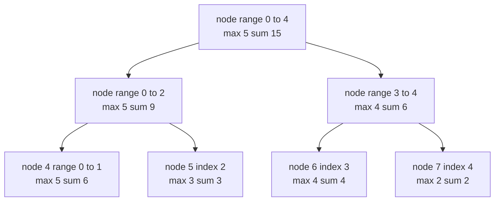
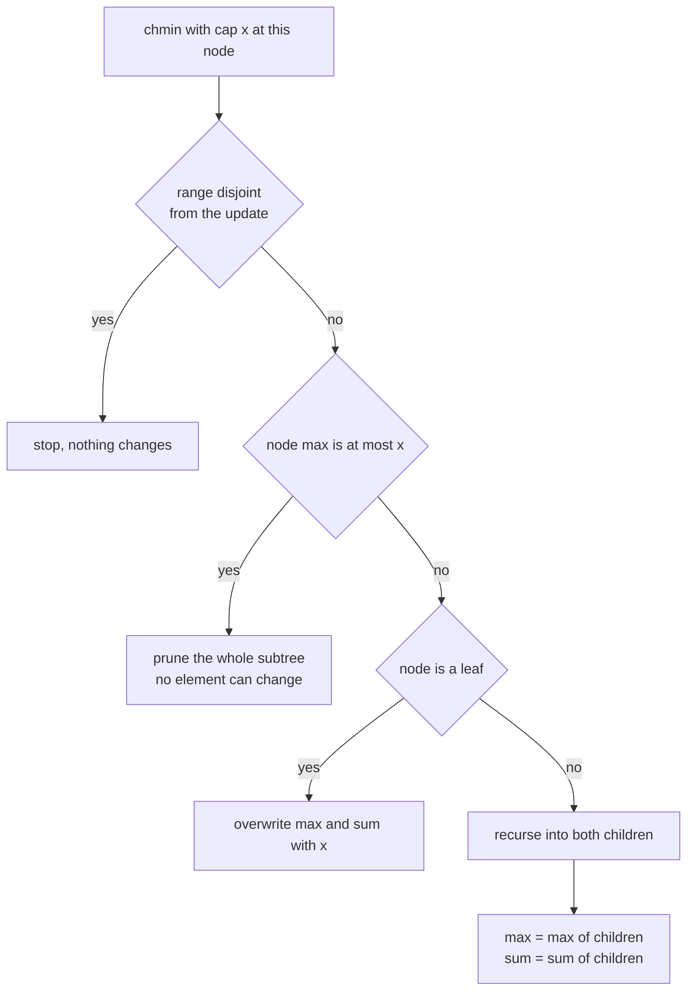
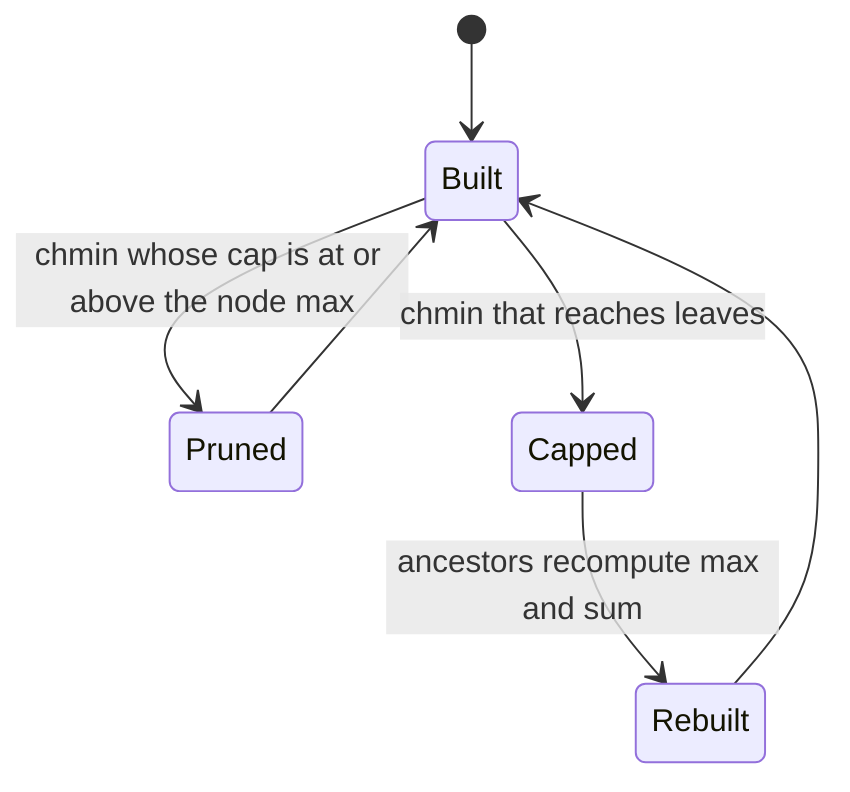
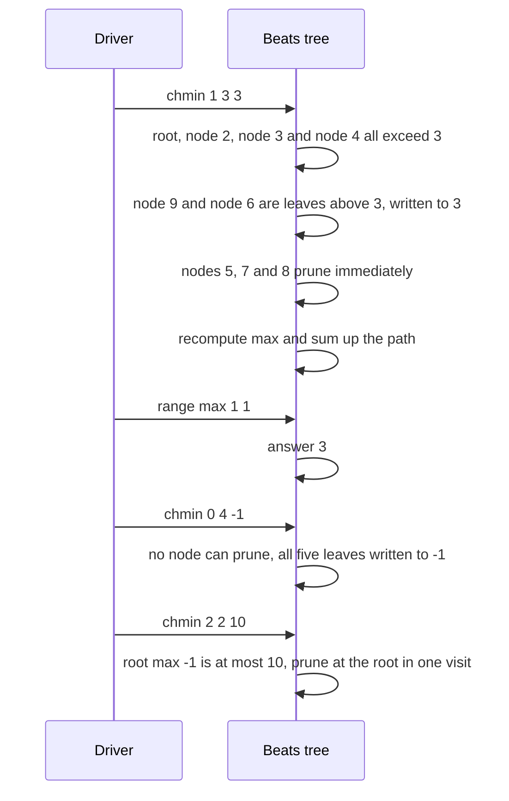

# 442 — Implement segment tree beats for complex range operations (conceptual).

> **Tier:** Advanced · **CTCI chapter:** Ch 4 — Trees and Graphs
> **Task spec:** [442-implement-segment-tree-beats-for-complex-range-operations-concep.md](../../../tasks/advanced/442-implement-segment-tree-beats-for-complex-range-operations-concep.md)
> **Solutions:** [Python](../../../solutions/python/advanced/442-implement-segment-tree-beats-for-complex-range-operations-concep/solution.py) ·
> [Java](../../../solutions/java/advanced/442-implement-segment-tree-beats-for-complex-range-operations-concep/Solution.java) ·
> [JavaScript](../../../solutions/javascript/advanced/442-implement-segment-tree-beats-for-complex-range-operations-concep/solution.js) ·
> [C#](../../../solutions/csharp/advanced/442-implement-segment-tree-beats-for-complex-range-operations-concep/Solution.cs)

## 1. Problem restatement

The task is a **segment tree beats** structure for the operation set *range `chmin`* (cap every
element of a range at `x`), *range max* and *range sum*. The header documents the simplification
explicitly:

- Full segment tree beats adds a **second maximum** plus a **count of maxima** per node, which lets
  a whole subtree be capped in one step, and the amortised bound usually quoted for that version is
  `O((n + q) log n)`.
- This file is the **pruning-only** variant: it keeps the beats stopping rule — stop the recursion
  the moment a node's whole range already has `max <= x`, because capping can then change nothing
  inside it — but without the second-maximum shortcut.

Each node caches `node_max` and `node_sum` for its range. The API is
`SegmentTreeBeats(values)`, `chmin(left, right, cap)`, `range_max(left, right)` and
`range_sum(left, right)`, with `4 · max(1, n)` cells per array.

| Call on `[1, 5, 3, 4, 2]` | Result | Why |
| --- | --- | --- |
| `range_max(0, 4)`, `range_sum(0, 4)` | `5`, `15` | the tree built from the array |
| `chmin(1, 3, 3)` then `range_max(0, 4)` | `3` | positions 1..3 capped at 3 |
| `range_max(1, 1)` after that | `3` | only `5` had to change, to `3` |
| `range_sum(0, 4)` after that | `12` | `1 + 2 + 3 + 3 + 2 + ...` — the two capped elements lost 2 in total |
| `range_sum(2, 3)` after that | `6` | `3 + 3` |
| `chmin(0, 4, -1)` then `range_max`, `range_sum` | `-1`, `-5` | every element capped at `-1` |
| `chmin(2, 2, 10)` then both | `-1`, `-5` | the cap is above the current max, so nothing changes |

The scripted part builds a 16-element tree from the LCG (`seed 1234`, `seed mod 50 - 25`) and runs
300 generated operations (`seed 777`) with `kind = seed mod 3`: `0` is `chmin(lo, hi, cap)` with
`cap = seed mod 41 - 20`, `1` is a `range_max` query, `2` is a `range_sum` query, all against a
brute-force array updated element by element.

## 2. Intuition

A plain lazy segment tree handles range *add* and range *max* because adding a constant shifts a
node's maximum by exactly that constant — the shortcut is uniform across the subtree. `chmin` has
no such uniform shortcut: capping a range changes elements that were above the cap and leaves the
rest alone, so the new maximum is `min(old_max, cap)` but the new *sum* depends on how many
elements were above the cap and by how much.

The beats insight is that even without knowing those details, you can often **refuse to descend**:



Three cases cover a `chmin(node, x)` visit:

1. the node's range does not intersect the update range → stop;
2. the node's whole range already has `max <= x` → **stop, because nothing inside can change**;
3. otherwise descend; at a leaf, set `max = sum = x` and on the way back up recompute
   `max = max(children)` and `sum = sum(children)`.

Case 2 is the beats pruning rule and it is where the name comes from: the structure checks whether
the update would be a no-op for a whole block of elements before spending any work on them.



The `chmin(0, 4, -1)` case in the worked example shows the opposite extreme: when the cap is below
every element, no node can be pruned and the recursion really does reach all five leaves. That is
the honest cost profile of this variant — the pruning saves work proportional to how much of the
tree survives the cap untouched, and full beats exists precisely to avoid that descent by capping
whole subtrees through the second maximum.

## 3. Algorithm

1. Allocate `node_max` and `node_sum` of size `4 · max(1, n)` and build recursively: a leaf gets
   the array value in both caches; an internal node gets `max` and `sum` of its children.
2. `_chmin(node, lo, hi, left, right, cap)`: stop when the node's range is disjoint from
   `[left, right]` **or** when `node_max[node] <= cap` (the pruning rule). At a leaf, assign `cap`
   to both `node_max` and `node_sum`.
3. Otherwise recurse into both children with the same range and cap, then recompute
   `node_max` and `node_sum` from the children.
4. `_range_max` and `_range_sum` are ordinary range queries: return the node's cache on full
   coverage, otherwise fold the intersecting children — a maximum with `-inf` as the neutral
   element, a sum with `0`.
5. No lazy array is needed anywhere: `chmin` never parks a pending operation, it either prunes or
   materialises the change at leaves and repairs the path back up.

```text
procedure chmin(node, lo, hi, left, right, cap)
    if right < lo or hi < left then
        return
    end
    if max of node is at most cap then
        return
    end
    if lo = hi then
        max of node ← cap
        sum of node ← cap
        return
    end
    mid ← floor of (lo + hi) / 2
    chmin(2 * node, lo, mid, left, right, cap)
    chmin(2 * node + 1, mid + 1, hi, left, right, cap)
    max of node ← maximum of the children maxima
    sum of node ← sum of the children sums
end

procedure range_sum(node, lo, hi, left, right)
    if left <= lo and hi <= right then
        return sum of node
    end
    mid ← floor of (lo + hi) / 2
    total ← 0
    if left <= mid then
        total ← total + range_sum(2 * node, lo, mid, left, right)
    end
    if right > mid then
        total ← total + range_sum(2 * node + 1, mid + 1, hi, left, right)
    end
    return total
end
```

The two stopping conditions are checked in one line — `right < lo or hi < left or node_max[node]
<= cap` — and they mean different things: the first is "this node is irrelevant to the update", the
second is "this node is relevant but cannot change". Only the second is the beats rule, and only it
makes the variant fast in practice.



## 4. Worked example

Trace the hand-asserted sequence on `[1, 5, 3, 4, 2]`. Instrumenting the shipped Python
implementation with a visit counter gives the exact node counts.

`chmin(1, 3, 3)` — cap positions 1, 2 and 3 at 3:

| Node | Range | Visited? | Reason | `max` / `sum` after |
| --- | --- | --- | --- | --- |
| 1 | 0..4 | yes | `max 5 > 3` | 3 / 12 |
| 2 | 0..2 | yes | `max 5 > 3` | 3 / 7 |
| 3 | 3..4 | yes | `max 4 > 3` | 3 / 5 |
| 4 | 0..1 | yes | `max 5 > 3` | 3 / 4 |
| 5 | 2..2 | yes | **pruned**: `max 3 <= 3` | unchanged 3 / 3 |
| 6 | 3..3 | yes | leaf, `4 > 3` | 3 / 3 |
| 7 | 4..4 | yes | **pruned**: `max 2 <= 3` | unchanged 2 / 2 |
| 8 | 0..0 | yes | **pruned**: `max 1 <= 3` | unchanged 1 / 1 |
| 9 | 1..1 | yes | leaf, `5 > 3` | 3 / 3 |

Nine node visits in total, **three of them immediate prunes** and only **two leaf writes** — the
elements 1, 3 and 2 never had to be touched because their subtrees were already capped low enough.
The results line up with the assertions: `range_max(0, 4) == 3`, `range_max(1, 1) == 3`,
`range_sum(0, 4) == 12`, `range_sum(2, 3) == 6`.



The next two operations are the two extremes:

| Operation | Visits | Prunes | Leaf writes | Result |
| --- | --- | --- | --- | --- |
| `chmin(0, 4, -1)` | 9 | 0 | 5 | `range_max == -1`, `range_sum == -5` |
| `chmin(2, 2, 10)` | **1** | **1** | 0 | nothing changes, `range_max == -1`, `range_sum == -5` |

`chmin(2, 2, 10)` is the pruning rule at its best: the cap is above the root's maximum, so the
recursion stops after a single visit and the tree is untouched — the same answer an `O(1)` check
would give. `chmin(0, 4, -1)` is the pruning rule at its worst: every element is above the cap, so
no node can prune and the recursion rewrites all five leaves.

The 16-element scripted workload puts numbers on the mix: 300 operations turn out to be **104
`chmin`, 93 `range_max` and 103 `range_sum`**, and the 104 `chmin` calls together make **392 node
visits, of which 206 prune immediately**, producing only **42 leaf writes**. More than half of the
visits are stopped by the beats rule, and the number of elements actually rewritten is far smaller
than the number of update ranges.

## 5. Complexity

Let `n` be the array length and `q` the number of operations.

| Measure | Bound | Why it holds |
| --- | --- | --- |
| Build | O(n) | each node is built once from its children |
| `range_max`, `range_sum` | O(log n) | ordinary range decomposition, two boundary paths plus full-cover nodes |
| `chmin`, best | O(1) | the root itself prunes when `max <= cap` — the measured `chmin(2, 2, 10)` visit count was 1 |
| `chmin`, worst | O(n) | a cap below every element cannot prune anywhere, as in `chmin(0, 4, -1)`, which made 9 visits for 5 leaves |
| `chmin`, observed | far below the worst case | 392 visits for 104 calls on `n = 16`, with 206 prunes and 42 leaf writes |
| Space | O(n) | two cached arrays of `4n` slots and no lazy array |
| Full beats | amortised `O((n + q) log n)` as quoted in the header | the second maximum plus the count of maxima let a whole subtree be capped without descending |
| Plain lazy tree with `add` | O(log n) per update | range add has a uniform shortcut that `chmin` does not |

The table is deliberately honest about the difference: the pruning-only variant has **no improved
worst-case bound** — it inherits `O(log n)` queries and a per-update cost proportional to the part
of the tree that actually changes. What it buys is the `206 / 392` prune ratio, and what full beats
buys on top is the ability to cap an entire subtree in one step so that even a cap below everything
stays logarithmic in the amortised sense.

## 6. Pitfalls and edge cases

- **The pruning condition is `node_max <= cap`, not `node_max < cap`.** A node whose maximum equals
  the cap is already capped: every element in it is `<= cap`, so capping changes nothing. Using a
  strict `<` would descend needlessly and, in the `chmin(2, 2, 10)` case, would visit the whole
  subtree instead of one node.
- **Pruning and disjointness are different reasons to stop.** The first stop is correctness (the
  range is irrelevant); the second is the optimisation (the range is relevant but cannot change).
  Both are checked before the leaf case, because a leaf may also be irrelevant or already capped.
- **Leaves are overwritten, not decremented.** At a leaf the cap *is* the new value:
  `node_max = node_sum = cap`. There is no "min of the two" to compute, and no lazy tag to park.
- **Sum must be recomputed, not adjusted.** After a `chmin` on a partial range, both `node_max` and
  `node_sum` are rebuilt from the children. Trying to adjust the parent's sum by the change at the
  leaves would require knowing how many elements changed and by how much — exactly the information
  full beats stores in its extra tags.
- **No lazy array means no push.** Unlike the range-add tree, nothing is parked, so the query paths
  need no `push` step; the price is that a widely affecting `chmin` descends to the leaves.
- **Duplicate-friendly operations.** Values may repeat (the scripted base array contains `10` twice
  and `14` twice), and capping a range containing equal values changes all of them — the structure
  never needs to distinguish elements, because it caches only max and sum.
- **Negative caps and negative elements.** Caps range over `-20 .. 20` and elements over `-25 .. 24`,
  so `chmin` often raises values rather than lowering them: capping a `-25` at `-20` leaves it
  unchanged, and only elements above the cap move. The brute-force mirror uses `min(brute[i], cap)`
  for exactly that reason.
- **Neutral elements in the queries.** `_range_max` folds from `-(1 << 60)` and `_range_sum` from 0;
  using the node's own value or a partial sum as the seed would corrupt ranges that only intersect
  one child.
- **Empty tree.** `4 · max(1, n)` keeps the allocation sane for `n = 0`, but no operation is defined
  on it — with `lo = 0, hi = -1` the very first recursion would prune as disjoint. The drivers never
  build an empty tree.
- **No bounds validation.** `chmin` and the queries trust that `0 <= left <= right < n`; the LCG
  generator (`hi = lo + seed mod (n - lo)`) is what guarantees well-formed ranges.

## 7. Variants and follow-ups

- **The lazy sibling.** [441-implement-range-add-range-max-with-lazy-propagation-segment-tree.md](../../../tasks/advanced/441-implement-range-add-range-max-with-lazy-propagation-segment-tree.md)
  solves the neighbouring problem with tags instead of pruning, and is the natural starting point
  before reading this task.
- **Plain segment trees.** [182-implement-segment-tree-for-range-sum-build-query-update.md](../../../tasks/beginner/182-implement-segment-tree-for-range-sum-build-query-update.md)
  builds the same max-and-sum skeleton with point updates, and
  [335-implement-data-structure-for-skyline-queries-segment-tree-varian.md](../../../tasks/intermediate/335-implement-data-structure-for-skyline-queries-segment-tree-varian.md)
  shows a different variant payload on the same recursion.
- **Constraints instead of beats.** [181-range-update-point-query-with-fenwick-tree.md](../../../tasks/beginner/181-range-update-point-query-with-fenwick-tree.md)
  handles range *add* with a Fenwick tree, which is the case where a uniform shortcut really does
  exist and the beats machinery is unnecessary.
- **More aggressive aggregate reuse.** [429-implement-range-kth-order-statistic-using-persistent-segtree.md](../../../tasks/advanced/429-implement-range-kth-order-statistic-using-persistent-segtree.md)
  and [582-implement-run-length-encoded-segment-tree-for-binary-string-oper.md](../../../tasks/advanced/582-implement-run-length-encoded-segment-tree-for-binary-string-oper.md)
  carry richer per-node state so that whole subtrees can be summarised without descending.
- The chapter walkthrough in [Trees and Graphs](../../ctci/04-trees-and-graphs.md) puts segment
  trees next to the balanced trees that share their range-decomposition idea.

## 8. Check yourself

1. In `chmin(1, 3, 3)`, node 5 (index 2) is inside the update range but is not written. Why not?

<details><summary>Show answer</summary>

Because its `max` is 3, which is already `<= cap = 3`. Every element inside that node is at most 3,
so capping at 3 cannot change anything — the recursion prunes it. Node 8 (index 0) prunes for a
different reason: its value 1 is below the cap, so it is also unaffected.

</details>

2. Why does node 4's sum become 4 rather than staying 6?

<details><summary>Show answer</summary>

Node 4 covers indices 0 and 1, whose values were 1 and 5. The cap of 3 changed the second one to 3,
so the sum became `1 + 3 = 4`. The parent's caches are always recomputed from the children —
`max = max(1, 3) = 3`, `sum = 1 + 3 = 4` — rather than adjusted by hand.

</details>

3. `chmin(2, 2, 10)` visits exactly one node. What does that tell you about the structure's state,
   and what would it have cost without the pruning rule?

<details><summary>Show answer</summary>

It tells you that after the previous operation the whole tree is capped at `-1`, so the root's
maximum `-1` is at most the new cap `10` and nothing can change. Without the pruning rule the
recursion would have descended to index 2's leaf and back, visiting about `2 · log2(5)` nodes for
zero actual work.

</details>

4. The scripted workload shows 206 prunes out of 392 visits. Why is that ratio the thing that
   matters for this variant?

<details><summary>Show answer</summary>

Because pruning is the *only* thing this variant has: it has no lazy tag and no second maximum, so
every change has to reach a leaf, and every visited-but-unchanged subtree is pure overhead. The
ratio measures how much of the work the beats stopping rule removed — over half of the visits here
— and it is the reason full beats, which can also cap a subtree in a single step, extends this
variant rather than replacing it.

</details>
