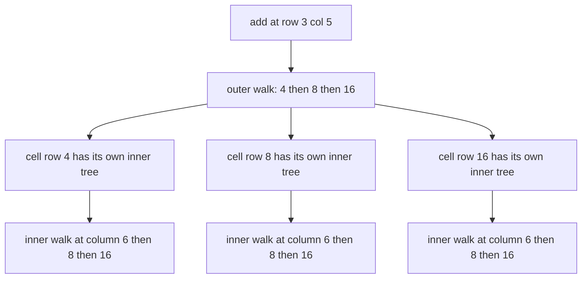
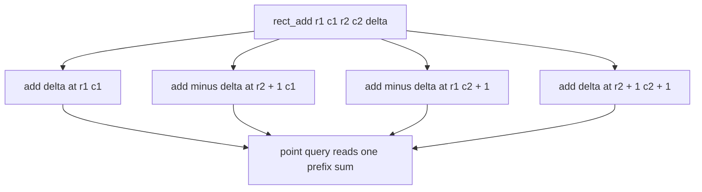
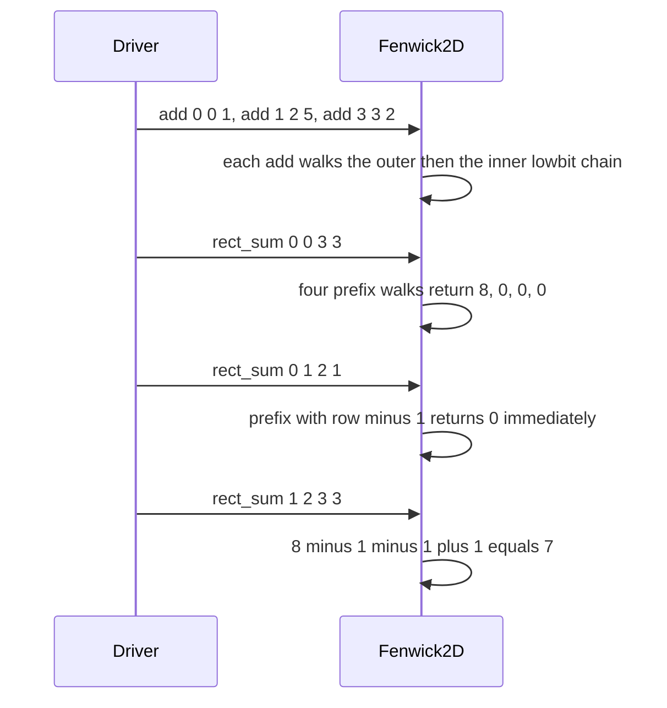

# 443 — Implement 2D Fenwick tree for rectangle sum/update.

> **Tier:** Advanced · **CTCI chapter:** Ch 4 — Trees and Graphs
> **Task spec:** [443-implement-2d-fenwick-tree-for-rectangle-sum-update.md](../../../tasks/advanced/443-implement-2d-fenwick-tree-for-rectangle-sum-update.md)
> **Solutions:** [Python](../../../solutions/python/advanced/443-implement-2d-fenwick-tree-for-rectangle-sum-update/solution.py) ·
> [Java](../../../solutions/java/advanced/443-implement-2d-fenwick-tree-for-rectangle-sum-update/Solution.java) ·
> [JavaScript](../../../solutions/javascript/advanced/443-implement-2d-fenwick-tree-for-rectangle-sum-update/solution.js) ·
> [C#](../../../solutions/csharp/advanced/443-implement-2d-fenwick-tree-for-rectangle-sum-update/Solution.cs)

## 1. Problem restatement

The task implements a Fenwick tree over a grid — a "BIT of BITs" — in two mirror-image flavours,
both checked against a brute-force grid:

| Class | Supported pair | Cost |
| --- | --- | --- |
| `Fenwick2D(rows, cols)` | `add(row, col, delta)` point update + `rect_sum(r1, c1, r2, c2)` rectangle sum | `O(log rows · log cols)` each, with four prefix queries |
| `DiffFenwick2D(rows, cols)` | `rect_add(r1, c1, r2, c2, delta)` rectangle update + `point(row, col)` point query | four corner updates, then one prefix query |

Internally both use 1-based indices (`i = row + 1`, `j = col + 1`) and the two lowbit walks. The
rectangle sum is the standard inclusion–exclusion over four `_prefix` calls, and `_prefix` tolerates
a `-1` corner because the walk stops immediately when `i == 0` — which is what makes
`rect_sum(0, c1, r2, c2)` and friends work without special cases.

| Call on a 4×4 `Fenwick2D` with `add(0,0,1)`, `add(1,2,5)`, `add(3,3,2)` | Result | Why |
| --- | --- | --- |
| `rect_sum(0, 0, 3, 3)` | `8` | the whole grid |
| `rect_sum(1, 2, 1, 2)` | `5` | a single cell |
| `rect_sum(0, 1, 2, 1)` | `0` | a column strip with no values; exercises the `c1 - 1 == -1` corner |
| `rect_sum(0, 0, 0, 0)` | `1` | the first cell |
| `rect_sum(1, 2, 3, 3)` | `7` | `5 + 2` from the two remaining cells |

| Call on a 4×4 `DiffFenwick2D` | Result | Why |
| --- | --- | --- |
| `rect_add(0, 0, 1, 1, 3)` then `point(0,0)`, `point(1,1)` | `3`, `3` | the 2×2 block received the delta |
| `point(1, 2)`, `point(2, 2)` | `0`, `0` | outside the block |
| `rect_add(1, 1, 2, 2, 10)` then `point(1,1)`, `point(2,2)` | `13`, `10` | overlapping rectangles accumulate |
| `point(3, 3)`, `point(0, 0)` | `0`, `3` | unaffected corners stay put |

The scripted part runs `lcg_grid_ops(300, 443, 16)` — a 16×16 grid with `r1, c1 = seed mod 16`,
`r2 = r1 + seed mod (16 - r1)`, `c2 = c1 + seed mod (16 - c1)`, `kind = seed mod 2` and
`value = seed mod 21 - 10`. The same 300-operation script drives both structures, with `kind == 0`
meaning "update" and `kind == 1` meaning "query": point-add/rectangle-sum for the first one,
rectangle-add/point-query for the second.

## 2. Intuition

The 1D Fenwick tree stores, in cell `i`, the sum of the `lowbit(i)` positions ending at `i`. Ask for
a 2D grid and the direct generalisation is a **BIT of BITs**: cell `(i, j)` of the outer tree holds
an entire inner Fenwick tree over a row band, and an update at `(row, col)` walks the outer index
and, for each outer cell it reaches, walks the inner index of that cell's own tree.



Each update therefore touches `O(log rows · log cols)` cells, and a rectangle sum costs four of
those prefix walks — one for each corner of the inclusion–exclusion:

```text
rect_sum(r1, c1, r2, c2)
  = prefix(r2, c2) - prefix(r1 - 1, c2) - prefix(r2, c1 - 1) + prefix(r1 - 1, c1 - 1)
```

The second class takes the mirror-image route. Instead of storing values, it stores the **2D
difference array**: adding `delta` to a rectangle is four corner updates (two `+delta`, two
`-delta`), and the value at a point is the prefix sum of that difference array. This is the same
trick the 1D "range update, point query" Fenwick tree uses, lifted one dimension:



A corner that would fall outside the grid is simply skipped, because a prefix walk never visits
indices beyond the grid — the guards `r2 + 1 < rows` and `c2 + 1 < cols` encode exactly that.

## 3. Algorithm

1. Allocate a `(rows + 1) × (cols + 1)` table of zeros; both classes share this layout.
2. `add(row, col, delta)`: set `i = row + 1`; while `i <= rows`, set `j = col + 1` and while
   `j <= cols` add `delta` to `tree[i][j]` and advance `j += j & -j`; then advance `i += i & -i`.
3. `_prefix(row, col)`: set `total = 0`; while `i > 0`, walk `j` down with `j -= j & -j`; then
   `i -= i & -i`. A negative input row or column makes `i` or `j` zero immediately, so the walk
   contributes nothing.
4. `rect_sum(r1, c1, r2, c2)`: the four-corner inclusion–exclusion shown above.
5. `DiffFenwick2D.rect_add`: one `add` at `(r1, c1)` with `+delta`, one at `(r2 + 1, c1)` and one
   at `(r1, c2 + 1)` with `-delta`, and one at `(r2 + 1, c2 + 1)` with `+delta` — each performed
   only when the corner is still inside the grid.
6. `DiffFenwick2D.point(row, col)` is a single `_prefix(row, col)` on that difference tree.

```text
procedure add(row, col, delta)
    i ← row + 1
    while i <= rows do
        j ← col + 1
        while j <= cols do
            tree[i][j] ← tree[i][j] + delta
            j ← j + (j AND minus j)
        end
        i ← i + (i AND minus i)
    end
end

procedure prefix(row, col)
    total ← 0
    i ← row + 1
    while i > 0 do
        j ← col + 1
        while j > 0 do
            total ← total + tree[i][j]
            j ← j - (j AND minus j)
        end
        i ← i - (i AND minus i)
    end
    return total
end

procedure rect_sum(r1, c1, r2, c2)
    return prefix(r2, c2) - prefix(r1 - 1, c2) - prefix(r2, c1 - 1) + prefix(r1 - 1, c1 - 1)
end
```

```text
procedure rect_add(r1, c1, r2, c2, delta)
    add(r1, c1, delta)
    if r2 + 1 < rows then
        add(r2 + 1, c1, minus delta)
    end
    if c2 + 1 < cols then
        add(r1, c2 + 1, minus delta)
    end
    if r2 + 1 < rows and c2 + 1 < cols then
        add(r2 + 1, c2 + 1, delta)
    end
end
```

The two structures are duals: one stores values and reads rectangles, the other stores a difference
array and reads points. Neither can be turned into the other by renaming — a rectangle *sum* on the
difference tree, or a *point* value on the value tree, are different questions with different
answers.

## 4. Worked example

Trace the hand-asserted `Fenwick2D` case. The grid of values is `1` at `(0,0)`, `5` at `(1,2)` and
`2` at `(3,3)`.

| Query | `prefix(r2, c2)` | `- prefix(r1-1, c2)` | `- prefix(r2, c1-1)` | `+ prefix(r1-1, c1-1)` | Result |
| --- | --- | --- | --- | --- | --- |
| `rect_sum(0, 0, 3, 3)` | 8 | 0 | 0 | 0 | `8` |
| `rect_sum(1, 2, 1, 2)` | 8 | 1 | 6 | 1 | `5` |
| `rect_sum(0, 1, 2, 1)` | 1 | 0 | 1 | 0 | `0` |
| `rect_sum(0, 0, 0, 0)` | 1 | 0 | 0 | 0 | `1` |
| `rect_sum(1, 2, 3, 3)` | 8 | 1 | 1 | 1 | `7` |

The third and fifth rows show the two subtleties at once. For `rect_sum(0, 1, 2, 1)` the corners
`r1 - 1 = -1` and `c1 - 1 = 0` include a negative row index: `prefix(-1, ...)` returns 0 because
`i = row + 1 = 0` skips the outer loop, and `prefix(2, 0)` returns the single value in column 0 —
`1 - 0 - 1 + 0 = 0`. For `rect_sum(1, 2, 3, 3)` the subtraction removes everything outside the
bottom-right block, leaving `5 + 2`.



The difference tree on the same 4×4 grid tells the mirror story. `rect_add(0, 0, 1, 1, 3)` writes
four corner cells: `+3` at `(0,0)`, `-3` at `(2,0)`, `-3` at `(0,2)` and `+3` at `(2,2)` — all four
inside the grid, since `r2 + 1 = 2 < 4` and `c2 + 1 = 2 < 4`.

| `point(row, col)` after the first `rect_add` | Difference cells inside the prefix rectangle | Value |
| --- | --- | --- |
| `(0, 0)` | `+3` | `3` |
| `(1, 1)` | `+3` | `3` |
| `(1, 2)` | `+3` and `-3` | `0` |
| `(2, 2)` | `+3`, `-3`, `-3`, `+3` | `0` |

Adding the second rectangle `rect_add(1, 1, 2, 2, 10)` writes corners at `(1,1)`, `(3,1)`, `(1,3)`
and `(3,3)`, again all inside the grid. Now `point(1, 1)` sums `3 + 10 = 13`, `point(2, 2)` sums
`3 - 3 + 10 = 10`, and `point(3, 3)` sums all eight corners, which cancel exactly: `0`. The
assertions follow this precisely, and they check that a corner *outside* both rectangles — `(0, 0)`
— still reads `3`.

The scripted 16×16 run puts numbers on the workload: 300 operations take the `kind == 0` branch
**150** times and the query branch **150** times, the random query rectangles range from a single
cell to **132** cells out of 256, and the updates land on **176 distinct points** of the grid. Both
structures are validated against a brute-force grid that is updated cell by cell.

## 5. Complexity

Let `R` be the number of rows and `C` the number of columns.

| Measure | Bound | Why it holds |
| --- | --- | --- |
| `Fenwick2D.add` | `O(log R · log C)` | the outer lowbit walk takes `O(log R)` steps and each step walks `O(log C)` inner cells |
| `Fenwick2D.rect_sum` | `O(log R · log C)` | four prefix walks, each the same product of logarithmic chains |
| `DiffFenwick2D.rect_add` | `O(log R · log C)` | at most four point updates |
| `DiffFenwick2D.point` | `O(log R · log C)` | one prefix walk |
| Space | `O(R · C)` | the full `(R + 1) × (C + 1)` table, one cell per grid position plus a zero border |
| Naive grid | `O(R · C)` per rectangle sum or rectangle update | summing or adding over every cell of the rectangle |
| 2D segment tree alternative | `O(log R · log C)` too, with a larger constant | it stores explicit range nodes instead of lowbit cells |

For the scripted 16×16 grid that is at most `4 · 4 = 16` cell visits per outer/inner pair, versus up
to 256 cells for a brute-force sweep of the whole grid — which is exactly why the query rectangles
can afford to cover half the grid (`132` of `256` cells).

## 6. Pitfalls and edge cases

- **1-based internals, 0-based API.** Every public method takes 0-based `row`/`col`, and every walk
  starts from `row + 1`/`col + 1`. Mixing the two conventions shifts the whole grid by one cell.
- **The `-1` corner is legal.** `rect_sum` passes `r1 - 1` and `c1 - 1` to `_prefix`; for `r1 = 0`
  or `c1 = 0` that is `-1`, and the walk must return 0 rather than raise. This is asserted directly
  by `rect_sum(0, 1, 2, 1)` and `rect_sum(0, 0, 0, 0)`.
- **Rectangle sums need all four corners.** Dropping the `+ prefix(r1-1, c1-1)` term double-counts
  the overlap region; the hand table shows the term mattering (`+1` in two of the five rows).
- **The difference tree needs the corner guards.** `rect_add` skips the `r2 + 1` and `c2 + 1`
  corners when they fall outside the grid. Writing them anyway would index out of bounds, and the
  skipped corners are genuinely unreadable: no prefix query can reach past the grid.
- **Point updates on `DiffFenwick2D` are not exposed.** Its inner tree is a difference array, so
  the inherited `add` means "corner update", not "add to this cell" — the class only offers
  `rect_add` and `point` for that reason.
- **No negative-index guard beyond the walk.** `_prefix` relies on `i > 0` and `j > 0`; a caller
  passing `row = -5` gets a 0 result rather than an error, which is convenient for the corner
  arithmetic and dangerous as a silent bug elsewhere.
- **Negative deltas and mixed signs.** Values are drawn from `-10 .. 10`, so cells can be negative
  and rectangle sums can cancel. The structures are difference arrays, not counters: nothing
  assumes non-negativity.
- **Both structures share one op script.** The same 300 operations are interpreted as point-update
  plus rectangle-query in one run and as rectangle-update plus point-query in the other, so a test
  that passes for one structure says nothing about the other — each has its own brute-force mirror.
- **`O(R · C)` allocation.** A 16×16 grid is trivial to allocate; a sparse 10^6 × 10^6 grid is not,
  which is where the compressed idea of
  [439-implement-compressed-fenwick-sparse-fenwick-idea.md](../../../tasks/advanced/439-implement-compressed-fenwick-sparse-fenwick-idea.md)
  takes over.

## 7. Variants and follow-ups

- **The 1D originals.** [180-implement-binary-indexed-tree-fenwick-basic-point-update-prefix.md](../../../tasks/beginner/180-implement-binary-indexed-tree-fenwick-basic-point-update-prefix.md)
  is the point-update/prefix-sum tree this task squares, and
  [181-range-update-point-query-with-fenwick-tree.md](../../../tasks/beginner/181-range-update-point-query-with-fenwick-tree.md)
  is the 1D version of the difference trick used by `DiffFenwick2D`.
- **Sparse universes.** [439-implement-compressed-fenwick-sparse-fenwick-idea.md](../../../tasks/advanced/439-implement-compressed-fenwick-sparse-fenwick-idea.md)
  replaces the dense table with a map when only a handful of coordinates are touched.
- **Explicit range nodes.** [444-implement-2d-segment-tree-for-range-sum-rectangle-queries.md](../../../tasks/advanced/444-implement-2d-segment-tree-for-range-sum-rectangle-queries.md)
  answers rectangle sums with a segment tree of segment trees — the same complexity with a
  different constant and a different update story.
- **Sparse storage for grids.** [177-implement-basic-sparse-matrix-storage-coordinate-list.md](../../../tasks/beginner/177-implement-basic-sparse-matrix-storage-coordinate-list.md)
  is the coordinate-list alternative when the grid itself, not the index tree, is the sparse part.
- The chapter walkthrough in [Trees and Graphs](../../ctci/04-trees-and-graphs.md) introduces the
  range-decomposition idea that the lowbit chains implement implicitly.

## 8. Check yourself

1. Why does `_prefix(-1, 3)` return 0 instead of failing?

<details><summary>Show answer</summary>

Because the walk converts the 0-based row to `i = row + 1 = 0`, and the loop condition `i > 0` is
false immediately. The result is the sum over an empty rectangle, which is exactly what the
inclusion–exclusion needs when `r1 == 0`.

</details>

2. `rect_sum(1, 2, 3, 3)` returns 7 while `prefix(3, 3)` alone is 8. What do the three correction
   terms remove?

<details><summary>Show answer</summary>

`prefix(r1-1, c2) = prefix(0, 3) = 1` removes the row band above the rectangle (the `1` at
`(0,0)`), `prefix(r2, c1-1) = prefix(3, 1) = 1` removes the columns left of it (again the `1` at
`(0,0)`), and `prefix(0, 1) = 1` adds back the top-left block that was subtracted twice. The net is
`8 - 1 - 1 + 1 = 7`, which is `5 + 2`.

</details>

3. What is the difference between `Fenwick2D.add(1, 1, 5)` and `DiffFenwick2D.rect_add(1, 1, 1, 1,
   5)`?

<details><summary>Show answer</summary>

They add 5 to the same single cell, but they are not interchangeable operations. `Fenwick2D.add`
writes into a tree of *values*, so the 5 contributes to every rectangle sum containing `(1,1)`.
`rect_add` writes four *difference* corners (two of which are outside the query rectangle), so the 5
contributes to point queries inside `(1,1)..(1,1)` — and to every *point* whose prefix rectangle
contains the cell, which is exactly the 1×1 rectangle here.

</details>

4. The 300-operation script performs 150 updates and 150 queries on a 16×16 grid, with query
   rectangles up to 132 cells. Why is that workload impractical for a brute-force structure?

<details><summary>Show answer</summary>

Because each of the 150 queries would have to sum up to 132 cells directly, i.e. roughly 20,000
cell reads, and each of the 150 rectangle updates would touch a similar number of cells for
`DiffFenwick2D`. The Fenwick structure answers either direction in at most `log 16 · log 16 = 16`
cell visits, and the brute-force grid is kept only as the correctness oracle.

</details>
