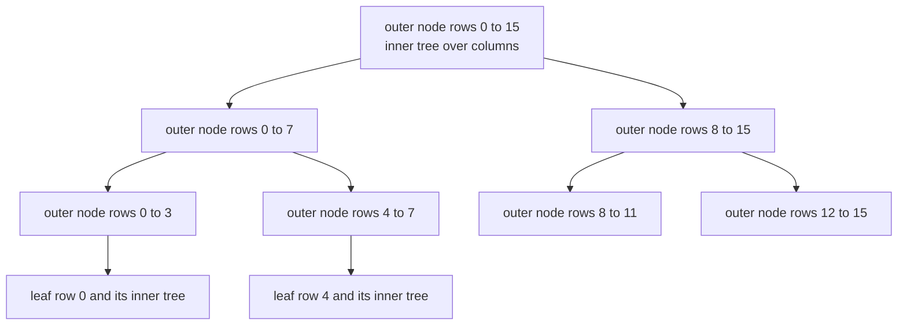
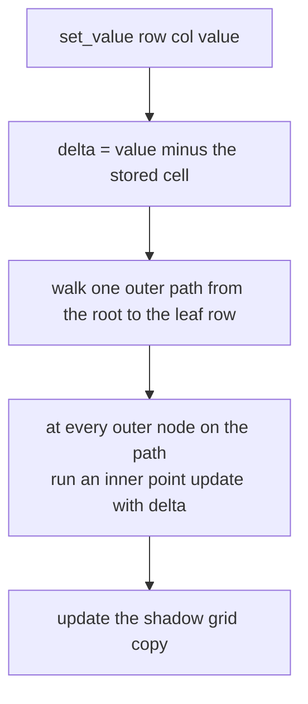
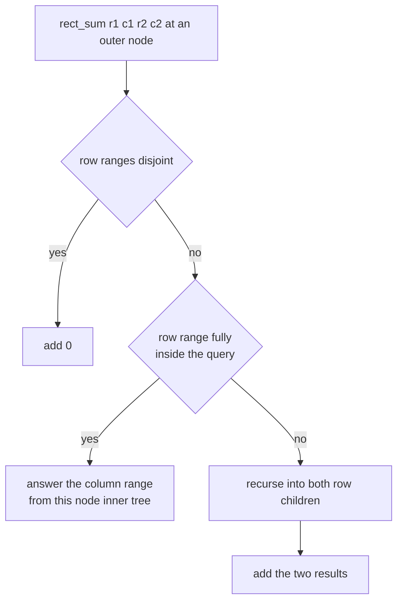
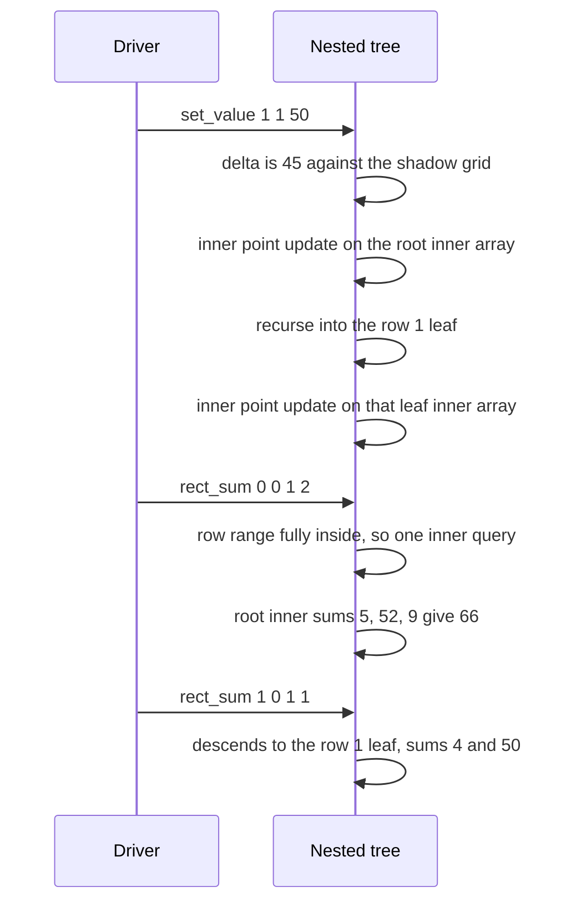

# 444 — Implement 2D segment tree for range sum rectangle queries.

> **Tier:** Advanced · **CTCI chapter:** Ch 4 — Trees and Graphs
> **Task spec:** [444-implement-2d-segment-tree-for-range-sum-rectangle-queries.md](../../../tasks/advanced/444-implement-2d-segment-tree-for-range-sum-rectangle-queries.md)
> **Solutions:** [Python](../../../solutions/python/advanced/444-implement-2d-segment-tree-for-range-sum-rectangle-queries/solution.py) ·
> [Java](../../../solutions/java/advanced/444-implement-2d-segment-tree-for-range-sum-rectangle-queries/Solution.java) ·
> [JavaScript](../../../solutions/javascript/advanced/444-implement-2d-segment-tree-for-range-sum-rectangle-queries/solution.js) ·
> [C#](../../../solutions/csharp/advanced/444-implement-2d-segment-tree-for-range-sum-rectangle-queries/Solution.cs)

## 1. Problem restatement

The task is a **nested 2D segment tree**: the outer tree runs over rows, and every outer node owns a
1D segment tree over the columns holding the sums of its row range. The documented costs are build
`O(n · m)`, and both operations `O(log n · log m)` — a point update walks `O(log n)` outer nodes
and touches `O(log m)` inner nodes each, while a rectangle sum decomposes the row range into
`O(log n)` outer nodes whose column ranges are answered in `O(log m)` each.

| Method | Meaning |
| --- | --- |
| `SegmentTree2D(grid)` | builds both levels from a rectangular grid (all rows the same length) |
| `set_value(row, col, value)` | replaces one cell, propagating the *difference* through the trees |
| `rect_sum(r1, c1, r2, c2)` | inclusive rectangle sum |

Hand assertions on `[[1, 2, 3], [4, 5, 6]]` (2 rows, 3 columns):

| Call | Result | Why |
| --- | --- | --- |
| `rect_sum(0, 0, 0, 1)` | `3` | `1 + 2` in the first row |
| `rect_sum(0, 0, 1, 2)` | `21` | the whole grid |
| `rect_sum(1, 0, 1, 1)` | `9` | `4 + 5` |
| `set_value(1, 1, 50)` then `rect_sum(1, 1, 1, 1)` | `50` | the cell itself |
| `rect_sum(0, 0, 1, 2)` after that | `66` | `21 + (50 - 5)` |
| `set_value(0, 2, 1)` then `rect_sum(0, 2, 0, 2)` | `1` | replacing a value that was higher |
| `rect_sum(0, 0, 1, 2)` after that | `64` | `66 - 2` |

The scripted run builds a 16×16 grid from the LCG (`seed 99`, `seed mod 50 - 25`) and applies
`lcg_grid_ops(300, 444, 16)`: `kind == 0` calls `set_value(r1, c1, value)` with
`value = seed mod 41 - 20`, `kind == 1` asserts `rect_sum(r1, c1, r2, c2)` against a brute-force
sum of the mirrored grid.

## 2. Intuition

A 1D segment tree answers ranges by decomposing them into `O(log n)` cached nodes. The 2D version
does that twice: the outer tree decomposes the **row** range into `O(log n)` nodes, and each of
those nodes answers the **column** range from its own inner tree in `O(log m)`. The result is a
product of the two logarithmic factors.



The inner trees of the inner nodes are not stored independently — an outer node's inner array is the
**elementwise sum** of its two children's inner arrays. That is what makes the build `O(n · m)` and
what makes an update a single path: changing one cell changes exactly one inner entry per level of
each tree.



Queries take the complementary shape: rather than descending to a single row, they stop at every
outer node whose row range is fully inside the query and hand the column range to that node's inner
tree.



A point update also needs to know the *previous* value of the cell to compute the delta, which is
why the class keeps a shadow copy of the grid next to the trees. Setting a value is therefore
`set_value`, not `add` — the API replaces rather than accumulates.

## 3. Algorithm

1. Store a copy of the grid, then allocate `4 · rows` outer nodes, each with an inner array of
   `4 · cols` cells.
2. `_build(node, lo, hi, grid)`: at a leaf row, build the inner tree from `grid[lo]`; otherwise
   build both children and set `current[k] = left[k] + right[k]` for every inner index — the
   elementwise sum of the children's inner trees, computed with a single loop over `O(m)` entries
   per outer node.
3. `set_value(row, col, value)`: compute `delta = value - grid[row][col]`, write the new value into
   the shadow grid, and start `_outer_update` at the root.
4. `_outer_update(node, lo, hi, row, col, delta)`: run `_inner_update` on this node's inner array,
   then recurse into the child whose row range contains `row`, stopping at the leaf row. Every outer
   node on the path sees exactly one inner point update.
5. `_inner_update(arr, node, lo, hi, pos, delta)`: add `delta` to `arr[node]`, then descend to the
   child containing `pos` until the leaf column is reached.
6. `rect_sum(r1, c1, r2, c2)`: start `_rect` at the outer root.
7. `_rect(node, lo, hi, ...)`: return 0 when the node's row range is disjoint from `[r1, r2]`; when
   the row range is fully inside, answer `_inner_query(this node's array, c1, c2)`; otherwise add
   the results of both row children.
8. `_inner_query(arr, node, lo, hi, left, right)`: return `arr[node]` on full column coverage,
   otherwise fold the children that intersect the column range, with 0 as the neutral element.

```text
procedure outer_update(node, lo, hi, row, col, delta)
    inner_update(tree[node], 1, 0, cols - 1, col, delta)
    if lo = hi then
        return
    end
    mid ← floor of (lo + hi) / 2
    if row <= mid then
        outer_update(2 * node, lo, mid, row, col, delta)
    else
        outer_update(2 * node + 1, mid + 1, hi, row, col, delta)
    end
end

procedure inner_update(arr, node, lo, hi, pos, delta)
    arr[node] ← arr[node] + delta
    if lo = hi then
        return
    end
    mid ← floor of (lo + hi) / 2
    if pos <= mid then
        inner_update(arr, 2 * node, lo, mid, pos, delta)
    else
        inner_update(arr, 2 * node + 1, mid + 1, hi, pos, delta)
    end
end
```

```text
procedure rect(node, lo, hi, r1, c1, r2, c2)
    if r2 < lo or hi < r1 then
        return 0
    end
    if r1 <= lo and hi <= r2 then
        return inner_query(tree[node], 1, 0, cols - 1, c1, c2)
    end
    mid ← floor of (lo + hi) / 2
    return rect(2 * node, lo, mid, r1, c1, r2, c2)
         + rect(2 * node + 1, mid + 1, hi, r1, c1, r2, c2)
end
```

The asymmetry between the two operations is the whole design: **updates are paths, queries are
ranges.** An update visits one outer path (one node per level) and one inner path per node; a query
visits every outer node that intersects the row range but only descends where the range is partial,
then reads inner ranges without descending past their boundaries.

## 4. Worked example

Trace the hand case on the 2×3 grid `[[1, 2, 3], [4, 5, 6]]`. Row indices are 0..1, so the outer
root covers both rows that contain rows 0..1, and its two children are the leaf rows.

| Operation | What the trees hold | Result |
| --- | --- | --- |
| build | row 0 inner tree sums `1, 2, 3`; row 1 inner tree sums `4, 5, 6`; root inner tree sums `5, 7, 9` | — |
| `rect_sum(0, 0, 0, 1)` | row range 0..0 is partial at the root, so it descends to the row-0 leaf and asks columns 0..1 | `1 + 2 = 3` |
| `rect_sum(0, 0, 1, 2)` | the root's row range is fully inside, so one inner query over columns 0..2 | `5 + 7 + 9 = 21` |
| `rect_sum(1, 0, 1, 1)` | descends to the row-1 leaf, columns 0..1 | `4 + 5 = 9` |
| `set_value(1, 1, 50)` | `delta = 45`, propagated along root → row-1 leaf, one inner point update at each | — |
| `rect_sum(1, 1, 1, 1)` | row-1 leaf inner tree now sums `4, 50, 6` | `50` |
| `rect_sum(0, 0, 1, 2)` | the root's inner tree now sums `5, 52, 9` | `5 + 52 + 9 = 66` |
| `rect_sum(1, 0, 1, 1)` | `4 + 50` | `54` |
| `set_value(0, 2, 1)` | `delta = 1 - 3 = -2`, propagated along root → row-0 leaf | — |
| `rect_sum(0, 2, 0, 2)` | row-0 leaf inner tree sums `1, 2, 1` | `1` |
| `rect_sum(0, 0, 1, 2)` | the root's inner tree now sums `3, 52, 7` | `3 + 52 + 7 = 64` |

The update path is what keeps these numbers consistent: `set_value(1, 1, 50)` runs one inner point
update on the root's inner array and one on the row-1 leaf's inner array, so both the whole-grid
query and the single-row query see the new value — with exactly two inner updates on a 2-row grid.



The 16×16 scripted run measures the same mechanics at scale. Instrumenting the shipped Python
implementation counts every recursion:

| Quantity | Measured value |
| --- | --- |
| operations | 300, split into 156 `set_value` and 144 `rect_sum` |
| inner updates issued by the 156 updates | 3900 — exactly **25 per update** |
| inner queries issued by the 144 queries | 2223, about **15.4 per query** |
| outer `_rect` calls for those queries | 1430, about **9.9 per query** |
| largest query rectangle | 196 of the 256 cells |

The 25 is the product of two path lengths: on a 16-leaf tree the path from the root to a leaf has
`log2 16 + 1 = 5` nodes, and each of those outer nodes runs an inner update whose own path is
another 5 nodes, so `5 × 5 = 25` inner updates per `set_value` — precisely the
`O(log n · log m)` claim with the constants showing. Queries are heavier on the outer level (9.9
nodes visited on average) because a wide row range stops at several fully covered nodes, each of
which then costs an inner query.

## 5. Complexity

Let `n` be the row count and `m` the column count.

| Measure | Bound | Why it holds |
| --- | --- | --- |
| Build | `O(n · m)` | each outer node copies `O(m)` sums from its children, and there are `O(n)` outer nodes |
| `set_value` | `O(log n · log m)` | one outer path (`log n` nodes) times one inner path (`log m` nodes) — measured 25 inner updates on a 16×16 tree |
| `rect_sum` | `O(log n · log m)` | `O(log n)` fully covered outer nodes, each answering a column range in `O(log m)` |
| Space | `O(n · m)` | `4n` outer nodes each holding `4m` cached sums |
| Naive grid | `O(n · m)` per query | direct summation over the rectangle |
| 2D Fenwick alternative | same asymptotic complexity, smaller constant | the lowbit trees of [443-implement-2d-fenwick-tree-for-rectangle-sum-update.md](../../../tasks/advanced/443-implement-2d-fenwick-tree-for-rectangle-sum-update.md) store fewer cells and need no inner trees for range *queries* |

The `O(n · m)` space is the honest cost of the nested layout — four times the grid in each
direction — and it is what makes the 2D segment tree a poor fit for very large sparse grids, unlike
the Fenwick version, which can be compressed row by row.

## 6. Pitfalls and edge cases

- **Updates carry a delta, not a value.** `set_value` computes `delta = value - grid[row][col]`
  from the shadow grid and propagates the *difference*. Adding the new value outright would grow
  every ancestor instead of shifting it, so the shadow copy is not optional bookkeeping — it is
  what makes `set_value` a replacement.
- **Every outer node on the path gets an inner update.** The outer walk updates the *current* node
  before recursing, so the root's inner tree is refreshed as well. Skipping the current node and
  updating only the leaf row would leave every rectangle sum wrong.
- **Inner trees of inner nodes are sums, not copies.** After building the children, the parent's
  inner array is filled with `left[k] + right[k]` over the whole `4m` range. Recomputing only the
  entries on an update path is correct precisely because every ancestor array is a sum of its
  children's arrays.
- **Disjoint rows contribute 0.** `_rect` returns 0 for a disjoint outer range and adds the two
  children's answers otherwise, so a query that only touches one side of the tree still needs the
  other side's 0 — the recursion has no early stopping on the row level beyond the full-cover case.
- **Full row cover answers from the inner tree without descending.** That is the optimisation that
  makes wide queries cheap, and it is why the root's inner tree must always be current.
- **Column ranges use the same tree shape everywhere.** Every outer node has an inner tree over the
  *same* column domain `0..m-1`, so the column recursion is identical at every level; a ragged grid
  (rows of different lengths) is not supported — the constructor reads `len(grid[0])` once.
- **Zero rows or zero columns.** `rows = 0` leaves the outer arrays empty and `_build` is skipped,
  but any query is then undefined; the `4 · max(1, cols)` sizing keeps the allocation valid
  without claiming the operations are meaningful.
- **No bounds validation.** `set_value` and `rect_sum` trust `0 <= row < n`, `0 <= col < m` and
  `r1 <= r2`, `c1 <= c2`; the LCG generator (`r2 = r1 + seed mod (n - r1)`) is what makes the
  scripted ranges well formed.
- **Negative values.** The scripted grid holds values in `-25 .. 24` and the update values in
  `-20 .. 20`, so sums can be negative and deltas can increase or decrease; the whole-grid sum after
  the scripted run is `-131`, which is fine for a sum tree.
- **Recursion depth.** Depth is `O(log n)` on the outer level and `O(log m)` on the inner one, so
  the stack stays small even for large grids.

## 7. Variants and follow-ups

- **The sibling structure.** [443-implement-2d-fenwick-tree-for-rectangle-sum-update.md](../../../tasks/advanced/443-implement-2d-fenwick-tree-for-rectangle-sum-update.md)
  solves rectangle sums with a BIT of BITs, including the mirror-image rectangle-update/point-query
  variant this tree does not offer.
- **The concept version of this task.** [362-implement-2d-segment-tree-for-range-sum-conceptual.md](../../../tasks/intermediate/362-implement-2d-segment-tree-for-range-sum-conceptual.md)
  is the same nested idea written as an outline, which is the better starting point if the recursion
  above is unclear.
- **The 1D building block.** [182-implement-segment-tree-for-range-sum-build-query-update.md](../../../tasks/beginner/182-implement-segment-tree-for-range-sum-build-query-update.md)
  is the single-level tree used at both levels here, and
  [183-implement-iterative-segment-tree.md](../../../tasks/beginner/183-implement-iterative-segment-tree.md)
  lays those levels out without recursion.
- **Adding updates that are themselves ranges.** [441-implement-range-add-range-max-with-lazy-propagation-segment-tree.md](../../../tasks/advanced/441-implement-range-add-range-max-with-lazy-propagation-segment-tree.md)
  is what a lazy tag looks like in one dimension; nesting that two levels deep is the natural next
  exercise.
- The chapter walkthrough in [Trees and Graphs](../../ctci/04-trees-and-graphs.md) covers the range
  decomposition this structure applies twice.

## 8. Check yourself

1. Why is the root's inner tree updated even though a single cell change only affects one row?

<details><summary>Show answer</summary>

Because the root's inner tree is the *sum* of its children's inner trees, and a rectangle query
whose row range covers the whole grid answers directly from that array without descending. If the
root were stale, whole-grid queries would return the old total — the scripted run's
`rect_sum(0, 0, 1, 2) == 66` assertion is exactly that case.

</details>

2. On a 16×16 grid, why exactly 25 inner updates per `set_value`?

<details><summary>Show answer</summary>

The outer path from the root to a leaf row visits `log2 16 + 1 = 5` nodes, and each of those five
nodes runs one inner update, whose own path over 16 columns also has 5 nodes — but the inner update
is counted once per outer node, not per inner node. The measured 25 is the product `5 × 5` for the
two levels, which is why the complexity is written `O(log n · log m)`.

</details>

3. Why does `set_value` need the shadow grid at all?

<details><summary>Show answer</summary>

Because the trees store aggregate sums, not cell values: to change a cell to `value` you must know
what it was, so that you can propagate `value - old` through the ancestors. The class keeps a copy
of the grid purely to answer that question, and it is also what makes repeated `set_value` calls on
the same cell behave as replacements.

</details>

4. A query with a wide row range visits about 10 outer nodes but a narrow one visits about 2. Why
   does the wide query not cost more, given the row range is larger?

<details><summary>Show answer</summary>

Because a wide range is answered by *fewer, larger* fully covered nodes — the decomposition of any
range into segment tree nodes has at most `2 log n` pieces regardless of its width. Those pieces
each cost an inner query, so the total is still `O(log n · log m)`; a narrow range simply reaches
leaves on a single path with no fan-out.

</details>
