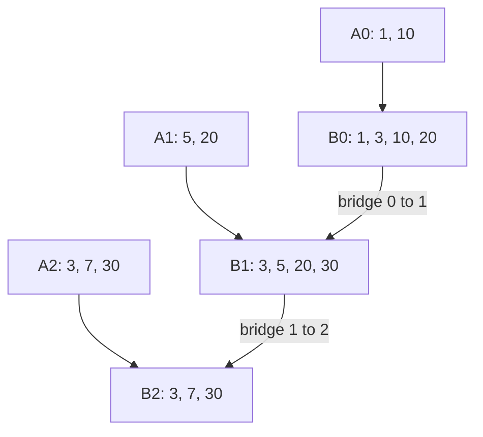
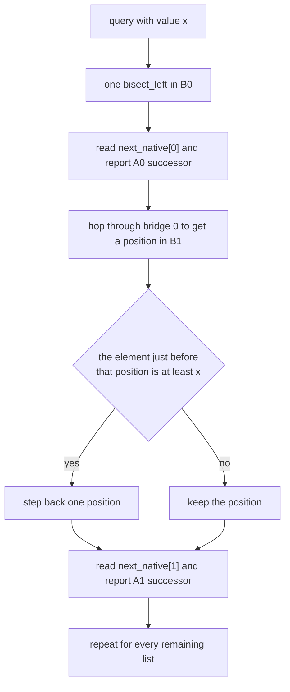
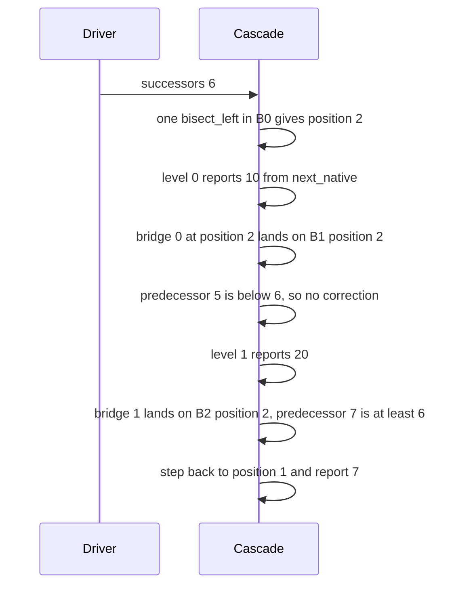

# 445 — Implement fractional cascading for multiple binary searches.

> **Tier:** Advanced · **CTCI chapter:** Beyond — Advanced Data Structures & Algorithms
> **Task spec:** [445-implement-fractional-cascading-for-multiple-binary-searches.md](../../../tasks/advanced/445-implement-fractional-cascading-for-multiple-binary-searches.md)
> **Solutions:** [Python](../../../solutions/python/advanced/445-implement-fractional-cascading-for-multiple-binary-searches/solution.py) ·
> [Java](../../../solutions/java/advanced/445-implement-fractional-cascading-for-multiple-binary-searches/Solution.java) ·
> [JavaScript](../../../solutions/javascript/advanced/445-implement-fractional-cascading-for-multiple-binary-searches/solution.js) ·
> [C#](../../../solutions/csharp/advanced/445-implement-fractional-cascading-for-multiple-binary-searches/Solution.cs)

## 1. Problem restatement

Given `k` sorted lists and a value `x`, find the successor of `x` (the smallest stored element
`>= x`) **in every list**. Doing `k` independent binary searches costs `O(k log n)` per query;
fractional cascading answers it with **one** binary search plus `k` constant-time hops, i.e.
`O(log N + k)` per query after an `O(N)` build, where `N` is the total size of the augmented
structures.

The implementation in the solution files builds, for each level `i`:

| Piece | Definition |
| --- | --- |
| `augmented[i]` | the augmented list `B[i]`; `B[k-1] = A[k-1]`, and for `i < k-1`, `B[i] = merge(A[i], every second element of B[i+1])` |
| `native[i]` | flags saying which entries of `B[i]` came from `A[i]` (the rest are foreign copies) |
| `bridge[i][p]` | the first position `q` in `B[i+1]` with `B[i+1][q] >= B[i][p]` |
| `next_native[i][p]` | the first native position at or after `p`, so the answer in `A[i]` is read in `O(1)` |

The header documents the presentation used: values are distinct **within** each list (the scripted
lists are strictly increasing samples), and every result is checked against an independent
`bisect_left` on each original list. Note that the same value may legitimately occur in two
different lists — the measured sample shares `-32`, `-4` and `15` between lists — which is
harmless because the query is per-list.

Hand assertions for `[[1, 10], [5, 20], [3, 7, 30]]`:

| Call | Result | Why |
| --- | --- | --- |
| `augmented[0]`, `augmented[1]`, `augmented[2]` | `[1, 3, 10, 20]`, `[3, 5, 20, 30]`, `[3, 7, 30]` | the merge with every second element copied down |
| `successors(6)` | `[10, 20, 7]` | in-list successors |
| `successors(3)` | `[10, 5, 3]` | 3 is stored in the last list |
| `successors(0)` | `[1, 5, 3]` | below every list |
| `successors(10)` | `[10, 20, 30]` | equal to a stored value in the first list |
| `successors(20)` | `[None, 20, 30]` | above the whole first list |
| `successors(31)` | `[None, None, None]` | above every list |

The scripted runs use `lcg_lists(count, size, seed)` — each list starts at `-40` and adds
`1 + seed mod 9` per element, so every list is strictly increasing. The main check builds 5 lists of
12 (`seed 445`), asserts the size invariant `len(B[i]) == len(A[i]) + ceil(len(B[i+1]) / 2)`, and
then compares 200 random queries (`seed 555`, `x = seed mod 200 - 90`) to the independent
`bisect_left` oracle. A final block repeats the check for 3 single-list cascades.

## 2. Intuition

Independent binary searches repeat the same information. If the answer in list `i` is at position
`p`, then the answer in list `i+1` must be near the position of `A[i][p]` in that list — so instead
of searching from scratch, you can *look up* a target position and move by at most one step.



The augmented list `B[i]` is `A[i]` merged with every second element of `B[i+1]`. The foreign
copies make `B[i+1]`'s own structure visible from `B[i]`: for any value, the position in `B[i]`
tells you approximately where to look in `B[i+1]`.

Two facts make the hop `O(1)`:

1. **Positions only move forward.** Because the values increase, `bridge[i]` — the first position in
   `B[i+1]` at or above each entry of `B[i]` — is non-decreasing, so it can be built with a linear
   two-pointer sweep and is monotone for lookups.
2. **The approximation is off by at most one.** Since only every second element is copied, between
   two consecutive bridge targets there can be at most one element of `B[i+1]` that is still `>= x`
   — hence the single comparison `if bridge_value_below >= x then decrement`.



The `next_native` table exists because the bridge position points into the *augmented* list, whose
entries may be foreign copies: the successor **in `A[i]`** is the first native entry at or after that
position. Reading `B[i][pos]` directly would sometimes return a value that list `i` does not contain.

## 3. Algorithm

1. `B[k-1] = A[k-1]` with all entries marked native, and `next_native[k-1]` is just the position
   itself (or one past the end).
2. For `i` from `k-2` down to `0`: set `copies = B[i+1][0::2]` (every second element), and merge it
   with `A[i]` using a two-pointer merge that prefers the native element on ties
   (`native_list[p] <= copies[q]`), recording a native flag for each emitted entry.
3. `bridge[i]`: sweep `p` over `B[i]` and advance `q` while `B[i+1][q] < B[i][p]`; `q` never goes
   backwards, so the whole table costs `O(|B[i]| + |B[i+1]|)`.
4. `next_native[i]`: fill an array of size `|B[i]| + 1` from the right, carrying the next native
   position forward and using `|B[i]|` as the sentinel.
5. `successors(x)`: one `bisect_left(B[0], x)` gives `pos` in the first augmented list. For each
   level `i`, produce the answer for `A[i]` from `next_native[i][pos]`, then advance `pos` to the
   next level: for `i > 0`, look up `bridge[i-1][pos]` and decrement by one if the bridge target's
   predecessor is still `>= x`; when `pos` had run off the end of `B[i-1]`, the only candidate in
   `B[i]` is its last element, used if that element is `>= x`.
6. Return the value at `next_native[i][pos]`, or `None`/`null` when that position is the sentinel.

```text
procedure successors(x)
    results ← array of nothing with one slot per list
    pos ← bisect_left(B[0], x)
    for i from 0 to k - 1 do
        if i > 0 then
            if pos = length of B[i - 1] then
                m ← length of B[i]
                if m > 0 and B[i][m - 1] >= x then
                    pos ← m - 1
                else
                    pos ← m
                end
            else
                q ← bridge[i - 1][pos]
                if q > 0 and B[i][q - 1] >= x then
                    q ← q - 1
                end
                pos ← q
            end
        end
        nxt ← next_native[i][pos]
        if nxt < length of B[i] then
            results[i] ← B[i][nxt]
        else
            results[i] ← nothing
        end
    end
    return results
end
```

```text
procedure build_lists(lists)
    B[k - 1] ← list at position k - 1
    native[k - 1] ← all true
    for i from k - 2 down to 0 do
        copies ← every second element of B[i + 1]
        B[i], native[i] ← merge(lists[i], copies)
    end
    for i from 0 to k - 2 do
        q ← 0
        for p from 0 to length of B[i] - 1 do
            while q < length of B[i + 1] and B[i + 1][q] < B[i][p] do
                q ← q + 1
            end
            bridge[i][p] ← q
        end
    end
    for i from 0 to k - 1 do
        nxt[length of B[i]] ← length of B[i]
        for p from length of B[i] - 1 down to 0 do
            nxt[p] ← p if native[p] is true, otherwise nxt[p + 1]
        end
        next_native[i] ← nxt
    end
end
```

The size invariant is what keeps the build linear: `|B[i]| = |A[i]| + ceil(|B[i+1]| / 2)`, so the
total is `O(N)` and no level explodes.

## 4. Worked example

Build the cascade for `[[1, 10], [5, 20], [3, 7, 30]]` and trace one query, node by node.

| Level | Augmented list | Native flags | `next_native` |
| --- | --- | --- | --- |
| 2 | `[3, 7, 30]` | all native | `[0, 1, 2, 3]` with sentinel 3 |
| 1 | `[3, 5, 20, 30]` | `[foreign, native, native, foreign]` | `[1, 1, 2, 4, 4]` |
| 0 | `[1, 3, 10, 20]` | `[native, foreign, native, foreign]` | `[0, 2, 2, 4, 4]` |

The foreign entries come from copying every second element downwards: `B[2][0::2] = [3, 30]` into
level 1, and `B[1][0::2] = [3, 20]` into level 0. The bridges are

| Bridge | Values | Table |
| --- | --- | --- |
| `bridge[1]` over `B[1]` into `B[2]` | `[3, 5, 20, 30]` into `[3, 7, 30]` | `[0, 1, 2, 2]` |
| `bridge[0]` over `B[0]` into `B[1]` | `[1, 3, 10, 20]` into `[3, 5, 20, 30]` | `[0, 0, 2, 2]` |

Now query `x = 6`:

| Step | `pos` | Reasoning | Result reported |
| --- | --- | --- | --- |
| binary search in `B[0]` | `2` | `bisect_left([1, 3, 10, 20], 6) = 2` | — |
| level 0 | `2` | `next_native[0][2] = 2`, `B[0][2] = 10` | `10` |
| hop to level 1 | `2` | `bridge[0][2] = 2`; the predecessor `B[1][1] = 5` is **not** `>= 6`, so no step back | — |
| level 1 | `2` | `next_native[1][2] = 2`, `B[1][2] = 20` | `20` |
| hop to level 2 | `1` | `bridge[1][2] = 2`; the predecessor `B[2][1] = 7` **is** `>= 6`, so step back to 1 | — |
| level 2 | `1` | `next_native[2][1] = 1`, `B[2][1] = 7` | `7` |

The single step back at the last level is the entire approximation error: the bridge landed on 30,
but 7 was the real successor. Because only every second element is copied downwards, at most one
element can hide between the bridge target and the true answer.



Two more asserted queries show the corner cases the hop must handle:

| Query | Positions per level | Why | Result |
| --- | --- | --- | --- |
| `successors(0)` | `0 → 0 → 0` | every bridge target is 0 and the predecessor guard never fires | `[1, 5, 3]` |
| `successors(20)` | `3 → 2 → 2` | level 0's position is foreign, so `next_native[0][3] = 4` reports nothing | `[None, 20, 30]` |
| `successors(31)` | `4 → 4 → 3` | position runs off `B[0]`, then off `B[1]`, and the final sentinel reports nothing | `[None, None, None]` |

`successors(31)` is the interesting one: at level 1 the code takes the "`x` is above all of
`B[i-1]`" branch, and at level 2 it takes it again because `pos = 4` equals the length of `B[1]`.
Both times the only candidate left is the final element of the current list, compared once against
`x`. The measured sample at scale — 5 lists of 12 elements (`seed 445`) — gives augmented sizes
`[24, 23, 21, 18, 12]` for a total of `N = 98`, with 200 random queries all matching the
`bisect_left` oracle.

## 5. Complexity

Let `k` be the number of lists, `n` the size of each original list and `N` the total augmented size.

| Measure | Bound | Why it holds |
| --- | --- | --- |
| Build, merges | `O(N)` | each level merges `|A[i]|` natives with `ceil(|B[i+1]|/2)` copies |
| Build, bridges | `O(N)` | the two-pointer sweep advances `q` monotonically across each level |
| Build, native tables | `O(N)` | one right-to-left pass per level |
| Query | `O(log N + k)` | one `bisect_left` in `B[0]`, then exactly one bridge lookup and one comparison per level |
| Space | `O(N)` | the augmented lists plus a bridge and a native table per level |
| `k` independent binary searches | `O(k log n)` per query | the baseline this structure replaces |
| A single query | `O(log n)` | fractional cascading does not beat one search; it beats `k` of them |

The measured structure sums up the size argument exactly: 5 lists of 12 become
`24 + 23 + 21 + 18 + 12 = 98` entries, roughly twice the original data, and every query then costs
one binary search plus four bridge steps regardless of how large the lists grow.

## 6. Pitfalls and edge cases

- **`next_native` is not optional.** The position produced by a bridge points into a list that
  contains foreign copies, so reading `B[i][pos]` can return a value that is *not* in `A[i]`. The
  hand case's `successors(20)` hits exactly that: `B[0][3] = 20` is foreign, and level 0 must
  report nothing.
- **The one-step correction can go either way.** The bridge target may be one too high, so the code
  checks the *predecessor* of the target against `x` and steps back when needed. It never needs to
  step forward — that is the guarantee bought by copying every second element rather than every
  `k`-th.
- **Positions run off the end.** When `bisect_left` returns the length of `B[i-1]`, the generic
  bridge lookup would be out of range; the special branch handles it by considering only the last
  element of `B[i]`. `successors(31)` takes this branch twice.
- **Sentinel positions.** `next_native[i][size] = size` is the "no native element left" marker, and
  the reporting code checks `nxt < len(B[i])` before reading. Dropping the sentinel turns end-of-list
  cases into index errors.
- **Native preference in the merge.** The merge uses `native_list[p] <= copies[q]`, so a native
  duplicate wins over a copy. That keeps the flags meaningful when a value exists both natively and
  as a copied element.
- **Values may repeat across lists.** The distinct-value presentation is about *within* a list: the
  scripted lists are strictly increasing, but the same value can occur in two different lists (the
  measured sample shares `-32`, `-4`, `15`). This is harmless — each list is answered independently —
  but it means an augmented list can contain the same value twice, once native and once foreign.
- **Empty lists.** The invariant `|B[i]| = |A[i]| + ceil(|B[i+1]|/2)` in the assertions also shows
  why level `k-1` must be the original last list: it is the only level that can be empty without
  multiplying zeros upwards.
- **Ordering of construction.** Levels are built **bottom-up** (`i` from `k-2` down to 0), because
  level `i` needs `B[i+1]` to exist. Building top-down would require the copies before they are
  known.
- **`k = 1`.** A single list degenerates gracefully: `B[0] = A[0]`, there are no bridges, and the
  query is one binary search plus one `next_native` read. The final scripted block exercises it.

## 7. Variants and follow-ups

- **The plain baseline.** [075-binary-search-iterative-on-sorted-array.md](../../../tasks/beginner/075-binary-search-iterative-on-sorted-array.md)
  and [076-binary-search-recursive.md](../../../tasks/beginner/076-binary-search-recursive.md)
  are the single-list searches that fractional cascading replaces with one search plus hops.
- **Rank/select structures over many levels.** [578-implement-dynamic-orthogonal-range-counting-with-wavelet-tree-co.md](../../../tasks/advanced/578-implement-dynamic-orthogonal-range-counting-with-wavelet-tree-co.md)
  and [606-implement-wavelet-matrix-for-large-alphabet-rank-select.md](../../../tasks/expert/606-implement-wavelet-matrix-for-large-alphabet-rank-select.md)
  answer multi-level range queries with cascading-like descents of their own.
- **Search structures built on sorted levels.** [401-implement-suffix-array-sa-is-or-doubling-for-medium-n.md](../../../tasks/advanced/401-implement-suffix-array-sa-is-or-doubling-for-medium-n.md)
  and [410-fm-index-basic-concept-and-small-demo.md](../../../tasks/advanced/410-fm-index-basic-concept-and-small-demo.md)
  use level-wise sorted data as well, with the ranking done by rank/select instead of bridges.
- **Offline multi-query tricks.** [423-implement-offline-queries-with-divide-conquer-on-value-cdq.md](../../../tasks/advanced/423-implement-offline-queries-with-divide-conquer-on-value-cdq.md)
  is the other classic way to amortise many related queries: reorder them instead of precomputing
  bridges.
- **Succinct versions of the same idea.** [605-implement-fm-index-full-search-with-rank-select-structures.md](../../../tasks/expert/605-implement-fm-index-full-search-with-rank-select-structures.md)
  and [609-implement-advanced-compressed-bitvectors-rrr-and-rank-select.md](../../../tasks/expert/609-implement-advanced-compressed-bitvectors-rrr-and-rank-select.md)
  show what happens when the level structures must be compressed as well as cascaded.

## 8. Check yourself

1. Why is only *every second* element of `B[i+1]` copied into `B[i]`, and what would change with
   every element?

<details><summary>Show answer</summary>

Copying every second element keeps the total augmented size linear (each level adds half of the
level below, so `O(N)` overall) while guaranteeing that at most one element of `B[i+1]` can lie
between two consecutive bridge targets. Copying *every* element would make the hop exact but double
each level's size, giving `O(N log k)` space; copying every `k`-th element would save space but allow
up to `k-1` elements to hide, turning the constant hop into a scan.

</details>

2. In `successors(6)` the last hop steps back from position 2 to position 1. What exactly made the
   step necessary?

<details><summary>Show answer</summary>

The bridge entry `bridge[1][2]` points at `B[2][2] = 30`, because 30 is the first element of `B[2]`
that is `>= B[1][2] = 20`. But the query is `x = 6`, and `B[2][1] = 7` is also `>= 6` — the
predecessor of the bridge target survives the query, so the true successor position is one lower.

</details>

3. `successors(20)` returns `None` for the first list even though `20` appears in `B[0]`. Why?

<details><summary>Show answer</summary>

Because `B[0] = [1, 3, 10, 20]` and the `20` there is a *foreign copy* of `A[1]`'s element, not an
element of `A[0]`. `next_native[0][3] = 4` skips it and lands on the sentinel, so the answer for
`A[0] = [1, 10]` is correctly `None` — `10` is smaller than `20`.

</details>

4. The build is `O(N)` and so is the space. Where does the `log` in the query time come from?

<details><summary>Show answer</summary>

Only from the single `bisect_left` in `B[0]`: everything after it is `k` bridge lookups and `k`
comparisons, i.e. `O(k)`. That is why the query is `O(log N + k)` and why fractional cascading pays
off exactly when `k` is large relative to one binary search.

</details>
