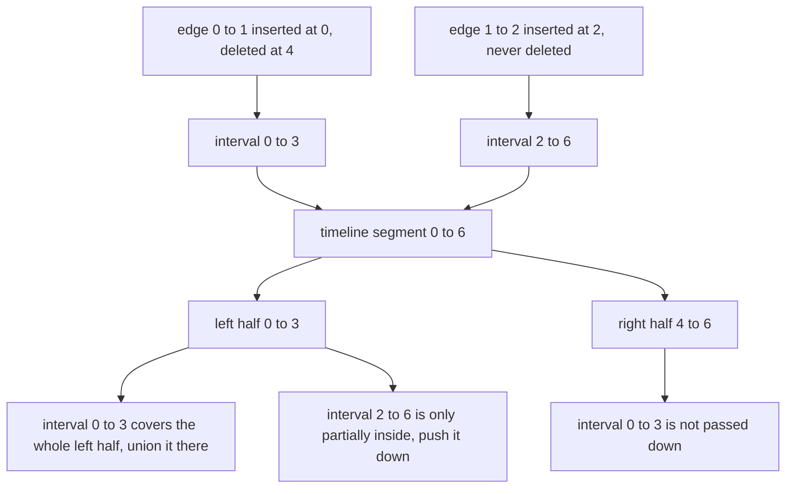
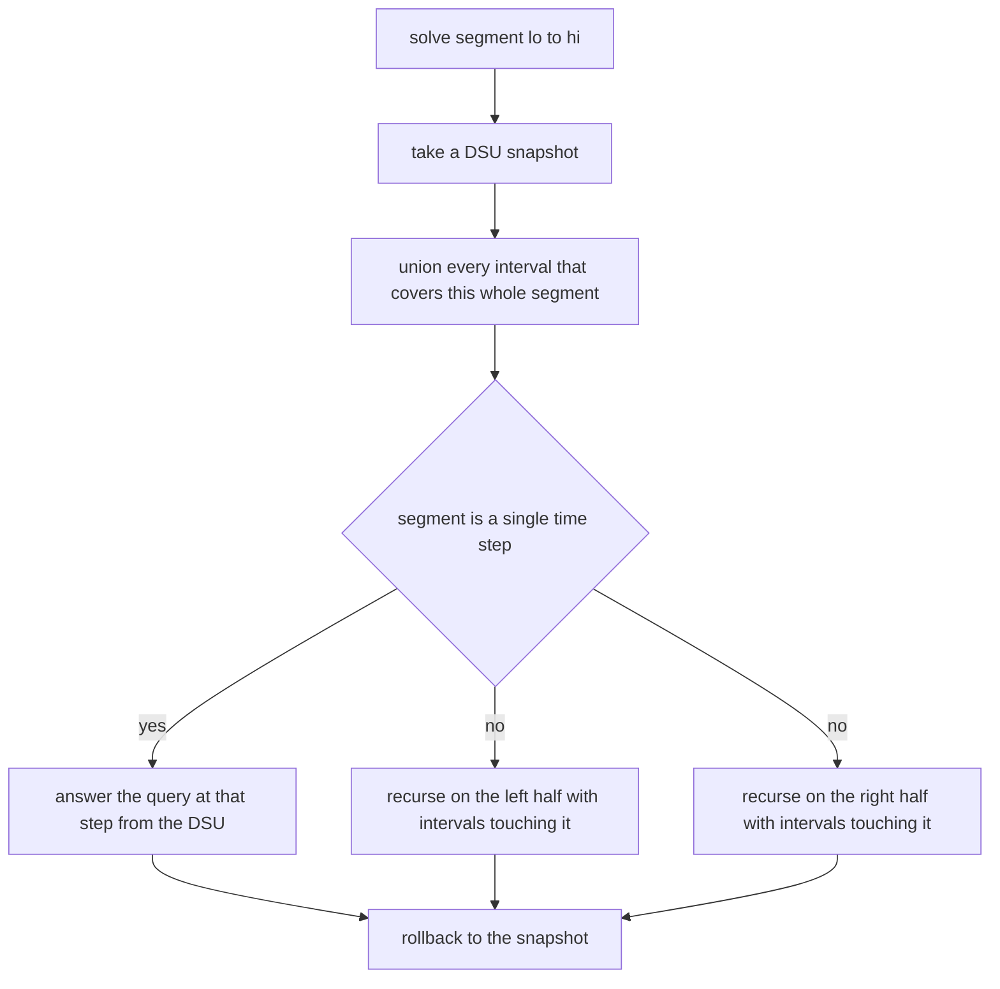
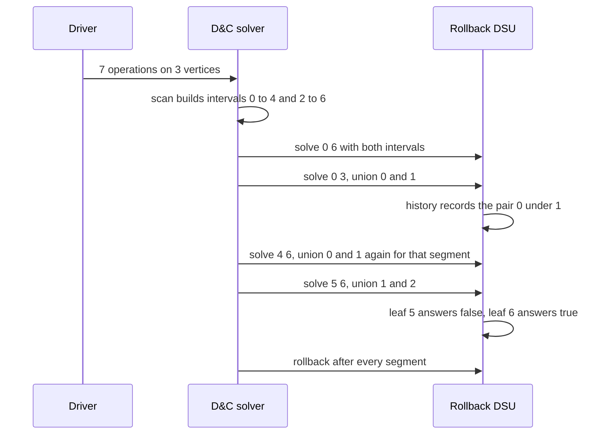

# 446 — Implement offline dynamic connectivity (divide & conquer + union find).

> **Tier:** Advanced · **CTCI chapter:** Ch 4 — Trees and Graphs
> **Task spec:** [446-implement-offline-dynamic-connectivity-divide-conquer-union-find.md](../../../tasks/advanced/446-implement-offline-dynamic-connectivity-divide-conquer-union-find.md)
> **Solutions:** [Python](../../../solutions/python/advanced/446-implement-offline-dynamic-connectivity-divide-conquer-union-find/solution.py) ·
> [Java](../../../solutions/java/advanced/446-implement-offline-dynamic-connectivity-divide-conquer-union-find/Solution.java) ·
> [JavaScript](../../../solutions/javascript/advanced/446-implement-offline-dynamic-connectivity-divide-conquer-union-find/solution.js) ·
> [C#](../../../solutions/csharp/advanced/446-implement-offline-dynamic-connectivity-divide-conquer-union-find/Solution.cs)

## 1. Problem restatement

A sequence of `q` operations on an undirected graph with `n` vertices is given **up front**:

| Kind | Meaning |
| --- | --- |
| `0` | insert edge `(u, v)` |
| `1` | delete edge `(u, v)` |
| `2` | query: are `u` and `v` connected right now? |

The task answers every query offline — one pass for all of them — instead of maintaining a dynamic
structure online. The returned list has one entry per operation, `true`/`false` for queries and
`None`/`null` for inserts and deletes.

| Script on `n = 3` | Answers |
| --- | --- |
| `(0,0,1), (2,0,1), (0,1,2), (2,0,2), (1,0,1), (2,0,2), (2,0,0)` | `[None, True, None, True, None, False, True]` |
| `(2,0,1), (0,0,1), (2,0,1), (1,0,1), (2,0,1), (2,1,1)` on `n = 2` | `[False, None, True, None, False, True]` |

Three semantics are documented in the header and enforced by those assertions:

1. **A deletion takes effect before any query at the same time step.** The interval of a deleted
   edge therefore ends at `t - 1`, exactly as the header's comment states.
2. **Parallel edges are counted.** Each edge carries a multiplicity, so inserting the same pair
   twice needs two deletions before it disappears.
3. **A query of a vertex with itself is always `True`**, because a vertex is trivially connected to
   itself.

The scripted runs generate valid scripts with `lcg_op_scripts(trials, seed, n, q)` — a delete only
ever removes an edge that is currently present, and `u == v` is fixed up to `v = (u + 1) mod n` —
and compare every answer against a brute-force replay that rebuilds the adjacency lists and runs a
BFS per query. The first batch is 30 scripts of 40 operations on `n = 8` (`seed 446`) and the
assertions require more than 100 query operations overall; the second is 10 scripts of 60
operations on `n = 12` (`seed 777`).

## 2. Intuition

Online dynamic connectivity is hard: a deletion can split a component and undoing that split needs
a structure that remembers far more than a parent pointer. The offline version sidesteps the whole
problem by never undoing anything — because it never has to.

The first observation is that the timeline can be turned into **intervals**. Every edge that is
inserted at time `a` and deleted at time `b` is present during `[a, b]`, and edges never deleted
stay present until `q - 1`. A query at time `t` only cares about intervals covering `t`.

The second observation is that a union-find with **rollback** can undo additions cheaply, as long as
it never uses path compression: union by size attaches one root under another, and undoing means
restoring `parent[ra] = ra` and subtracting the size again.



Put together, a **divide and conquer over the timeline** does the work: at a segment `[lo, hi]`,
union every interval that covers the whole segment, recurse into the two halves with the remaining
intervals, answer queries at leaves, then roll the DSU back to the state it had when the segment
was entered.



Each interval is unioned only on the `O(log q)` segments that fully contain it, and each segment
pays one snapshot plus one rollback, so the total is `O(q log q · α)` with the DSU's inverse
Ackermann factor.

## 3. Algorithm

1. Scan the operations once, keeping a multiplicity counter per canonical edge
   `key = (min(u,v), max(u,v))`. The first copy at time `t` opens an interval; when the counter drops
   back to zero at time `t`, close the interval at `t - 1`.
2. Every edge still open at the end of the scan gets an interval ending at `q - 1`.
3. Create a rollback DSU over `n` vertices: `parent`, `size`, and a `history` stack.
4. `solve(lo, hi, active)`: take a snapshot of the history; for each interval in `active`, if it
   covers `[lo, hi]` completely, `union` its endpoints, otherwise keep it for the children.
5. At a leaf (`lo == hi`), if the operation at that time is a query, record `same(u, v)` in the
   answer array.
6. Otherwise split at `mid` and recurse: the left child receives the intervals with `a <= mid` and
   `b >= lo`, the right child those with `a <= hi` and `b >= mid + 1`.
7. After both children return, `rollback(snapshot)` pops every union made since the snapshot,
   restoring `parent` and `size` — which is what makes sibling segments independent.
8. `union` returns immediately for endpoints already in the same component, and when it does merge
   it always attaches the smaller root under the larger, pushing the pair onto the history.

```text
procedure solve(lo, hi, active)
    snapshot ← dsu.snapshot()
    rest ← empty list
    for each interval (u, v, a, b) in active do
        if a <= lo and hi <= b then
            dsu.union(u, v)
        else
            append (u, v, a, b) to rest
        end
    end
    if lo = hi then
        if operation at lo is a query then
            answers[lo] ← dsu.same(u, v)
        end
    else
        mid ← floor of (lo + hi) / 2
        solve(lo, mid, intervals in rest with a <= mid and b >= lo)
        solve(mid + 1, hi, intervals in rest with a <= hi and b >= mid + 1)
    end
    dsu.rollback(snapshot)
end
```

```text
procedure rollback(snapshot)
    while length of history > snapshot do
        pop (ra, rb) from history
        parent[ra] ← ra
        size[rb] ← size[rb] - size[ra]
    end
end

procedure union(a, b)
    ra ← find(a)
    rb ← find(b)
    if ra = rb then
        return false
    end
    if size[ra] > size[rb] then
        swap ra and rb
    end
    parent[ra] ← rb
    size[rb] ← size[rb] + size[ra]
    append (ra, rb) to history
    return true
end
```

`find` is a plain iterative walk with **no path compression**: compression rewrites parent pointers
along the path, and those rewrites are not recorded in `history`, so a rollback would leave the
structure inconsistent. Union by size alone still keeps the depth `O(log n)`, which is what makes
the unchanging walk acceptable.

## 4. Worked example

Take the first hand script, `n = 3`, operations
`(0,0,1), (2,0,1), (0,1,2), (2,0,2), (1,0,1), (2,0,2), (2,0,0)` at times `0..6`.

Intervals: edge `(0,1)` is inserted at 0 and deleted at 5, so it is active on `[0, 4]`; edge `(1,2)`
is inserted at 2 and never deleted, so it is active on `[2, 6]`.

| Segment | Intervals covering it fully | DSU after the covering unions | Leaf action |
| --- | --- | --- | --- |
| `[0, 6]` | none | empty | recurse |
| `[0, 3]` | `(0,1)` on `[0,4]` covers it | `{0, 1}` | recurse |
| `[4, 6]` | none | empty | recurse |
| `[0, 1]` | `(0,1)` already unioned by the parent, so it is not re-unioned | `{0, 1}` | times 0, 1 |
| `[2, 3]` | none (interval `[0,4]` did not reach this child) | empty | times 2, 3 |
| `[4, 4]` | `(0,1)` is re-unioned here — segment `[4,6]` did not have it | `{0, 1}` | query at 4 |
| `[5, 6]` | `(1,2)` on `[2,6]` covers it | `{1, 2}` | times 5, 6 |

The leaf answers follow directly:

| Time | Operation | Component state at that leaf | Answer |
| --- | --- | --- | --- |
| 0 | insert `(0,1)` | — | `None` |
| 1 | query `(0,1)` | `{0, 1}` from the covering interval | `True` |
| 2 | insert `(1,2)` | — | `None` |
| 3 | query `(0,2)` | `(0,1)` and `(1,2)` both active | `True` |
| 4 | delete `(0,1)` | — | `None` |
| 5 | query `(0,2)` | only `(1,2)` active, so 0 is isolated | `False` |
| 6 | query `(0,0)` | a vertex is connected to itself | `True` |

Time 3 is the subtle one: the interval `(1,2)` becomes active *at* time 2, so the query at time 3
sees it, and the answer is `True`. Time 4 shows the deletion semantics: edge `(0,1)` is deleted at
time 5, so its interval `[0, 4]` covers time 4 — the deletion removes the edge **before** any query
at time 5, which is why the interval ends at `5 - 1 = 4` and why the query at time 5 already sees
vertex 0 isolated.



The measured workloads confirm the machinery runs at scale. Across the 30 scripts of 40 operations
on `n = 8` there are **426 query operations**, and the DSU is asked to union **924 times** in total
(about 31 union attempts per script, against roughly 15 inserts) — the gap is the `O(log q)` reuse
of each interval across the segment tree. The second batch adds 10 scripts of 60 operations on
`n = 12` holding **197 queries**, all matching the brute-force replay.

## 5. Complexity

Let `q` be the number of operations, `n` the number of vertices and `α` the inverse Ackermann
function of the union-by-size DSU.

| Measure | Bound | Why it holds |
| --- | --- | --- |
| Interval extraction | `O(q)` | one scan with a hash map of multiplicities |
| Segment recursion | `O(q)` nodes | the recursion is a segment tree over `q` time steps |
| Union work | `O(q log q · α)` | each interval is unioned on the `O(log q)` segments that contain it, and `find` is `O(log n)` at worst with union by size |
| Rollback work | `O(q log q)` | each successful union is popped exactly once |
| Space | `O(n + q)` | the DSU arrays, the history (at most the depth of the recursion in unions), the interval list, and the per-level active lists |
| Online alternative | amortised `O(log² n)` per operation with much heavier machinery | Euler-tour trees or link-cut trees maintain connectivity under deletions online |
| Brute replay | `O(q · (q + n))` | rebuilding adjacency lists and running a BFS per query — fine as an oracle, not as a solution |

Two rules keep the bounds honest. Path compression is forbidden, because compressed pointers cannot
be rolled back; union by size alone keeps `find` logarithmic. And each interval is only unioned on
segments it *fully* covers, which is what bounds the total union count by `O(q log q)` rather than
`O(q²)`.

## 6. Pitfalls and edge cases

- **Deletion timing.** A delete at time `t` removes the edge *before* any query at `t`, so the
  interval closes at `t - 1`. Closing it at `t` would make a query that happens at the same moment
  as the deletion see a connectivity that no longer exists; the second hand script
  (`delete`, then query at the next step) is the assertion that pins this down.
- **Multiplicities.** Inserting the same pair twice requires two deletions before the edge is gone.
  The solution keeps a counter per canonical key and only closes the interval when it reaches zero,
  and the driver's generator maintains the same invariant so that no script ever deletes an absent
  edge.
- **Canonical edge keys.** `(u, v)` and `(v, u)` are the same edge; the key is `(min, max)`. Without
  that normalisation, half the deletions would silently do nothing.
- **Intervals open at the end.** Edges never deleted are active until `q - 1`, not until `q`.
  Forgetting the tail interval loses connectivity for every query after the last insertion.
- **No path compression.** `find` must stay a plain walk. Compression rewrites pointers that the
  rollback does not know about, and the first rollback then leaves a corrupted parent array — the
  failure would show up as a wrong answer several segments later, not immediately.
- **Roll back exactly what you did.** `solve` snapshots on entry and rolls back on exit, so sibling
  subtrees never see each other's unions. Rolling back only some unions, or forgetting the rollback
  on the leaf path, leaks state sideways through the tree.
- **Union of already connected endpoints still costs a `find`.** `union` returns `false` without
  touching the history, which is why the history length is exactly the number of *successful* merges
  and the rollback can pop blindly.
- **Self-connectivity.** A query on `(v, v)` is `True` by definition — no union is needed — and the
  first hand script's last operation asserts it.
- **Isolated vertices.** A vertex touched by no surviving edge is its own component; the second hand
  script queries `(0,1)` before any insertion and must answer `False`.
- **Empty operation list.** `q == 0` returns an empty answer list immediately, before any interval
  or recursion is attempted.
- **Offline only.** Nothing here answers a query before the whole script is known; the algorithm's
  entire advantage comes from seeing the future of each edge.

## 7. Variants and follow-ups

- **The union-find basics.** [109-implement-union-find-disjoint-set-basic.md](../../../tasks/beginner/109-implement-union-find-disjoint-set-basic.md)
  and [110-path-compression-in-union-find.md](../../../tasks/beginner/110-path-compression-in-union-find.md)
  introduce the DSU that this task deliberately *simplifies* by dropping path compression, and
  [108-detect-cycle-in-undirected-graph-union-find.md](../../../tasks/beginner/108-detect-cycle-in-undirected-graph-union-find.md)
  is the online problem that needs no rollback at all.
- **The same problem, harder setting.** [704-implement-offline-dynamic-connectivity-with-divide-conquer-uf-ro.md](../../../tasks/expert/704-implement-offline-dynamic-connectivity-with-divide-conquer-uf-ro.md)
  is the expert-tier treatment of the identical technique.
- **Persistence instead of rollback.** [422-persistent-union-find-partial-persistence-basic.md](../../../tasks/advanced/422-persistent-union-find-partial-persistence-basic.md)
  and [613-implement-fully-persistent-union-find-complex.md](../../../tasks/expert/613-implement-fully-persistent-union-find-complex.md)
  keep old versions around instead of undoing the current one.
- **MST under insertions.** [447-implement-dynamic-mst-under-edge-insertions-conceptual.md](../../../tasks/advanced/447-implement-dynamic-mst-under-edge-insertions-conceptual.md)
  and [111-kruskal-s-mst-using-union-find.md](../../../tasks/beginner/111-kruskal-s-mst-using-union-find.md)
  apply the same DSU to a different dynamic question.
- **Other offline divide-and-conquer tricks.** [423-implement-offline-queries-with-divide-conquer-on-value-cdq.md](../../../tasks/advanced/423-implement-offline-queries-with-divide-conquer-on-value-cdq.md)
  reorders queries over values rather than over time; the shared idea is that answering everything
  at once can be cheaper than answering each query as it arrives.

## 8. Check yourself

1. Why is path compression incompatible with rollback union-find?

<details><summary>Show answer</summary>

Because compression rewrites the `parent` pointers of every node on the `find` path, and the history
stack only records the merges performed by `union`. Rolling back restores the merged roots but
leaves the compressed pointers in place, so nodes can end up pointing at a root that no longer
represents their component. Union by size keeps `find` at `O(log n)` without touching extra
pointers, which is why this structure uses it alone.

</details>

2. In the hand script, why is the query at time 3 `True` while the query at time 5 is `False`?

<details><summary>Show answer</summary>

The interval `[2, 6]` of edge `(1,2)` covers time 3, and the interval `[0, 4]` of edge `(0,1)`
covers it too, so all three vertices are in one component. At time 5 the deletion of `(0,1)` has
already happened (the deletion is at time 5 and takes effect before queries of that step), so only
`(1,2)` remains and vertex 0 is isolated from vertex 2.

</details>

3. Why does the algorithm *not* union an interval at a segment the interval only partially covers?

<details><summary>Show answer</summary>

Because the union would then be visible in time steps where the edge is not actually present —
including queries in the other half of that segment. The edge is instead pushed down to the children
whose segments it *does* cover, and eventually it is unioned exactly on the segments inside its own
interval. That is also what limits the union count to `O(log q)` per interval.

</details>

4. What does the measured "924 union attempts for 30 scripts" tell you about the segment
   decomposition?

<details><summary>Show answer</summary>

Each of those scripts has about 15 inserts and 40 operations in total, so a purely linear pass would
produce roughly 15 unions per script (450 overall). The observed 924 is close to double that, which
is the visible cost of re-unioning an interval once for every segment it spars over — and the
expected `O(log q)` is the *upper* bound that a random script rarely reaches.

</details>
