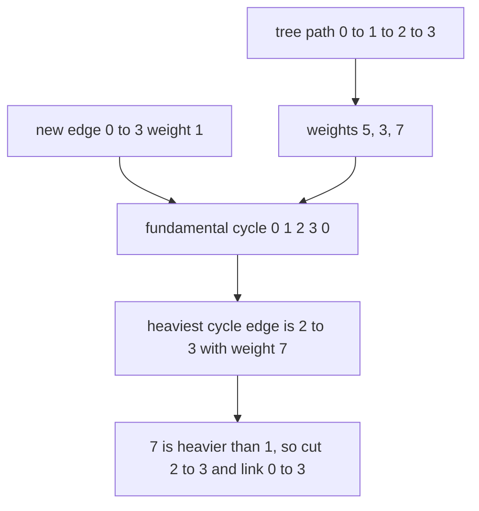
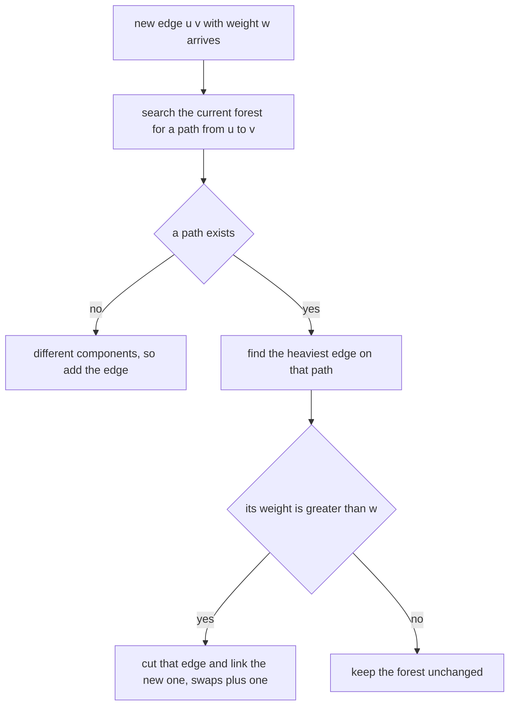
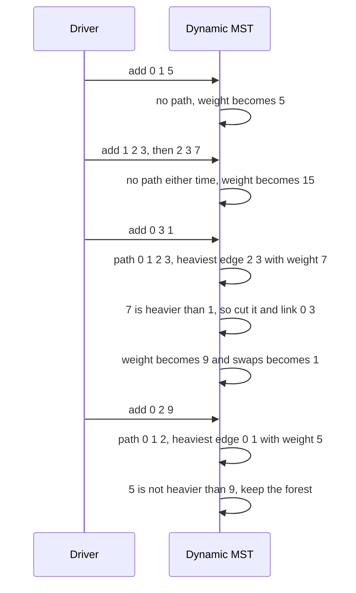

# 447 — Implement dynamic MST under edge insertions (conceptual).

> **Tier:** Advanced · **CTCI chapter:** Ch 4 — Trees and Graphs
> **Task spec:** [447-implement-dynamic-mst-under-edge-insertions-conceptual.md](../../../tasks/advanced/447-implement-dynamic-mst-under-edge-insertions-conceptual.md)
> **Solutions:** [Python](../../../solutions/python/advanced/447-implement-dynamic-mst-under-edge-insertions-conceptual/solution.py) ·
> [Java](../../../solutions/java/advanced/447-implement-dynamic-mst-under-edge-insertions-conceptual/Solution.java) ·
> [JavaScript](../../../solutions/javascript/advanced/447-implement-dynamic-mst-under-edge-insertions-conceptual/solution.js) ·
> [C#](../../../solutions/csharp/advanced/447-implement-dynamic-mst-under-edge-insertions-conceptual/Solution.cs)

## 1. Problem restatement

Edges arrive one at a time, and after every insertion the weight of a minimum spanning forest must be
available. The header documents the incremental rule the solutions implement:

- If the new edge joins **two different components** of the current forest, add it.
- Otherwise the new edge closes a **fundamental cycle** with the unique tree path between its
  endpoints, and it only belongs to an MST when it is **strictly lighter** than the heaviest tree
  edge on that path — in which case the two swap (cut the heavy edge, link the new one).

`DynamicMST(n)` exposes `add_edge(u, v, w)`, `mst_weight()` and a `swaps` counter. The harness never
trusts the rule blindly: after every insertion it recomputes **Kruskal from scratch** on the edges
seen so far and asserts the weights agree.

| Hand case on `n = 4` | Weight after | Tree edges | Swaps |
| --- | --- | --- | --- |
| `add_edge(0, 1, 5)` | `5` | `(0,1,5)` | 0 |
| `add_edge(1, 2, 3)` | `8` | `(0,1,5), (1,2,3)` | 0 |
| `add_edge(2, 3, 7)` | `15` | `(0,1,5), (1,2,3), (2,3,7)` | 0 |
| `add_edge(0, 3, 1)` | `9` | `(0,1,5), (1,2,3), (0,3,1)` | 1 |
| `add_edge(0, 2, 9)` | `9` | unchanged | 1 |

The scripted runs use `lcg_edge_stream(count, seed, n)` (`u = seed mod n`, `v = seed mod n` with
`v = (u + 1) mod n` when they coincide, `w = 1 + seed mod 30`) and check the maintained weight
against `kruskal_weight(n, inserted)` **after every single insertion** for 25 trials with
`n = 4 + trial mod 5` and `2n` edges each. A final case inserts `3n` edges into `n = 6` and asserts
both the weight and that the maintained tree has exactly `n - 1 = 5` edges.

## 2. Intuition

Recomputing an MST from scratch after each insertion costs a full sort and a Kruskal pass. The
incremental rule replaces that with a local check, and it rests on one property of minimum spanning
trees: **the heaviest edge on a cycle is never in any MST**. When a new edge closes a cycle, either
the new edge is that heaviest edge — and then it can be discarded — or the heaviest tree edge on the
path is, and the two must exchange places.



The four steps of an insertion follow directly:



The `_heaviest_on_path` helper is a plain search from `u` that records parents until it either finds
`v` or exhausts its component; when `v` is unreachable the answer is "different components". The
current forest is stored as a small list of tree edges and rebuilt into an adjacency map on every
search, which is why the header is explicit that "O(1) insertions become O(n) path scans here
because graphs in the tests are small; the rule itself is the conceptual core".

Three invariants make the maintained object a valid forest at all times: sizes never grow past
`n - 1` tree edges, a swap keeps that count unchanged, and the cut edge is always on the cycle, so
removing it cannot disconnect anything.

## 3. Algorithm

1. `add_edge(u, v, w)`: append the edge to the full edge list, then compute
   `heaviest = _heaviest_on_path(u, v)` — the heaviest tree edge on the current `u`–`v` path, or
   nothing when there is no such path.
2. If there is no path, the endpoints are in different components: append the edge to `tree_edges`.
3. Otherwise, if `heaviest.weight > w`, remove the heavy edge from `tree_edges`, append the new edge,
   and increment `swaps`. Equal weights do **not** swap.
4. `_heaviest_on_path(u, v)`: return nothing when `u == v` or when `u` has no tree edges; otherwise
   walk the component from `u` with a stack, recording `parent[y] = (x, edge)` for every newly
   discovered vertex.
5. If `v` was never discovered, the vertices are in different components. Otherwise walk from `v`
   back to `u` along the parent chain, tracking the maximum-weight edge seen.
6. `mst_weight()` sums the weights of `tree_edges` — the answer is a forest weight when the graph is
   disconnected, exactly like Kruskal's total.

```text
procedure add_edge(u, v, w)
    append (u, v, w) to edges
    heaviest ← heaviest_on_path(u, v)
    if heaviest is nothing then
        append (u, v, w) to tree_edges
    else if weight of heaviest > w then
        remove heaviest from tree_edges
        append (u, v, w) to tree_edges
        swaps ← swaps + 1
    end
end
```

```text
procedure heaviest_on_path(u, v)
    if u = v then
        return nothing
    end
    adjacency ← map from vertex to its tree neighbours with their edges
    if u is not in adjacency then
        return nothing
    end
    parent ← map with u mapped to nothing
    stack ← list containing u
    while stack is not empty do
        x ← pop from stack
        for each (y, edge) adjacent to x do
            if y is not in parent then
                parent[y] ← (x, edge)
                push y onto stack
            end
        end
    end
    if v is not in parent then
        return nothing
    end
    heaviest ← nothing
    node ← v
    while parent[node] is not nothing do
        (x, edge) ← parent[node]
        if heaviest is nothing or weight of edge > weight of heaviest then
            heaviest ← edge
        end
        node ← x
    end
    return heaviest
end
```

The search doubles as the connectivity test: a single traversal answers both "is there a path" and
"what is the heaviest edge on it", which is why the rule needs no separate component bookkeeping —
and why the maintained structure never needs a union-find of its own.

## 4. Worked example

Trace the hand case, where every insertion is asserted individually.

| Step | Insert | Path found in the forest | Heaviest on path | Decision | Weight | `swaps` |
| --- | --- | --- | --- | --- | --- | --- |
| 1 | `(0,1,5)` | none — vertex 1 is unreachable | — | add | `5` | 0 |
| 2 | `(1,2,3)` | none — vertex 2 is unreachable | — | add | `8` | 0 |
| 3 | `(2,3,7)` | none — vertex 3 is unreachable | — | add | `15` | 0 |
| 4 | `(0,3,1)` | `0 → 1 → 2 → 3` | `(2,3,7)` | `7 > 1`, so swap | `9` | 1 |
| 5 | `(0,2,9)` | `0 → 1 → 2` | `(0,1,5)` | `5 > 9` is false, keep | `9` | 1 |

Step 4 is the cut-and-link: the forest `{(0,1,5), (1,2,3), (2,3,7)}` weighs 15, and the new edge
`(0,3,1)` closes the cycle `0-1-2-3-0` whose heaviest edge is `(2,3,7)`. Removing that edge and
adding the new one keeps the edge count at three and drops the weight to `5 + 3 + 1 = 9`, which is
what Kruskal computes on the four edges (sorted: 1, 3, 5, 7 — pick 1, 3, 5 and stop: 9).

Step 5 is the discard: the new edge is heavier than every edge on its path, so the heaviest path
edge `(0,1,5)` stays and the weight does not move. Note that the path here is `0 → 1 → 2`, **not**
the longer route through vertex 3, because the forest is a tree — which is exactly what makes the
path unique.



The scripted runs put numbers on how often the swap path fires: **300 inserted edges across 25
trials produced 76 swaps**, with individual trials ranging from 2 to 4 swaps (for example `n = 4`
with 8 edges gave 2 swaps, `n = 6` with 12 edges gave 4). The `n = 6` run with 18 edges ends with
`swaps = 6`, a maintained tree of exactly `n - 1 = 5` edges, and a weight of `43` that equals
Kruskal's `43`.

## 5. Complexity

Let `n` be the vertex count, `m` the number of insertions so far and `n_t` the number of tree edges
(at most `n - 1`).

| Measure | Bound | Why it holds |
| --- | --- | --- |
| `add_edge`, path search | `O(n_t)` = `O(n)` | the adjacency map is rebuilt and one traversal of the forest is performed |
| `add_edge`, swap | `O(n_t)` | the cut is a list removal and the link is an append |
| `add_edge`, whole | `O(n)` | search plus constant bookkeeping — the header's "O(1) insertions become O(n) path scans" |
| `mst_weight` | `O(n)` | it sums at most `n - 1` edges (an `O(1)` running total would be possible) |
| Space | `O(m + n)` | the full edge list is kept, plus the forest and a temporary adjacency map |
| Kruskal from scratch | `O(m log m)` per insertion, `O(m² log m)` for the whole stream | the oracle the harness uses, not the solution |
| Fully dynamic structures | `O(log² n)` amortised per update | link-cut trees and Euler-tour trees maintain the MST incrementally with far heavier machinery |

The interesting part of the table is the last two rows: the rule is what this task documents, and the
`O(n)` rescan is the deliberate simplification. Over 300 measured insertions the maintained forest
never exceeded `n - 1 = 7` edges, so the rescans stayed cheap.

## 6. Pitfalls and edge cases

- **The swap is strictly lighter, not lighter-or-equal.** `heaviest.weight > w` is the condition, so
  an edge of equal weight leaves the forest alone. Both choices give a minimum spanning tree of the
  same weight, which is all the driver asserts — but the *tree* differs, so the comparison must not
  be flipped casually.
- **A path search doubles as the connectivity test.** Returning nothing means "different
  components", and that case *adds* the edge. Treating it as "do nothing" would leave the forest
  short of an edge and make the weight too small.
- **The path must be the unique tree path.** The forest is acyclic by construction, so the route
  between two connected vertices is unique; a search that found a non-tree route (or a cycle) would
  compare the new edge against the wrong edges.
- **Self-loops.** `_heaviest_on_path(u, u)` returns nothing, so a self-loop would be *added* to the
  forest as if it joined two components. The generator prevents `u == v`
  (`if u == v then v = (v + 1) mod n`), and the hand cases never contain one — the rule as written
  assumes simple edges.
- **Parallel edges.** Two edges between the same pair are fine: the second one finds the first on its
  path and swaps only if it is strictly lighter, which is exactly the correct behaviour for
  multi-edges.
- **Disconnected graphs.** The forest is a spanning forest, and `mst_weight()` sums its edges.
  Kruskal's total for a disconnected graph is the same sum, so the harness comparison stays valid
  even before the stream connects the graph.
- **Empty and single-vertex graphs.** No edges means weight 0; a single vertex has no adjacency
  entry, so every search returns nothing and every edge is added — there are none.
- **The heaviest edge on the path may be the new edge itself?** It cannot: the search runs *before*
  the new edge is added to the forest, so it only sees tree edges.
- **Rebuilding the adjacency map each time.** `_adjacency()` runs on every insertion, which is where
  the `O(n)` cost comes from. Keeping an incremental adjacency structure would speed it up without
  changing the rule.
- **`tree_edges` is a list, not a set.** Removing the heavy edge relies on tuple equality, so the
  stored tuple is exactly the one that was inserted — reconstructing it differently (for instance
  swapping `u` and `v`) would silently fail to remove anything.
- **The oracle is not optional.** Every one of the 300 scripted insertions is checked against a full
  Kruskal pass, because the rule's correctness is subtle and a single missed swap would show up only
  as a slightly wrong weight.

## 7. Variants and follow-ups

- **Building an MST from scratch.** [111-kruskal-s-mst-using-union-find.md](../../../tasks/beginner/111-kruskal-s-mst-using-union-find.md)
  is the batch algorithm the harness recomputes after every insertion, and
  [112-prim-s-mst-using-heap.md](../../../tasks/beginner/112-prim-s-mst-using-heap.md) is the
  heap-based alternative.
- **Dynamic connectivity, the sibling dynamic question.** [446-implement-offline-dynamic-connectivity-divide-conquer-union-find.md](../../../tasks/advanced/446-implement-offline-dynamic-connectivity-divide-conquer-union-find.md)
  answers insertions *and* deletions offline, which is what the `O(n)` rescan here avoids.
- **The structures that make it fast.** [419-implement-dynamic-tree-link-cut-tree-basic-operations.md](../../../tasks/advanced/419-implement-dynamic-tree-link-cut-tree-basic-operations.md)
  and [420-implement-euler-tour-tree-for-dynamic-forests-conceptual.md](../../../tasks/advanced/420-implement-euler-tour-tree-for-dynamic-forests-conceptual.md)
  maintain a dynamic forest with `cut` and `link` in `O(log n)` — the operations this task simulates
  with a path scan and a list edit.
- **Union-find as the connectivity oracle.** [109-implement-union-find-disjoint-set-basic.md](../../../tasks/beginner/109-implement-union-find-disjoint-set-basic.md)
  and [110-path-compression-in-union-find.md](../../../tasks/beginner/110-path-compression-in-union-find.md)
  show the structure Kruskal uses; the dynamic rule above does not need it because the forest itself
  answers connectivity.
- **Other incremental geometric maintenance.** [418-implement-online-convex-hull-maintenance-dynamic.md](../../../tasks/advanced/418-implement-online-convex-hull-maintenance-dynamic.md)
  applies the same "insert, repair locally" discipline to a convex hull.

## 8. Check yourself

1. Why can the heaviest edge on the fundamental cycle always be removed without disconnecting the
   graph?

<details><summary>Show answer</summary>

Because it lies on a cycle. A cycle edge is never a bridge: the rest of the cycle already provides an
alternative route between its endpoints, so removing it keeps every vertex reachable. Here the cycle
is the tree path plus the new edge, and the heaviest of those edges — whichever it is — can go.

</details>

2. After the four hand-case insertions the forest is `{(0,1,5), (1,2,3), (0,3,1)}`. Why does
   `add_edge(0, 2, 9)` leave it alone?

<details><summary>Show answer</summary>

The tree path from 0 to 2 is `0 → 1 → 2` with edges of weight 5 and 3, so the heaviest path edge is
the 5. The condition is `5 > 9`, which is false, so the new edge is heavier than everything on its
cycle and cannot be in any MST — exactly the "heaviest edge on a cycle" rule.

</details>

3. The n = 6 scripted run ends with 5 forest edges and `swaps == 6`. What would a bug that never
   performs swaps produce?

<details><summary>Show answer</summary>

A heavier forest: the algorithm would keep the first `n - 1` edges that connect the graph and ignore
every lighter edge arriving later, so the weight would exceed Kruskal's. The final assertion compares
against Kruskal (both 43 in the measured run), and the `swaps_seen > 0` assertion in the 25-trial
loop exists precisely to ensure the swap path is not dead code.

</details>

4. Why does the implementation not use union-find at all, even though Kruskal's version does?

<details><summary>Show answer</summary>

Because connectivity here is decided by the forest itself: the path search from `u` already tells you
whether `v` is reachable, and it also has to run anyway to find the heaviest path edge. Adding a
union-find would duplicate information that the swap logic must be able to *undo* when an edge is
cut — and union-find has no cheap rollback (unlike the version used in
[446](../../../tasks/advanced/446-implement-offline-dynamic-connectivity-divide-conquer-union-find.md),
which uses union by size with no path compression).

</details>
