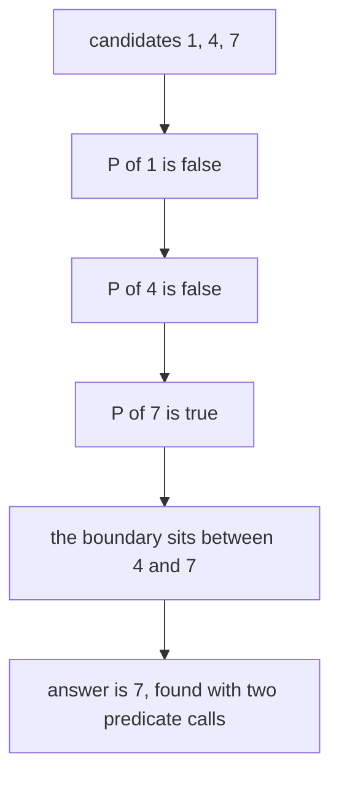
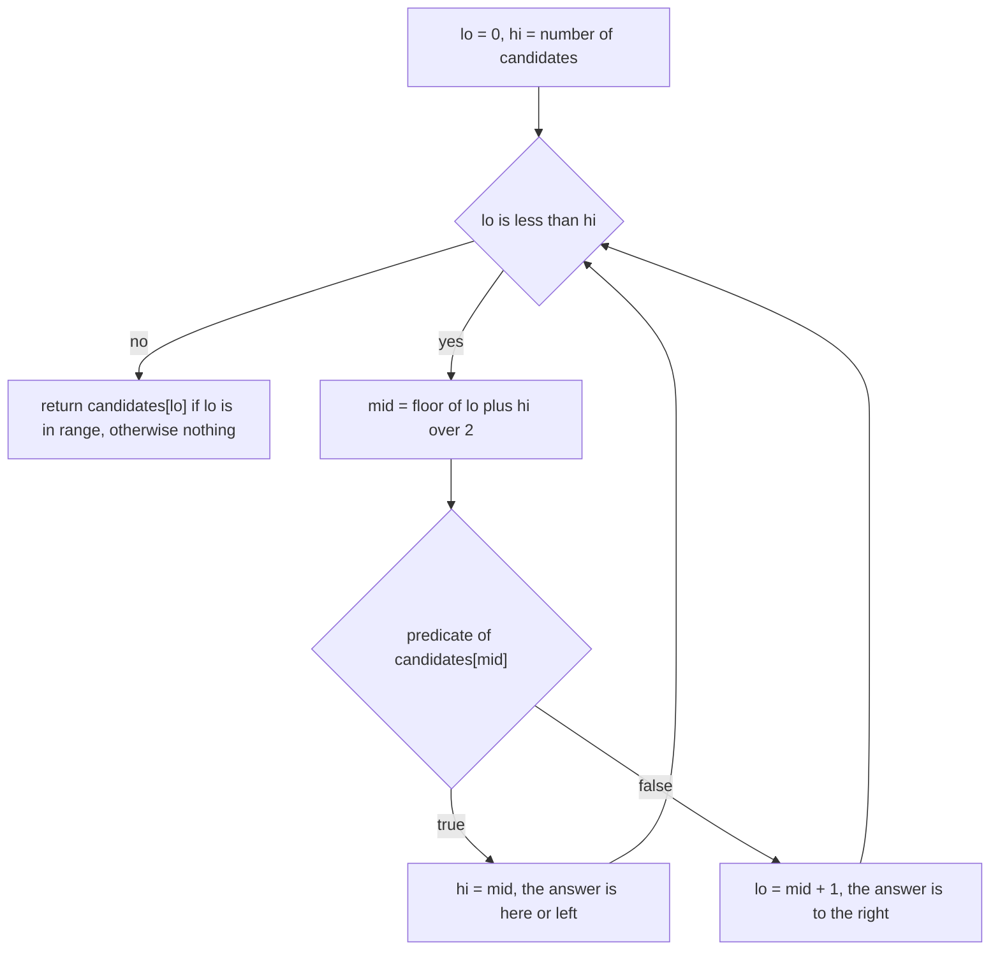
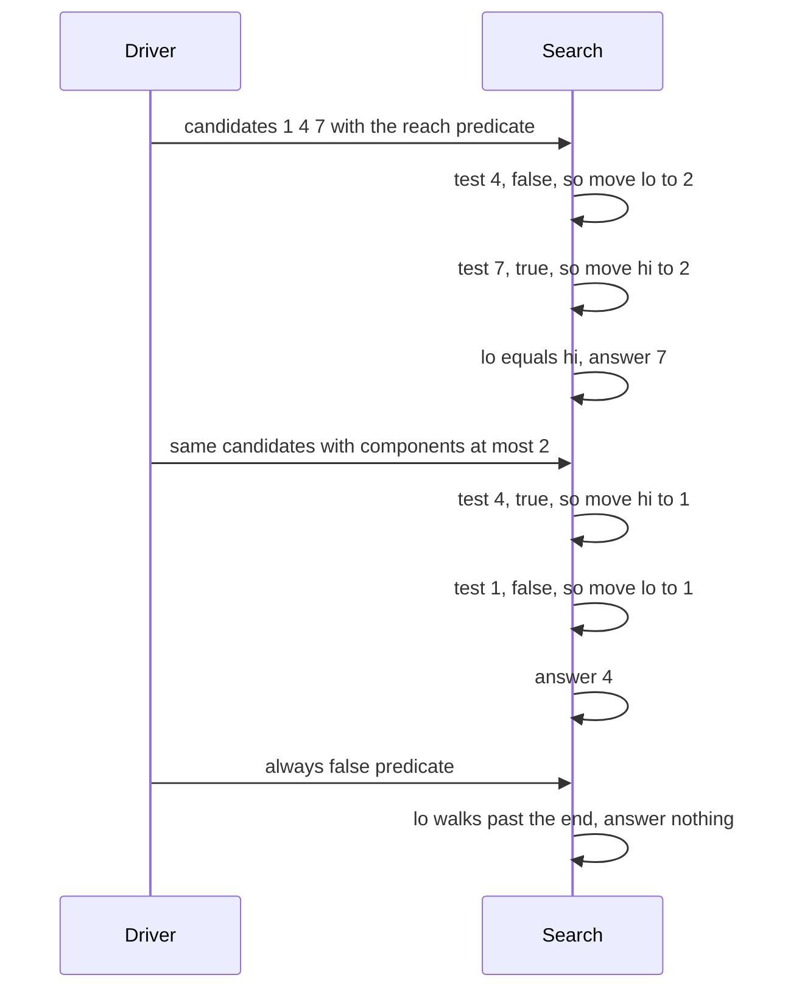

# 448 — Implement parametric search for optimizing monotone predicates.

> **Tier:** Advanced · **CTCI chapter:** Beyond — Advanced Data Structures & Algorithms
> **Task spec:** [448-implement-parametric-search-for-optimizing-monotone-predicates.md](../../../tasks/advanced/448-implement-parametric-search-for-optimizing-monotone-predicates.md)
> **Solutions:** [Python](../../../solutions/python/advanced/448-implement-parametric-search-for-optimizing-monotone-predicates/solution.py) ·
> [Java](../../../solutions/java/advanced/448-implement-parametric-search-for-optimizing-monotone-predicates/Solution.java) ·
> [JavaScript](../../../solutions/javascript/advanced/448-implement-parametric-search-for-optimizing-monotone-predicates/solution.js) ·
> [C#](../../../solutions/csharp/advanced/448-implement-parametric-search-for-optimizing-monotone-predicates/Solution.cs)

## 1. Problem restatement

A predicate `P(d)` over a numeric parameter is **monotone** when its values over increasing `d` look
like `false, false, …, true, true`: once it fires, it stays true. The task is to find the smallest
candidate for which it fires, by binary searching a sorted list of candidates instead of testing
every value.

| Function | Meaning |
| --- | --- |
| `parametric_min(candidates, predicate)` | the smallest candidate `c` with `predicate(c)` true, or `None` when it never fires |
| `linear_scan(candidates, predicate)` | the same answer by walking the list — the oracle |
| `assert_monotone(candidates, predicate)` | asserts the sampled values are already sorted |

Two graph instances are built on the same machinery:

| Predicate | Definition |
| --- | --- |
| `reachable_all(n, edges, d, source)` | every vertex is reachable from `source` using only edges of weight `<= d` (bottleneck connectivity, a BFS) |
| `components_leq(n, edges, d, k)` | the graph has at most `k` connected components when only edges of weight `<= d` are kept (a union-find pass) |

The hand case uses the path `(0,1,4), (1,2,1), (2,3,7)` with candidates `[1, 4, 7]`:

| Predicate | Values over `[1, 4, 7]` | `parametric_min` | `linear_scan` |
| --- | --- | --- | --- |
| `reachable_all(4, edges, d, 0)` | `False, False, True` | `7` | `7` |
| `components_leq(4, edges, d, 2)` | `False, True, True` | `4` | `4` |
| `components_leq(4, edges, d, 1)` | `False, False, True` | `7` | `7` |

Boundary behaviour is asserted directly: a single candidate (`[5]` with the edge `(0,1,5)`) resolves
to `5`; a predicate that is always false returns `None`; a predicate that is always true returns the
**first** candidate (`1`), not the last.

The scripted part builds 20 graphs with `lcg_graphs(20, 448, 12)` — a random spanning tree plus `n`
extra edges, so each graph is connected and weighted `1..30` — takes the sorted set of distinct edge
weights as the candidate list, and for every graph runs **five** predicates: `reachable_all` from
`source = 0` and from `source = n - 1`, and `components_leq` for `k = 1, 2, 4`. Each run asserts
monotonicity on the sample and equality with `linear_scan`, for exactly `100` checks.

## 2. Intuition

The pattern is the same one that powers "binary search on the answer": a feasibility question that
flips from no to yes exactly once as the parameter grows. Instead of asking the expensive question at
every value, you ask it at the middle of the remaining range and discard half.



Monotonicity is what makes the halving safe: if `P(mid)` is true, the answer cannot be to the right
of `mid` (everything there is also true, and none of it is *smaller*); if `P(mid)` is false, the
answer cannot be at `mid` or to its left. The search therefore never needs to inspect the discarded
half.



The two graph predicates show why the candidate list is a *sorted list of weights* rather than an
integer range: the answer is always one of the input weights, because nothing changes between two
consecutive weight values. Binary searching `1..30` would do more predicate evaluations for exactly
the same answer. Note also what "parametric search" means here — the header describes the
binary-search-the-answer technique, not Megiddo's more elaborate parallel parametric search.

## 3. Algorithm

1. `parametric_min(candidates, predicate)`: set `lo = 0` and `hi = len(candidates)` — a half-open
   range, so `hi` is also the "nothing is true" sentinel.
2. While `lo < hi`, take `mid = (lo + hi) // 2`; if the predicate is true at `candidates[mid]`, set
   `hi = mid`, otherwise set `lo = mid + 1`.
3. When the loop ends, return `candidates[lo]` if `lo` is inside the list, else `None`.
4. `linear_scan` walks the same list and returns the first candidate the predicate accepts — the
   independent oracle the drivers compare against.
5. `reachable_all(n, edges, d, source)` builds an adjacency list from the edges with `w <= d`, runs
   a stack-based DFS from `source`, and returns whether every vertex was seen.
6. `components_leq(n, edges, d, k)` unions the endpoints of every edge with `w <= d` in a
   path-compressed union-find and returns whether the remaining component count is at most `k`.
7. `assert_monotone` evaluates the predicate at every candidate and asserts the resulting list is
   non-decreasing.

```text
procedure parametric_min(candidates, predicate)
    lo ← 0
    hi ← length of candidates
    while lo < hi do
        mid ← floor of (lo + hi) / 2
        if predicate(candidates[mid]) then
            hi ← mid
        else
            lo ← mid + 1
        end
    end
    if lo < length of candidates then
        return candidates[lo]
    end
    return nothing
end
```

```text
procedure components_leq(n, edges, d, k)
    parent ← identity over n vertices
    components ← n
    for each (u, v, w) in edges do
        if w <= d then
            ru ← find(u)
            rv ← find(v)
            if ru is not rv then
                parent[ru] ← rv
                components ← components - 1
            end
        end
    end
    return components <= k
end
```

Both predicates are monotone in `d` for the same structural reason: raising `d` only ever *adds*
edges to the filtered graph, so reachability can only grow (never shrink) and the component count can
only fall. `reachable_all` is monotone up to the point where it becomes permanently true, and
`components_leq` is monotone because the count is non-increasing in `d`.

## 4. Worked example

Trace `parametric_min([1, 4, 7], reachable_all(4, edges, d, 0))` on the path
`(0,1,4), (1,2,1), (2,3,7)`.

| Iteration | `lo` | `hi` | `mid` | Candidate tested | `P(d)` | Action |
| --- | --- | --- | --- | --- | --- | --- |
| 1 | 0 | 3 | 1 | `4` | `False` (vertex 3 unreachable, needs weight 7) | `lo = 2` |
| 2 | 2 | 3 | 2 | `7` | `True` (1, 4 and 7 all available) | `hi = 2` |
| end | 2 | 2 | — | — | — | return `candidates[2] = 7` |

Two predicate calls, and the answer `7` matches the assertion and the `linear_scan` result, which
needed three calls in this case (`1` false, `4` false, `7` true).

The second predicate uses the same candidates but a different threshold semantics:

| Search | Iteration | `lo` | `hi` | Candidate tested | `P(d)` | Action |
| --- | --- | --- | --- | --- | --- | --- |
| `components_leq(..., k = 2)` | 1 | 0 | 3 | `4` | `True` (edges 1 and 4 leave components `{0,1,2}, {3}`, that is 2) | `hi = 1` |
| | 2 | 0 | 1 | `1` | `False` (only the 1-edge is available, so 3 components) | `lo = 1` |
| | end | 1 | 1 | — | — | return `4` |
| `components_leq(..., k = 1)` | 1 | 0 | 3 | `4` | `False` (2 components, needs 1) | `lo = 2` |
| | 2 | 2 | 3 | `7` | `True` (connected) | `hi = 2` |
| | end | 2 | 2 | — | — | return `7` |



The degenerate cases show the loop bounds working:

| Call | Trace | Result |
| --- | --- | --- |
| `parametric_min([1, 2, 3], always false)` | `mid = 1` false, `mid = 2` false, `lo = 3 = hi` | `None` |
| `parametric_min([1, 2, 3], always true)` | `mid = 1` true, `mid = 0` true, `lo = 0 = hi` | `1` |
| `parametric_min([5], reachable_all(2, [(0,1,5)], d, 0))` | `mid = 0` true, `hi = 0` | `5` |

The scripted 20 graphs give a measured comparison of the two strategies. With candidate lists of
`5` to `17` distinct weights (average about `11.6`), the 100 checks performed **358 predicate calls
via the binary search and 676 via the linear scan**. The gap is smaller than the asymptotic
`log₂ L` versus `L` would suggest, because the linear scan *stops at the answer* — it never evaluates
the candidates above the boundary.

## 5. Complexity

Let `L` be the number of candidates, `n` the vertex count and `m` the edge count.

| Measure | Bound | Why it holds |
| --- | --- | --- |
| `parametric_min`, predicate calls | `O(log L)` | each iteration halves the range; the measured average is `358 / 100 ≈ 3.6` calls per check |
| `linear_scan`, predicate calls | `O(L)` worst, `O(position of the answer)` on average | it stops at the first true candidate |
| `reachable_all` | `O(n + m)` | it filters the edge list and runs one DFS |
| `components_leq` | `O(m · α(n))` | one union-find pass over the filtered edges |
| Whole query (binary search) | `O(log L · (n + m))` | `log L` evaluations of a linear predicate |
| Whole query (linear scan) | `O(L · (n + m))` worst | measured 676 against 358 calls on the same inputs |
| Space | `O(n + m)` per predicate call | the temporary adjacency list or union-find arrays |
| Brute force over the whole weight range | `O(max weight · (n + m))` | iterating every integer parameter, not just the candidate weights |

The last row is why the candidate list matters: the problem is defined on *weights*, and the answer is
one of them, so testing integers between two distinct weights can never discover anything new.

## 6. Pitfalls and edge cases

- **Monotonicity is a precondition, not a property of the search.** The binary search is only correct
  because the predicate flips once; `assert_monotone` checks that on every candidate list the drivers
  use, and the whole technique silently returns a wrong answer for a predicate that is true, then
  false, then true.
- **The candidate list must be sorted and distinct.** `parametric_min` never sorts — it assumes the
  list is already in increasing order, which is why the drivers build it with
  `sorted({w for _, _, w in edges})`.
- **The answer is a candidate, not an index or a count.** The function returns `candidates[lo]`, so a
  caller that expects a position will be off by an arbitrary amount.
- **`None` means "never true".** The half-open range `hi = len(candidates)` doubles as that sentinel:
  if the predicate never fires, `lo` walks all the way to `len(candidates)` and the function reports
  `None` instead of indexing past the end.
- **Always-true predicates return the first candidate,** not the last — the loop keeps moving `hi`
  left while the predicate holds, so it converges on the *smallest* satisfying candidate.
- **A disconnected graph makes `reachable_all` always false.** Then the bottleneck answer is `None`,
  not infinity; the scripted graphs are explicitly built as "random spanning tree plus extra edges"
  so the predicate does fire for some candidate.
- **`components_leq` with a large `k` is trivially true at the smallest candidate.** For `k >= n` no
  edge is needed at all, so the answer is `candidates[0]`; the driver's `k` values are `1, 2, 4`,
  which is what keeps all three cases meaningful.
- **`reachable_all` counts the source as reachable.** It marks the source before the DFS, so a
  single-vertex graph is trivially satisfied at every candidate — and a predicate that is always true
  returns the first candidate rather than failing.
- **Predicate cost dominates.** Binary search saves calls, not work per call: each evaluation of
  `reachable_all` rebuilds the adjacency list and re-runs a DFS from scratch, so the total cost is
  `log L` full passes rather than `L` of them.
- **Ties in weights.** Duplicate weights collapse into a single candidate, which is correct: two
  edges of the same weight are always added together by the `w <= d` filter, so no boundary can fall
  between them.
- **The measured advantage is modest on small lists.** With `L` around 10 the binary search does about
  3.6 calls and the scan about 6.8, so the technique's real payoff appears on large candidate lists —
  a fact the measured `358` versus `676` makes concrete.

## 7. Variants and follow-ups

- **The primitive underneath.** [075-binary-search-iterative-on-sorted-array.md](../../../tasks/beginner/075-binary-search-iterative-on-sorted-array.md)
  is the plain search this function reuses, with the comparison replaced by a predicate call.
- **Binary search on the answer elsewhere.** [317-longest-duplicate-substring-binary-search-hash.md](../../../tasks/intermediate/317-longest-duplicate-substring-binary-search-hash.md)
  binary searches a *length* whose predicate is a hashing check — the same shape with a different
  monotone parameter.
- **The bottleneck problem behind `reachable_all`.** [111-kruskal-s-mst-using-union-find.md](../../../tasks/beginner/111-kruskal-s-mst-using-union-find.md)
  solves the same class of questions offline: the bottleneck value on a path is the heaviest edge on
  the minimax path, which Kruskal's process reveals directly.
- **Component counting as a predicate.** [446-implement-offline-dynamic-connectivity-divide-conquer-union-find.md](../../../tasks/advanced/446-implement-offline-dynamic-connectivity-divide-conquer-union-find.md)
  uses the same union-find component counting for a temporal problem instead of a monotone one.
- **Other monotone search problems.** [417-implement-dp-with-monotone-queue-optimization.md](../../../tasks/advanced/417-implement-dp-with-monotone-queue-optimization.md)
  exploits monotonicity in dynamic programming rather than in a predicate over a parameter.

## 8. Check yourself

1. Why is `reachable_all(n, edges, d, source)` monotone in `d`?

<details><summary>Show answer</summary>

Because the filtered graph only *gains* edges as `d` grows: the edge set for `d` is a subset of the
edge set for any larger `d`. Adding edges can turn unreachable vertices into reachable ones but can
never make a reachable vertex unreachable, so the predicate's values are false up to a threshold and
true afterwards.

</details>

2. In the hand case, `parametric_min(candidates, components_leq(..., k = 2))` returns 4 with only two
   predicate calls. Which two calls, and why is 1 not tested?

<details><summary>Show answer</summary>

The calls are `P(4) = True` and `P(1) = False`. Testing `P(4)` first moves `hi` to 1, so the range
becomes `[0, 1)`, and the next midpoint is 0 — candidate 1. Since that is false, `lo` becomes 1 and
the loop ends with `lo == hi == 1`, which is the position of 4. Candidate 7 is never tested because
the true at 4 already proved the answer is at most 4.

</details>

3. Why does the driver set `hi = len(candidates)` rather than `len(candidates) - 1`?

<details><summary>Show answer</summary>

Because `hi` doubles as the "no candidate works" sentinel. With a half-open range, the loop can end
with `lo == len(candidates)`, and the final check `lo < len(candidates)` turns that into `None`. With
`hi = len(candidates) - 1` the search would have to test the last candidate separately and would lose
the ability to express "the predicate never fired".

</details>

4. The measured predicate calls are 358 for the binary search and 676 for the linear scan, only about
   half as many. Why is the gap not closer to `L / log L`?

<details><summary>Show answer</summary>

Because `linear_scan` stops at the first true candidate, so its cost is the *rank* of the answer in the
candidate list rather than the list length. Only the worst case — an answer near the end, or a
predicate that never fires — costs all `L` calls. The measured ratio, about 1.9×, is the realistic
average for lists of 5 to 17 candidates; the advantage grows as the candidate list grows.

</details>
