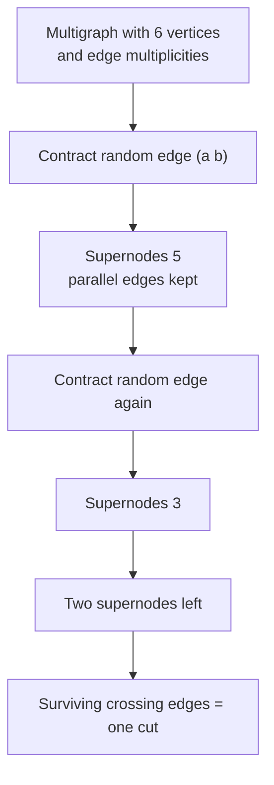
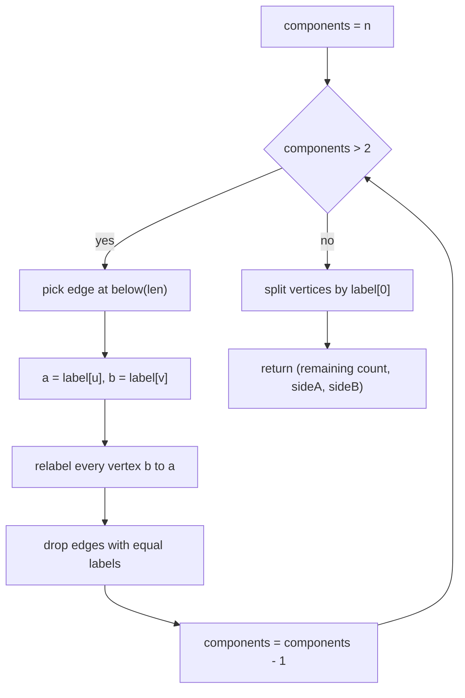
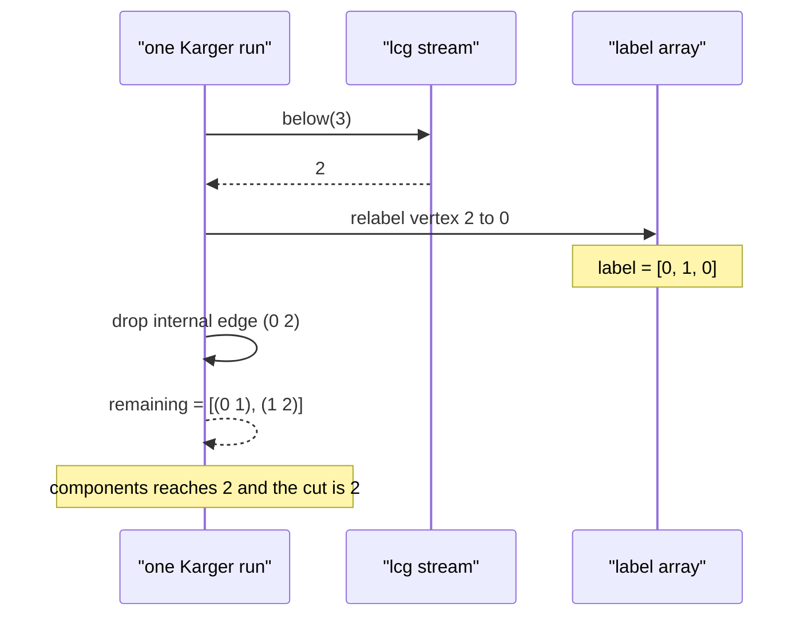

# 449 — Implement global min-cut (Karger randomized algorithm).

> **Tier:** Advanced · **CTCI chapter:** Ch 4 — Trees and Graphs
> **Task spec:** [449-implement-global-min-cut-karger-randomized-algorithm.md](../../../tasks/advanced/449-implement-global-min-cut-karger-randomized-algorithm.md)
> **Solutions:** [Python](../../../solutions/python/advanced/449-implement-global-min-cut-karger-randomized-algorithm/solution.py) ·
> [Java](../../../solutions/java/advanced/449-implement-global-min-cut-karger-randomized-algorithm/Solution.java) ·
> [JavaScript](../../../solutions/javascript/advanced/449-implement-global-min-cut-karger-randomized-algorithm/solution.js) ·
> [C#](../../../solutions/csharp/advanced/449-implement-global-min-cut-karger-randomized-algorithm/Solution.cs)

## 1. Problem restatement

**Input:** an undirected multigraph given as a vertex count `n` and a list of edges
`(u, v)`; parallel edges between the same pair count separately, so a repeated pair is a
real multiplicity.

**Output:** a **global min-cut** — the smallest number of edges whose removal disconnects
the graph — plus a *witness*: the two vertex sets `sideA` and `sideB` that the cut separates.
The four solutions return a triple `(value, sideA, sideB)` where `sideA` and `sideB` partition
all `n` vertices into two non-empty parts and the number of original edges with exactly one
endpoint in `sideA` equals `value`.

Karger's algorithm is **randomized and one-sided**: every single run returns a *valid* cut
combined with a positive probability of returning the *minimum* cut; it never returns
something smaller than the min-cut. The solutions pin the randomness down with a small
documented LCG instead of a library RNG, so the runs are reproducible:

| Call | Result | Why |
| --- | --- | --- |
| `karger_min_cut(3, triangle, 1)` | `(2, [0, 2], [1])` | contracting edge `(0, 2)` leaves 2 crossing edges |
| `karger_best_of(4, K4, 42, 60, 3)` | best `3`, successes `> 0` | 60 fixed-seed runs find the true cut of `K4` |
| `brute_min_cut(6, K6)` | `5` | exhaustive enumerator used as ground truth |
| `karger_best_of(2, [(0,1),(1,0),(0,1)], 7, 25, 3)` | best `3`, successes `25` | two vertices: every run succeeds |

The LCG is fixed by the solutions: `state ← seed % 65537`, then
`state ← (state * 75 + 74) % 65537` per draw, and `below(bound) = state % bound`.

## 2. Intuition

The naive exact algorithm enumerates every partition of the vertex set, pinning vertex `0`
to one side and walking all `2^(n-1) - 1` masks — correct but exponentially slow. That
enumerator is still written in all four solutions, not as the answer but as the **oracle**
that the randomized algorithm must match.

Karger's key insight is that a cut is destroyed only when an edge *of that cut* is
contracted, and that picking edges uniformly at random keeps the graph's structure
unbiased. Contract the endpoints of a random edge into one supernode (the parallel edges
between the two supernodes survive as multiplicity), repeat until only two supernodes
remain, and the surviving edges **are** a cut of the original graph. No bookkeeping about
flow or residual graphs is needed — the cut falls out of the contraction process itself.



A run is cheap but not guaranteed: the textbook bound, quoted in the solution header, is
that a single run hits the min-cut with probability at least `2 / (n * (n - 1))`. That is
tiny for large `n`, which is why the solutions never trust one run — they run `trials`
*independent* (here: different fixed seeds) contractions and keep the best cut. Because
`2/(n(n-1))` is a constant independent of the vertex count, `Theta(n^2)` repetitions push
the failure probability below any fixed `1/k`.

One subtlety the implementation bakes in: it never physically merges edge lists. Each
vertex keeps a `label` pointing at the supernode it currently belongs to, and the edge list
is re-filtered (`label[x] != label[y]`) after every contraction. The surviving edge
*objects* are always the original endpoint pairs, so deleting an edge once removes all of
its copies that have become internal.

## 3. Algorithm

1. Draw a seed-derived stream: `lcg_next()` returns `state` after the linear update.
2. `label[v] ← v` for every vertex: each vertex is its own supernode.
3. Copy the input edge list into `remaining`; set `components ← n`.
4. While `components > 2`: pick `remaining[below(len(remaining))]` uniformly, read
   `a ← label[u]`, `b ← label[v]`, relabel **every** vertex with `label == b` to `a`,
   then rebuild `remaining` keeping only edges whose endpoint labels still differ, and
   decrement `components`.
5. The surviving list is the cut. Split vertices by `label[v] == label[0]` into `sideA`
   and `sideB` and return `(len(remaining), sideA, sideB)`.
6. `check_witness` asserts the sides disjointly cover `0..n-1`, both are non-empty, and the
   number of crossing edges equals the reported value.
7. `karger_best_of` repeats step 2-6 for `trials` seeds `(base * 31 + t * 17 + 1) % 65537`,
   asserts `value >= expected` (one-sidedness), counts runs where `value == expected`, and
   returns the minimum seen together with the success count.

```text
procedure karger_min_cut(n, edges, seed)
    rng ← new lcg with seed
    label ← identity array of size n
    remaining ← copy of edges
    components ← n
    while components > 2 do
        u, v ← remaining[rng.below(length(remaining))]
        a ← label[u]
        b ← label[v]
        for i ← 0 to n - 1 do
            if label[i] = b then label[i] ← a end
        end
        remaining ← edges of remaining with label[x] != label[y]
        components ← components - 1
    end
    side_a ← vertices with label equal to label[0]
    side_b ← the remaining vertices
    return (length(remaining), side_a, side_b)
end
```

```text
procedure karger_best_of(n, edges, base_seed, trials, expected)
    best ← none
    successes ← 0
    for t ← 0 to trials - 1 do
        seed ← (base_seed * 31 + t * 17 + 1) mod 65537
        value, side_a, side_b ← karger_min_cut(n, edges, seed)
        check_witness(n, edges, value, side_a, side_b)
        assert value >= expected
        if value = expected then successes ← successes + 1 end
        best ← min(best, value)
    end
    return (best, successes)
end
```



## 4. Worked example

Trace one single run on the triangle `n = 3`, `edges = [(0,1), (1,2), (0,2)]`, `seed = 1`.
The LCG starts at `state = 1`, and the first draw is `(1 * 75 + 74) % 65537 = 149`, so
`below(3) = 149 % 3 = 2` — index 2 of the edge list.

| Step | `components` | `remaining` | Picked edge | `label` after relabel | Cut so far |
| --- | --- | --- | --- | --- | --- |
| start | 3 | `[(0,1), (1,2), (0,2)]` | — | `[0, 1, 2]` | — |
| 1 | 3 | as above | index 2 → `(0,2)` | `[0, 1, 0]` (vertex 2 joined 0) | — |
| 1b | 3 | `[(0,1), (1,2)]` | drop `(0,2)` (labels 0 and 0) | `[0, 1, 0]` | — |
| 2 | 2 | `[(0,1), (1,2)]` | loop exits: `components = 2` | `[0, 1, 0]` | **2** |

`label[0] = 0`, so `sideA = [0, 2]` and `sideB = [1]`. The original edges crossing that
split are `(0,1)` and `(1,2)` — exactly 2, matching `len(remaining)`, so `check_witness`
passes. `brute_min_cut(3, triangle)` also returns `2`, and the solutions assert that the
seeds `1, 2, 3, 65536` all give `2` on this graph.

The degenerate `n = 2` case is worth seeing because it explains the `25/25` success count in
the "parallel triple edge" test: with `n = 2` the loop never executes, so `remaining` is
untouched and the reported cut is the full multiplicity.



For the best-of loop, the `K4` test uses `base_seed = 42` and `trials = 60`; the assertion
`best == 3` says those 60 deterministic seeds contained at least one run that found the true
min-cut, and `successes > 0` records that fact rather than assuming it.

## 5. Complexity

Let `n` be the vertex count and `m` the edge count of the multigraph.

| Measure | Bound | Why it holds |
| --- | --- | --- |
| One contraction pass | `O(n + m)` | one `n`-element relabel scan plus one `m`-element filter |
| One Karger run | `O(n * m + n^2)` | the while loop runs exactly `n - 2` times |
| Best-of-`T` runs | `O(T * (n * m + n^2))` | runs are independent; no shared state |
| Success probability, one run | `>= 2 / (n * (n - 1))` | bound quoted in the solution header |
| Failure probability of `T` runs | `<= (1 - 2/(n(n-1)))^T` | runs use distinct seeds and are independent |
| Space | `O(n + m)` | `label` is `n` slots, `remaining` copies at most `m` edges |
| Brute-force oracle | `O(2^(n-1) * m)` | `2^(n-1) - 1` masks, `m` edge checks each |

The brute-force enumerator is only usable for the tiny graphs in the tests (`n <= 6`), which
is exactly why it appears as the ground truth rather than as the submitted algorithm.

## 6. Pitfalls and edge cases

- **`n = 2` never enters the loop.** `components > 2` is false immediately, so the run
  returns all edges as the cut — still a valid cut, and on a two-vertex graph it is always
  the minimum. The parallel-triple test depends on this and asserts `successes == 25`.
- **Parallel edges are multiplicity, not duplicates.** Three copies of `(0, 1)` yield a cut
  of `3`, not `1`; the solution keeps them as separate list entries and the brute-force
  oracle counts each copy.
- **Self-loops are never generated** by the graph builder (`if u != v`), and a self-loop
  would contribute `0` to any cut anyway — the filter would remove it once both endpoints
  carry the same label.
- **Relabel direction matters for the witness, not the value.** `label[i] == b → a` always
  folds the *later* label into the first one; the sides are then derived from `label[0]`,
  so vertex `0` is always on `sideA` and neither side can be empty.
- **The filter compares original vertices, not merged ones.** `label[x] != label[y]` is
  evaluated on the stored endpoints after the relabel, which is why one pass is enough.
- **One-sidedness is asserted, not assumed.** Every run asserts `value >= expected`, so a
  bug that produced a *below-minimum* cut would fail loudly instead of silently passing.
- **Determinism replaces "random enough".** A real RNG would make failures unreproducible;
  the LCG with `% 65537` and `below(bound) = next() % bound` gives the same graph, the same
  seed list and the same counts on every run.
- **Modulo bias** exists in principle for `below(bound)` when `bound` does not divide
  `65537`, but `65537` is prime and the test graphs only have a handful of edges, so the
  bias is irrelevant to the asserted outcomes.

## 7. Variants and follow-ups

- **Deterministic exact min-cut:** Stoer-Wagner replaces randomization with a greedy
  maximum-adjacency search and gets `Theta(n^3)` worst case with no probability of failure —
  see [450 — Stoer-Wagner minimum cut](../../../tasks/advanced/450-implement-stoer-wagner-minimum-cut-algorithm.md).
- **All-pairs min-cut:** the Gomory-Hu construction turns `n - 1` max-flow computations into
  a tree that answers every pairwise min-cut query —
  see [451 — Gomory-Hu tree](../../../tasks/advanced/451-implement-gomory-hu-tree-for-all-pairs-min-cut-outline.md).
- **The flow-based route to the same quantity:** max-flow/min-cut duality,
  [454 — Push-relabel max flow](../../../tasks/advanced/454-implement-push-relabel-max-flow-algorithm.md)
  computes a minimum cut from a source-sink pair, and a global min-cut can be obtained by
  pinning a source and sweeping sinks.
- **Boosting a single run:** Karger-Stein recursion repeats contraction until the graph has
  `n / sqrt(2)` vertices and then branches, reducing the run count to `O(log n)` while
  keeping the same success guarantee; the solutions implement the plain `O(n^2)`-trials
  version and stop there.

## 8. Check yourself

**Q1.** Why does contracting a random edge never make the reported cut *smaller* than the
true min-cut?

<details><summary>Show answer</summary>

The reported value is the number of surviving original edges that cross the final split, and
`sideA`/`sideB` is a genuine partition of the vertices, so the reported value is the size of an
actual cut of the graph. No cut can be smaller than the minimum, so every run is
one-sided-correct — that is exactly what `assert value >= expected` checks.

</details>

**Q2.** In the trace of section 4, why is edge `(1, 2)` kept when its endpoints are `1` and
`2` rather than `1` and `0`?

<details><summary>Show answer</summary>

Because the filter reads the *labels*, not the vertex numbers: after the relabel,
`label = [0, 1, 0]`, so `(1, 2)` has labels `1` and `0`, which differ and therefore stays.
`(0, 2)` has labels `0` and `0` and is dropped.

</details>

**Q3.** The header claims a single run succeeds with probability `>= 2/(n(n-1))`. For `n = 6`
that is about `1/15`. If a run costs `O(n * m)`, roughly how many runs do the tests use, and
why is that affordable?

<details><summary>Show answer</summary>

The big test loops use `trials = 400` per base seed (`4800` total trials across the three LCG
graphs and four seeds), and `n <= 6` with a handful of edges, so `400 * n * m` is trivial.
In production you would pick `T` from the failure bound `(1 - 2/(n(n-1)))^T`, i.e. `Theta(n^2)`
runs for constant failure probability.

</details>

**Q4.** Why do the solutions use a hand-written LCG instead of the language's `random`?

<details><summary>Show answer</summary>

So that the seed list, the drawn edges, the per-run values and the success counts are
identical in Python, Java, JavaScript and C#, and identical on every execution. The tests
assert exact totals (`total_trials == 4800`, `successes == 25`), which a platform-dependent
RNG could not guarantee.

</details>

**Q5.** A graph has `n = 500` vertices. Would you run the brute-force oracle on it?

<details><summary>Show answer</summary>

No. `2^(n-1) - 1` masks is astronomically many. The oracle exists only for the tiny
verification graphs (`n <= 6`); for real sizes you rely on the `T` repeated Karger runs
(optionally combined with the Stoer-Wagner or flow-based alternatives in section 7).

</details>
