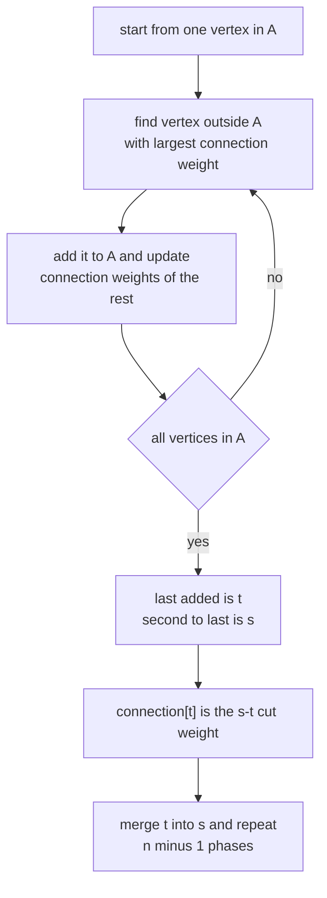
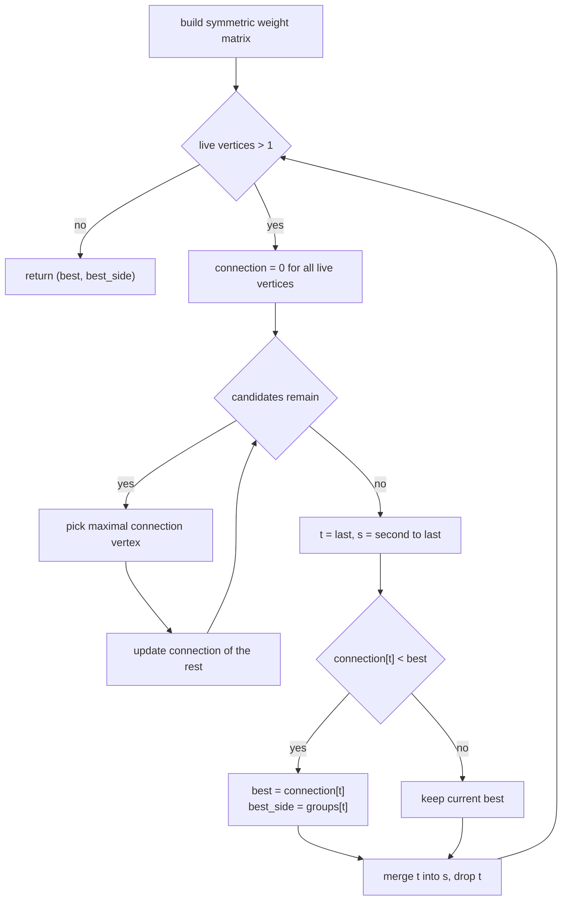
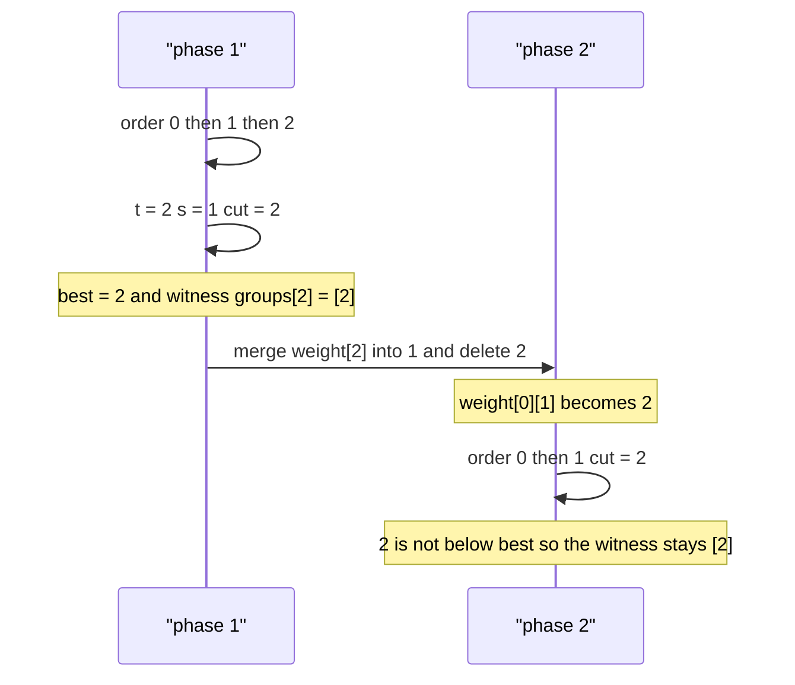

# 450 — Implement stoer-wagner minimum cut algorithm.

> **Tier:** Advanced · **CTCI chapter:** Ch 4 — Trees and Graphs
> **Task spec:** [450-implement-stoer-wagner-minimum-cut-algorithm.md](../../../tasks/advanced/450-implement-stoer-wagner-minimum-cut-algorithm.md)
> **Solutions:** [Python](../../../solutions/python/advanced/450-implement-stoer-wagner-minimum-cut-algorithm/solution.py) ·
> [Java](../../../solutions/java/advanced/450-implement-stoer-wagner-minimum-cut-algorithm/Solution.java) ·
> [JavaScript](../../../solutions/javascript/advanced/450-implement-stoer-wagner-minimum-cut-algorithm/solution.js) ·
> [C#](../../../solutions/csharp/advanced/450-implement-stoer-wagner-minimum-cut-algorithm/Solution.cs)

## 1. Problem restatement

**Input:** `n` vertices and a weighted edge list `(u, v, w)` with **non-negative** weights.
Duplicate pairs, reversed duplicates and self-loops all appear in the test data.

**Output:** the weight of the global minimum cut together with **one side** of a partition
realising it. `stoer_wagner` returns `(min_cut_weight, side)`, where `side` is the vertex set
of the supernode that was absorbed last in the winning phase; the identity
`crossing_weight(edges, side) == value` is asserted in all four languages.

Unlike Karger's algorithm, Stoer-Wagner is **deterministic** and exact — no seeds, no
repetition, no probability of being wrong. The header documents the complexity as
`O(n^3)` and the contract as "each phase runs a maximum-adjacency search, records the
connection weight of the last added vertex as a candidate cut, then merges the last two
vertices; the minimum over all phases is the answer".

| Call | Result | Why |
| --- | --- | --- |
| `stoer_wagner(3, triangle)` | `(2, [2])` | the phase that merges `1` and `2` last reports 2 |
| `stoer_wagner(4, K4)` | `(3, side)` | single-vertex cuts; every 2+2 split of `K4` costs 4 |
| `stoer_wagner(4, cycle4)` | `(2, side)` | two opposite cycle edges |
| `stoer_wagner(6, disjoint)` | `(0, side)` | two disconnected triangles |
| `stoer_wagner(2, [(0,1,3), (1,0,4), (0,1,5)])` | `(12, [1])` | parallel weights sum to 12 |
| `stoer_wagner(3, [(0,1,5), (1,2,5), (0,2,5)])` | `(10, side)` | weighted triangle |

The last two rows show the two conventions the solutions bake in: parallel edges are summed
into a single weight matrix cell, and a phase on a 2-vertex graph simply reports the whole
remaining weight.

## 2. Intuition

The naive exact method enumerates all `2^(n-1) - 1` partitions that keep vertex `0` on one
side; that oracle is included in every solution as `brute_min_cut`, and the tests run it on
graphs with `n <= 8` (`checked == 34` graphs in total). It is hopeless beyond that.

Stoer-Wagner needs one observation. Take any two vertices `s` and `t`. If some minimum cut
does **not** separate `s` from `t`, then merging `s` and `t` preserves that minimum cut; if
it does separate them, the cut between `s` and `t` is itself a candidate. So there exists a
minimum cut that can be found by picking *some* pair `(s, t)`, recording the `s`-`t` cut, and
contracting `t` into `s`. Repeat `n - 1` times, keep the smallest value you ever recorded,
and you have the global minimum cut — no enumeration, no randomness.

The pair `(s, t)` is not arbitrary: the algorithm uses a **maximum-adjacency search**
(also called the "maximum cardinality / maximum weight" search). Grow a set `A` from a
single vertex and repeatedly add the vertex outside `A` whose total connection weight to `A`
is largest. The last vertex added is `t`, the second-to-last is `s`, and the connection
weight of `t` at that moment **equals** the weight of the `s`-`t` cut in the current
contracted graph.



The tie-breaking detail matters for reproducibility: Python maximises the pair
`(connection[v], -v)`, i.e. the *smallest* vertex number wins a tie; the Java, JavaScript and
C# loops scan the remaining vertices in order and replace the pick only on a strictly larger
connection weight, which picks the first — also the smallest. All four therefore produce the
same phase order on the same input.

## 3. Algorithm

1. Build a symmetric weight matrix; skip self-loops, add parallel weights (`weight[u][v] += w`
   and `weight[v][u] += w`).
2. Keep a list `vertices` of live supernodes and, for each, a `group` list of the original
   vertices it contains.
3. While more than one live vertex remains (**one phase**):
   a. Reset `connection[v] = 0` for every live vertex and let `A` be empty.
   b. Repeatedly pick the live vertex outside `A` with the largest `connection` value
      (smallest index on ties), append it to `order`, remove it from the candidate set, and
      add `weight[pick][other]` to `connection[other]` for the still-unadded vertices.
   c. `t ← order[-1]`, `s ← order[-2]`, `cut ← connection[t]`.
   d. If `cut` beats the best so far, store `cut` and `group[t]` as the witness.
   e. Merge `t` into `s` in the weight matrix (`weight[s][v] += weight[t][v]` for all other
      live `v`), zero out row and column `t`, delete `t` from `vertices`, and append
      `group[t]` to `group[s]`.
4. Return `(best, best_side)`.

```text
procedure stoer_wagner(n, edges)
    weight ← zero matrix of size n by n
    for each (u, v, w) in edges do
        if u != v then
            weight[u][v] ← weight[u][v] + w
            weight[v][u] ← weight[v][u] + w
        end
    end
    vertices ← all vertices
    groups[v] ← {v} for every vertex v
    best ← nothing
    while length(vertices) > 1 do
        connection[v] ← 0 for every v in vertices
        order ← empty
        candidates ← copy of vertices
        while candidates is not empty do
            pick ← candidate with maximal connection, smallest index on a tie
            remove pick from candidates
            append pick to order
            for each other in candidates do
                connection[other] ← connection[other] + weight[pick][other]
            end
        end
        t ← order[length(order) - 1]
        s ← order[length(order) - 2]
        if best is nothing or connection[t] < best then
            best ← connection[t]
            best_side ← copy of groups[t]
        end
        for each v in vertices with v != s and v != t do
            weight[s][v] ← weight[s][v] + weight[t][v]
            weight[v][s] ← weight[s][v]
        end
        zero out row t and column t
        remove t from vertices
        groups[s] ← groups[s] joined with groups[t]
    end
    return (best, best_side)
end
```



## 4. Worked example

Trace `stoer_wagner(3, [(0,1,1), (1,2,1), (0,2,1)])` (the unit triangle). The matrix has
`weight[u][v] = 1` for every distinct pair.

**Phase 1** — `vertices = [0, 1, 2]`, all `connection = 0`.

| Step | Candidate set | Pick | `connection` after update | `order` |
| --- | --- | --- | --- | --- |
| 1 | `{0, 1, 2}` | `0` (all tie at 0, smallest wins) | `0: -, 1: 1, 2: 1` | `[0]` |
| 2 | `{1, 2}` | `1` (tie at 1, smallest wins) | `2: 1 + weight[1][2] = 2` | `[0, 1]` |
| 3 | `{2}` | `2` | — | `[0, 1, 2]` |

So `t = 2`, `s = 1`, `cut = connection[2] = 2`. That beats the (absent) best, so
`best = 2` and `best_side = groups[2] = [2]`. The merge adds `weight[2][0] = 1` into
`weight[1][0]`, which becomes `2`, zeroes row/column `2`, removes `2` from `vertices`, and
sets `groups[1] = [1, 2]`.

**Phase 2** — `vertices = [0, 1]`, `weight[0][1] = 2`.

| Step | Candidate set | Pick | `connection` after update | `order` |
| --- | --- | --- | --- | --- |
| 1 | `{0, 1}` | `0` (tie at 0) | `1: 2` | `[0]` |
| 2 | `{1}` | `1` | — | `[0, 1]` |

`t = 1`, `s = 0`, `cut = 2`. The test `cut < best` is `2 < 2` — false, so the witness stays
`[2]`. Removing `1` leaves one live vertex and the loop ends: the answer is `(2, [2])`.

`crossing_weight` confirms the witness independently: the edges leaving `{2}` are `(0, 2)`
and `(1, 2)`, both of weight 1, total 2. `brute_min_cut(3, triangle)` also returns 2, and the
same check runs on `K4` (value 3), the 4-cycle (value 2) and the disconnected 6-vertex graph
(value 0, a witness whose crossing weight is 0).



## 5. Complexity

| Measure | Bound | Why it holds |
| --- | --- | --- |
| Matrix build | `O(m)` | one pass over the edge list, self-loops skipped |
| One maximum-adjacency search | `O(n^2)` | `n` picks, each scanning and updating `O(n)` `connection` entries |
| One phase | `O(n^2)` | the search dominates; the merge is `O(n)` |
| All phases | `O(n^3)` | exactly `n - 1` phases |
| Space | `O(n^2)` | the weight matrix; `groups` and `connection` are `O(n)` |
| Brute-force oracle | `O(2^(n-1) * m)` | used only for `n <= 8` verification |

Time is `Theta(n^3)` in every case — the phase count depends only on `n`, so best, average and
worst coincide; unlike Karger's `O(n * m)` per run there is no repetition factor and no
failure probability. For sparse graphs the matrix can be replaced by adjacency lists plus a
priority structure, but the solutions deliberately use the plain `O(n^3)` formulation.

## 6. Pitfalls and edge cases

- **Negative weights break the premise.** The header states weights are assumed non-negative,
  as the algorithm requires; every generated weight is `1 + seed % 20`, so at least 1.
- **Self-loops are dropped** before the matrix is built (`if u == v: continue`). The Python
  graph generator even has a latent `n == 1` branch producing `(0, 0, w)`; it never fires
  because `n = 2 + seed % (max_n - 1) >= 2`.
- **`n = 1` returns no answer.** With a single vertex the outer loop never runs, so `best` and
  `best_side` stay empty — the solutions never call it with `n < 2`.
- **`n = 2` returns everything.** One phase, no merge, `cut` equals the summed weight between
  the two vertices: the parallel-edge test expects exactly `12`.
- **Disconnected graphs give 0.** The two triangles test expects `(0, side)` with crossing
  weight 0; a phase whose `t` is only loosely attached reports 0.
- **Parallel and reversed edges accumulate.** `weight[u][v] += w` plus `weight[v][u] += w`
  puts `(0,1,3)`, `(1,0,4)` and `(0,1,5)` into one cell holding 12.
- **Ties change the witness, never the value.** All four solutions pick the smallest vertex
  index on a tie. On `K4` the value is 3 (a single-vertex cut); a 2+2 split would cost 4.
- **Strict improvement only.** The update is `cut < best`, so an equal later phase leaves the
  earlier witness in place — that is why the triangle yields `[2]` and not `[1, 2]`.
- **Groups must be copied, not aliased.** `best_side = list(groups[t])` snapshots the side
  before `groups[s]` is mutated by the merge; aliasing would corrupt the witness.
- **Overflow.** Java and C# store weights in `long` (then cast the final value), which keeps
  intermediate sums safe when many parallel edges accumulate.

## 7. Variants and follow-ups

- **Randomized counterpart:** [449 — Karger's global min-cut](../../../tasks/advanced/449-implement-global-min-cut-karger-randomized-algorithm.md)
  solves the same problem in `O(n * m)` per run with success probability `2/(n(n-1))`, and
  needs repeated runs; Stoer-Wagner trades that for a deterministic `O(n^3)`.
- **All-pairs min-cut:** [451 — Gomory-Hu tree](../../../tasks/advanced/451-implement-gomory-hu-tree-for-all-pairs-min-cut-outline.md)
  answers every pairwise min-cut query after `n - 1` max-flow computations.
- **Source-sink cuts instead of global ones:** [454 — Push-relabel max flow](../../../tasks/advanced/454-implement-push-relabel-max-flow-algorithm.md)
  computes the minimum `s`-`t` cut as a by-product of a maximum flow, which is the usual way
  to turn a global min-cut into `n - 1` source-sink instances.
- **Weighted vs unweighted:** with all weights 1 the algorithm degenerates to counting
  edges — the triangle test expects 2 and `K4` expects 3, exactly the edge counts.
- **Sparse optimisation:** the maximum-adjacency search can use a Fibonacci heap to reach
  `O(n * m + n^2 log n)`, but the test graphs (`n <= 8`) do not justify it.

## 8. Check yourself

**Q1.** Why does the algorithm need to record *every* phase's candidate cut instead of only
the last one?

<details><summary>Show answer</summary>

Each phase's maximum-adjacency search certifies only the `s`-`t` cut for the pair it happened
to pick, and merges that pair afterwards. The global minimum cut may be separated by some
other pair of supernodes, so the minimum over all `n - 1` phases is the right answer.

</details>

**Q2.** In phase 1 of the trace, why is vertex `0` picked first when all connection weights
are 0?

<details><summary>Show answer</summary>

Because of the tie-break. Python maximises `(connection[v], -v)`, so among equal weights the
smallest vertex number wins; the Java, JavaScript and C# loops behave the same way by only
replacing the pick on a strictly larger weight while scanning in ascending order.

</details>

**Q3.** The triangle yields the witness `[2]` rather than `[1, 2]`. Is `[1, 2]` also a valid
minimum cut?

<details><summary>Show answer</summary>

Yes — both sides have crossing weight 2, and so does `[0]`. The result is only canonical in
the sense that the *first* phase achieving the optimum wins, because the update is
`cut < best`. The tests assert the value and the crossing weight, never a specific side.

</details>

**Q4.** How does the disconnected-graph test exercise the "0" answer?

<details><summary>Show answer</summary>

`disjoint` holds two triangles on `{0,1,2}` and `{3,4,5}` with weights 5 and 7 and no edge
between them. The true min-cut is 0 (the empty cut separating the components), and the phase
that merges across the components reports 0; `crossing_weight` then confirms a witness of 0.

</details>

**Q5.** Could you swap in Karger's algorithm whenever Stoer-Wagner is slow?

<details><summary>Show answer</summary>

Only with a cost in confidence: Karger is faster per attempt on sparse graphs but returns the
minimum only with probability `>= 2/(n(n-1))` and needs `Theta(n^2)` attempts for a constant
failure probability, while Stoer-Wagner is exact and deterministic at `O(n^3)`.

</details>
