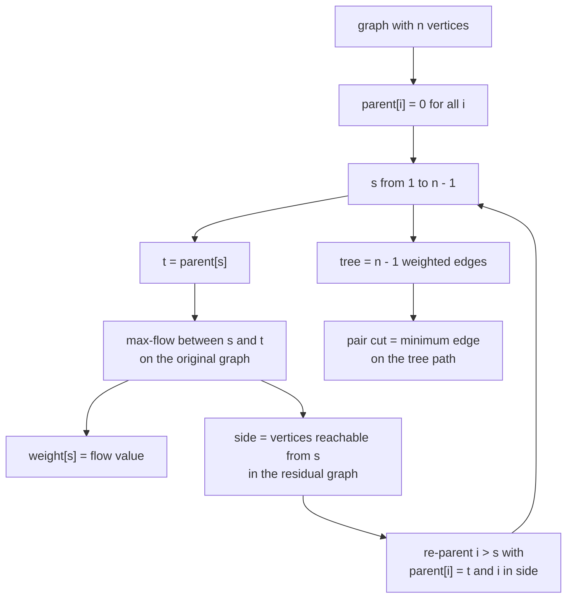
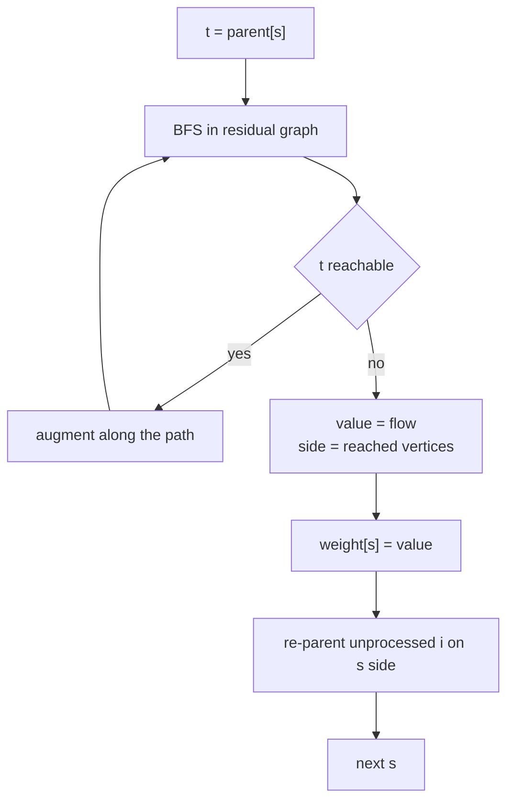
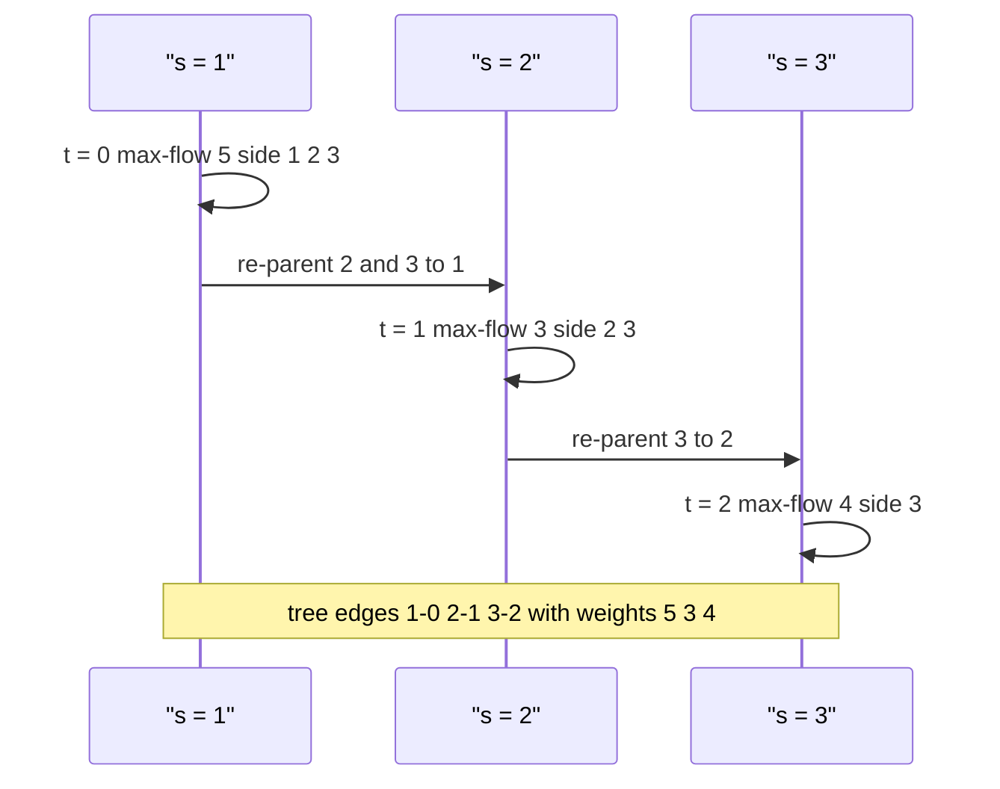

# 451 — Implement Gomory-Hu tree for all-pairs min-cut (outline).

> **Tier:** Advanced · **CTCI chapter:** Ch 4 — Trees and Graphs
> **Task spec:** [451-implement-gomory-hu-tree-for-all-pairs-min-cut-outline.md](../../../tasks/advanced/451-implement-gomory-hu-tree-for-all-pairs-min-cut-outline.md)
> **Solutions:** [Python](../../../solutions/python/advanced/451-implement-gomory-hu-tree-for-all-pairs-min-cut-outline/solution.py) ·
> [Java](../../../solutions/java/advanced/451-implement-gomory-hu-tree-for-all-pairs-min-cut-outline/Solution.java) ·
> [JavaScript](../../../solutions/javascript/advanced/451-implement-gomory-hu-tree-for-all-pairs-min-cut-outline/solution.js) ·
> [C#](../../../solutions/csharp/advanced/451-implement-gomory-hu-tree-for-all-pairs-min-cut-outline/Solution.cs)

## 1. Problem restatement

**Input:** an undirected weighted graph on `n` vertices, connected (the LCG generator builds a
random spanning tree plus `n` extra edges).

**Output:** an all-pairs min-cut *summary*: a tree on the same vertex set such that the minimum
`u`-`v` cut equals the **minimum edge weight on the tree path** from `u` to `v`. The solutions
return that tree as a parent array plus a weight array: `parent[s]` is the tree neighbour of
`s`, `weight[s]` is the weight of the tree edge `(s, parent[s])`, and `runs` counts the
max-flow computations used.

The spec marks this task as an **outline**, and the Python header documents the simplification
explicitly: *"Gusfield's simplification keeps a parent array... Documented simplification vs.
the original Gomory-Hu contraction scheme: no vertex contraction is ever done; the flow
network is always the original one."* That is the version all four languages implement.

| Call | Result | Why |
| --- | --- | --- |
| `gomory_hu(3, triangle)` | `runs == 2`, every pair gives `2` | `n - 1` flow runs on 3 vertices |
| `gomory_hu(4, path)` | tree `1-0(5)`, `2-1(3)`, `3-2(4)` | the six pairs reproduce the path's cuts |
| `gomory_hu(4, K4)` | every pair gives `3` | `K4` is 3-edge-connected |
| `gomory_hu(2, [(0,1,3), (1,0,4)])` | pair `(0,1)` gives `7` | parallel weights sum |
| 4 seeds × 4 graphs | `graph_count == 16`, `pair_checks >= 96` | each pair checked against brute force |

## 2. Intuition

The naive answer runs a max-flow for every one of the `O(n^2)` pairs — expensive and, worse,
redundant: the pair cuts of an undirected graph are not independent. Gomory and Hu proved
that `n - 1` flow runs suffice, because the results can be stored as a **tree** in which the
`u`-`v` min-cut is the *bottleneck* (minimum weight edge) on the path.

Gusfield's simplification is what the solutions implement. Instead of contracting vertex sets
and re-running flows on smaller networks, Gusfield keeps a flat parent array and always runs
the flow on the **original** graph:

- Process `s = 1, 2, ..., n - 1` in order.
- The partner is `t = parent[s]`; run one max-flow between `s` and `t`.
- Store the flow value as `weight[s]`.
- The max-flow call also returns the `s`-side of a minimum `s`-`t` cut. Every still
  unprocessed vertex `i > s` whose current parent is `t` and which lies on `s`'s side is
  re-parented to `s`.



Because `parent[0] = 0` for the starting array, vertex `0` (or vertex `s`'s parent chain) is
always the first partner, and the resulting structure is a tree with roots towards `0`.
Nothing is contracted, so the flows are always solved on the same `n`-vertex network — cheaper
to implement, and the header calls this out as the deliberate simplification.

## 3. Algorithm

1. `parent[i] ← 0` and `weight[i] ← 0` for every vertex.
2. For `s` from `1` to `n - 1`: set `t ← parent[s]`, run `max_flow_undirected(n, edges, s, t)`
   and increment `runs`. That call returns `(value, side)`, where `side` is the set of vertices
   still reachable from `s` in the final residual graph — the `s`-side of a minimum cut.
3. Set `weight[s] ← value`.
4. For every `i` with `i > s`, `parent[i] == t` and `i ∈ side`, set `parent[i] ← s`.
5. After the loop, `(parent, weight)` describes the tree; answer a query by walking the tree
   and taking the minimum edge weight along the path.

```text
procedure gomory_hu(n, edges)
    parent[i] ← 0 and weight[i] ← 0 for every vertex i
    runs ← 0
    for s ← 1 to n - 1 do
        t ← parent[s]
        value, side ← max_flow_undirected(n, edges, s, t)
        runs ← runs + 1
        weight[s] ← value
        for i ← s + 1 to n - 1 do
            if parent[i] = t and i is in side then
                parent[i] ← s
            end
        end
    end
    return (parent, weight, runs)
end
```

```text
procedure max_flow_undirected(n, edges, s, t)
    cap ← zero matrix of size n by n
    for each (u, v, w) in edges with u != v do
        cap[u][v] ← cap[u][v] + w
        cap[v][u] ← cap[v][u] + w
    end
    flow ← 0
    loop
        parent_of ← BFS from s over arcs with positive capacity
        if t is unreachable then
            side ← vertices reached by the BFS
            return (flow, side)
        end
        augment ← minimum residual capacity along the BFS path from s to t
        push augment along every arc of that path, adding capacity to the reverse arcs
        flow ← flow + augment
    end
end
```

```text
procedure tree_min_cut(n, parent, weight, u, v)
    build an adjacency list of the n - 1 tree edges
    breadth-first from u carrying best ← infinity
    when visiting a child, best ← min(best, edge weight)
    return best when v is dequeued
end
```



## 4. Worked example

Take the weighted path `n = 4`, `edges = [(0,1,5), (1,2,3), (2,3,4)]`. The test expects
`(0,1) = 5`, `(0,2) = 3`, `(0,3) = 3`, `(1,2) = 3`, `(1,3) = 3`, `(2,3) = 4`.

| `s` | `t = parent[s]` | Max-flow value | Reachable `side` from `s` | Re-parented | `parent` after |
| --- | --- | --- | --- | --- | --- |
| 1 | 0 | `5` (cut `{1,2,3}` vs `{0}`) | `{1, 2, 3}` | `2 → 1`, `3 → 1` | `[0, 0, 1, 1]` |
| 2 | 1 | `3` (cut `{2,3}` vs `{0,1}`) | `{2, 3}` | `3 → 2` | `[0, 0, 1, 2]` |
| 3 | 2 | `4` (cut `{3}` vs `{0,1,2}`) | `{3}` | none | `[0, 0, 1, 2]` |

`weight` becomes `[0, 5, 3, 4]`, i.e. tree edges `1—0` of weight 5, `2—1` of weight 3 and
`3—2` of weight 4 — exactly the input path. Now every query is a path-minimum:

| Pair | Tree path | Minimum edge on the path | Expected |
| --- | --- | --- | --- |
| `(0, 1)` | `0—1` | 5 | 5 |
| `(0, 2)` | `0—1—2` | `min(5, 3) = 3` | 3 |
| `(0, 3)` | `0—1—2—3` | `min(5, 3, 4) = 3` | 3 |
| `(1, 2)` | `1—2` | 3 | 3 |
| `(1, 3)` | `1—2—3` | `min(3, 4) = 3` | 3 |
| `(2, 3)` | `2—3` | 4 | 4 |

Each row is also asserted against `brute_pair_min_cut`, which enumerates all `2^n` masks and
keeps the cheapest one that separates `u` from `v`; the two agree on all six pairs, and
`tree_min_cut(u, v) == tree_min_cut(v, u)` confirms the symmetry of every reported value.



## 5. Complexity

| Measure | Bound | Why it holds |
| --- | --- | --- |
| Max-flow runs | exactly `n - 1` | one per `s`, asserted as `runs == n - 1` |
| One max-flow (Edmonds-Karp on a matrix) | `O(n^2)` per BFS, `O(n · m)` augmentations | fully manual BFS on the capacity matrix, `m` input edges |
| Tree query `(u, v)` | `O(n)` | one BFS over `n - 1` tree edges |
| All `O(n^2)` queries | `O(n^3)` | `O(n^2)` queries times `O(n)` each |
| Re-parenting pass | `O(n)` per `s` | one scan of the still-unprocessed vertices |
| Space | `O(n^2)` | the capacity matrix (`parent`, `weight`, `side` are `O(n)`) |
| Brute-force oracle per pair | `O(2^n · m)` | all masks, every edge counted — only for tiny `n` |

The headline win is the run count: `n - 1` flows instead of `O(n^2)`. Since the implementations
always re-run on the original graph (no contraction), no flow is ever cheaper than the first
one — the saving is purely in how many flows are needed.

## 6. Pitfalls and edge cases

- **The max-flow returns a side, not just a value.** `side` is the BFS-reachable set in the
  *final* residual graph, i.e. the `s`-side of a min-cut; re-parenting depends on it.
- **Only `i > s` is re-parented.** The loop starts at `s + 1`, because vertices below `s`
  have already been given their final tree edge.
- **Only parents equal to `t` are touched.** The condition `parent[i] == t` prevents moving a
  vertex that has already been re-parented by a later phase.
- **`parent[0]` is never used.** The array starts as all zeros so `s = 1` pairs with vertex 0;
  `parent[0] = 0` is self-referential and never read on a tree path.
- **Parallel and reversed edges.** `capacity_matrix` accumulates `cap[u][v] += w` and
  `cap[v][u] += w`, so `(0,1,3)` plus `(1,0,4)` yields a cut value of `7`; self-loops are
  skipped (`if u != v`).
- **Undirected edges need both arcs.** An undirected edge `{u, v, w}` becomes arcs `u→v` and
  `v→u` of capacity `w`, and augmentation subtracts from one and adds to the other — that is
  what makes the cut value come out doubled-free and symmetric.
- **`n = 2`.** One flow run, one tree edge, and the query is that edge's weight.
- **`tree_min_cut` returns nothing if `v` is unreachable.** A correct tree always connects
  every vertex, so the `None` branch is unreachable for valid input; the tests never see it.
- **The values must be symmetric.** `tree_min_cut(u, v) == tree_min_cut(v, u)` is asserted for
  every pair in every generated graph, catching asymmetric parent bookkeeping.
- **Disconnected input is not tested.** Every LCG graph is connected by construction (a random
  spanning tree is planted first), which keeps the min-cut well defined and non-zero.

## 7. Variants and follow-ups

- **One pair instead of all pairs:** a single `max_flow_undirected(n, edges, s, t)` call is
  exactly the source-sink min-cut computed inside [454 — Push-relabel max flow](../../../tasks/advanced/454-implement-push-relabel-max-flow-algorithm.md);
  Gomory-Hu reuses that primitive `n - 1` times.
- **Global min-cut instead of pairwise:** [449 — Karger's randomized min-cut](../../../tasks/advanced/449-implement-global-min-cut-karger-randomized-algorithm.md)
  and [450 — Stoer-Wagner](../../../tasks/advanced/450-implement-stoer-wagner-minimum-cut-algorithm.md)
  need no source vertex; the global value is the minimum over all tree edges when the tree is
  built by Gomory-Hu.
- **True Gomory-Hu with contractions:** the original scheme contracts each side into a
  supernode and runs flows on shrinking networks; the outline here trades that for simpler
  bookkeeping, per the documented simplification.
- **Faster flow engines:** swapping Edmonds-Karp for Dinic or push-relabel inside
  `max_flow_undirected` changes only the per-run cost, not the `n - 1` run count.

## 8. Check yourself

**Q1.** Why is `n - 1` flow runs enough to answer all `n(n-1)/2` pairs?

<details><summary>Show answer</summary>

Because the pair cuts can be represented by a single weighted tree: the minimum `u`-`v` cut
equals the minimum edge weight on the tree path between `u` and `v`. Each flow run fixes one
tree edge (and its weight), so `n - 1` runs complete the tree.

</details>

**Q2.** In the worked example, why does the query `(0, 3)` return 3 rather than 4 or 5?

<details><summary>Show answer</summary>

The tree path `0—1—2—3` uses edges of weight 5, 3 and 4, and the answer is the *minimum* along
the path, so 3. Cutting the cheapest edge of that path, `2—3`'s neighbour `1—2`, separates
`0` from `3`, and no cheaper cut exists.

</details>

**Q3.** What exactly does the `side` returned by `max_flow_undirected` contain, and when is it
computed?

<details><summary>Show answer</summary>

It is the set of vertices reachable from `s` by BFS over arcs with positive residual capacity
*after* the last augmentation — the moment `t` becomes unreachable. By max-flow/min-cut duality
that reachable set is one side of a minimum `s`-`t` cut.

</details>

**Q4.** Why must the re-parenting loop skip vertices `i <= s`?

<details><summary>Show answer</summary>

For `i < s` the tree edge `(i, parent[i])` has already been finalised by an earlier phase;
changing it would invalidate the tree. Gusfield's order guarantees the later phases only need
to fix up the not-yet-processed vertices `i > s`.

</details>

**Q5.** The test graphs have `n` between 4 and 7. What bound does the suite assert about the
number of flow runs and about pair coverage?

<details><summary>Show answer</summary>

`runs == n - 1` for every graph, `graph_count == 16` (4 seeds times 4 graphs per seed) and
`pair_checks >= 16 * 6` — at least six pairs per graph, each verified against the brute-force
pair oracle plus a symmetry check.

</details>
