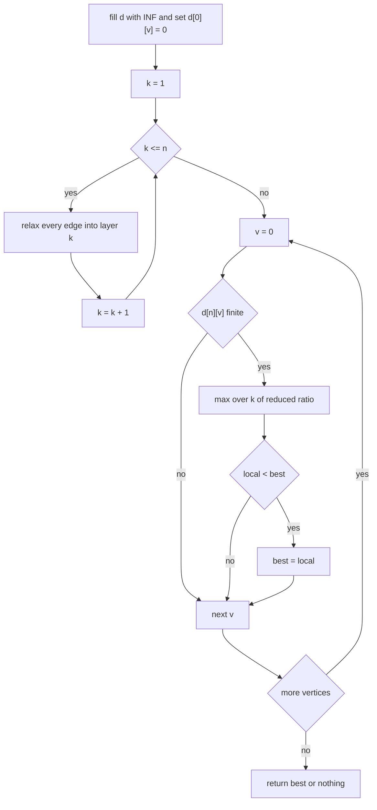
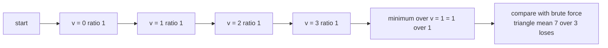

# 452 — Implement minimum mean cycle detection (Karp).

> **Tier:** Advanced · **CTCI chapter:** Ch 4 — Trees and Graphs
> **Task spec:** [452-implement-minimum-mean-cycle-detection-karp.md](../../../tasks/advanced/452-implement-minimum-mean-cycle-detection-karp.md)
> **Solutions:** [Python](../../../solutions/python/advanced/452-implement-minimum-mean-cycle-detection-karp/solution.py) ·
> [Java](../../../solutions/java/advanced/452-implement-minimum-mean-cycle-detection-karp/Solution.java) ·
> [JavaScript](../../../solutions/javascript/advanced/452-implement-minimum-mean-cycle-detection-karp/solution.js) ·
> [C#](../../../solutions/csharp/advanced/452-implement-minimum-mean-cycle-detection-karp/Solution.cs)

## 1. Problem restatement

**Input:** a directed graph with `n` vertices and weighted edges `(u, v, w)`. Weights may be
**negative**, and self-loops are generated (`seed % 100 < 20` in the generator).

**Output:** the *minimum mean* cycle weight

```text
lambda* = min over cycles C of (sum of edge weights in C) / (number of edges in C)
```

returned as an **exact reduced fraction** `(num, den)`, or nothing when the digraph is acyclic.
Reduction goes through `gcd(abs(num), den)`, and comparisons use cross-multiplication, so no
floating point ever appears.

The header pins the method to Karp's DP:

```text
d[k][v] = minimum weight of a walk with EXACTLY k edges ending at v,  d[0][v] = 0
lambda* = min_v max_{0 <= k <= n-1} (d[n][v] - d[k][v]) / (n - k)
```

`d[0][v] = 0` for every `v` is equivalent to joining a super-source of weight 0 to all
vertices, which is what makes the theorem's numerator start from a free origin.

| Call | Result | Why |
| --- | --- | --- |
| `karp_min_mean_cycle(4, [(0,1,1),(1,2,1),(2,3,1),(3,0,1),(2,0,5)])` | `(1, 1)` | 4-cycle mean `4/4 = 1` beats the triangle `7/3` |
| `karp_min_mean_cycle(3, [(0,1,-2),(1,2,-1),(2,0,-3)])` | `(-2, 1)` | `-6/3` |
| `karp_min_mean_cycle(1, [(0,0,7)])` | `(7, 1)` | a single self-loop |
| `karp_min_mean_cycle(3, [(0,1,2),(1,0,2),(1,2,-1),(2,1,-1)])` | `(-1, 1)` | the cheap 2-cycle wins |
| `karp_min_mean_cycle(2, [(0,1,1),(1,0,0)])` | `(1, 2)` | `(1 + 0) / 2` stays a fraction |
| `karp_min_mean_cycle(3, [(0,1,1),(1,2,2)])` | `None` | a DAG has no cycle |

Every one of those rows is also produced by `brute_min_mean_cycle`, which enumerates all simple
cycles, and the two agree on all 20 LCG digraphs across the seeds `4521..4524`.

## 2. Intuition

The naive method lists every simple cycle and averages its edges. The brute-force oracle does
exactly that: a DFS from each start vertex `s`, only descending into vertices `v > s` that are
not already on the path, and closing the cycle when an edge returns to `s`. Every cycle is
generated exactly once — from its minimum-index vertex — but the enumeration is exponential,
so it is usable only on tiny graphs (`n <= 6` here).

Karp's algorithm replaces enumeration with a shortest-walk table. Everything hinges on one
fact: **any cycle is a walk of exactly `n` edges repeated**. If `d[k][v]` is the lightest walk
of exactly `k` edges ending at `v`, then for a cycle `C` of length `j` and the vertices on it,
the expression `(d[n][v] - d[k][v]) / (n - k)` is the mean of the best cycle found by comparing
a length-`n` walk with a length-`k` walk that shares the endpoint `v`. Taking the maximum over
`k` picks the heaviest such ratio for that `v`, and taking the minimum over `v` gives the
minimum mean cycle. The `n - k` difference is why the division is not by `n`.

Because `d[0][v] = 0`, a walk may "start" anywhere without paying for the trip, and a walk of
`n` edges ending at `v` plus a shorter walk of `k` edges ending at `v` differ by a closed walk
of `n - k` edges — a cycle, repeated if necessary.


The 4-vertex hand case from the header shows why the longest cycle can win: the closing edge
`3 → 0` of weight 1 makes the 4-cycle mean `(1+1+1+1)/4 = 1`, while the shortcut `2 → 0` of
weight 5 forms the triangle `0→1→2→0` with mean `(1+1+5)/3 = 7/3 ≈ 2.33`. The algorithm must
therefore return `1`, and the tests assert exactly that.

## 3. Algorithm

1. Allocate `d[0..n][0..n-1]`, fill with `INF`, then set `d[0][v] = 0` for every `v`.
2. For `k = 1 .. n`: for every edge `(u, v, w)`, if `d[k-1][u]` is finite and
   `d[k-1][u] + w < d[k][v]` then relax `d[k][v]`. This is one Bellman-Ford style sweep per
   layer, so `d[k][v]` ends as the lightest walk of *exactly* `k` edges.
3. For each vertex `v` with `d[n][v]` finite, compute
   `local(v) = max over k in 0..n-1 with d[k][v] finite of reduce(d[n][v] - d[k][v], n - k)`.
4. Answer `min over v of local(v)`; if no `v` has a finite `d[n][v]`, return nothing — no walk
   of `n` edges exists, so the digraph is acyclic.

```text
procedure karp_min_mean_cycle(n, edges)
    d ← table (n + 1) by n filled with INF
    for v ← 0 to n - 1 do
        d[0][v] ← 0
    end
    for k ← 1 to n do
        for each (u, v, w) in edges do
            if d[k - 1][u] is finite and d[k - 1][u] + w < d[k][v] then
                d[k][v] ← d[k - 1][u] + w
            end
        end
    end
    best ← nothing
    for v ← 0 to n - 1 do
        if d[n][v] is finite then
            local ← nothing
            for k ← 0 to n - 1 do
                if d[k][v] is finite then
                    cand ← reduce(d[n][v] - d[k][v], n - k)
                    if local is nothing or cand > local then
                        local ← cand
                    end
                end
            end
            if best is nothing or local < best then
                best ← local
            end
        end
    end
    return best
end
```

```text
procedure reduce(num, den)
    g ← gcd(abs(num), den)
    return (num / g, den / g)
end

function less(a, b)
    return a.num * b.den < b.num * a.den
end
```



## 4. Worked example

Trace `karp_min_mean_cycle(4, [(0,1,1), (1,2,1), (2,3,1), (3,0,1), (2,0,5)])`.

Layer by layer, `d[k][v]` for each `v`:

| `k` | `d[k][0]` | `d[k][1]` | `d[k][2]` | `d[k][3]` | How the row arises |
| --- | --- | --- | --- | --- | --- |
| 0 | 0 | 0 | 0 | 0 | the free start |
| 1 | 1 | 1 | 1 | 1 | every vertex has an incoming edge of weight 1 |
| 2 | 2 | 2 | 2 | 2 | `d[1][3]+1`, `d[1][0]+1`, `d[1][1]+1`, `d[1][2]+1` |
| 3 | 3 | 3 | 3 | 3 | the same walk extended once more |
| 4 | 4 | 4 | 4 | 4 | the 4-cycle repeated |

The shortcut only matters for longer routes into `0` (`d[k][2] + 5`), and it never beats the
cheap path (`d[k][3] + 1`), which is why the fourth row is 4 and not larger.

Now the scan. For `v = 0`:

| `k` | `d[4][0] - d[k][0]` | `4 - k` | Fraction | Reduced |
| --- | --- | --- | --- | --- |
| 0 | 4 | 4 | `4/4` | `1/1` |
| 1 | 3 | 3 | `3/3` | `1/1` |
| 2 | 2 | 2 | `2/2` | `1/1` |
| 3 | 1 | 1 | `1/1` | `1/1` |

`local(0) = 1`, and the other three vertices give the same table, so
`lambda* = 1 = (1, 1)`. The brute-force enumerator agrees: the simple cycles are the 4-cycle
(mean 1), the triangle `0→1→2→0` (mean `7/3`) and the self-loop-free variant path
`0→1→2→3→0` again; the minimum is the 4-cycle.

A second, smaller trace shows the fraction machinery. For `n = 2` with edges `0→1` of weight 1
and `1→0` of weight 0: `d[1] = [0, 1]` and `d[2] = [1, 1]`.

| `v` | `k` | `d[2][v] - d[k][v]` | `2 - k` | Fraction |
| --- | --- | --- | --- | --- |
| 0 | 0 | 1 | 2 | `1/2` |
| 0 | 1 | 1 | 1 | `1/1` |
| 1 | 0 | 1 | 2 | `1/2` |
| 1 | 1 | 0 | 1 | `0/1` |

`local(0) = max(1/2, 1/1) = 1` and `local(1) = max(1/2, 0/1) = 1/2`, so
`lambda* = min(1, 1/2) = 1/2 = (1, 2)` — the cycle is `1→0` of weight 0 followed by `0→1` of
weight 1, and the answer stays an exact fraction.



## 5. Complexity

| Measure | Bound | Why it holds |
| --- | --- | --- |
| DP table | `O(n * m)` | `n` layers, each a single sweep over all `m` edges |
| Final scan | `O(n^2)` | for each of `n` vertices a `k` loop of length `n`, each with a `gcd` |
| Total, one run | `O(n * m + n^2)` | table plus scan; the exact-fraction arithmetic is `O(log)` factors |
| Space | `O(n^2)` | the whole `(n+1) x n` table is kept |
| Brute force | exponential in the number of simple cycles | DFS from every start vertex, only vertices `> start` allowed |
| Test coverage | `checked == 20` graphs | 4 seeds times 5 LCG digraphs, each cross-checked |

Best, average and worst case are identical: the DP always fills every layer, and the scan
always visits every `(v, k)` pair. Negative weights are no obstacle — unlike Dijkstra, Karp's
DP is a Bellman-Ford style relaxation and never relies on non-negativity.

## 6. Pitfalls and edge cases

- **"Exactly `k` edges", not "at most `k`".** `d[k][v]` is a separate layer, so a walk may not
  be shortened; `d[0][v] = 0` supplies the free start instead.
- **`d[0][v] = 0` for *all* vertices.** Setting only `d[0][s] = 0` would restrict the search to
  cycles through `s` and miss the answer.
- **Acyclicity is the `INF` test.** If `d[n][v]` is infinite for every `v`, no walk of `n`
  edges exists, hence no cycle: the DAG test expects `None`/`null`.
- **Self-loops are legal cycles.** The `n = 1` case with edge `(0, 0, 7)` gives `d[1][0] = 7`
  and `lambda* = 7/1`; the generator injects self-loops with about 20% probability.
- **Ties and divisions by the wrong denominator.** Using `n` instead of `n - k` would give the
  wrong mean; the worked example would return `4/4` for every `k` and miss nothing here, but on
  the `n = 2` case it would return `1/1` instead of `1/2`.
- **Exact fractions, not floats.** `reduce_fraction` divides by `gcd(abs(num), den)` and
  `frac_less`/`frac_greater` compare by cross-multiplication; the expected results are literal
  pairs such as `(1, 2)` and `(-2, 1)`, which floats could not represent reliably.
- **Integer range.** Cross-multiplication multiplies two numerators, so it is done in the
  language's integer type; the generator's weights are between `-5` and `9`, far from any
  overflow boundary.
- **Parallel edges are fine.** The DP relaxes each edge independently, so two edges between the
  same pair of vertices simply both get considered.
- **The `max` over `k` is per vertex.** Swapping the `min` and `max` (or taking `min` over `k`)
  breaks the theorem; the order is `min_v max_k`.

## 7. Variants and follow-ups

- **Negative-cycle detection instead of its mean:** [114 — Bellman-Ford with negative edges](../../../tasks/beginner/114-bellman-ford-algorithm-with-negative-edges.md)
  answers whether a negative cycle exists; Karp answers *how negative* the cheapest one is, and
  reduces to Bellman-Ford when the weights are unit.
- **Cycle existence without weights:** [107 — Detect a cycle in a directed graph by DFS colouring](../../../tasks/beginner/107-detect-cycle-in-directed-graph-dfs-coloring.md)
  is the unweighted special case; here a cycle only matters if it is the cheapest average.
- **Flow-themed follow-ups on the same graph:** [453 — Circulation with lower bounds](../../../tasks/advanced/453-implement-circulation-with-lower-bounds-flow-transform.md)
  also reasons about cycles, but as the residual structure of a feasible-flow transform.
- **Weighted-cycle problems with a second resource:** [536 — Constrained shortest path by resource-constrained DP](../../../tasks/advanced/536-implement-constrained-shortest-path-resource-constrained-dp.md)
  shows the same "layered table indexed by a count" pattern with an extra constraint axis.
- **Faster cycle-mean computations:** Howard's policy iteration and Lawler's binary search on
  the mean both avoid the full table; Karp's `O(n * m + n^2)` version is the one implemented
  here because it is exact and needs no tuning.

## 8. Check yourself

**Q1.** Why does the numerator use `d[n][v] - d[k][v]` rather than `d[n][v]` alone?

<details><summary>Show answer</summary>

Subtracting the shorter walk cancels the cost of reaching `v` in `k` edges, leaving the weight
of a closed walk of `n - k` edges — a cycle that starts and ends at `v`. Dividing by `n - k`
gives that cycle's mean.

</details>

**Q2.** `d[0][v] = 0` for every `v`. What does that model, and what would break otherwise?

<details><summary>Show answer</summary>

It models a super-source of weight 0 connected to every vertex, so a walk may begin anywhere for
free. Without it, only cycles reachable from the chosen start would be found, and the
`k = 0` term of the `max` would be unavailable.

</details>

**Q3.** In the 4-vertex example, why is the answer 1 and not the triangle's `7/3`?

<details><summary>Show answer</summary>

Because the minimum mean cycle is the *smallest* average weight. The 4-cycle has mean `4/4 = 1`
and `1 < 7/3`, so the longer cycle wins; the shortcut edge of weight 5 makes the triangle
expensive.

</details>

**Q4.** The result is a reduced fraction like `(1, 2)`. Why not return the float `0.5`?

<details><summary>Show answer</summary>

Exactness and testability. Comparisons are done by cross-multiplication, so `1/2` versus `2/3`
is decided without rounding, and the assertions can compare integer pairs literally;
`reduce_fraction` keeps the numerators small.

</details>

**Q5.** A digraph has `d[n][v] = INF` for every `v`. What does the algorithm report, and which
test exercises that path?

<details><summary>Show answer</summary>

It reports "no cycle" (`None` in Python, `null` in JavaScript, an empty result in the typed
languages). The DAG test `[(0,1,1), (1,2,2)]` with `n = 3` exercises it, and the brute-force
enumerator confirms it.

</details>
