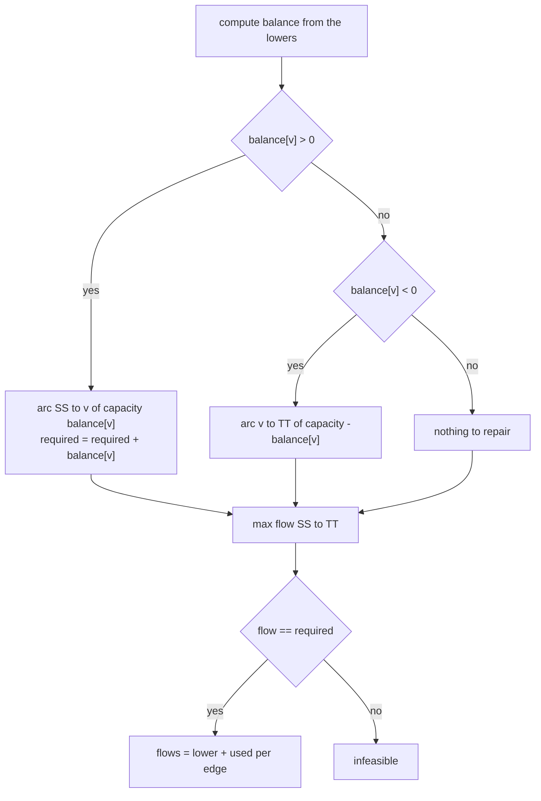
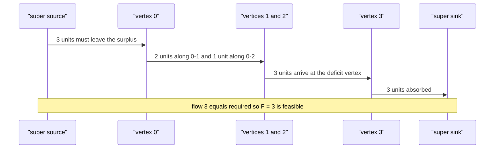

# 453 — Implement circulation with lower bounds (flow transform).

> **Tier:** Advanced · **CTCI chapter:** Ch 4 — Trees and Graphs
> **Task spec:** [453-implement-circulation-with-lower-bounds-flow-transform.md](../../../tasks/advanced/453-implement-circulation-with-lower-bounds-flow-transform.md)
> **Solutions:** [Python](../../../solutions/python/advanced/453-implement-circulation-with-lower-bounds-flow-transform/solution.py) ·
> [Java](../../../solutions/java/advanced/453-implement-circulation-with-lower-bounds-flow-transform/Solution.java) ·
> [JavaScript](../../../solutions/javascript/advanced/453-implement-circulation-with-lower-bounds-flow-transform/solution.js) ·
> [C#](../../../solutions/csharp/advanced/453-implement-circulation-with-lower-bounds-flow-transform/Solution.cs)

## 1. Problem restatement

**Input:** `n` vertices and `m` directed edges `(u, v, lower, upper)` with integer bounds.

**Output:** a **circulation** — an integer flow `f(u, v)` with `lower <= f <= upper` on every edge
and conservation at every vertex (`sum of f entering v == sum of f leaving v`). `circulation`
returns `(feasible, flows)`; `flows` is the per-edge assignment in input order when feasible,
otherwise `(False, None)`.

The header describes the transform that produces it: route the mandatory `lower` part first,
leaving each vertex a balance `b[v] = (lowers entering v) - (lowers leaving v)`, then find a flow
in the residual network (capacities `upper - lower`) that absorbs the balances by joining a
super source `SS` to every `b[v] > 0` vertex and every `b[v] < 0` vertex to a super sink `TT`.

| Call | Result | Why |
| --- | --- | --- |
| `circulation(3, [(0,1,1,3), (1,2,1,3), (2,0,1,3)])` | `(True, [1, 1, 1])` | all balances are 0, so 1 per edge works |
| `circulation(3, [(0,1,2,3), (1,2,0,1), (2,0,1,3)])` | `(False, None)` | vertex 1 owes 2 units but can only send 1 |
| `circulation(2, [(0,1,3,5), (1,0,0,5)])` | `(True, [3, 3])` | the upper triangle is 1 and has no flow at all |
| `circulation(4, [(0,1,1,2), (1,0,1,2), (2,3,0,1), (3,2,0,1)])` | feasible | two independent 2-cycles |
| `circulation(2, [(0,1,1,1)])` | `(False, None)` | one unit in, nowhere out |
| `circulation_with_required_value(4, st, 0, 3, 3)` | feasible, last flow `3` | max flow 3 = 2 via `0-1-3` + 1 via `0-2-3` |
| `circulation_with_required_value(4, st, 0, 3, 4)` | infeasible | the same network caps out at 3 |

The feasibility answer is cross-checked on 24 LCG instances (`feasible + infeasible == 24`)
against `brute_feasible`, which enumerates every integer assignment in `[lower, upper]`.

## 2. Intuition

A plain max-flow problem starts with the zero flow and pushes as much as possible. A circulation
with lower bounds cannot start at zero: every edge already carries `lower` units that must go
somewhere. Trying to satisfy the bounds directly turns into a search over all assignments —
which is exactly what the `brute_feasible` oracle does (and why it is only usable on instances
with at most five edges and capacity ranges of at most two).

The transform removes that difficulty in one move: **pretend the lower bounds are already
routed**. If every edge `(u, v)` carries `lower`, then a vertex `v` receives
`sum of lowers entering v` and loses `sum of lowers leaving v`. The difference

```text
b[v] = (sum of lowers entering v) - (sum of lowers leaving v)
```

is the surplus (`b[v] > 0`) or deficit (`b[v] < 0`) that the *additional* flow, on top of the
lowers, has to repair. Additional flow on an edge is exactly what the residual capacity
`upper - lower` allows.

Now the repair is an ordinary max-flow: attach a super source `SS` with an arc of capacity
`b[v]` into each surplus vertex and an arc of capacity `-b[v]` from each deficit vertex into a
super sink `TT`. A max flow of value `required = sum of positive balances` can only exist if
every `SS` arc is fully saturated — that is the feasibility test. The edge values are then
`lower + used`, where `used` is the flow the max-flow pushed along the residual arc.


The same transform answers the classic *s*-*t* question "is there a flow of exactly `F`?" by
closing the network: add the artificial edge `t → s` with bounds `[F, F]` and ask for a feasible
circulation. The header derives the hand case: with `max flow 3 = 2 via 0-1-3 + 1 via 0-2-3`,
`F = 3` is feasible and `F = 4` is not.

## 3. Algorithm

1. Create a max-flow structure on `n + 2` nodes, with `SS = n` and `TT = n + 1`.
2. For each input edge `(u, v, lower, upper)`: add `lower` to `balance[v]` and subtract it from
   `balance[u]`; add an arc `u → v` of capacity `upper - lower` and remember its index.
3. For each vertex `v`: if `balance[v] > 0` add an arc `SS → v` of capacity `balance[v]` and
   accumulate `required += balance[v]`; if `balance[v] < 0` add an arc `v → TT` of capacity
   `-balance[v]`.
4. Run Edmonds-Karp from `SS` to `TT`. If the value differs from `required`, return
   `(False, None)` — some surplus cannot reach a deficit.
5. Otherwise return `(True, flows)` with `flows[i] = lower[i] + used(forward arc of edge i)`,
   where `used = initial capacity - residual capacity` on that arc.
6. For a required `s`-`t` value `F`: append the edge `(t, s, F, F)` and call step 1-5 on the
   extended edge list.

```text
procedure circulation(n, edges)
    ss ← n
    tt ← n + 1
    network ← max-flow structure on n + 2 nodes
    balance[v] ← 0 for every vertex v
    arc_ids ← empty
    for each (u, v, lower, upper) in edges do
        balance[v] ← balance[v] + lower
        balance[u] ← balance[u] - lower
        append add_arc(network, u, v, upper - lower) to arc_ids
    end
    required ← 0
    for v ← 0 to n - 1 do
        if balance[v] > 0 then
            add_arc(network, ss, v, balance[v])
            required ← required + balance[v]
        else if balance[v] < 0 then
            add_arc(network, v, tt, -balance[v])
        end
    end
    used ← max_flow(network, ss, tt)
    if used != required then
        return (false, nothing)
    end
    flows ← empty
    for each edge i do
        append lower[i] + flow_on_arc(network, arc_ids[i]) to flows
    end
    return (true, flows)
end

procedure circulation_with_required_value(n, edges, s, t, required_value)
    return circulation(n, edges joined with (t, s, required_value, required_value))
end
```



## 4. Worked example

**Feasible case.** `n = 3`, `edges = [(0,1,1,3), (1,2,1,3), (2,0,1,3)]` — a directed triangle
with every edge bounded by `[1, 3]`.

| Vertex | Lowers in | Lowers out | `balance` | `SS`/`TT` arc |
| --- | --- | --- | --- | --- |
| 0 | 1 (from 2) | 1 (to 1) | 0 | none |
| 1 | 1 (from 0) | 1 (to 2) | 0 | none |
| 2 | 1 (from 1) | 1 (to 0) | 0 | none |

Every balance is 0, so `required = 0` and the max-flow value is trivially 0 — feasibility holds.
The residual arc of each edge is untouched, so `used = 0` everywhere and the answer is
`[1, 1, 1]`, which `check_flow_valid` verifies for bounds and conservation.

**Infeasible case.** `edges = [(0,1,2,3), (1,2,0,1), (2,0,1,3)]`.

| Vertex | Lowers in | Lowers out | `balance` | Arc added |
| --- | --- | --- | --- | --- |
| 0 | 1 (from 2) | 2 (to 1) | `-1` | `0 → TT`, capacity 1 |
| 1 | 2 (from 0) | 0 | `+2` | `SS → 1`, capacity 2 |
| 2 | 0 | 1 (to 0) | `-1` | `2 → TT`, capacity 1 |

`required = 2`. Residual arcs: `0→1` has `3 - 2 = 1`, `1→2` has `1 - 0 = 1`, `2→0` has
`3 - 1 = 2`. From `SS` the only route is `SS → 1`, and from vertex 1 the only residual arc is
`1 → 2` with capacity 1, so at most 1 unit can move; the max-flow value is 1 while
`required = 2`. The mismatch makes the instance infeasible, and `brute_feasible` agrees after
scanning all `2 * 2 * 3` assignments.

**Required-value case.** `n = 4`, `st_edges = [(0,1,0,2), (1,3,0,2), (0,2,0,1), (2,3,0,1)]`,
`F = 3` appends `(3, 0, 3, 3)`.

| Vertex | `balance` after lowers (all 0) plus `3→0` | Arc |
| --- | --- | --- |
| 0 | `+3` | `SS → 0`, capacity 3 |
| 3 | `-3` | `3 → TT`, capacity 3 |

Residual capacities are `0→1: 2`, `1→3: 2`, `0→2: 1`, `2→3: 1`, `3→0: 0`. Two augmentations
saturate everything available: `SS → 0 → 1 → 3 → TT` carries 2, then `SS → 0 → 2 → 3 → TT`
carries 1, for a total of 3 = `required`. The recorded flows are
`[0+2, 0+2, 0+1, 0+1, 3] = [2, 2, 1, 1, 3]`, and the test asserts `flows[-1] == 3`. With
`F = 4` the required amount is 4 but the residual network can only carry 3, so the same check
returns infeasible.



## 5. Complexity

Let `n` be the vertex count, `m` the number of bounded edges, and `V = n + 2`, `E = m + n` the
size of the transformed network.

| Measure | Bound | Why it holds |
| --- | --- | --- |
| Transform construction | `O(m + n)` | one pass over the edges, one pass over the vertices |
| Feasibility max-flow | `O(V * E^2)` | Edmonds-Karp with BFS augmentation on an explicit arc list |
| Flow extraction | `O(m)` | `lower + used` per edge, no graph work |
| Space | `O(V + E)` | arc list plus per-arc capacities; no matrix |
| Required-value variant | same as one circulation | one extra artificial edge, one more max-flow |
| Brute-force oracle | product of `(upper - lower + 1)` per edge, times `O(m)` | only used for the tiny LCG instances |

Every test instance is tiny, so the `O(V E^2)` worst case never bites: the interesting cost is
the *number* of max-flow runs, which is exactly one per feasibility question regardless of how
many edges carry lower bounds.

## 6. Pitfalls and edge cases

- **`upper < lower` is never generated**, and `upper == lower` is a perfectly legal "mandatory"
  edge — the residual capacity is 0 and the flow is pinned.
- **The `used` value must come from the forward arc.** `used = initial - residual` on the arc
  `u → v` created for the edge; the paired reverse arc with initial capacity 0 exists only to
  let augmentations cancel earlier pushes.
- **Saturation is the test, not just flow value equality in general.** `used != required` means
  at least one surplus vertex could not ship its balance out to a deficit, which is exactly
  when no circulation exists.
- **Vertices with `balance == 0` get no arc at all**, including isolated vertices. The
  `with_isolated` test has vertex 2 with no edges and is still feasible.
- **A dead end is infeasible.** `[(0, 1, 1, 1)]` gives `balance = [-1, +1]` but the residual
  capacity of `0 → 1` is `1 - 1 = 0`, so the unit can never leave vertex 1.
- **Returned flows must respect the original bounds** — `check_flow_valid` asserts
  `lower <= f <= upper` for each edge and full conservation, which catches any off-by-one in the
  residual bookkeeping.
- **The `s`-`t` extension needs `F` on both bounds.** Using `[0, F]` would ask only for *at most*
  `F`; `[F, F]` makes the flow mandatory, which is what "flow of exactly F" means.
- **Infinity in the flow loop is a sentinel** (`INF = 10 ** 9`) used as the initial augmentation
  minimum; capacities here are tiny integers.
- **Both feasible and infeasible outcomes are required.** The LCG block asserts
  `feasible_count >= 1` and `infeasible_count >= 1` over 24 instances, so a solver that always
  answers "yes" or always "no" cannot pass.

## 7. Variants and follow-ups

- **Maximum flow without lower bounds** is the same code with every `lower = 0`; the
  push-relabel formulation in [454 — Push-relabel max flow](../../../tasks/advanced/454-implement-push-relabel-max-flow-algorithm.md)
  and the scaling variant in [455 — Capacity scaling for max flow](../../../tasks/advanced/455-implement-capacity-scaling-for-max-flow.md)
  are drop-in replacements for the `MaxFlow` structure used here.
- **Minimum cuts from flows:** the saturated `SS` arcs identify the obstruction, and the same
  duality underlies the pairwise cuts in [451 — Gomory-Hu tree](../../../tasks/advanced/451-implement-gomory-hu-tree-for-all-pairs-min-cut-outline.md).
- **Scheduling and rounding applications:** bounds `[lower, upper]` model tasks that must run at
  least `lower` and at most `upper` times; a lower-bound flow feasibility test answers whether a
  round-robin schedule exists at all.
- **Integrality:** because all bounds are integers, Edmonds-Karp augments by integers and the
  circulation it returns is integral — `brute_feasible` enumerates integer assignments only,
  matching that guarantee.

## 8. Check yourself

**Q1.** Why does the transform need a super source *and* a super sink instead of a single
source?

<details><summary>Show answer</summary>

Surpluses (`b[v] > 0`) and deficits (`b[v] < 0`) can occur at any vertices and in any pattern,
with no designated source or sink. `SS` injects exactly the surplus amounts and `TT` absorbs
exactly the deficits, so "can every balance be repaired?" becomes a single max-flow question.

</details>

**Q2.** Why is `used == required` the feasibility criterion?

<details><summary>Show answer</summary>

`required` is the total surplus in the graph. Only by saturating every `SS` arc can all surpluses
leave their vertices, and every unit that leaves `SS` must eventually reach `TT`, since flow is
conserved at all the original vertices. Any shortfall means some surplus cannot be routed to a
deficit, so no circulation exists.

</details>

**Q3.** In the infeasible triangle, `required` is 2 but the max flow is 1. Which edge is the
bottleneck?

<details><summary>Show answer</summary>

The residual arc `1 → 2` with capacity `upper - lower = 1 - 0 = 1`. Vertex 1 has surplus 2 but
can only forward 1 unit, and its only other residual arc does not exist, so 1 unit of surplus is
stuck.

</details>

**Q4.** How does `circulation_with_required_value` reuse the plain solver?

<details><summary>Show answer</summary>

It appends the artificial edge `(t, s, F, F)` and calls `circulation`. The mandatory `F` units
travelling `t → s` force `F` units through the network from `s` to `t`, so a feasible
circulation of the extended graph is exactly an `s`-`t` flow of value `F` in the original graph.

</details>

**Q5.** The triangle case returns `[1, 1, 1]` even though the bounds allow up to 3. Why does the
solver not push more?

<details><summary>Show answer</summary>

Because the surplus/deficit balances are all 0, `required = 0`, so nothing needs to be pushed on
the residual arcs. The lower bounds alone already form a valid circulation, and the flattest
feasible solution is what comes out.

</details>
