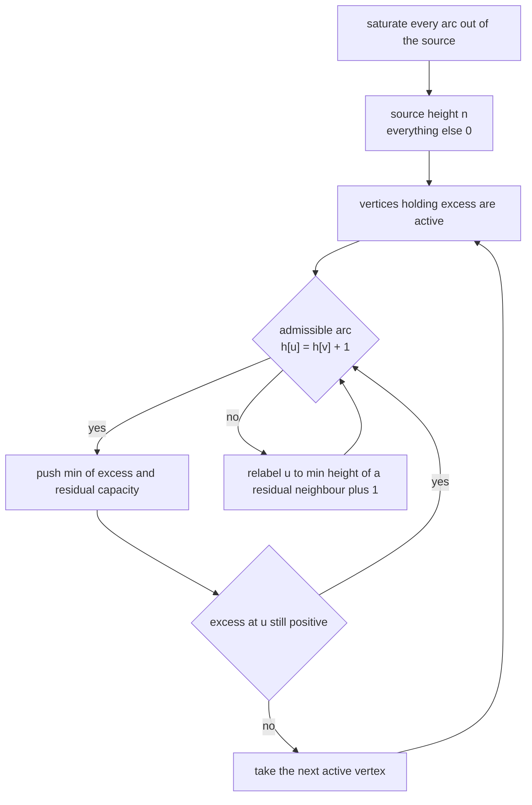
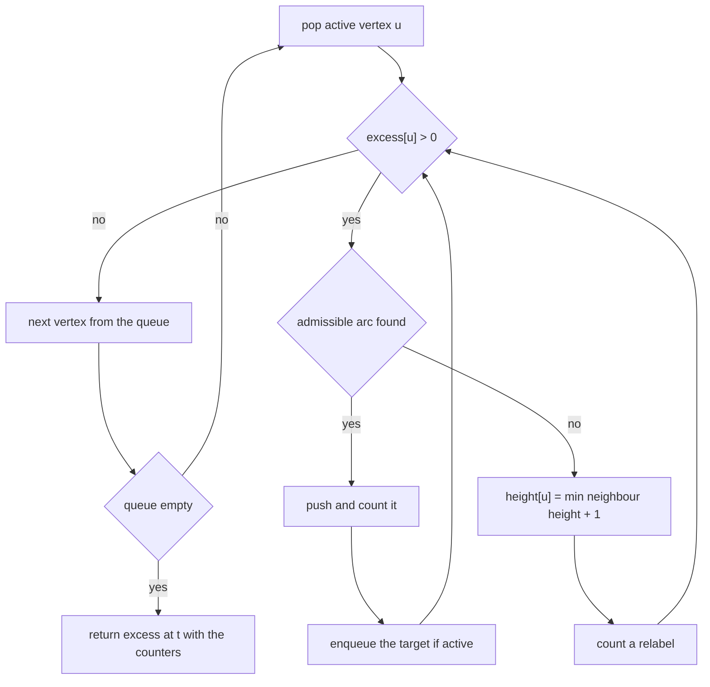
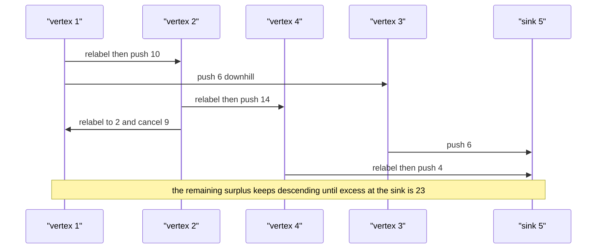

# 454 — Implement push-relabel max-flow algorithm.

> **Tier:** Advanced · **CTCI chapter:** Ch 4 — Trees and Graphs
> **Task spec:** [454-implement-push-relabel-max-flow-algorithm.md](../../../tasks/advanced/454-implement-push-relabel-max-flow-algorithm.md)
> **Solutions:** [Python](../../../solutions/python/advanced/454-implement-push-relabel-max-flow-algorithm/solution.py) ·
> [Java](../../../solutions/java/advanced/454-implement-push-relabel-max-flow-algorithm/Solution.java) ·
> [JavaScript](../../../solutions/javascript/advanced/454-implement-push-relabel-max-flow-algorithm/solution.js) ·
> [C#](../../../solutions/csharp/advanced/454-implement-push-relabel-max-flow-algorithm/Solution.cs)

## 1. Problem restatement

**Input:** a directed capacitated network — `n` vertices and arcs `(u, v, capacity)` — plus a
source `s` and a sink `t`.

**Output:** the maximum flow value from `s` to `t`, plus the number of pushes and relabels the
algorithm performed. `push_relabel` returns `(excess[t], pushes, relabels)` and *mutates* the
network's residual capacities, so the per-arc flow is read afterwards as
`initial - residual` (`flow_on`).

The header pins the variant to **generic FIFO push-relabel**: "start with a preflow that
saturates every arc out of the source, give the source height `n` and everything else `0`, then
repeatedly discharge an active vertex: push along an admissible arc (`h[u] == h[v] + 1`),
otherwise relabel `u` to `min(h[v]) + 1` over residual arcs."

| Call | Result | Why |
| --- | --- | --- |
| CLRS 26.1 graph, `s = 0`, `t = 5` | `23` | the classic example, `23 = 12 + 11` through the two sink arcs |
| `[(0,1,5)]`, `s = 0`, `t = 1` | `5` | a single arc |
| `[(0,1,3), (0,1,4), (1,2,2)]` | `2` | the bottleneck is `1 → 2` |
| `[(0,1,9), (2,3,9)]`, `s = 0`, `t = 3` | `0` | the sink is unreachable |
| `[(0,1,0), (1,2,5)]` | `0` | a zero-capacity arc blocks the path |
| 4 seeds × 8 LCG graphs | `checked == 32` | every value equals the Edmonds-Karp oracle |

For every case the suite also validates the resulting flow: capacities respected, conservation
at all internal vertices, `balance[t] == value` and `balance[s] == -value`.

## 2. Intuition

Edmonds-Karp searches for one augmenting path at a time and can be slow when paths are long and
capacities tiny. Push-relabel abandons paths entirely. Instead it keeps:

- a **preflow** — flow that may violate conservation, so a vertex can hold *excess*, and
- a **height** label per vertex, maintained so that flow only ever moves downhill
  (`h[u] == h[v] + 1` for an admissible push).

The source's arcs are saturated immediately, so every neighbour ends up with excess. A vertex
holding excess is *active*, and discharging it means: push excess to a lower neighbour if the
height difference is exactly 1, otherwise raise (`relabel`) the vertex just enough to create
such a difference. Heights of non-source vertices only increase, and the source keeps the fixed
height `n`. Because flow never moves "uphill", excess can only march towards the sink, and when
no active vertex remains, all the excess that accumulated at `t` is the maximum flow.



Relabelling is where the "distance to the sink" intuition lives: after a relabel, `h[u]` is one
more than the smallest height among the vertices `u` still has residual capacity towards, so the
labels behave like lower bounds on the remaining distance and only the sink can absorb without
raising the label further.

## 3. Algorithm

1. Build the arc list; each `add_edge(u, v, c)` appends the arc `u → v` with capacity `c` and its
   paired reverse arc `v → u` with capacity 0, so `idx ^ 1` is always the reverse. `add_edge`
   returns the forward index.
2. `h[v] ← 0` for all `v`, `h[s] ← n`, `excess[v] ← 0`.
3. Saturate every arc leaving `s`: for each such arc move its whole capacity, subtracting from
   the arc, adding to its reverse, and adding to `excess[v]` (and subtracting from `excess[s]`).
4. Seed a FIFO queue with every vertex `v ≠ s, t` having `excess[v] > 0`.
5. While the queue is not empty: pop `u` and discharge it — while `excess[u] > 0`, scan `u`'s
   arcs for the first with residual capacity and `h[u] == h[v] + 1`, push
   `min(excess[u], cap)`, and enqueue `v` if it is active and not already queued. If no
   admissible arc exists, set `h[u] ← min(h[v]) + 1` over arcs of `u` with residual capacity and
   count a relabel.
6. Return `(excess[t], pushes, relabels)`.

```text
procedure push_relabel(network, s, t)
    n ← number of vertices
    height[v] ← 0 for every v
    excess[v] ← 0 for every v
    height[s] ← n
    for each arc idx leaving s with residual capacity do
        amount ← residual capacity of idx
        move amount along idx and its reverse
        excess[target of idx] ← excess[target of idx] + amount
        excess[s] ← excess[s] - amount
    end
    pushes ← 0
    relabels ← 0
    queue ← active vertices other than s and t
    while queue is not empty do
        u ← pop front of queue
        while excess[u] > 0 do
            pushed ← false
            for each arc idx of u with residual capacity do
                v ← target of idx
                if height[u] = height[v] + 1 then
                    amount ← min(excess[u], residual capacity of idx)
                    move amount along idx and its reverse
                    excess[u] ← excess[u] - amount
                    excess[v] ← excess[v] + amount
                    pushes ← pushes + 1
                    enqueue v when it is active and not already queued
                    pushed ← true
                    stop the scan
                end
            end
            if pushed is false then
                height[u] ← 1 + minimum height over the arcs of u with residual capacity
                relabels ← relabels + 1
            end
        end
    end
    return (excess[t], pushes, relabels)
end
```



## 4. Worked example

The CLRS 26.1 network: `n = 6`, `s = 0`, `t = 5`, arcs
`0→1(16)`, `0→2(13)`, `1→2(10)`, `2→1(4)`, `1→3(12)`, `3→2(9)`, `2→4(14)`, `4→3(7)`,
`3→5(20)`, `4→5(4)`. The source can emit 29 units in total, while the two arcs into the sink
cap the answer at 24; the true maximum is 23, one below that bound.

**Initialisation.** `h = [6, 0, 0, 0, 0, 0]`; the source arcs are saturated, so
`excess = [-, 16, 13, 0, 0, 0]` and the queue is `[1, 2]`.

| Event | Vertex | Action | `excess` after | Queue |
| --- | --- | --- | --- | --- |
| 1 | 1 | no admissible arc, relabel to `0 + 1` | `[-, 16, 13, 0, 0, 0]` | `[1, 2]` |
| 2 | 1 | push `10` along `1 → 2` (`h = 1 = 0 + 1`) | `[-, 6, 23, 0, 0, 0]` | `[1, 2]` |
| 3 | 1 | push `6` along `1 → 3` | `[-, 0, 23, 6, 0, 0]` | `[2, 3]` |
| 4 | 2 | relabel to `0 + 1` (cheapest residual neighbour is 4) | `[-, 0, 23, 6, 0, 0]` | `[2, 3]` |
| 5 | 2 | push `14` along `2 → 4` | `[-, 0, 9, 6, 14, 0]` | `[3, 4]` |
| 6 | 2 | relabel to `1 + 1` (cheapest is vertex 1 at height 1) | `[-, 0, 9, 6, 14, 0]` | `[3, 4]` |
| 7 | 2 | push `9` along `2 → 1`, the reverse of `1 → 2`'s earlier push | `[-, 13, 0, 6, 14, 0]` | `[3, 4, 1]` |
| 8 | 3 | relabel to `0 + 1` (cheapest is the sink at height 0) | `[-, 13, 0, 6, 14, 6]` | `[4, 1]` |
| 9 | 3 | push `6` along `3 → 5` into the sink | `[-, 13, 0, 0, 14, 6]` | `[4, 1]` |
| 10 | 4 | relabel to `0 + 1`, then push `4` along `4 → 5` | `[-, 13, 0, 0, 10, 10]` | `[1, 4]` |

Read step 7 carefully: the push is on the *reverse* arc of `1 → 2`, which exists only because
step 2 pushed 10 units forward earlier. Cancelling flow this way is normal for push-relabel —
the algorithm does not need to find augmenting paths, it just moves excess towards lower
heights.

The discharge of vertex 4 continues: it relabels to 2 and pushes 7 units back along `4 → 3`,
then relabels to 3 and pushes its last 3 units along the reverse arc `4 → 2`. From there the
excess at vertices 1, 2 and 3 keeps moving downhill. Since `4 → 5` is already saturated, every
one of the remaining 13 units has to enter the sink through `3 → 5`, so the run ends with
`excess[5] == 23`, `pushes > 0` and `relabels > 0`.

| Quantity | Value | Checked by |
| --- | --- | --- |
| `excess[5]` (the answer) | `23` | `assert value == 23` |
| Edmonds-Karp on the same graph | `23` | asserted equal |
| `pushes` | `> 0` | `assert pushes > 0 and relabels > 0` |
| `relabels` | `> 0` | same assertion |
| Per-arc flow validity | bounds plus conservation | `check_flow_valid` |

The small cases pin down the degenerate behaviour: a single arc `0 → 1` of capacity 5 saturates
immediately and returns 5; the parallel pair `(0,1,3)`, `(0,1,4)` feeding `1 → 2` of capacity 2
returns 2; and the disconnected graph `[(0,1,9), (2,3,9)]` returns 0 because no excess can ever
reach the sink.



## 5. Complexity

Forty arcs of work per vertex and a queue that can hold a vertex many times make the exact
operation count instance dependent, which is why the implementation returns its `pushes` and
`relabels` counters instead of a fixed figure.

| Measure | Bound | Why it holds |
| --- | --- | --- |
| Relabels | `O(V^2)` | heights never decrease and never exceed `2V - 1` (classic bound) |
| Saturating pushes | `O(V * E)` | a saturating push raises the cheaper endpoint, so each pair is charged twice per height |
| Non-saturating pushes, FIFO order | `O(V^3)` | the classic bound for the FIFO discharge rule |
| Total, worst case | `O(V^3)` | dominated by the non-saturating pushes |
| Space | `O(V + E)` | arc lists with paired reverse arcs; no capacity matrix |
| Edmonds-Karp oracle | `O(V * E^2)` | used only to double-check the value |
| Test coverage | `checked == 32` | 4 seeds times 8 LCG graphs, plus the CLRS case and four hand cases |

The implementation does not use the current-arc optimisation (each discharge rescans `u`'s arc
list from the head) nor the gap or highest-label heuristics, so it stays on the classic generic
push-relabel bounds rather than the `O(V^2 * sqrt(E))` of the tuned variants.

## 6. Pitfalls and edge cases

- **The answer is `excess[t]`, not the flow out of the source.** Vertices may still hold excess
  during the run; only when the queue empties is `excess[t]` the flow value.
- **`excess[s]` is negative by construction** (the source pushes without receiving), so the
  source must be excluded from the queue and from the "active" test.
- **The sink is never queued and never relabelled.** If it could push, it could return flow and
  the final `excess[t]` would stop being the answer.
- **The push scan stops at the first admissible arc** and the inner loop then re-scans from the
  head, which is what makes the counter totals deterministic and reproducible across languages.
- **A relabel needs at least one residual arc.** `height[u] ← min(h[v]) + 1` is only computed
  over arcs with positive residual capacity; a vertex with excess always has a way out to the
  source's side, so the minimum is never the `INF` sentinel in valid runs.
- **Zero-capacity arcs are legal** and behave like non-edges: the `[(0,1,0), (1,2,5)]` case
  returns 0.
- **Unreachable sinks return 0** — the disconnected test and the zero-capacity test both assert
  0 rather than "no answer".
- **The network is consumed.** Capacities are mutated, so each test builds a fresh network
  (`build_network`) before running the Edmonds-Karp oracle on the same edges; reusing a network
  would compare against an already-flowing graph.
- **Both counters must be positive.** `assert total_pushes > 0 and total_relabels > 0` over the
  32 LCG graphs guards against an implementation that never actually discharges anything.
- **Conservation is checked globally.** `check_flow_valid` asserts `balance[t] == value`,
  `balance[s] == -value` and `balance[v] == 0` for every other vertex, which catches an
  incomplete discharge even when the value happens to be right.

## 7. Variants and follow-ups

- **Capacity scaling** ([455 — Capacity scaling for max flow](../../../tasks/advanced/455-implement-capacity-scaling-for-max-flow.md))
  adds a scaling parameter `delta` so that only arcs with residual capacity at least `delta` are
  considered, cutting the number of non-saturating pushes and giving a polynomial bound
  independent of the capacities.
- **Feasible flows with bounds** ([453 — Circulation with lower bounds](../../../tasks/advanced/453-implement-circulation-with-lower-bounds-flow-transform.md))
  reuses any max-flow routine; a push-relabel engine plugs in behind the same `add_edge` /
  `max_flow` interface used here.
- **All-pairs min-cut** ([451 — Gomory-Hu tree](../../../tasks/advanced/451-implement-gomory-hu-tree-for-all-pairs-min-cut-outline.md))
  benefits from a fast source-sink engine, since it runs `n - 1` of them.
- **Tuned push-relabel variants:** highest-label selection with the gap heuristic reaches
  `O(V^2 * sqrt(E))`; the current-arc data structure removes the repeated rescans of each arc
  list. Neither is implemented here, and the tests do not require them.

## 8. Check yourself

**Q1.** Why does the algorithm start by saturating every arc out of the source instead of
starting from the zero flow?

<details><summary>Show answer</summary>

Because push-relabel is built on a *preflow*: violating conservation at the source is allowed and
gives the neighbours immediate excess to work with. From then on, flow only moves downhill and
the excess is pushed towards the sink, so no augmenting-path search is needed at all.

</details>

**Q2.** What makes an arc admissible, and what happens when a vertex has none?

<details><summary>Show answer</summary>

An arc `u → v` is admissible when it has positive residual capacity and
`h[u] == h[v] + 1`. If no arc of the active vertex `u` is admissible, `u` is relabelled to one
more than the smallest height among its residual neighbours, which creates an admissible arc
(unless the excess has nowhere left to go, in which case it can only return towards the source).

</details>

**Q3.** In step 7 of the trace, excess moves from vertex 2 to vertex 1 — backwards relative to
the original arcs. Is the recorded flow invalid?

<details><summary>Show answer</summary>

No. The push uses the reverse arc created by the earlier 10-unit push on `1 → 2`, so it
*cancels* 9 units of that flow rather than creating new flow from 2 to 1. The per-arc flow is
read as `initial - residual`, which stays inside `[0, capacity]`, and `check_flow_valid`
confirms conservation.

</details>

**Q4.** Why does the source keep the fixed height `n`?

<details><summary>Show answer</summary>

It guarantees flow never returns uphill into the source (nothing has height `n + 1`) while
leaving every other vertex room to rise up to `2n - 1`; this is what bounds the number of
relabels at `O(n^2)`.

</details>

**Q5.** Both `pushes` and `relabels` are asserted to be positive. What bug would that catch?

<details><summary>Show answer</summary>

An implementation that skipped the discharge loop or returned `excess[t]` from the initial
saturation only. On the CLRS network the initial preflow puts nothing at the sink, so a
non-discharging version would report 0 while the correct answer is 23.

</details>
