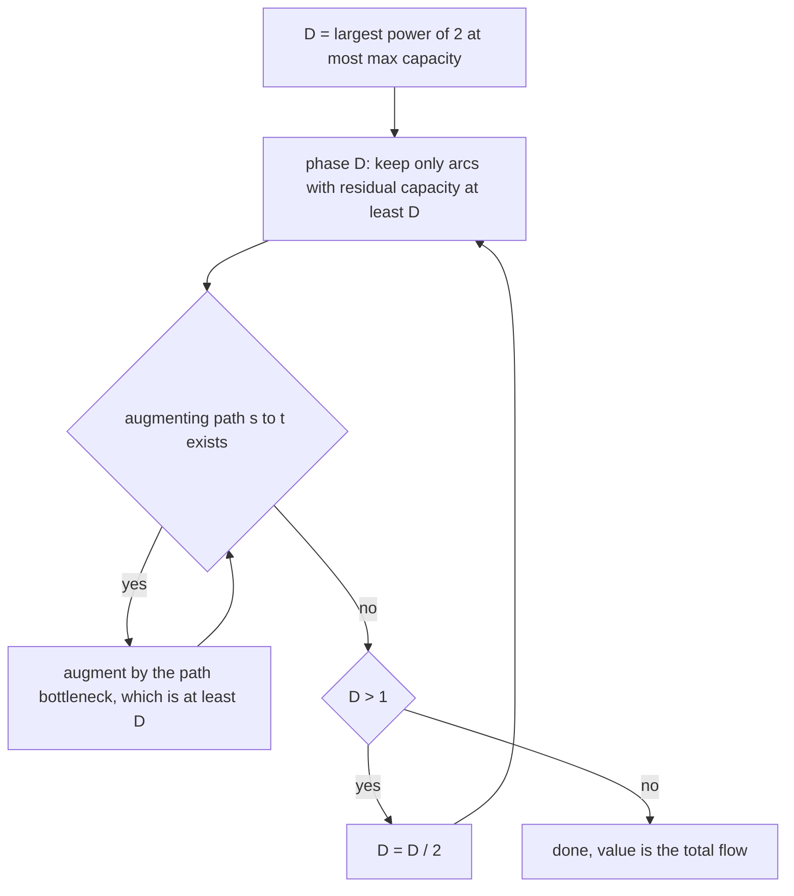
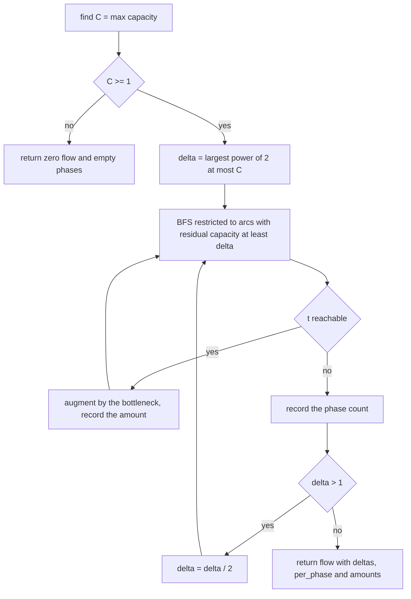
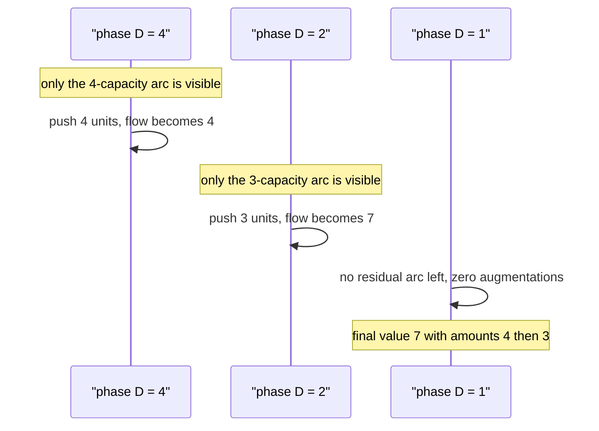

# 455 — Implement capacity scaling for max flow.

> **Tier:** Advanced · **CTCI chapter:** Ch 4 — Trees and Graphs
> **Task spec:** [455-implement-capacity-scaling-for-max-flow.md](../../../tasks/advanced/455-implement-capacity-scaling-for-max-flow.md)
> **Solutions:** [Python](../../../solutions/python/advanced/455-implement-capacity-scaling-for-max-flow/solution.py) ·
> [Java](../../../solutions/java/advanced/455-implement-capacity-scaling-for-max-flow/Solution.java) ·
> [JavaScript](../../../solutions/javascript/advanced/455-implement-capacity-scaling-for-max-flow/solution.js) ·
> [C#](../../../solutions/csharp/advanced/455-implement-capacity-scaling-for-max-flow/Solution.cs)

## 1. Problem restatement

**Input:** a directed capacitated network — `n` vertices, arcs `(u, v, capacity)` — plus a source
`s` and a sink `t`. Capacities are positive integers up to 500 in the generated graphs.

**Output:** the maximum flow value, plus the bookkeeping that makes the scaling visible:
`capacity_scaling` returns `(value, deltas, per_phase, amounts)` where `deltas` lists the scaling
parameter of each phase in order, `per_phase[i]` counts the augmentations performed in phase
`i`, and `amounts` holds the amount of every single augmentation in order.

The header fixes the strategy: "let `D` be the largest power of 2 not exceeding the largest
capacity. Phase `D` searches for augmenting paths that use only residual arcs of capacity `>= D`
and pushes along them until none remains; `D` halves each phase until `D = 1`... there are
`floor(log2 C) + 1` phases with at most `2E` augmentations each."

| Call | Result | Why |
| --- | --- | --- |
| `[(0,1,6)]` | value `6`, `deltas == [4, 2, 1]`, `per_phase == [1, 0, 0]`, `amounts == [6]` | one push of 6 exceeds the phase `D = 4` |
| `[(0,1,3), (0,1,4)]` | value `7`, `per_phase == [1, 1, 0]`, `amounts == [4, 3]` | `D = 4` uses the 4-arc, `D = 2` the 3-arc |
| `[(0,1,1000), (1,2,999)]` | value `999`, `len(deltas) == 10`, `deltas[0] == 512` | ten phases `512..1`, all in one push |
| `[(0,1,1)]` | value `1`, `deltas == [1]`, `amounts == [1]` | the smallest capacity needs a single phase |
| `[]` (no edges) | value `0`, `deltas == []` | no capacity at all means no phase |
| CLRS 26.1, `s = 0`, `t = 5` | value `23`, `deltas == [16, 8, 4, 2, 1]` | `16` is the largest power of 2 below `20` |
| 3 seeds × 8 LCG graphs | `checked == 24`, `late_phase_work >= 1` | values match Edmonds-Karp exactly |

## 2. Intuition

Plain Edmonds-Karp picks the shortest augmenting path and pushes the path's bottleneck. On a
graph with wildly different capacities that can mean thousands of tiny augmentations: the chain
`0 → 1` of capacity 1000 feeding `1 → 2` of capacity 999 is fine, but a network with capacity-1
side arcs next to capacity-1000 arcs can force many one-unit pushes.

Capacity scaling fixes this by working from the top down. Compute `D`, the largest power of two
not exceeding the biggest capacity. A phase `D` only looks at residual arcs whose capacity is at
least `D` — the "big" arcs — and augments along paths in that sparser subgraph until no such
path exists. Then halve `D` and repeat, finishing at `D = 1`, where the subgraph is the whole
residual graph and the remaining work is correct by ordinary max-flow theory.

The crucial detail from the header is that a bottleneck may exceed `D`: the *search* is
restricted to big arcs, but the *push* takes whatever the path's minimum residual capacity is.
On the single edge of capacity 6, phase `D = 4` finds the arc and pushes 6, so `amounts == [6]`
and the later phases have nothing left to do.



Because each phase spends its augmentations on arcs that are at least `D` big, every phase
leaves only arcs smaller than `D/2`-ish behind, and the phase count is
`floor(log2 C) + 1` — the assertions check `len(deltas) == phase_count_for(max_capacity)` and,
for the top phase, `deltas[0] * 2 > max_capacity` together with `deltas[0] <= max_capacity`.

## 3. Algorithm

1. Build the arc list with paired reverse arcs (reverse index is `idx ^ 1`).
2. Scan the forward arcs (`range(0, len(to), 2)`) for the largest capacity `C`.
3. If `C >= 1`, set `delta` to the largest power of two `<= C` by doubling while
   `delta * 2 <= C`; otherwise `delta = 0` and there are no phases.
4. While `delta >= 1`:
   a. Record `delta` in `deltas`.
   b. Repeatedly BFS from `s` over residual arcs with capacity `>= delta` only. If `t` is
      unreachable, end the phase.
   c. Otherwise augment along the found path by its bottleneck capacity, assert
      `amount >= delta`, append the amount, add it to the running flow and to the phase counter.
   d. Append the phase counter to `per_phase` and set `delta //= 2`.
5. Return `(flow, deltas, per_phase, amounts)`.

```text
procedure capacity_scaling(network, s, t)
    C ← maximum capacity over all forward arcs
    if C < 1 then
        return (0, empty, empty, empty)
    end
    delta ← 1
    while delta * 2 <= C do
        delta ← delta * 2
    end
    flow ← 0
    deltas ← empty
    per_phase ← empty
    amounts ← empty
    while delta >= 1 do
        append delta to deltas
        count ← 0
        loop
            parent_edge ← BFS from s over arcs with residual capacity at least delta
            if t is unreachable then
                exit the loop
            end
            amount ← bottleneck residual capacity along the parent_edge path
            push amount along the path and its reverse arcs
            assert amount >= delta
            append amount to amounts
            flow ← flow + amount
            count ← count + 1
        end
        append count to per_phase
        delta ← delta / 2
    end
    return (flow, deltas, per_phase, amounts)
end
```



## 4. Worked example

Two parallel arcs from `0` to `1` with capacities 3 and 4. The maximum capacity is 4, so
`delta` starts at 4.

| Phase `D` | Arcs with residual capacity `>= D` | Path used | Amount | `per_phase` | Running flow |
| --- | --- | --- | --- | --- | --- |
| 4 | only `0→1` of capacity 4 | `0 → 1` | `min(4) = 4` | 1 | 4 |
| 2 | only `0→1` of capacity 3 | `0 → 1` | `min(3) = 3` | 1 | 7 |
| 1 | none left (both arcs saturated) | — | — | 0 | 7 |

So `deltas == [4, 2, 1]`, `per_phase == [1, 1, 0]` and `amounts == [4, 3]` with
`sum(amounts) == 7 == value` — all four assertions the solution makes for this case. Note that
phase 4 ignores the capacity-3 arc entirely; that is the whole point of the scaling parameter.

The single-edge case shows the "bottleneck may exceed `D`" rule: with capacity 6 the phases are
`[4, 2, 1]` but `per_phase == [1, 0, 0]`, because phase `D = 4` already pushes all 6 units and
the smaller phases find no residual arc left.

The chain `0 → 1 (1000)`, `1 → 2 (999)` pins the phase count down:

| Quantity | Value | Why |
| --- | --- | --- |
| `deltas[0]` | `512` | the largest power of 2 not exceeding 1000 |
| `len(deltas)` | `10` | `512, 256, 128, 64, 32, 16, 8, 4, 2, 1` |
| `amounts` | a single push of `999` | the bottleneck is `1 → 2` |
| `value` | `999` | confirmed by Edmonds-Karp on a fresh network |

After that push the arc `0 → 1` has residual capacity 1 and `1 → 2` is saturated, so every later
phase sees no path with a big-enough arc and contributes nothing.

For the CLRS 26.1 network the maximum capacity is 20, so `deltas == [16, 8, 4, 2, 1]`. Phase
`D = 16` performs no augmentation at all: the only arcs with residual capacity at least 16 are
`0 → 1` (16) and `3 → 5` (20), and nothing leaves vertex 1 with capacity 16 or more
(`1 → 3` is only 12). The flow of 23 is therefore delivered in the later, finer phases, and the
test asserts the phase list and the total rather than the per-phase counts.



## 5. Complexity

Let `C` be the largest capacity, `E` the number of arcs and `V` the number of vertices.

| Measure | Bound | Why it holds |
| --- | --- | --- |
| Number of phases | `floor(log2 C) + 1` | `delta` halves from the top power of two down to 1; asserted as `len(deltas) == phase_count_for(max_capacity)` |
| Augmentations per phase | at most `2E` | each augmentation saturates a big arc, and after `E` saturating pushes the `D`-subgraph is exhausted (classic bound quoted in the header) |
| One BFS | `O(E)` | arc-list traversal with the `capacity >= delta` filter |
| One augmentation | `O(V)` | parent pointers are walked from `t` back to `s` |
| Total work | `O(E * (E + V) * log C)` | phases times augmentations times path work |
| Space | `O(V + E)` | arc lists with paired reverse arcs and a parent array |
| Plain Edmonds-Karp oracle | `O(V * E^2)` | used to verify each value independently |

The cost model is what makes scaling attractive: the number of augmentations depends on
`log C` and on `E`, not on the magnitudes of the capacities themselves, so huge capacities no
longer mean proportionally many pushes. All values reported here (the phase lists, the counts
and the amounts) come from the test assertions, not from measurement.

## 6. Pitfalls and edge cases

- **A bottleneck can exceed `D`.** The filter applies to the search only; the single capacity-6
  edge is drained in one 6-unit push during phase `D = 4`.
- **The phase count depends on the maximum capacity, not on the flow value.** The chain case has
  ten phases even though a single push ends the work.
- **`delta` must start at a power of two.** The initialisation doubles while
  `delta * 2 <= C`, so `deltas[0] <= C < 2 * deltas[0]`; both halves of that inequality are
  asserted on the LCG graphs.
- **No arcs at all means no phases.** `capacity_scaling` on an edgeless network returns
  `(0, [], [], [])`; the guard `if max_capacity >= 1` prevents a bogus phase at `delta = 0`.
- **`D = 0` would loop forever** if the guard were missing, because `0 // 2 == 0` never reaches
  the exit condition `delta >= 1`.
- **Both parallel arcs must be usable.** The `3`/`4` case only reaches 7 because phase `D = 2`
  picks up the arc that phase `D = 4` skipped; a filter left in place after the last phase would
  under-report.
- **The flow value must equal plain Edmonds-Karp.** The LCG block builds a second network and
  compares; the per-augmentation assertions (`amount >= delta`, `sum(amounts) == value`,
  `sum(per_phase) == len(amounts)`) are checked on the same run.
- **Late phases are not always idle.** The suite asserts `late_phase_work >= 1` over the 24
  graphs, so a version that did everything in the first phase of every instance would fail.
- **Zero-capacity arcs are legal input.** They are simply never visible to a phase, matching the
  plain-flow behaviour.
- **The network is consumed by augmentations**, so the comparison against Edmonds-Karp rebuilds
  the graph from the edge list rather than reusing the scaled one.

## 7. Variants and follow-ups

- **The unscaled baseline:** [454 — Push-relabel max flow](../../../tasks/advanced/454-implement-push-relabel-max-flow-algorithm.md)
  attacks the same problem from the other direction — a different engine with its own operation
  counters (`pushes`, `relabels`) instead of phases and amounts.
- **Bounds instead of plain capacities:** [453 — Circulation with lower bounds](../../../tasks/advanced/453-implement-circulation-with-lower-bounds-flow-transform.md)
  layers a surplus/deficit transform on top of any max-flow routine, including this one.
- **Many source-sink pairs:** [451 — Gomory-Hu tree](../../../tasks/advanced/451-implement-gomory-hu-tree-for-all-pairs-min-cut-outline.md)
  runs `n - 1` max flows, so a faster engine here directly shortens the tree construction.
- **Strongly polynomial methods:** Dinic's blocking-flow algorithm and the tuned push-relabel
  variants give bounds independent of `C` as well; the scaling version implemented here keeps
  the simpler Edmonds-Karp BFS inside each phase.

## 8. Check yourself

**Q1.** Why does the algorithm restrict the *search* to arcs of capacity at least `D` but not the
*push* amount?

<details><summary>Show answer</summary>

The restriction keeps each phase's subgraph sparse, which bounds the number of augmentations per
phase by `2E`. The bottleneck along a path found that way is automatically at least `D`, but it
can be larger, and pushing the full bottleneck drains the path immediately rather than in many
`D`-sized steps — the capacity-6 edge is drained by a single push of 6 in phase `D = 4`.

</details>

**Q2.** Why are there `floor(log2 C) + 1` phases?

<details><summary>Show answer</summary>

`delta` starts at the largest power of two `<= C`, which is `2^floor(log2 C)`, and halves each
phase until it reaches 1: that is `floor(log2 C) + 1` values. The tests assert exactly this count
via `phase_count_for(max_capacity)`.

</details>

**Q3.** In the parallel example, why does phase `D = 4` not push 7 units at once?

<details><summary>Show answer</summary>

Because the capacity-3 arc is invisible to that phase — a path may only use arcs with residual
capacity at least 4. Phase 4 drains the 4-arc, and the 3-arc is picked up in phase `D = 2`,
giving `amounts == [4, 3]`.

</details>

**Q4.** The chain `1000 / 999` has ten phases but only one augmentation. Does that mean the later
phases were wasted?

<details><summary>Show answer</summary>

They cost one BFS each and find nothing, because after the 999-unit push the arc `0 → 1` has
residual capacity 1 and `1 → 2` is saturated. The phase structure is what guarantees correctness
for networks whose big arcs *do* get exhausted; the cost here is `O(log C)` extra searches.

</details>

**Q5.** Phase `D = 16` on the CLRS network augments nothing. Why is that still useful?

<details><summary>Show answer</summary>

It is the price of the scheme: the top phase simply finds no path through arcs of capacity at
least 16, because `1 → 3` has only 12. The flow is then built up by the finer phases
`8, 4, 2, 1`, and the test asserts the phase list `[16, 8, 4, 2, 1]` together with the final
value 23.

</details>
