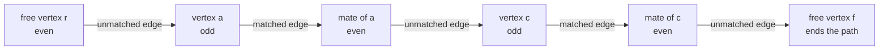
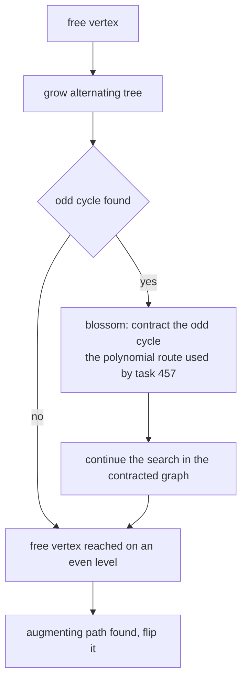
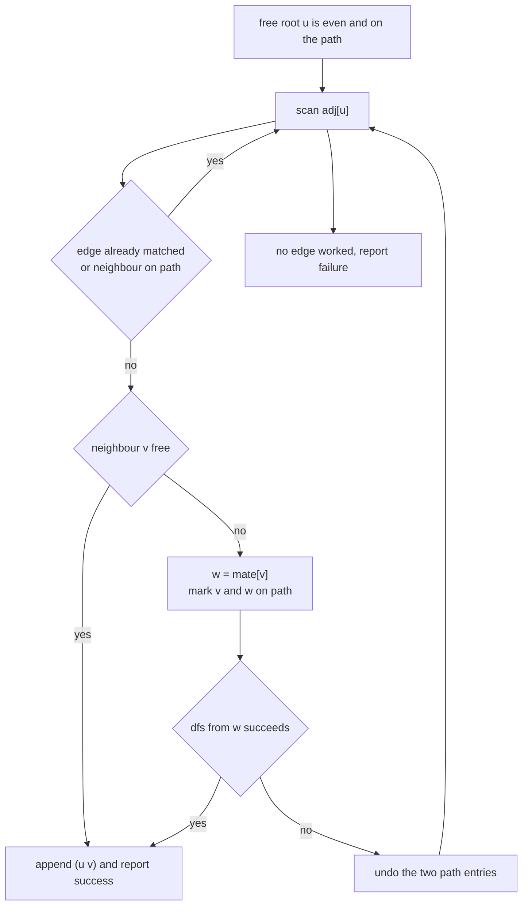
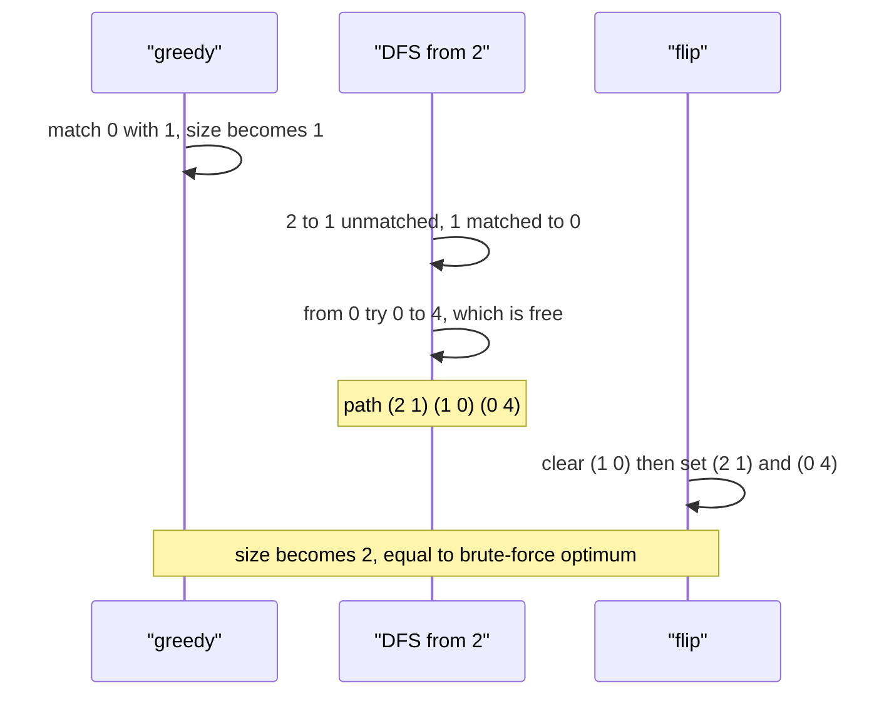

# 456 — Implement matchings in general graph (Edmonds blossom outline).

> **Tier:** Advanced · **CTCI chapter:** Ch 4 — Trees and Graphs
> **Task spec:** [456-implement-matchings-in-general-graph-edmonds-blossom-outline.md](../../../tasks/advanced/456-implement-matchings-in-general-graph-edmonds-blossom-outline.md)
> **Solutions:** [Python](../../../solutions/python/advanced/456-implement-matchings-in-general-graph-edmonds-blossom-outline/solution.py) ·
> [Java](../../../solutions/java/advanced/456-implement-matchings-in-general-graph-edmonds-blossom-outline/Solution.java) ·
> [JavaScript](../../../solutions/javascript/advanced/456-implement-matchings-in-general-graph-edmonds-blossom-outline/solution.js) ·
> [C#](../../../solutions/csharp/advanced/456-implement-matchings-in-general-graph-edmonds-blossom-outline/Solution.cs)

## 1. Problem restatement

**Input:** an undirected graph on `n` vertices given as an edge list — no bipartition, no
weights. Vertices may be isolated, cycles may be odd.

**Output:** a **maximum matching**, returned as a `mate` array where `mate[v] = -1` means `v` is
free and otherwise `mate[v]` is `v`'s partner. `max_matching_outline` returns
`(mate, augmentations)` — the matching and the number of augmenting-path flips performed.

Every produced matching must pass `check_matching`, which asserts mate symmetry
(`mate[mate[v]] == v`), that nobody is matched to itself, and that each matched pair is a real
edge of the graph.

The spec marks the task as an **outline**, and the header documents the simplification: the
polynomial blossom algorithm that contracts odd cycles "is the subject of task 457. Here the
search is kept as an explicit exhaustive depth-first search over *simple alternating paths*...
By Berge's theorem a matching is maximum iff it has no augmenting path, and the exhaustive
search finds one whenever it exists, so the outline is exact for the small graphs it is meant
for."

| Graph | Expected size | Why |
| --- | --- | --- |
| triangle on 3 vertices | `1` | one vertex must stay free |
| `C5` | `2` | an odd cycle matches all but one vertex |
| `C6` / `C7` | `3` / `3` | `floor(n / 2)` |
| `K4` | `2` | `n / 2` |
| star with centre 0 | `1` | every edge touches the centre |
| two disjoint triangles | `2` | the components do not interact |
| `K3,3` | `3` | a perfect matching exists |
| diamond (`K4` minus an edge) | `2` | four vertices, one of them with degree 2 |
| path `P4` | `2` | two disjoint edges |
| no edges at all | `0` | nothing to match |
| single edge, `n = 2` | `1` | trivial |
| 24 LCG graphs (`n <= 8`) | equals brute force | `checked == 24`, `improved_graphs >= 1` |

## 2. Intuition

A greedy pass is the obvious start: walk the vertices in order and match each free vertex to its
first free neighbour. The result is a **maximal** matching — no edge can be added without
disturbing it — but maximal is not maximum. The run below shows a five-vertex graph where greedy
picks one edge and the optimum has two.

The repair tool is an **augmenting path**: a path that starts and ends at free vertices and whose
edges alternate unmatched, matched, unmatched, ... along its length. Flipping such a path (every
unmatched edge becomes matched and every matched edge becomes unmatched) keeps the object a valid
matching and increases its size by one. Berge's theorem says a matching is maximum if and only
if no augmenting path exists, so "greedy plus repeated flipping until nothing is found" is exact
— provided the search really finds an augmenting path whenever one exists.



Odd cycles are why the search cannot be a plain BFS on bipartite sides: in a triangle, a path can
return to an already seen "even" vertex through an odd cycle, and a naive search either loops
forever or makes the wrong conclusion. Edmonds' blossom algorithm resolves this by *contracting*
the odd cycle into a single super-vertex and continuing. That contraction is the polynomial
machinery deliberately left to [457 — Blossom algorithm conceptual skeleton](../../../tasks/advanced/457-implement-blossom-algorithm-conceptual-skeleton.md).



The outline takes the other road: enumerate simple alternating paths with a depth-first search,
recording which *even* vertices are already on the path so the search stays finite. It is
exponential in the worst case, but on the small graphs this task targets it finds an augmenting
path whenever one exists and therefore returns a provably maximum matching.

## 3. Algorithm

1. `build_adj` turns the edge list into an adjacency list, adding both directions.
2. `greedy_matching`: for `u` from `0` to `n - 1`, if `u` is free, scan `adj[u]` in order and
   match `u` to the first neighbour `v > u` that is also free.
3. Repeat until a full pass performs no flip:
   a. For each free vertex `u`, call `find_augmenting_path(n, adj, mate, u)`.
   b. The DFS walks a simple alternating path: from the even vertex `u`, follow an **unmatched**
      edge `(u, v)`; if `v` is free the path is complete, otherwise step along `v`'s matched edge
      to `w = mate[v]`, mark both `v` and `w` as on-path, and recurse from `w`.
   c. `apply_augmenting` clears the matched edges (the odd-indexed entries of the path) and then
      sets the previously unmatched ones (the even-indexed entries), asserting the alternation.
4. Return the `mate` array and the flip count.

```text
procedure max_matching_outline(n, adj)
    mate ← greedy_matching(n, adj)
    augmentations ← 0
    changed ← true
    while changed do
        changed ← false
        for u ← 0 to n - 1 do
            if mate[u] = -1 then
                path ← find_augmenting_path(n, adj, mate, u)
                if path is not nothing then
                    apply_augmenting(mate, path)
                    augmentations ← augmentations + 1
                    changed ← true
                end
            end
        end
    end
    return (mate, augmentations)
end
```

```text
procedure find_augmenting_path(n, adj, mate, root)
    on_path[v] ← false for every v
    on_path[root] ← true
    path ← empty
    if dfs(root) then
        return path
    end
    return nothing
end

function dfs(u)
    for each v in adj[u] do
        if mate[u] = v or on_path[v] then
            skip v
        else if mate[v] = -1 then
            append (u, v) to path
            return true
        else
            w ← mate[v]
            if on_path[w] then
                skip v
            else
                on_path[v] ← true
                on_path[w] ← true
                append (u, v) and (v, w) to path
                if dfs(w) then
                    return true
                end
                remove the last two entries of path
                on_path[v] ← false
                on_path[w] ← false
            end
        end
    end
    return false
end
```



## 4. Worked example

A graph from the suite's own LCG run (seed `4564`, `n = 5`):
`edges = [(1,0), (2,1), (3,1), (4,1), (2,0), (0,4)]`. Vertex 3 is a leaf on vertex 1.

**Greedy pass.** `adj[0] = [1, 2, 4]`, `adj[1] = [0, 2, 3, 4]`, `adj[2] = [1, 0]`,
`adj[3] = [1]`, `adj[4] = [1, 0]`.

| Vertex `u` | Free? | First free neighbour `v > u` | `mate` after |
| --- | --- | --- | --- |
| 0 | yes | 1 | `[1, 0, -1, -1, -1]` |
| 1 | no | — | unchanged |
| 2 | yes | none (1 and 0 both matched) | unchanged |
| 3 | yes | none (1 matched) | unchanged |
| 4 | yes | none (1 and 0 matched) | unchanged |

Greedy returns `[1, 0, -1, -1, -1]`, size `1` — a maximal matching, not a maximum one.

**Augmentation.** The outer loop tries the free vertex `2` first.

| DFS step | Even vertex | Edge tried | Verdict |
| --- | --- | --- | --- |
| 1 | 2 | `(2, 1)` | `1` is matched to `0`, so step to `w = 0`; mark 1 and 0 on-path |
| 2 | 0 | `(0, 1)` | `1` is `0`'s own mate — the matched edge is skipped |
| 2 | 0 | `(0, 2)` | `2` is the path root and already on-path — skipped |
| 2 | 0 | `(0, 4)` | `4` is free — the path ends |

The path is `[(2,1), (1,0), (0,4)]`: unmatched, matched, unmatched. `apply_augmenting` first
clears the odd-indexed entry `(1,0)` (asserting `mate[1] == 0` and `mate[0] == 1`), then sets the
even-indexed entries `(2,1)` and `(0,4)`.

| Step | `mate` | Size |
| --- | --- | --- |
| after greedy | `[1, 0, -1, -1, -1]` | 1 |
| clear `(1, 0)` | `[-1, -1, -1, -1, -1]` | 0 |
| set `(2, 1)` and `(0, 4)` | `[4, 2, 1, -1, 0]` | **2** |

The second outer pass finds no augmenting path — from the remaining free vertex 3 the search
reaches `2`, then `0`, then `4`, whose neighbours are both unavailable (0 is its mate and 1 is
already on-path), so the search backtracks and fails — and the loop stops with
`augmentations == 1`. `check_matching` verifies validity, and `brute_max_matching`,
which branches on the first free vertex, confirms the optimum is 2.

The same LCG run contains larger improvements, for example seed `4561` with `n = 8`, where greedy
matches 3 pairs and a single flip along
`[(4,1), (1,0), (0,2), (2,3), (3,5), (5,6), (6,7)]` reaches `[2, 4, 0, 5, 1, 3, 7, 6]`, size 4.
That is exactly why the suite asserts `improved_graphs >= 1` and
`total_augmentations >= improved_graphs`: the augmentation loop has to do real work.



## 5. Complexity

| Measure | Bound | Why it holds |
| --- | --- | --- |
| Adjacency build | `O(V + E)` | one pass over the edge list |
| Greedy pass | `O(V + E)` | each adjacency entry is scanned at most once |
| One DFS | exponential in the worst case | it enumerates simple alternating paths |
| Root attempts | `O(V)` per outer pass | one search per free vertex |
| Outer passes | at most `V / 2` effective flips | every flip raises the matching size by 1 |
| Total | exact but exponential worst case | the documented trade-off of this outline |
| Space | `O(V + E)` | adjacency lists, `on_path`, `mate`, and the path |
| Brute force oracle | exponential | first-free-vertex branching, used only for `n <= 8` |

The polynomial alternative is blossom contraction, whose run time is `O(V^3)` in the classic
implementation and `O(V * E)` style bounds for the later variants — the machinery task 457
describes. This outline instead pays an exponential search in exchange for a short, checkable
implementation that is exact on the small graphs the tests use (`n <= 8`).

## 6. Pitfalls and edge cases

- **`mate[v] != -1` with `mate[mate[v]] != v` is invalid.** `check_matching` asserts symmetry and
  also that the matched pair is a genuine edge, so a search that returns a non-edge fails loudly.
- **A vertex must never be its own mate.** `assert mate[v] != v` catches that case explicitly.
- **The matched edge itself is never walked.** `if mate[u] == v: continue` keeps the path
  alternating; revisiting the mate would immediately break the even/odd structure.
- **Both endpoints of a matched edge are marked on-path at once.** `on_path[v] = on_path[w] = true`
  is what makes the DFS explore simple paths only and terminate on odd cycles.
- **A free neighbour ends the search immediately.** The path is appended and success returned at
  the first free `v`, so the shortest augmenting path found is as short as the DFS order allows.
- **Backtracking must undo both path entries and both flags** — the code pops two entries and
  clears two `on_path` values, otherwise later branches of the search are blocked.
- **The alternation is asserted during the flip.** `apply_augmenting` checks `mate[a] == b and
  mate[b] == a` on every odd-indexed entry before clearing it, so a bug in the DFS surfaces
  immediately instead of producing a subtly wrong matching.
- **Odd cycles make greedy and DFS harder, not the answer wrong.** `C5` still returns 2 and
  `triangle` returns 1; the exhaustive DFS finds no augmenting path in those cases, which is the
  correct conclusion.
- **Isolated vertices stay free.** The empty graph on 5 vertices returns size 0, and any odd `n`
  leaves at least one vertex unmatched, since `size % 2 == 0` is asserted on the paired count.
- **A maximal matching can already be maximum.** On `C6`, `K4` and `P4` greedy reaches the
  optimum and the augmentation loop performs no flips, which is why the suite only asserts
  `improved_graphs >= 1` rather than requiring an improvement everywhere.

## 7. Variants and follow-ups

- **The polynomial general-graph route:** [457 — Blossom algorithm conceptual skeleton](../../../tasks/advanced/457-implement-blossom-algorithm-conceptual-skeleton.md)
  replaces the exhaustive path search with blossom contraction, which is what makes the problem
  solvable in polynomial time on large graphs.
- **A practical blossom implementation:** [534 — Matching in general graphs with improved heuristics](../../../tasks/advanced/534-implement-matching-in-general-graphs-improved-heuristics-edmonds.md)
  keeps Edmonds' framework but adds the heuristics real solvers use.
- **Bipartite special case:** [275 — Maximum bipartite matching (Hopcroft-Karp outline)](../../../tasks/intermediate/275-maximum-bipartite-matching-hopcroft-karp-outline.md)
  exploits a bipartition to search in alternating levels, giving `O(E * sqrt(V))`; there the
  naive level search is already correct because odd cycles cannot appear.
- **Weighted version:** [276 — Hungarian algorithm (assignment) basic](../../../tasks/intermediate/276-implement-hungarian-algorithm-assignment-basic.md)
  asks for the minimum-cost perfect matching instead of the largest one.
- **Streaming approximation:** [949 — Approximate maximum matching in huge graphs](../../../tasks/master/949-implement-approximate-maximum-matching-in-huge-graphs-with-strea.md)
  drops exactness to process edges it can never store.

## 8. Check yourself

**Q1.** Why is a maximal matching not necessarily maximum, and how do the solutions fix it?

<details><summary>Show answer</summary>

Greedy commits to the first available edge and can block a larger matching, as the five-vertex
example shows (size 1 versus optimum 2). The fix is repeated augmenting-path flipping: each flip
raises the size by exactly one, and by Berge's theorem the process can only stop at a maximum
matching.

</details>

**Q2.** What precisely does the DFS mark, and why are *pairs* of vertices marked together?

<details><summary>Show answer</summary>

It marks both endpoints of each matched edge it traverses — the odd vertex `v` and its mate
`w = mate[v]`. Together with `mate[u] == v` as a skip rule, this restricts the search to simple
alternating paths and prevents an odd cycle from being walked again, which is what keeps the DFS
finite.

</details>

**Q3.** In the worked example, why does the search from vertex 2 not immediately fail, even though
both of 2's neighbours are matched?

<details><summary>Show answer</summary>

Because 2 can use the matched pair `0—1`: it takes the unmatched edge `2—1`, continues along the
matched edge `1—0`, and from the even vertex 0 it reaches the free vertex 4 through the unmatched
edge `0—4`. The flipped path `2—1`, `1—0`, `0—4` gives the extra edge.

</details>

**Q4.** What is a blossom, and why does the header send that case to task 457 instead of handling
it here?

<details><summary>Show answer</summary>

A blossom is an odd cycle discovered while growing the alternating tree; it can hide an
augmenting path because a vertex would need to be both even and odd. Edmonds' algorithm
*contracts* the blossom into one super-vertex and continues in polynomial time. This outline
instead enumerates simple alternating paths exhaustively, which is exact on small graphs but
exponential, so the contraction machinery is documented as the subject of task 457.

</details>
