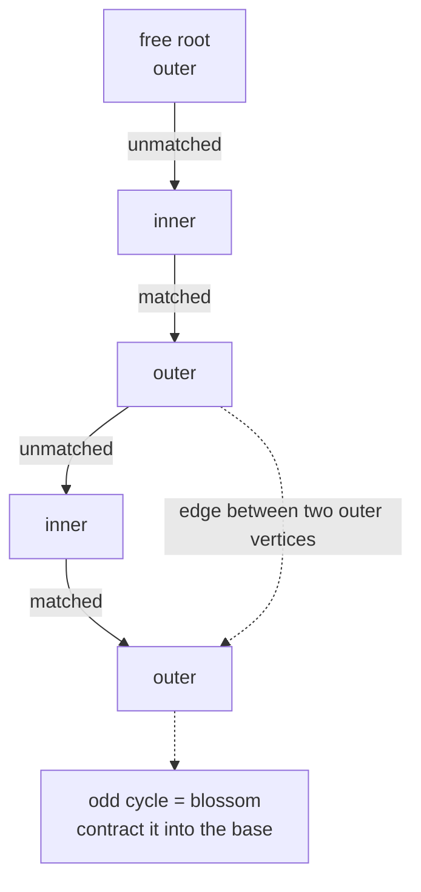
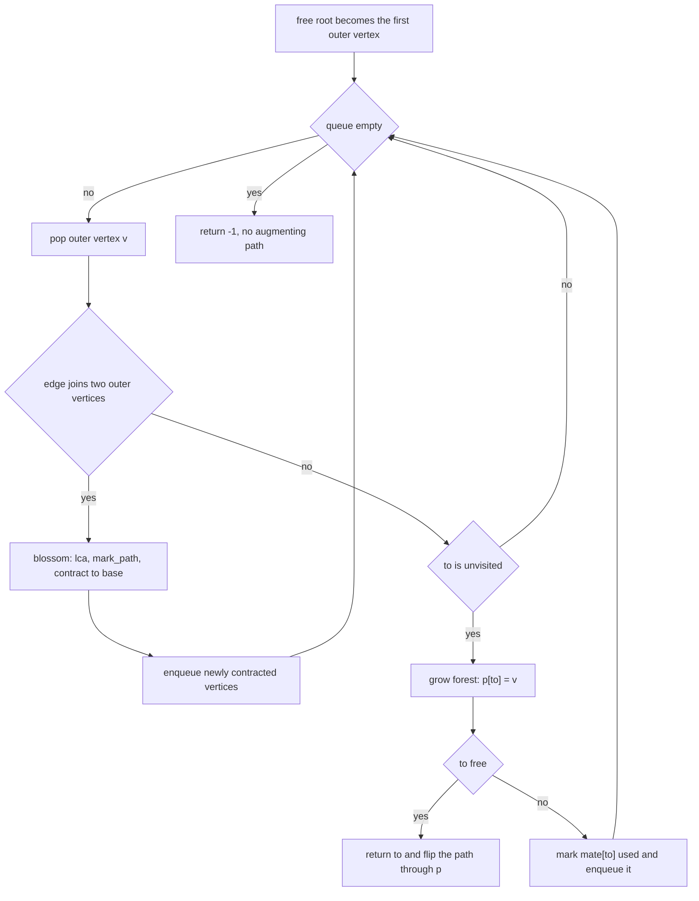
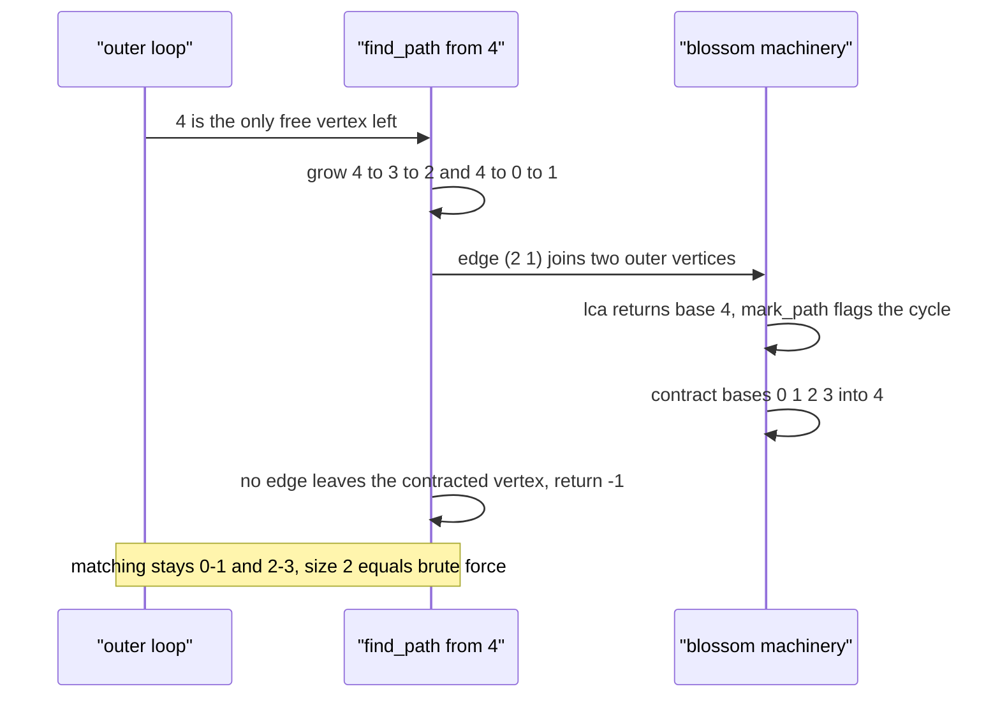

# 457 — Implement blossom algorithm (conceptual/skeleton).

> **Tier:** Advanced · **CTCI chapter:** Ch 4 — Trees and Graphs
> **Task spec:** [457-implement-blossom-algorithm-conceptual-skeleton.md](../../../tasks/advanced/457-implement-blossom-algorithm-conceptual-skeleton.md)
> **Solutions:** [Python](../../../solutions/python/advanced/457-implement-blossom-algorithm-conceptual-skeleton/solution.py) ·
> [Java](../../../solutions/java/advanced/457-implement-blossom-algorithm-conceptual-skeleton/Solution.java) ·
> [JavaScript](../../../solutions/javascript/advanced/457-implement-blossom-algorithm-conceptual-skeleton/solution.js) ·
> [C#](../../../solutions/csharp/advanced/457-implement-blossom-algorithm-conceptual-skeleton/Solution.cs)

## 1. Problem restatement

**Input:** an undirected graph on `n` vertices as an edge list. No bipartition is promised, no
weights, isolated vertices allowed.

**Output:** a maximum matching as a `mate` array (`mate[v] = -1` means free) **plus** the number
of blossom contractions the search performed: `blossom_matching` returns `(mate, contractions)`.

The spec marks this task as a **conceptual / skeleton** implementation, and the header describes
exactly what the skeleton contains: Edmonds' algorithm "as a labelled BFS skeleton: vertices in
the alternating forest are labelled *outer* (even, `S`) via `used` and *inner* (odd, `T`) via `p`
(`p[v]` is the outer vertex that reached `v`). When a BFS step meets an edge joining two outer
vertices, the odd cycle it closes is a **blossom**: `lca()` finds the blossom base..., `mark_path()`
relabels the stem and blossom edges..., and every vertex whose base lies on the blossom is
contracted to the base so the search continues 'as if' the blossom were one vertex."

| Call | `mate` | Size | Contractions | Brute force |
| --- | --- | --- | --- | --- |
| `C5` (`0-1-2-3-4-0`) | `[1, 0, 3, 2, -1]` | `2` | `1` | `2` |
| triangle | `[1, 0, -1]` | `1` | `1` | `1` |
| `C6` | `[1, 0, 3, 2, 5, 4]` | `3` | `0` | `3` |
| star on centre 0 | `[1, 0, -1, -1, -1]` | `1` | `0` | `1` |
| two disjoint triangles | `[1, 0, -1, 4, 3, -1]` | `2` | `2` | `2` |
| `P4` (`0-1-2-3`) | `[1, 0, 3, 2]` | `2` | `0` | `2` |

The hand-graph optima asserted by the suite are `triangle -> 1`, `C5 -> 2`, `K4 -> 2`,
`star -> 1`, `C6 -> 3`, `C7 -> 3`, `K3,3 -> 3`, `two triangles -> 2`, `diamond/P4 -> 2`, plus
`empty -> 0` and `single -> 1`. The C5 case additionally asserts `contractions >= 1`, which is
what proves the contraction branch is actually taken; over the 24 LCG graphs the suite asserts
`checked == 24` and `total_contractions >= 1`.

## 2. Intuition

Berge's theorem says a matching is maximum exactly when it has no augmenting path, so the whole
problem reduces to finding augmenting paths. On bipartite graphs a plain alternating BFS suffices
because the two sides give every vertex a fixed parity. General graphs break that: an odd cycle
lets a vertex be reached at both an even and an odd distance from the root.

Edmonds' answer is to grow an **alternating forest** from the free root. Every vertex in the
forest is labelled by parity — *outer* (even level, reached by an unmatched edge) or *inner*
(odd level, reached by a matched edge) — and two things can happen when the BFS examines an edge:

- the edge leads to a vertex not yet in the forest: extend the forest (an unmatched edge to an
  inner vertex, then its matched edge to a new outer vertex);
- the edge joins two **outer** vertices: the path between them through the forest plus the edge
  forms an odd cycle, a **blossom**.



Contracting the blossom keeps the search honest: if an augmenting path enters the blossom, it can
always be rerouted through the base, so treating the whole odd cycle as one super-vertex loses
nothing. Each contraction shrinks the effective graph, and Edmonds showed the total work stays
polynomial — this is what makes general-graph matching solvable in polynomial time while the
exhaustive search of [456 — Matchings in general graph (Edmonds blossom outline)](../../../tasks/advanced/456-implement-matchings-in-general-graph-edmonds-blossom-outline.md)
stays exponential.

The skeleton keeps the structure but not the asymptotics: `base[v]` is the contracted super-vertex
containing `v`, `lca` walks both outer vertices up through `p`/`mate` until their bases meet,
`mark_path` flips the parity along one side, and the contraction loop rewrites `base[i] = curbase`
for every vertex whose base sits on the blossom.

## 3. Algorithm

1. `mate[v] ← -1` for all `v`; `base[v] ← v`; `p[v] ← -1`; `used[v] ← false`;
   `blossom[v] ← false`; `contractions ← 0`.
2. For each vertex `i` with `mate[i] == -1`, call `find_path(i)`; while it returns a vertex `v`,
   flip the augmenting path through the `p` pointers (`mate[v] = p[v]`, `mate[p[v]] = v`, then
   continue from `mate[p[v]]`).
3. `find_path(root)` resets `used`, `p` and `base`, marks the root as used and runs a BFS:
   for the dequeued outer vertex `v` and each neighbour `to`:
   - skip if `base[v] == base[to]` (inside the same contracted vertex) or if `to` is `v`'s mate;
   - if `to == root` **or** `to` is matched and `p[mate[to]] != -1`, then `to` is another outer
     vertex: increment `contractions`, compute `curbase = lca(v, to)`, clear the `blossom` flags,
     relabel both sides with `mark_path`, then set `base[i] = curbase` for every `i` whose base is
     flagged, enqueueing any newly contracted vertex not yet used;
   - otherwise, if `p[to] == -1`, grow the forest: `p[to] = v`; if `to` is free, return it — that
     is the end of an augmenting path; else mark `mate[to]` used and enqueue it.
4. `lca(a, b)` walks `a` up to its root marking bases as seen, then walks `b` up until it hits a
   seen base and returns it.
5. `mark_path(v, b, child)` walks up from `v` to base `b`, flagging `base[v]` and `base[mate[v]]`
   as blossom vertices and setting `p[v] = child` so the alternating structure points towards the
   stem.
6. Return `(mate, contractions)`.

```text
procedure blossom_matching(n, adj)
    mate[v] ← -1, base[v] ← v, p[v] ← -1, used[v] ← false, blossom[v] ← false for all v
    contractions ← 0
    for i ← 0 to n - 1 do
        if mate[i] = -1 then
            v ← find_path(i)
            while v != -1 do
                pv ← p[v]
                next_free ← mate[pv]
                mate[v] ← pv
                mate[pv] ← v
                v ← next_free
            end
        end
    end
    return (mate, contractions)
end
```

```text
function lca(a, b)
    seen[v] ← false for all v
    loop
        a ← base[a]
        seen[a] ← true
        if mate[a] = -1 then break end
        a ← p[mate[a]]
    end
    loop
        b ← base[b]
        if seen[b] then return b end
        b ← p[mate[b]]
    end
end

procedure mark_path(v, b, child)
    while base[v] != b do
        blossom[base[v]] ← true
        blossom[base[mate[v]]] ← true
        p[v] ← child
        child ← mate[v]
        v ← p[mate[v]]
    end
end
```

```text
procedure find_path(root)
    reset used, p and base for every vertex
    used[root] ← true
    queue ← [root]
    while queue is not empty do
        v ← pop front
        for each to in adj[v] do
            if base[v] = base[to] or mate[v] = to then continue end
            if to = root or (mate[to] != -1 and p[mate[to]] != -1) then
                contractions ← contractions + 1
                curbase ← lca(v, to)
                clear blossom flags
                mark_path(v, curbase, to)
                mark_path(to, curbase, v)
                for i ← 0 to n - 1 do
                    if blossom[base[i]] then
                        base[i] ← curbase
                        if used[i] = false then
                            used[i] ← true
                            push i onto queue
                        end
                    end
                end
            else if p[to] = -1 then
                p[to] ← v
                if mate[to] = -1 then return to end
                used[mate[to]] ← true
                push mate[to] onto queue
            end
        end
    end
    return -1
end
```



## 4. Worked example

Trace `C5`: `n = 5`, `edges = [(0,1), (1,2), (2,3), (3,4), (4,0)]`, so
`adj[0] = [1, 4]`, `adj[1] = [0, 2]`, `adj[2] = [1, 3]`, `adj[3] = [2, 4]`, `adj[4] = [3, 0]`.
The matching starts empty.

**Outer loop, `i = 0`.** `find_path(0)` marks the root used and pops it; the first neighbour `1`
has `p[1] == -1` and is free, so it returns `1` before any tree grows. The flip sets
`mate[1] = 0` and `mate[0] = 1`: the matching is `{0—1}`.

**Outer loop, `i = 2`.** `find_path(2)` grows the forest `2 → 1` (unmatched) → `0 = mate[1]`
(matched, becomes outer) and also `2 → 3` (unmatched, free) — so it returns `3` and the flip sets
`mate[3] = 2`, `mate[2] = 3`. The matching is now `{0—1, 2—3}`, which is already the optimum.

**Outer loop, `i = 4`.** Vertex 4 is the last free vertex. `find_path(4)`:

| BFS step | Outer vertex | Edge | Verdict |
| --- | --- | --- | --- |
| 1 | 4 | `(4, 3)` | `3` is matched to `2`; grow: `p[3] = 4`, mark `2` used, enqueue 2 |
| 1 | 4 | `(4, 0)` | `0` is matched to `1`; grow: `p[0] = 4`, mark `1` used, enqueue 1 |
| 2 | 2 | `(2, 1)` | both 2 and 1 are **outer** (`p[mate[1]] = p[0] = 4` is set) → **blossom** |
| 3 | — | — | `lca(2, 1)` walks `2 → base[2] → p[mate[2]] = p[3] = 4` and `1 → base[1] → p[mate[1]] = p[0] = 4`, meeting at `4` |
| 4 | — | — | `mark_path` flags vertices `2`, `3`, `1`, `0`, and the contraction sets `base[0..3] = 4` |
| 5 | 0, 3 | — | the freshly contracted vertices are marked used and enqueued |
| 6 | 1, 0, 3 | all edges | every remaining edge now joins two vertices with the same base, so it is skipped |
| 7 | — | — | the queue empties and the search returns `-1` |

The contraction is what makes the BFS terminate correctly: after `base[0] = base[1] = base[2] =
base[3] = 4`, the odd cycle `0-1-2-3-4-0` behaves like a single super-vertex, so the edges
`(2,1)`, `(1,0)` and `(0,4)` no longer look like ways to reach a new outer vertex. No augmenting
path exists, which is the right answer: `{0—1, 2—3}` already matches 4 of the 5 vertices, and
`floor(5 / 2) = 2`.

Running the same code on the other hand graphs gives the numbers in section 1: the triangle
contracts once and returns size 1, the two disjoint triangles contract twice and return size 2,
while `C6`, the star and `P4` finish with zero contractions because no odd cycle is ever closed
during their searches.



## 5. Complexity

| Measure | Bound | Why it holds |
| --- | --- | --- |
| One `find_path` BFS | `O(V + E)` per attempt, plus contraction work | every vertex is enqueued when it becomes used |
| `lca(a, b)` | `O(V)` | walks the `p`/`mate` chains at most once each |
| `mark_path` (two calls) | `O(V)` | each step moves to `p[mate[v]]`, strictly upward |
| One contraction | `O(V)` | the relabel loop scans all `n` vertices |
| Outer loop | `O(V)` roots | one search per free vertex |
| Space | `O(V + E)` | adjacency lists plus `mate`, `p`, `base`, `used`, `blossom` |
| Brute force oracle | exponential | first-free-vertex backtracking, only for `n <= 8` |

The skeleton deliberately keeps the `O(V)`-per-contraction arrays rather than the union-find
contraction that the tuned implementations use, so its constant factor is larger than the
classic `O(V^3)` blossom bound quoted in the textbooks. The point of the task is the structure —
labelled forest, `lca`, `mark_path`, contraction — not a competitive runtime; the tests only
require the answers to match brute force and at least one contraction to happen.

## 6. Pitfalls and edge cases

- **Parity labels must be maintained by `p`, not by depth.** `used` marks outer vertices and `p`
  marks inner ones; the test `p[mate[to]] != -1` is what recognises the second outer endpoint of
  a blossom.
- **`base[v] == base[to]` edges are skipped.** Inside a contracted blossom every vertex behaves
  like the base, so those edges are no longer usable for reaching a free vertex.
- **The matched edge is never traversed.** `mate[v] == to` is skipped, keeping the forest
  alternating.
- **`lca` compares `base`, not raw vertices.** Both walks step to `base[a]`, then to
  `p[mate[a]]`; without the base projection the two chains could never meet correctly after a
  contraction.
- **`blossom` flags must be cleared before each `mark_path` pair.** The code resets
  `blossom[i] = False` for all `i` right after computing `curbase`, so flags from an earlier
  blossom cannot leak into the contraction.
- **Contracted vertices are re-enqueued.** The loop sets `used[i] = True` and pushes any vertex
  whose base changed and which was not already used, otherwise the search would never explore the
  super-vertex's edges.
- **`mark_path` writes `p[v] = child`.** That is the relabelling that preserves an alternating
  direction to the stem; skipping it produces the right matching size on some graphs but wrong
  parents for the final flip.
- **A free neighbour ends the search immediately** (`return to`), and the flip loop then walks the
  `p` pointers: `mate[v] = p[v]`, `mate[p[v]] = v`, continue from `mate[p[v]]` — stopping when the
  chain reaches a vertex with no parent, which is the free root.
- **Validity is asserted.** `check_matching` verifies mate symmetry, no self-match, and that each
  matched pair is a real edge, for every hand graph and every LCG graph.
- **Isolated vertices and odd `n`** simply leave vertices free: the empty graph gives size 0 and
  `C5`/`C7`/`triangle` leave one vertex unmatched.

## 7. Variants and follow-ups

- **Exhaustive-search counterpart:** [456 — Matchings in general graph (Edmonds blossom outline)](../../../tasks/advanced/456-implement-matchings-in-general-graph-edmonds-blossom-outline.md)
  solves the same problem by enumerating simple alternating paths; on `C5` it finds no augmenting
  path either, but it pays exponential time to conclude that.
- **Practical blossom implementations:** [534 — Matching in general graphs with improved heuristics](../../../tasks/advanced/534-implement-matching-in-general-graphs-improved-heuristics-edmonds.md)
  replaces the naive contraction bookkeeping with the data structures real solvers use.
- **Bipartite special case:** [275 — Maximum bipartite matching (Hopcroft-Karp outline)](../../../tasks/intermediate/275-maximum-bipartite-matching-hopcroft-karp-outline.md)
  needs no contraction at all because parity is fixed by the bipartition, and it reaches
  `O(E * sqrt(V))`.
- **Weighted version:** [276 — Hungarian algorithm (assignment) basic](../../../tasks/intermediate/276-implement-hungarian-algorithm-assignment-basic.md)
  asks for a minimum-cost perfect matching instead of a maximum cardinality one.
- **Huge graphs:** [949 — Approximate maximum matching in huge graphs](../../../tasks/master/949-implement-approximate-maximum-matching-in-huge-graphs-with-strea.md)
  gives up exactness for a single pass over a stream too large to store.

## 8. Check yourself

**Q1.** Why does an alternating BFS that works on bipartite graphs fail on a general graph?

<details><summary>Show answer</summary>

Because a vertex can be reached at both an even and an odd distance once an odd cycle is involved,
so "which side is this vertex on" is no longer well defined. Edmonds' forest handles it by
contracting the odd cycle into one vertex, after which the parity question becomes well posed
again.

</details>

**Q2.** In the C5 trace, which edge triggered the contraction and what was the blossom base?

<details><summary>Show answer</summary>

The edge `(2, 1)`: both endpoints were outer vertices because `p[mate[1]] = p[0] = 4` was set.
`lca(2, 1)` walked `2 → p[mate[2]] = p[3] = 4` and `1 → p[mate[1]] = p[0] = 4`, so the base is
vertex 4, and the contraction folded bases `0, 1, 2, 3` into it.

</details>

**Q3.** After the contraction, why do edges like `(0, 4)` and `(1, 0)` stop growing the forest?

<details><summary>Show answer</summary>

Because both endpoints now have the same base (4), and `base[v] == base[to]` is skipped — inside a
contracted blossom such edges are internal and cannot lead to an unmatched vertex.

</details>
