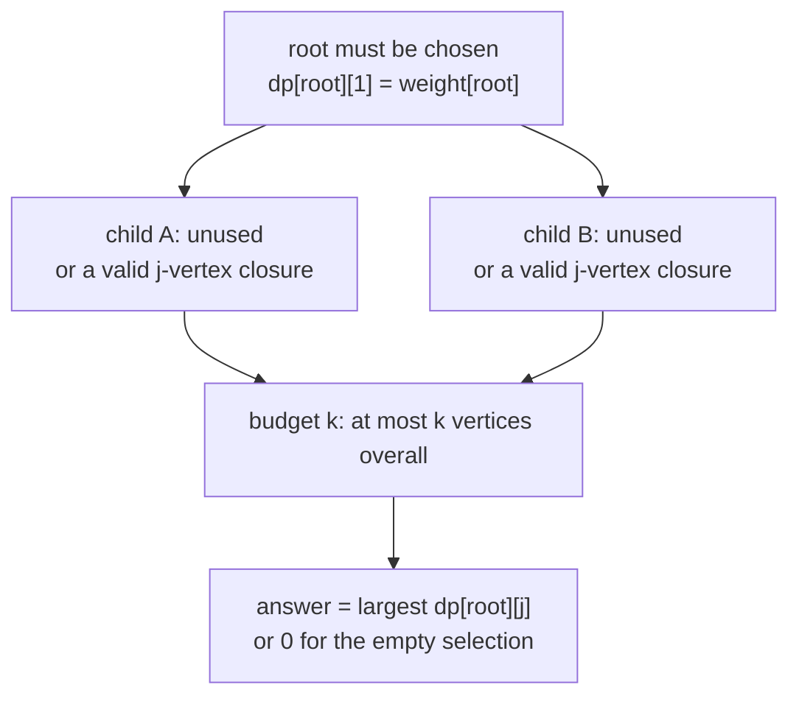
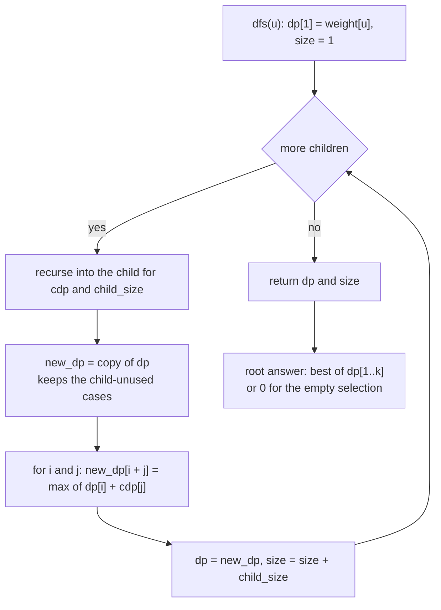
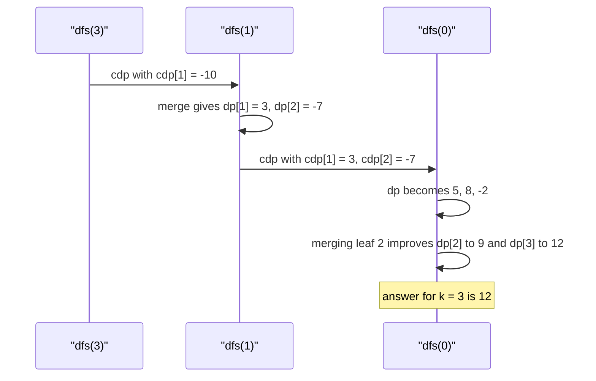

# 458 — Implement dynamic programming on trees with knapsack per node.

> **Tier:** Advanced · **CTCI chapter:** Ch 4 — Trees and Graphs
> **Task spec:** [458-implement-dynamic-programming-on-trees-with-knapsack-per-node.md](../../../tasks/advanced/458-implement-dynamic-programming-on-trees-with-knapsack-per-node.md)
> **Solutions:** [Python](../../../solutions/python/advanced/458-implement-dynamic-programming-on-trees-with-knapsack-per-node/solution.py) ·
> [Java](../../../solutions/java/advanced/458-implement-dynamic-programming-on-trees-with-knapsack-per-node/Solution.java) ·
> [JavaScript](../../../solutions/javascript/advanced/458-implement-dynamic-programming-on-trees-with-knapsack-per-node/solution.js) ·
> [C#](../../../solutions/csharp/advanced/458-implement-dynamic-programming-on-trees-with-knapsack-per-node/Solution.cs)

## 1. Problem restatement

**Input:** a rooted tree as a `parent` array (`parent[0] = -1`), a weight per vertex, and a budget
`k`. Weights may be negative — the generator draws them from `seed % 31 - 15`.

**Output:** the largest total weight of a **parent-closed** selection of at most `k` vertices:
if a vertex is chosen, its parent must be chosen too. The empty selection is allowed and is what
the answer falls back to when every weight is negative.

The header states the recurrence: "`dp[u][j]` = best weight of a valid choice of exactly `j`
vertices inside `subtree(u)` that contains `u`. Children merge one at a time: a child either
contributes 0 vertices (unused) or a valid `j >= 1` choice, so `dp[u]` is merged with `dp[child]`
by `(i + j)` convolution, `j >= 1`; the answer is `max(0, max_j dp[root][j])` because the empty
choice is allowed".

| Call | Result | Selection |
| --- | --- | --- |
| `tree_knapsack(4, [-1,0,0,1], [5,3,4,-10], 1)` | `5` | `{root}` |
| `tree_knapsack(4, [-1,0,0,1], [5,3,4,-10], 2)` | `9` | `{root, 4}` |
| `tree_knapsack(4, [-1,0,0,1], [5,3,4,-10], 3)` | `12` | `{root, 3, 4}` |
| `tree_knapsack(4, [-1,0,0,1], [5,3,4,-10], 4)` | `12` | the `-10` child is never worth adding |
| `tree_knapsack(5, [-1,0,0,1,1], [10,8,5,7,6], 3)` | `25` | `{10, 8, 7}` |
| `tree_knapsack(3, [-1,0,1], [1,-5,10], 3)` | `6` | `{1, -5, 10}` — the middle vertex is the toll |
| `tree_knapsack(2, [-1,0], [-2,-3], 2)` | `0` | all weights negative |
| 15 LCG trees, every `k` in `0..n` | equals brute force | `checked == 15`, monotone in `k` |

## 2. Intuition

Without the closure rule the task is an ordinary knapsack and you could take any `k` vertices.
The parent-before-child rule changes the shape of the answer: a valid selection is exactly a
**rooted subtree containing the root** (a "closure"), so the choices for different branches are
coupled only through the budget.

That coupling is what makes a per-node DP the natural tool. For each vertex `u`, keep a vector

```text
dp[u][j] = best total weight of a valid selection of exactly j vertices inside subtree(u)
           that includes u
```

The base case is `dp[u][1] = weight[u]`: choosing `u` alone. When a child `c` is merged, it either
contributes nothing — the child and its whole subtree stay unused — or it contributes a valid
`j >= 1` selection of its own; the `j = 0` case is precisely why the merge is a convolution over
`i + j` with `j >= 1` while the "child unused" case is kept by copying `dp[u]` unchanged.



Two details make the recurrence work. First, negative weights are harmless: a vertex is only ever
taken because the vertices below it pay for it, and the outer `max(0, ...)` covers the case where
nothing is worth taking. In the `1, -5, 10` chain the middle vertex costs 5 but unlocks the 10
below it, so `k = 3` gives 6 while `k = 2` gives only 1. Second, the loops are bounded by the
subtree sizes accumulated so far, which keeps the algorithm polynomial rather than exponential —
the exhaustive oracle in the solutions (`brute_tree_knapsack`) enumerates all `2^n` masks with a
closure check and is used only for `n <= 9`.

## 3. Algorithm

1. If `k <= 0` or `n == 0`, return 0 immediately.
2. `children_of(n, parent)` builds child lists from the `parent` array.
3. `dfs(u)` returns `(dp, subtree_size)`:
   a. Start with `subtree_size = 1` and `dp` of length `k + 1` filled with a negative sentinel,
      then `dp[1] = weight[u]`.
   b. For each child `c`: recurse to get `(cdp, child_size)`, raise `subtree_size` by
      `child_size`, start `new_dp` as a copy of `dp` (the "child unused" cases), and for
      `i` in `1 .. min(k, subtree_size - child_size)` and `j` in `1 .. min(child_size, k - i)`
      relax `new_dp[i + j] = max(new_dp[i + j], dp[i] + cdp[j])`.
   c. Set `dp = new_dp` and continue with the remaining children.
4. Run `dfs(0)`, then return the maximum of `dp[1..k]`, or 0 when all entries are sentinels.

```text
procedure tree_knapsack(n, parent, weight, k)
    if k <= 0 or n = 0 then
        return 0
    end
    children ← child lists derived from parent
    dp, size ← dfs(0)
    best ← 0
    for j ← 1 to k do
        if dp[j] > best then best ← dp[j] end
    end
    return best
end

function dfs(u)
    size ← 1
    dp[j] ← negative sentinel for j ← 0 to k
    dp[1] ← weight[u]
    for each child c of u do
        cdp, child_size ← dfs(c)
        size ← size + child_size
        new_dp ← copy of dp
        for i ← 1 to min(k, size - child_size) do
            if dp[i] is not the sentinel then
                for j ← 1 to min(child_size, k - i) do
                    if cdp[j] is not the sentinel then
                        new_dp[i + j] ← max(new_dp[i + j], dp[i] + cdp[j])
                    end
                end
            end
        end
        dp ← new_dp
    end
    return (dp, size)
end
```



## 4. Worked example

Take the first hand tree: `n = 4`, `parent = [-1, 0, 0, 1]`, `weight = [5, 3, 4, -10]`. Vertex 0
is the root, vertices 1 and 2 are its children, and vertex 3 hangs off vertex 1.

**Run with `k = 3`.** The sentinel is written `-inf`; only feasible `j` slots are listed.

| Node | After own initialisation | After merging its child | Final `dp` |
| --- | --- | --- | --- |
| 3 (leaf) | `dp[1] = -10` | — | `[-inf, -10, -inf, -inf]` |
| 1 | `dp[1] = 3` | `dp[2] = 3 + (-10) = -7` | `[-inf, 3, -7, -inf]` |
| 2 (leaf) | `dp[1] = 4` | — | `[-inf, 4, -inf, -inf]` |
| 0 | `dp[1] = 5` | merge 1: `dp[2] = 5 + 3 = 8`, `dp[3] = 5 + (-7) = -2` | see below |

Root 0 has one more child to merge: with `dp = [-inf, 5, 8, -2]` and the leaf's
`cdp = [-inf, 4, -inf, -inf]`, the convolution relaxes

| `i` | `j` | `dp[i] + cdp[j]` | Slot updated |
| --- | --- | --- | --- |
| 1 | 1 | `5 + 4 = 9` | `new_dp[2] = max(8, 9) = 9` |
| 2 | 1 | `8 + 4 = 12` | `new_dp[3] = max(-2, 12) = 12` |
| 3 | 1 | skipped, `j` would exceed `k - i = 0` | — |

Final root vector `[-inf, 5, 9, 12]`, so the answer for `k = 3` is `12`, matching
`{root, 3, 4}` — the two children of the root plus the root itself. The `-10` vertex is left out
because including it would spend a slot on a negative weight.

**Smaller budgets on the same tree.** Truncating `k` to 2 collapses the inner loop: merging child
1 only reaches `dp[2] = 8`, and merging leaf 2 then improves it to `max(8, 5 + 4) = 9`, so the
answer is `9` for `{root, 4}`. With `k = 1` the only feasible slot is `dp[1] = 5`, and with
`k = 4` the extra budget cannot help because the remaining vertex is worth `-10`.

The `1, -5, 10` chain shows the toll case:

| Node | `dp` for `k = 3` | Notes |
| --- | --- | --- |
| 2 (leaf) | `[-inf, 10, -inf, -inf]` | the valuable tail |
| 1 | `[-inf, -5, 5, -inf]` | a 2-vertex closure inside the subtree must contain the `-5` vertex and the `10` below it |
| 0 | `[-inf, 1, -4, 6]` | `dp[3] = 1 + (-5) + 10 = 6` |

So `k = 1` gives 1, `k = 2` gives 1 (`1 + (-5)` loses to the empty choice once the toll is
counted), and `k = 3` gives 6. Every `k` in `0..3` is also compared against
`brute_tree_knapsack`, which enumerates all `2^n` masks and rejects any mask containing a child
without its parent.



## 5. Complexity

| Measure | Bound | Why it holds |
| --- | --- | --- |
| Child-list build | `O(n)` | one pass over the `parent` array |
| One merge | `O(min(k, a) * min(k, b))` | `a` vertices already processed, `b` in the child's subtree |
| All merges | `O(n * k^2)` worst case | at most `n - 1` merges, each bounded by `k^2` |
| Final scan | `O(k)` | one pass over the root vector |
| Space | `O(n + k)` per live frame, `O(n * k)` worst case | each recursion level holds its own `dp` vector |
| Short circuits | `k <= 0` or `n == 0` returns 0 at once | asserted by `tree_knapsack(..., 0) == 0` |
| Brute-force oracle | `O(2^n * n)` | all masks plus a closure check, only for `n <= 9` |

The bounds `min(k, size - child_size)` and `min(child_size, k - i)` matter: without them the loops
would run `k^2` times even for leaves, and without the sentinel checks the DP would add
"impossible" states together. The `j >= 1` restriction is what enforces the closure rule — a child
either stays completely unused or brings its own valid closure with it.

## 6. Pitfalls and edge cases

- **Negative weights are legal, so the answer starts at 0.** `max(0, ...)` is required: the
  `[-2, -3]` tree returns 0 for both `k = 1` and `k = 2`.
- **`j` must start at 1, not 0.** Merging a child with `j = 0` would let a closure skip its parent;
  the "child unused" case is handled instead by copying `dp` into `new_dp`.
- **`dp[0]` is never a valid state** for a node that contains itself; only the root's answer
  scan handles the empty selection, and it does so through the outer `max(0, ...)`.
- **The sentinel must be checked, not just compared.** Unreachable slots hold `-10^9`; adding two
  sentinels could otherwise produce a "plausible" large negative that overrides nothing but wastes
  work.
- **`k` may exceed `n`.** The loops cap at subtree sizes, so the extra budget is simply unused;
  the `k = 4` row of the first tree returns 12 rather than 12 + (-10) = 2, because the only
  remaining vertex is worth `-10`.
- **`k = 0` is a valid query** and must return 0 without touching the recursion.
- **Monotonicity in `k` holds** and is asserted (`got >= previous` while `k` grows): a larger
  budget can always imitate a smaller one by ignoring the extra capacity.
- **The merge order does not matter for the value.** Convolution is associative; the solutions
  just take children in index order, which is why the intermediate vectors in section 4 are
  reproducible.
- **Every `k` in `0..n` is cross-checked** on 15 LCG trees with `n` between 6 and 9
  (`checked == 15`, `comparisons == expected_comparisons`), so an off-by-one in any loop bound
  would surface immediately.
- **Subtree sizes, not global `n`, bound the inner loops** — using `n` everywhere would still be
  correct but would make the DP visit unreachable states.

## 7. Variants and follow-ups

- **Queries on a set of nodes instead of one global tree:** [459 — Virtual tree building from a set of nodes](../../../tasks/advanced/459-implement-virtual-tree-building-from-set-of-nodes-for-queries.md)
  builds a small tree over the queried vertices so the same per-node DP runs on `O(k)` nodes
  rather than the whole tree.
- **A second resource axis:** [536 — Constrained shortest path by resource-constrained DP](../../../tasks/advanced/536-implement-constrained-shortest-path-resource-constrained-dp.md)
  shows the same "vector per state, merge by convolution" pattern with an extra constraint
  dimension.
- **Tree structures built for pairwise queries:** [451 — Gomory-Hu tree](../../../tasks/advanced/451-implement-gomory-hu-tree-for-all-pairs-min-cut-outline.md)
  is another example of precomputing per-node information so that later queries become path walks.
- **Dependency-style selections:** allowing a vertex to be chosen without its parent, or allowing
  the root to be skipped, only changes the definition of a valid state; the `j >= 1` merge rule and
  the `max(0, ...)` answer are what encode the closure here.
- **Budget on weight rather than on count:** swapping `j` for a capacity axis turns the same code
  into the classic knapsack-on-a-tree; the convolution and the subtree-size bounds stay identical.

## 8. Check yourself

**Q1.** Why is `dp[u][0]` never used for a node's own state, yet still relevant for the final
answer?

<details><summary>Show answer</summary>

`dp[u][j]` requires the selection to *contain* `u`, so `j >= 1` for every node vector; the `j = 0`
case for a child is exactly the "child unused" branch, which is handled by copying `dp` into
`new_dp`. The empty global selection is handled once, by `max(0, max_j dp[root][j])`.

</details>

**Q2.** In the first tree, why does `k = 4` still return 12?

<details><summary>Show answer</summary>

Because the only vertex not yet chosen, the `-10` leaf at position 3, has a negative weight.
Budget is an upper bound, not a requirement, so adding it would drop the total to 2. The maximum
is achieved at `j = 3` with `{root, 3, 4}`.

</details>

**Q3.** The chain `1, -5, 10` returns 1 for both `k = 1` and `k = 2`. Why not 6 for `k = 2`?

<details><summary>Show answer</summary>

The closure rule forces the middle vertex `-5` into any selection that reaches the 10 below it,
and that needs three slots: `1 + (-5) + 10 = 6`. With only two slots the best is `1 + (-5) = -4`,
which loses to taking just the root, so the answer stays 1.

</details>

**Q4.** What do the loop bounds `min(k, size - child_size)` and `min(child_size, k - i)` buy?

<details><summary>Show answer</summary>

They restrict the convolution to states that actually exist: at most the vertices already
processed, at most the child's subtree size, and never more than the remaining budget. Without them
the merge would iterate `k^2` times per child and touch unreachable slots filled with the sentinel.

</details>

**Q5.** How would you answer the same question for many different `k` values without rerunning the
DP each time?

<details><summary>Show answer</summary>

Keep the full root vector: one `dfs(0)` with `k = n` computes `dp[root][j]` for every `j`, and the
answer for any budget is the prefix maximum `max(0, max_{j <= k} dp[root][j])`. That is exactly the
computation the tests do implicitly when they assert monotonicity in `k` over 15 trees.

</details>
