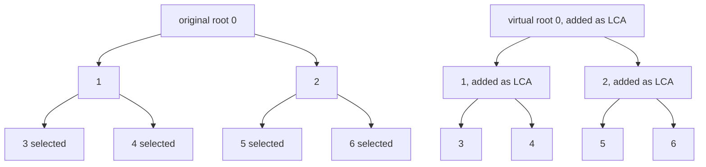
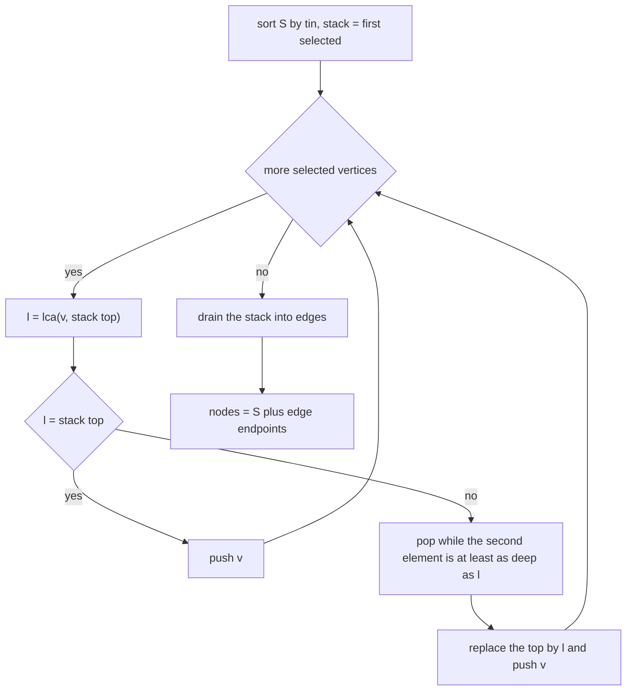
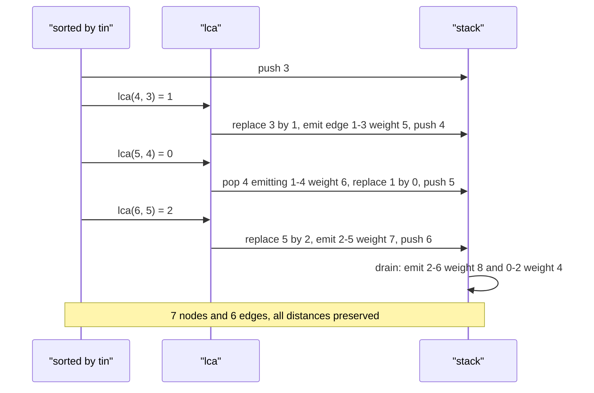

# 459 — Implement virtual tree building from set of nodes (for queries).

> **Tier:** Advanced · **CTCI chapter:** Ch 4 — Trees and Graphs
> **Task spec:** [459-implement-virtual-tree-building-from-set-of-nodes-for-queries.md](../../../tasks/advanced/459-implement-virtual-tree-building-from-set-of-nodes-for-queries.md)
> **Solutions:** [Python](../../../solutions/python/advanced/459-implement-virtual-tree-building-from-set-of-nodes-for-queries/solution.py) ·
> [Java](../../../solutions/java/advanced/459-implement-virtual-tree-building-from-set-of-nodes-for-queries/Solution.java) ·
> [JavaScript](../../../solutions/javascript/advanced/459-implement-virtual-tree-building-from-set-of-nodes-for-queries/solution.js) ·
> [C#](../../../solutions/csharp/advanced/459-implement-virtual-tree-building-from-set-of-nodes-for-queries/Solution.cs)

## 1. Problem restatement

**Input:** a rooted tree on `n` vertices given by a `parent` array plus a positive weight per
non-root vertex `edge_weight[v]` (the weight of the edge `parent[v] — v`), and a set `S` of
selected vertices.

**Output:** the **virtual tree** (auxiliary tree) of `S`: a much smaller tree whose vertex set is
`S` together with the LCAs that glue them, and whose edge weights are the original distances
between consecutive vertices. `build_virtual_tree` returns `(nodes, edges)` with edges as
`(virtual_parent, virtual_child, dist[child] - dist[parent])`, and
`virtual_tree_path_weight(nodes, edges, u, v)` walks that small tree to answer a distance query.

The header describes the construction and the checks that come with it: "the virtual tree
therefore contains every selected node and every LCA needed, with edge weight equal to the
original distance (`dist` values), so path sums in it match the original pairwise distances
exactly." The assertions are:

| Assertion | Meaning |
| --- | --- |
| every selected node is present | the query set is never dropped |
| every built node is selected **or** an ancestor of a selected node | no filler vertices |
| `len(edges) == len(nodes) - 1` | the result really is a tree |
| `len(nodes) <= 2 * len(selected) - 1` | the compression bound |
| every edge weight equals `dist[child] - dist[parent]` and is `> 0` | weights are original distances |
| every pair distance equals the naive tree distance | queries stay exact |

## 2. Intuition

To answer a question about `k` selected vertices you usually need only those vertices *and the
branching points between them* — the vertices where their paths to the root split. Those
branching points are exactly the **LCAs of pairs of selected vertices**, and it turns out you only
need the LCAs of *consecutive* selected vertices in DFS entry order (`tin`).

The reason is a sweep property: sort `S` by `tin`, walk the list, and the tree structure between
two consecutive selected vertices is always a straight path upward from the later one to their
LCA and downward again. Every structural vertex you meet during that sweep is the LCA of some
consecutive pair, so the virtual tree has at most `|S| - 1` extra vertices — the `2|S| - 1` bound
that `check_virtual_tree` asserts, and which the balanced test hits exactly.



Because edge weights are original root distances, a path sum in the virtual tree is the original
path sum: the path from `u` to `v` in the virtual tree is `u` up to `lca(u, v)` and down to `v`,
and each virtual edge telescopes `dist` differences. So distance queries become walks on `O(|S|)`
vertices instead of `O(n)` climbs — which is the whole point when the same tree is queried many
times.

## 3. Algorithm

1. `build_tree_data` derives the child lists from `parent` and runs an iterative DFS from the
   root, recording `tin[v]` (entry time), `depth[v]`, and `dist[v]` = sum of `edge_weight` along
   the root path. Children are pushed in reverse so `tin` increases in list order.
2. `lca(parent, depth, u, v)` lifts the deeper of `u`, `v` until the depths match and then lifts
   both together until they meet — a plain climb, no precomputation.
3. `is_ancestor(parent, candidate, node)` walks `node`'s parent chain looking for `candidate`.
4. `build_virtual_tree`:
   a. Sort `S` by `tin`; return `([], [])` for an empty set.
   b. Keep a `stack` whose top is the rightmost virtual root; start with the first selected vertex.
   c. For each next selected vertex `v`, compute `l = lca(v, stack[-1])`. If `l == stack[-1]`,
      just push `v`: it hangs below the current root.
   d. Otherwise pop while the *second* stack element is at least as deep as `l`, emitting the edge
      `(stack[-2], stack[-1], dist difference)` each time. If the new top is not `l`, emit the edge
      `(l, top, dist difference)` and replace the top by `l`. Then push `v`.
   e. After the sweep, drain the stack the same way.
   f. The node set is `S` plus every endpoint that appeared in an emitted edge, sorted.
5. `virtual_tree_path_weight` builds an adjacency map over the virtual edges and DFSes from
   `source` to `target`, summing weights.

```text
procedure build_virtual_tree(parent, depth, dist, tin, selected)
    order ← selected sorted by tin
    if order is empty then
        return (empty, empty)
    end
    stack ← [order[0]]
    edges ← empty
    for each v in order after the first do
        l ← lca(v, stack top)
        if l = stack top then
            push v
            continue
        end
        while length(stack) >= 2 and depth[stack[-2]] >= depth[l] do
            child ← stack top
            par ← stack[-2]
            append (par, child, dist[child] - dist[par]) to edges
            pop the top
        end
        if stack top != l then
            append (l, stack top, dist[stack top] - dist[l]) to edges
            replace the top with l
        end
        push v
    end
    while length(stack) >= 2 do
        child ← stack top
        par ← stack[-2]
        append (par, child, dist[child] - dist[par]) to edges
        pop the top
    end
    nodes ← selected joined with every endpoint of an edge
    return (sorted(nodes), edges)
end
```

```text
procedure virtual_tree_path_weight(nodes, edges, source, target)
    build an adjacency map of the virtual edges
    seen ← {source}
    stack ← [(source, 0)]
    while stack is not empty do
        node, total ← pop
        if node = target then
            return total
        end
        for each (next, weight) in adjacency[node] do
            if next is not in seen then
                add next to seen
                push (next, total + weight)
            end
        end
    end
    return nothing
end
```



## 4. Worked example

**Chain, `S = {2, 4}`.** `parent = [-1, 0, 1, 2, 3]`, `edge_weight = [0, 1, 1, 1, 1]`, so
`dist = [0, 1, 2, 3, 4]` and `tin` is `0, 1, 2, 3, 4`.

| Step | `stack` | `l = lca(v, top)` | Action |
| --- | --- | --- | --- |
| start | `[2]` | — | first selected vertex |
| `v = 4` | `[2, 4]` | `2` | `l` **is** the top (4 hangs below 2), so push |
| drain | `[]` | — | emit `(2, 4, dist[4] - dist[2] = 2)` |

`nodes = [2, 4]` and `edges = [(2, 4, 2)]`, exactly what the test asserts; the distance `2 → 4`
is 2 in both the virtual tree and the original.

**Star, `S = {1, 2}`.** `parent = [-1, 0, 0, 0]`, `edge_weight = [0, 1, 1, 1]`, `tin = [0, 1, 2, 3]`
and all three non-root vertices have `depth 1` and `dist 1`.

| Step | `stack` | `l = lca(v, top)` | Action |
| --- | --- | --- | --- |
| start | `[1]` | — | first selected vertex |
| `v = 2` | `[1]` → `[0]` | `0` | `l ≠ top`, stack too short to pop; emit `(0, 1, dist[1] - dist[0] = 1)` and replace the top by `0` |
| push | `[0, 2]` | — | `v` is pushed under the new root |
| drain | `[]` | — | emit `(0, 2, dist[2] - dist[0] = 1)` |

`nodes = [0, 1, 2]` — the root is added as the LCA even though it was not selected — and
`edges = [(0, 1, 1), (0, 2, 1)]`. The path `1 → 2` costs 2, matching the naive
`dist[1] + dist[2] - 2 * dist[0] = 2`.

**Balanced tree, `S = {3, 4, 5, 6}`.** `parent = [-1, 0, 0, 1, 1, 2, 2]`,
`edge_weight = [0, 3, 4, 5, 6, 7, 8]`, so `dist = [0, 3, 4, 8, 9, 11, 12]`,
`depth = [0, 1, 1, 2, 2, 2, 2]` and `tin = [0, 1, 2, 3, 4, 5, 6]` with the DFS order
`0, 1, 3, 4, 2, 5, 6`.

| Selected `v` (tin order) | `l = lca(v, top)` | Pops and edges emitted | `stack` after |
| --- | --- | --- | --- |
| `3` (tin 2) | — | — | `[3]` |
| `4` (tin 3) | `1` | replace top: `(1, 3, 5)` | `[1, 4]` |
| `5` (tin 5) | `0` | pop 4: `(1, 4, 6)`; replace top: `(0, 1, 3)` | `[0, 5]` |
| `6` (tin 6) | `2` | replace top: `(2, 5, 7)` | `[0, 2, 6]` |
| drain | — | `(2, 6, 8)` then `(0, 2, 4)` | `[0]` |

The virtual tree has `nodes = [0, 1, 2, 3, 4, 5, 6]` — 7 nodes, which is exactly `2 * 4 - 1` — and
6 edges. Its shape mirrors the original tree below the two internal vertices, because in this
instance every internal vertex is an LCA of consecutive selected vertices. Every pairwise distance
computed by walking these 6 edges matches `naive_distance`, and `check_virtual_tree` also confirms
that each of the 7 nodes is either selected or an ancestor of a selected node.

The single-node case is the degenerate one: `S = {1}` on the chain gives `nodes = [1]` and
`edges = []`, since there is nothing to glue, and the pairwise loop over selected nodes is empty.



## 5. Complexity

Let `n` be the tree size, `k = |S|` the query set size, and `h` the tree height.

| Measure | Bound | Why it holds |
| --- | --- | --- |
| `build_tree_data` | `O(n)` | one iterative DFS over the child lists |
| Sorting `S` | `O(k log k)` | sort by `tin` |
| One `lca` call | `O(h)` worst case, `O(n)` on a chain | the implementation lifts vertices one parent at a time |
| Sweep | `O(k)` LCA calls, `O(k)` pushes and pops | each vertex is pushed and popped at most once |
| Total build | `O(n + k log k + k * h)` | dominated by the LCA calls |
| Node count | `<= 2k - 1` | asserted by `check_virtual_tree` |
| One path query | `O(k)` after the build | DFS over at most `2k - 1` nodes |
| All pairs of selected vertices | `O(k^2)` walks | what the tests cross-check |
| Space | `O(n + k)` | `tin`/`depth`/`dist` arrays plus the stack and edge list |

The `lca` here is the deliberately simple climb documented in the header; precomputing binary
lifting (as in the repository's LCA task) would turn each call into `O(log n)` and make the
build `O(n + k log k)`, which matters only when the same tree is queried with huge sets.

## 6. Pitfalls and edge cases

- **The empty set returns nothing, not a crash.** `build_virtual_tree` checks
  `if not order: return [], []`.
- **A single selected vertex produces no edges.** `nodes = [1]`, `edges = []` is asserted for the
  chain; the drain loop needs two stack entries to emit anything.
- **Non-selected LCAs must be added.** In the star case the root `0` is not selected but appears
  in `nodes`; the check "every built node is a selected node or an ancestor of one" permits
  exactly this.
- **Edge weight is a `dist` difference, never a raw `edge_weight`.** When an LCA is inserted the
  virtual edge spans several original edges, so its weight is `dist[child] - dist[parent]`; the
  tests assert every weight is positive and equals that difference.
- **The pop condition uses `stack[-2]`, not `stack[-1]`.** The top is the vertex being replaced;
  the loop tests whether the element *below* it is at least as deep as `l`.
- **`l == stack[-1]` is the fast path.** When the next selected vertex is a descendant of the
  current root, no edges are emitted and the vertex is simply pushed.
- **The stack is drained after the sweep.** Leaving the remaining chain in the stack would produce
  a forest with fewer edges than `nodes - 1`, which the tree assertion would catch.
- **Duplicate selections.** `lcg_selection` draws distinct vertices, and a repeated vertex would
  simply sort next to itself and be pushed again; the tree assertion would then fail, so the
  generator avoids it.
- **`tin` must come from a real DFS order.** Sorting by anything else (vertex number, `depth`)
  breaks the sweep property; the implementation assigns `tin` while pushing children in reverse
  order so that the order matches the entry-time ordering the algorithm assumes.
- **Queries only work between selected vertices.** `virtual_tree_path_weight` can walk to any node
  in the virtual tree, but only the selected ones are guaranteed to have meaningful pairwise
  semantics; the tests query exactly those pairs.
- **All pairs are verified** — on 16 LCG trees with two selections each (`checked == 32`,
  `trees == 16`) every pair of selected vertices is compared against `naive_distance`.

## 7. Variants and follow-ups

- **Faster LCA:** [428 — Binary lifting for LCA and ancestor queries](../../../tasks/advanced/428-implement-binary-lifting-for-lca-and-ancestor-queries.md)
  replaces the `O(h)` climb used here with `O(log n)` jumps, which is the standard pairing for
  virtual trees on large inputs.
- **Per-query DP over a small set of nodes:** [458 — Dynamic programming on trees with knapsack per node](../../../tasks/advanced/458-implement-dynamic-programming-on-trees-with-knapsack-per-node.md)
  is the natural consumer — run the per-node DP on the virtual tree instead of the whole tree.
- **Euler-tour query tricks:** [430 — Mo's algorithm on trees (Euler tour)](../../../tasks/advanced/430-implement-mo-s-algorithm-on-trees-euler-tour-mo.md)
  answers offline range questions on a tree using the same Euler-tour indexing that produces `tin`.
- **Other uses of the compression idea:** marking only branch points shows up again in
  [451 — Gomory-Hu tree](../../../tasks/advanced/451-implement-gomory-hu-tree-for-all-pairs-min-cut-outline.md),
  where a compact tree answers all pairwise min-cut queries.

## 8. Check yourself

**Q1.** Why do only the LCAs of *consecutive* selected vertices in `tin` order matter?

<details><summary>Show answer</summary>

Because the sweep visits the selected vertices in DFS entry order, and between two consecutive ones
the tree structure is a single up-then-down path. Any LCA of a non-consecutive pair lies on such a
path between two consecutive vertices, so it is already captured by one of the consecutive LCAs —
adding it again would only duplicate a vertex.

</details>

**Q2.** In the star example, why does vertex 0 appear in the virtual tree although only 1 and 2 were
selected?

<details><summary>Show answer</summary>

Because the path between 1 and 2 goes up to the root and back down, and 0 is their LCA. Any virtual
tree must contain it to preserve the distance 2; the assertion "selected or ancestor of a selected
node" allows precisely these glue vertices.

</details>

**Q3.** The balanced example has 7 virtual nodes for 4 selected ones. Why is the bound `2k - 1`
tight there?

<details><summary>Show answer</summary>

Every internal vertex on the paths between the selected leaves acts as an LCA of a consecutive pair:
`1` glues 3 and 4, `2` glues 5 and 6, and `0` glues the two branches. That is `k - 1` extra vertices
on top of the `k` selected ones, giving `2k - 1 = 7` exactly.

</details>

**Q4.** Why must `tin` come from a DFS rather than from a breadth-first order?

<details><summary>Show answer</summary>

The sweep depends on the property that a subtree occupies a contiguous range of entry times, which
is what makes lca-based glueing work with a stack. A BFS order interleaves vertices from different
branches, so consecutive elements would not describe an up-then-down path.

</details>

**Q5.** What is the practical payoff of a virtual tree in a query-heavy setting?

<details><summary>Show answer</summary>

Queries about a set `S` run on `O(|S|)` vertices instead of the whole tree: path lengths, DP per
node, or "does this set form a connected subtree" checks all become cheap, at the cost of one
`O(n + k log k)` build per set. The tests demonstrate the exactness of this compression by
comparing every pairwise distance against the naive `dist[u] + dist[v] - 2 * dist[lca]` value.

</details>
