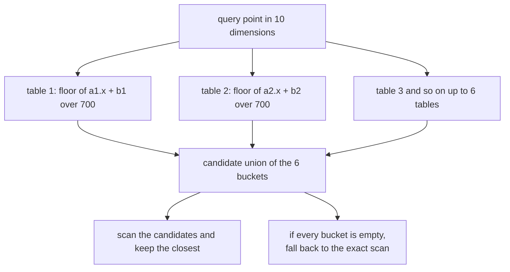
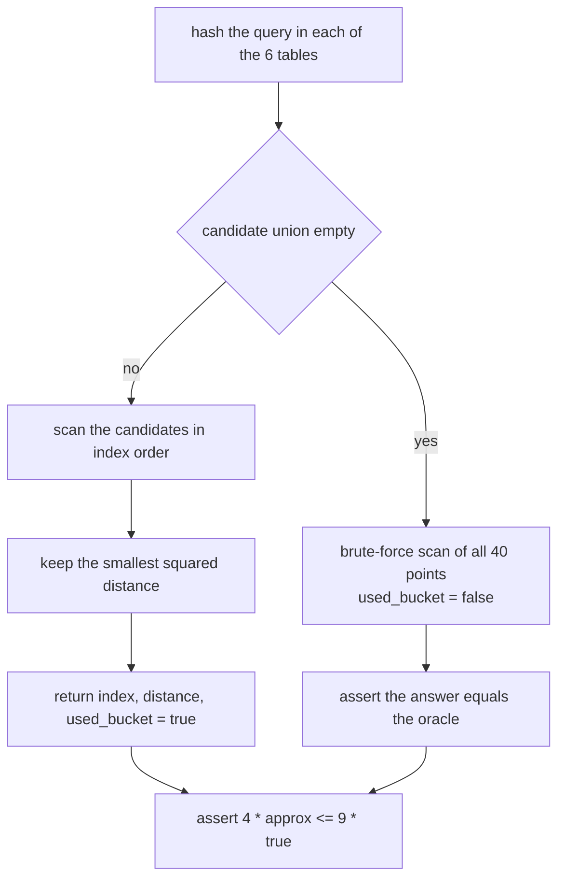
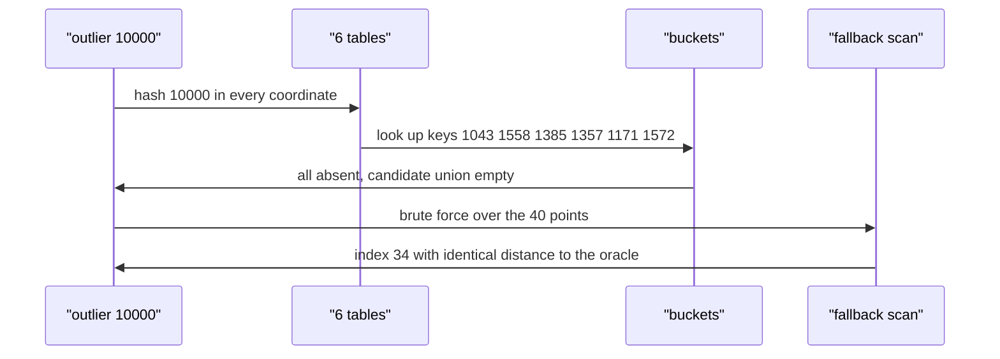

# 460 — Implement small epsilon-approximate nearest neighbor in high-dim (LSH idea).

> **Tier:** Advanced · **CTCI chapter:** Beyond — Advanced Data Structures & Algorithms
> **Task spec:** [460-implement-small-epsilon-approximate-nearest-neighbor-in-high-dim.md](../../../tasks/advanced/460-implement-small-epsilon-approximate-nearest-neighbor-in-high-dim.md)
> **Solutions:** [Python](../../../solutions/python/advanced/460-implement-small-epsilon-approximate-nearest-neighbor-in-high-dim/solution.py) ·
> [Java](../../../solutions/java/advanced/460-implement-small-epsilon-approximate-nearest-neighbor-in-high-dim/Solution.java) ·
> [JavaScript](../../../solutions/javascript/advanced/460-implement-small-epsilon-approximate-nearest-neighbor-in-high-dim/solution.js) ·
> [C#](../../../solutions/csharp/advanced/460-implement-small-epsilon-approximate-nearest-neighbor-in-high-dim/Solution.cs)

## 1. Problem restatement

**Input:** a data set of points in dimension `DIM = 10` with integer coordinates in
`[-30, 30]`, a hash family of `TABLES = 6` tables of bucket width `BUCKET_WIDTH = 700`, and a
query point. The bundled demo uses `NUM_POINTS = 40`, 12 LCG queries and one far outlier.

**Output:** the index of a point that is an `(1 + eps)` approximate nearest neighbour with
`eps = 0.5`, together with its squared distance and a flag saying whether the answer came from the
hash buckets or from the exact fallback scan.

The header describes both halves: "brute force: scan all points (exact, serves as the oracle /
certified answer)" and "LSH-style bucketing: `T` hash tables, each hashing an integer projection
`a.x + b` into floor buckets of width `r`; the query collects the union of its `T` buckets as
candidates and returns the closest one." Everything is integer arithmetic, so all four language
ports agree exactly.

| Assertion | Check |
| --- | --- |
| never better than the truth | `approx_dist >= true_dist` |
| `(1 + eps)` guarantee, `eps = 0.5` | `4 * approx_dist <= 9 * true_dist` (division-free) |
| the reported distance is real | `squared_distance(points[approx_idx], query) == approx_dist` |
| collisions exist | `max(bucket_sizes) >= 2` |
| both code paths used | `counters["bucket"] >= 1` and `counters["fallback"] >= 1` |
| the fallback is exact | `approx_idx == true_idx and approx_dist == true_dist` for the outlier |

## 2. Intuition

Exact nearest neighbour in high dimension costs a full scan of all `n` points (the brute-force
oracle does `n * DIM` arithmetic) and every tree structure degrades as the dimension grows — the
curse of dimensionality that motivates [461 — KD-tree nearest neighbour](../../../tasks/advanced/461-implement-kd-tree-nearest-neighbor-with-pruning-heuristics.md).

Locality-sensitive hashing gives up exactness for speed. Pick a random direction `a` and an offset
`b`, project every point onto that line, and chop the line into buckets of width `r`:

```text
h(x) = floor((a . x + b) / r)
```

Two points that are close together are *likely* to land in the same bucket; two points far apart
usually do not. A query then only examines its own buckets, so the scan shrinks from `n` points to
whatever landed there. Repeating this with `T = 6` independent tables takes the union of the `T`
buckets, which is what makes the answer good enough: with several independent directions, a point
that is close in every one of them is very likely to collide with the query in at least one table.



Because the buckets are a heuristic, the implementation is defensive: whenever the query hashes to
buckets that hold no points at all (the outlier test sends `(10000, ..., 10000)`), it falls back to
`brute_force_nn` and returns the certified answer. That mixture is why the tests can assert both
"the bucket path was exercised" and "the fallback path was exercised" on the same run.

## 3. Algorithm

1. `make_points(count, seed)` draws `count` points of `DIM` coordinates, each
   `seed % 61 - 30`, advancing the LCG `seed = (seed * 75 + 74) % 65537` once per coordinate.
2. `make_tables(seed)` builds `TABLES` tables: a projection vector `a` of `DIM` positive integers
   (`1 + seed % 20`), an offset `b = seed % BUCKET_WIDTH`, and an empty bucket map.
3. `hash_of(table, point)` computes `floor((b + sum(a[i] * point[i])) / BUCKET_WIDTH)` with
   Python-style floor division, so negative projections of negative coordinates floor downwards
   consistently in every language.
4. `build_index` inserts every point index into `table[2][hash]` for each table.
5. `brute_force_nn(points, query)` scans all points and returns `(best_idx, best_dist)`: the oracle.
6. `lsh_approx_nn(points, tables, query)`:
   a. Collect the candidate indices from the query's bucket in each of the `T` tables.
   b. If the union is empty, return `brute_force_nn(...)` with `used_bucket = false`.
   c. Otherwise scan the candidates in ascending index order, keep the smallest squared distance,
      and return `(best_idx, best_dist, true)`.
7. `check_query` compares the approximate answer with the oracle and asserts the `eps` bound, the
   distance consistency, and increments the bucket/fallback counter.

```text
procedure lsh_approx_nn(points, tables, query)
    candidates ← empty set
    for each table in tables do
        add every index of table.buckets[hash_of(table, query)] to candidates
    end
    if candidates is empty then
        idx, dist ← brute_force_nn(points, query)
        return (idx, dist, false)
    end
    best_idx ← nothing
    best_dist ← nothing
    for each idx in candidates sorted ascending do
        dist ← squared_distance(points[idx], query)
        if best_dist is nothing or dist < best_dist then
            best_idx ← idx
            best_dist ← dist
        end
    end
    return (best_idx, best_dist, true)
end

function hash_of(table, point)
    total ← table.offset
    for i ← 0 to DIM - 1 do
        total ← total + table.projection[i] * point[i]
    end
    return floor(total / BUCKET_WIDTH)
end
```



## 4. Worked example

The hand case pins down a single query exactly. Three points in 10 dimensions

| Index | Coordinates |
| --- | --- |
| 0 | `(0, 0, ..., 0)` |
| 1 | `(10, 0, ..., 0)` |
| 2 | `(0, 10, 0, ..., 0)` |

and the query `(9, 0, ..., 0)`. The exact oracle scans and finds the true nearest neighbour at
index 1 with squared distance `(10 - 9)^2 = 1`; index 0 costs `81` and index 2 costs `181`.

Table 0 of the hand tables has projection `[2, 6, 20, 15, 17, 5, 10, 17, 2, 2]` and offset `543`,
so with `r = 700`:

| Point | `a . x + b` | `floor(... / 700)` | Same bucket as the query? |
| --- | --- | --- | --- |
| query `(9,0,...)` | `543 + 2 * 9 = 561` | `0` | — |
| 0 | `543` | `0` | yes |
| 1 | `543 + 2 * 10 = 563` | `0` | yes |
| 2 | `543` | `0` | yes |

All six tables behave the same way on this tiny instance, so the candidate union is `{0, 1, 2}` and
the scan picks index 1 at distance 1. `check_query` then verifies the `eps` bound
`4 * 1 <= 9 * 1` and that the reported distance equals the recomputed one.

The main demo exercises the larger path:

| Observation | Value |
| --- | --- |
| non-empty buckets over the 6 tables | `31`, with a largest bucket of `23` points |
| 12 LCG queries | all answered from buckets (`used_bucket = true`) |
| outlier `(10000, ..., 10000)` | hashes to keys `1043, 1558, 1385, 1357, 1171, 1572`, all absent |
| outlier answer | index `34` from the fallback, exactly equal to the oracle |
| counters after the run | `bucket = 12`, `fallback = 1` |

So the demo shows both behaviours: the queries that live inside the data range are answered from a
bucket union, and the outlier, whose buckets contain nothing, gets the exact answer from the scan.
The collision assertion (`max(bucket_sizes) >= 2`) is satisfied by the 23-point bucket, which is
what makes the bucketing useful at all.



## 5. Complexity

Let `n` be the number of points, `d = DIM` the dimension and `T = TABLES` the number of tables.

| Measure | Bound | Why it holds |
| --- | --- | --- |
| Index build | `O(n * T * d)` | every point is hashed once per table |
| Hashing one query | `O(T * d)` | one projection per table |
| Candidate scan | `O(c * d)` | `c` = points in the union of the `T` buckets |
| Fallback | `O(n * d)` | the exact scan |
| Query, typical | `O(T * d + c * d)` with `c` often far below `n` | the demo's 12 queries came from bucket unions of 36-37 candidates |
| Space | `O(n * T)` | every point index is stored once per table |
| Brute-force oracle | `O(n * d)` | used as ground truth for every query |

The `(1 + eps)` guarantee with `eps = 0.5` is a per-query *check* here, not a theorem: the
implementation asserts `4 * approx_dist <= 9 * true_dist` for each of the 12 LCG queries and for the
hand case, and the outlier is exact because it takes the brute-force path. Tuning `TABLES` upwards
makes collisions more likely (better answers, more candidates); narrowing `BUCKET_WIDTH` makes the
buckets smaller (fewer candidates, more risk of a miss followed by a fallback).

## 6. Pitfalls and edge cases

- **Empty buckets must not produce "no answer".** The union being empty triggers the exact
  fallback, which is why the outlier returns index 34 instead of failing.
- **Floor division, not truncation.** `hash_of` floors, so a negative projection sum lands in the
  next lower bucket; using truncation would make the four language ports disagree.
- **The distance is squared throughout.** Coordinates are integers, so `squared_distance` stays
  exact and comparisons need no square roots; `4 * d_approx <= 9 * d_true` is the
  division-free form of `d_approx <= 1.5 * d_true`.
- **The approximate answer can never be smaller than the true distance**, because it is the
  distance to an actual point; the assertion `approx_dist >= true_dist` is a cheap invariant check
  that would catch a mis-indexed scan.
- **The reported index must match the reported distance.** `check_query` recomputes
  `squared_distance(points[approx_idx], query)` and asserts equality, catching an off-by-one
  between the stored index and the stored distance.
- **Candidates are scanned in index order.** Sorting the candidate set makes the tie-handling
  deterministic, so all four ports return the same index on equal distances.
- **The demo must exercise both paths.** `counters["bucket"] >= 1` and `counters["fallback"] >= 1`
  are asserted after the 12 LCG queries and the outlier, so a build that never falls back (or
  never uses buckets) fails.
- **Collisions are required, not incidental.** `max(bucket_sizes) >= 2` is asserted, since
  bucketing only helps when nearby points actually share buckets.
- **Point coordinates stay in `[-30, 30]`** while the outlier uses `10000`; the wide gap is what
  guarantees all its buckets are empty.
- **Only the exact path is certified.** When `used_bucket` is true the answer is "the best of the
  candidates", which is why the `eps` bound is asserted separately for every query.

## 7. Variants and follow-ups

- **Tree-based exact/approximate neighbour search:** [461 — KD-tree nearest neighbour with pruning heuristics](../../../tasks/advanced/461-implement-kd-tree-nearest-neighbor-with-pruning-heuristics.md)
  partitions space by coordinate splits instead of hashing projections.
- **Metric-space indexing:** [462 — Vantage-point tree for metric spaces](../../../tasks/advanced/462-implement-vantage-point-tree-vp-tree-for-metric-spaces.md)
  needs only a distance function, which is the right choice when coordinates are not meaningful.
- **The conceptual companion:** [463 — Locality sensitive hashing (conceptual demo)](../../../tasks/advanced/463-implement-locality-sensitive-hashing-conceptual-demo.md)
  isolates the hashing idea itself, including its collision statistics.
- **Recipes for better recall:** more tables, multiple projections per table (concatenation), or
  asymmetric variants; all of them trade candidate count for accuracy exactly as `TABLES` and
  `BUCKET_WIDTH` do here.
- **Real-world guardrails:** production systems combine the hash index with a verification pass —
  the same two-stage structure used here, where buckets propose and exact distances decide.

## 8. Check yourself

**Q1.** Why is the query hashed with the same projection and offset as the indexed points?

<details><summary>Show answer</summary>

Because a bucket is only meaningful if points and queries are placed by the same rule. The hash
`floor((a . x + b) / r)` is a function of the point only, so a query lands in the bucket of every
indexed point that projects into the same width-`r` interval along direction `a`.

</details>

**Q2.** What exactly does the `eps = 0.5` assertion allow?

<details><summary>Show answer</summary>

That the returned point's distance is at most `(1 + eps)` times the true nearest-neighbour
distance, i.e. at most `1.5 * d_true`; the code checks the squared, division-free form
`4 * d_approx <= 9 * d_true`. It does not require the answer to be the exact nearest neighbour.

</details>

**Q3.** In the hand example, why do all three points share the query's bucket in every table?

<details><summary>Show answer</summary>

Because the projection sums are tiny compared with the bucket width: with offset 543 and the
leading projection weight 2, the query contributes `543 + 18 = 561` and point 1 contributes
`543 + 20 = 563`, both flooring to bucket 0 under `r = 700`. Since the coordinates are 0 or 10 and
the other weights multiply zeros, nothing escapes the first bucket.

</details>

**Q4.** Why does the outlier query return the exact answer?

<details><summary>Show answer</summary>

Because its bucket keys (for example `1043` and `1558`) are absent from all six tables, so the
candidate union is empty and `lsh_approx_nn` falls back to `brute_force_nn`, which is exact by
construction. The test asserts the returned index and distance equal the oracle's.

</details>

**Q5.** How would you improve recall without changing the data set?

<details><summary>Show answer</summary>

Pick a different trade-off for the same two knobs the demo uses: increase `TABLES` so the union of
independent directions is larger, or increase `BUCKET_WIDTH` so more points share a bucket — both
make collisions with the true nearest neighbour more likely, at the cost of scanning more
candidates (wider buckets) or doing more hashing per query (more tables).

</details>
