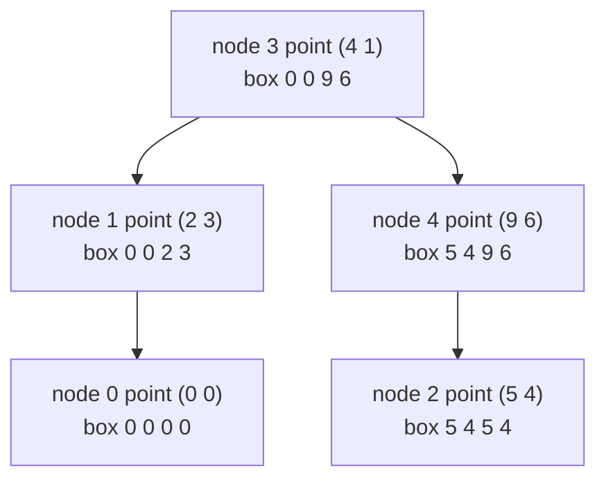
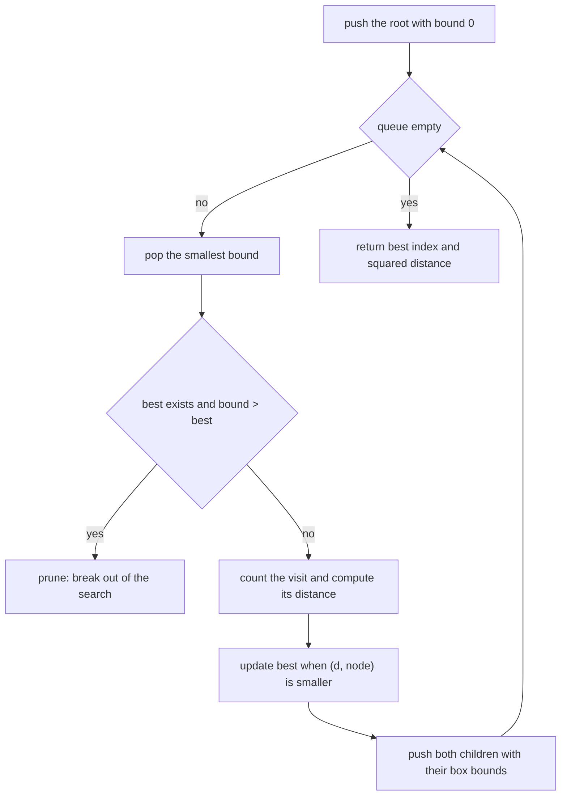
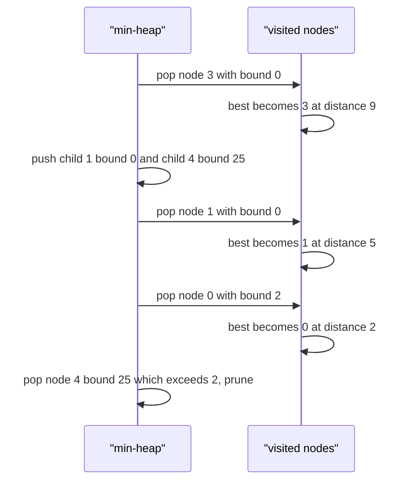

# 461 — Implement kd-tree nearest neighbor with pruning heuristics.

> **Tier:** Advanced · **CTCI chapter:** Beyond — Advanced Data Structures & Algorithms
> **Task spec:** [461-implement-kd-tree-nearest-neighbor-with-pruning-heuristics.md](../../../tasks/advanced/461-implement-kd-tree-nearest-neighbor-with-pruning-heuristics.md)
> **Solutions:** [Python](../../../solutions/python/advanced/461-implement-kd-tree-nearest-neighbor-with-pruning-heuristics/solution.py) ·
> [Java](../../../solutions/java/advanced/461-implement-kd-tree-nearest-neighbor-with-pruning-heuristics/Solution.java) ·
> [JavaScript](../../../solutions/javascript/advanced/461-implement-kd-tree-nearest-neighbor-with-pruning-heuristics/solution.js) ·
> [C#](../../../solutions/csharp/advanced/461-implement-kd-tree-nearest-neighbor-with-pruning-heuristics/Solution.cs)

## 1. Problem restatement

**Input:** a static set of 2-D integer points and a query point. The bundled workload is fixed:
`n = 200` points drawn from the LCG (`seed = (seed * 75 + 74) % 65537`, coordinates in
`[-1000, 1000]`), then 200 queries drawn from the same stream.

**Output:** the index of the nearest point and its **squared** distance, exactly as the
brute-force oracle computes them. The tree additionally reports how many nodes the search visited,
so the pruning can be measured.

The header pins down the three design decisions: "a 2-D kd-tree (median split on alternating
axes) keeps a bounding box per node. The nearest-neighbour search is best-first: search-queue
entries are ordered by the squared distance from the query point to the child's bounding box, and
a subtree whose lower bound strictly exceeds the best found squared distance is pruned (the break
is strict `>`, so equal-distance candidates are still explored). Tie-break rule (documented):
equal squared distance -> smaller point index."

| Call | Result | Why |
| --- | --- | --- |
| `nearest((1, 1))` on the tiny set | `(0, 2)` | `(0,0)` is at squared distance 2 |
| `nearest((4, 2))` | `(3, 1)` | `(4,1)` is at distance 1, and only one node is visited |
| `nearest((3, 3))` | `(1, 1)` | `(2,3)` is at distance 1 |
| `nearest((3, 2))` | `(1, 2)` | tie with index 3, resolved to the smaller index |
| empty tree | `(-1, -1)` | no points, no answer |
| 200 LCG queries | equal to `brute_nearest` | asserted per query |
| visited budget | `total_visited < 200 * 200 / 4` | measured average 8.01 nodes per query |

## 2. Intuition

A linear scan answers nearest neighbour in `O(n)` distance evaluations and needs no structure at
all — that is the oracle. A kd-tree tries to look at far fewer points by organising space: split
the points at the median along one axis, recurse on both halves, and alternate the axis at each
level. Every node then owns a **bounding box** containing all points of its subtree.

The search exploits the box. The squared distance from the query to a box is a **lower bound** on
the distance to any point inside it: if the query is inside the box along an axis, that axis
contributes 0; otherwise it contributes the gap to the nearest face, squared.



Best-first search pops the most promising subtree first, keeps the best distance found so far, and
**prunes** any subtree whose lower bound already exceeds that distance — nothing inside it can
improve the answer. Two details matter and both are documented in the header:

- the comparison is **strict** (`bound > best`), so a subtree whose bound *equals* the best
  distance is still explored, which is what keeps ties honest;
- the answer ties are broken towards the **smaller index**, so the result is deterministic across
  the four ports.

The payoff is the visited-node statistic: on the fixed 200-point cloud the best-first search
visits 8.01 nodes per query on average, against 200 point evaluations for the linear scan, while
still returning exactly the brute-force answer for every query.

## 3. Algorithm

1. `KdTree(points)` stores the points and allocates `left`, `right` and `box` arrays.
2. `_build(ids, depth)` sorts the ids on the axis `depth & 1`, breaking ties by the other
   coordinate and then by index, takes the middle id as the node, recurses on both halves, and
   stores the bounding box `(min x, min y, max x, max y)` over the whole id set. The root is the
   median of the first split.
3. `_bound(node, q)` returns the squared distance from `q` to the node's box using the per-axis
   gap rule.
4. `nearest(query)` runs a best-first search:
   a. Push `(0, root)` — the root's bound is 0 because the query may be inside the box.
   b. Pop the smallest bound; if a best answer exists and `bound > best_d`, break: every remaining
      entry is worse, so the search is finished.
   c. Count the visiting of `node`, compute its squared distance, and update `(best_d, best_i)`
      using the pair comparison `(d, node) < (best_d, best_i)` so ties prefer the smaller index.
   d. Push both children with their box bounds.
   e. Return `(best_i, best_d)`, or `(-1, -1)` for an empty tree.
5. `self.visited` counts only the popped nodes that passed the pruning test.

```text
procedure nearest(tree, query)
    visited ← 0
    if tree.root = -1 then
        return (-1, -1)
    end
    best_i ← -1
    best_d ← 0
    queue ← min-heap containing (0, tree.root)
    while queue is not empty do
        bound, node ← pop the entry with the smallest bound
        if best_i != -1 and bound > best_d then
            break
        end
        visited ← visited + 1
        d ← squared distance from tree.points[node] to query
        if best_i = -1 or (d, node) < (best_d, best_i) then
            best_d ← d
            best_i ← node
        end
        for each child in (tree.left[node], tree.right[node]) do
            if child != -1 then
                push (box_bound(child, query), child) onto queue
            end
        end
    end
    return (best_i, best_d)
end

function box_bound(node, query)
    dx ← 0 if query.x is inside the box else the gap to the nearest x face
    dy ← 0 if query.y is inside the box else the gap to the nearest y face
    return dx * dx + dy * dy
end
```



## 4. Worked example

The tiny hand set is `[(0,0), (2,3), (5,4), (4,1), (9,6)]`, indexed 0 to 4. Building it with
alternating median splits gives the structure shown in section 2:

| Node | Point | `left` | `right` | Box `(xmin, ymin, xmax, ymax)` |
| --- | --- | --- | --- | --- |
| 3 | `(4, 1)` | 1 | 4 | `(0, 0, 9, 6)` — the root |
| 1 | `(2, 3)` | 0 | — | `(0, 0, 2, 3)` |
| 0 | `(0, 0)` | — | — | `(0, 0, 0, 0)` |
| 4 | `(9, 6)` | 2 | — | `(5, 4, 9, 6)` |
| 2 | `(5, 4)` | — | — | `(5, 4, 5, 4)` |

**Query `(1, 1)`.** The search runs three visits and then prunes the rest:

| Event | Popped | Bound | Best before | Action |
| --- | --- | --- | --- | --- |
| 1 | node 3 | `0` | none | visit 1; `d = 9` → best `(3, 9)`; push child 1 (bound `0`) and child 4 (bound `25`) |
| 2 | node 1 | `0` | `(3, 9)` | `0 > 9`? no → visit 2; `d = 5` → best `(1, 5)`; push child 0 (bound `2`) |
| 3 | node 0 | `2` | `(1, 5)` | `2 > 5`? no → visit 3; `d = 2` → best `(0, 2)` |
| 4 | node 4 | `25` | `(0, 2)` | `25 > 2` → **prune**, stop without visiting |

The result is `(0, 2)`, the same as the linear scan, but two of the five points (`(5,4)` and
`(9,6)`) were never evaluated — their whole subtrees were discarded by the bound test.

**Query `(4, 2)` shows a one-visit answer.** The root `(4,1)` is popped with bound 0 and gives
`d = 1`; the two pushed children have bounds `4` (box `(0,0,2,3)`) and `5` (box `(5,4,9,6)`), so
the very next pop already exceeds the best distance and breaks. `visited = 1`.

**Query `(3, 2)` exercises the tie rule.** Points 1 `(2,3)` and 3 `(4,1)` are both at squared
distance `1 + 1 = 2`; the pair comparison `(d, node) < (best_d, best_i)` keeps the smaller index,
so the answer is `(1, 2)` as the test asserts.



On the fixed 200-point cloud the same code matches `brute_nearest` for all 200 queries. Measured
on that workload the search visits 8.01 nodes per query on average (minimum 4, maximum 14), while
the assertion only demands the weaker `total_visited < 200 * 200 / 4`, i.e. fewer than 50 nodes per
query on average — a clear margin below the 200 evaluations a linear scan needs.

## 5. Complexity

| Measure | Bound | Why it holds |
| --- | --- | --- |
| Build | `O(n log^2 n)` | each level sorts its id range; ties are broken deterministically |
| Box computation | `O(n log n)` total | each node scans the id range it owns |
| Query, worst case | `O(n)` | a degenerate tree plus a bound that never prunes |
| Query, typical | `O(log n)` visited nodes | the measured 8.01 visits per query on 200 points |
| Space | `O(n)` | points, `left`, `right`, `box` arrays |
| Tie handling | free | the pair comparison `(d, index)` adds no work |
| Brute-force oracle | `O(n)` per query | the baseline the tests compare against |

The pruning test is what converts the `O(n)` scan into a logarithmic-ish walk: a subtree is only
visited when its box bound is at most the best distance found so far. The strict `>` keeps
equal-distance subtrees alive, which costs a few extra visits but guarantees that index-tie answers
match the oracle, and the visited counter is what makes the pruning falsifiable — the suite fails
if the average ever reaches `n / 4`.

## 6. Pitfalls and edge cases

- **An empty tree must answer `(-1, -1)`.** `nearest` checks `root == -1` before touching the heap.
- **The root is pushed with bound 0, not with its box bound.** A query outside the root box would
  otherwise risk a bound larger than a candidate distance before any point is seen.
- **Pruning is strict.** `bound > best_d` prunes only subtrees that cannot *improve* the answer;
  with `>=` a subtree holding an equally distant, smaller-indexed point could be dropped and the
  documented tie rule would break.
- **Ties must prefer the smaller index.** Both the tree search and `brute_nearest` compare the
  pair `(d, i)`, so the hand query `(3, 2)` returns index 1 rather than 3 in every language.
- **Bounds are squared distances.** Mixing in a square root would make the comparison inexact and
  cost floating point; gap computation and distance both stay integer.
- **The box stores all four faces.** The median split alone is not enough for pruning, because the
  query can approach a subtree from a side other than the split axis.
- **Build ties are broken by the second coordinate and then by index**, so the tree shape is
  deterministic and the visited counts are reproducible across ports.
- **`visited` counts only nodes that survive the pruning test.** The node that triggers the break
  is not counted, which is why `(4, 2)` reports exactly 1.
- **The pruning budget is asserted, not assumed.** `total_visited > 0` guards against a search
  that visits nothing, and `total_visited < queries * n // 4` is the documented margin.
- **The structure is static.** Insertions or deletions would need node updates; this task only
  builds once and answers 200 queries.
- **Duplicate points are fine.** They are distinct ids in the same box, and the tie rule picks the
  smallest index among them.

## 7. Variants and follow-ups

- **Approximate hashing alternative:** [460 — Small epsilon approximate nearest neighbour in high-dim (LSH)](../../../tasks/advanced/460-implement-small-epsilon-approximate-nearest-neighbor-in-high-dim.md)
  trades exactness for `O(1)`-style bucket lookups instead of exact pruning.
- **Metric spaces without coordinates:** [462 — Vantage-point tree for metric spaces](../../../tasks/advanced/462-implement-vantage-point-tree-vp-tree-for-metric-spaces.md)
  replaces axis splits with distance-to-vantage-point splits, which works with any distance
  function.
- **The conceptual hashing demo:** [463 — Locality sensitive hashing (conceptual demo)](../../../tasks/advanced/463-implement-locality-sensitive-hashing-conceptual-demo.md)
  isolates the collision idea that the LSH task builds on.
- **Higher dimensions:** the same bounding-box pruning degrades quickly above a handful of
  dimensions (the curse of dimensionality), which is why approximate structures are the usual
  choice in high-dim settings.
- **Other pruning heuristics:** incremental distance updates while descending, split-axis-only
  bounds (cheaper but weaker), and `k`-nearest-neighbour priority queues are the classic
  refinements on top of this best-first skeleton.

## 8. Check yourself

**Q1.** Why does the pruning test use a *strict* inequality?

<details><summary>Show answer</summary>

Because the answer must respect the documented tie rule. If a subtree's bound *equals* the best
distance found, it may still contain a point at that same distance but with a smaller index, and
`bound >= best` would discard it. Pruning only on `bound > best` keeps such subtrees alive.

</details>

**Q2.** In the trace of query `(1, 1)`, why is node 4 never visited?

<details><summary>Show answer</summary>

Its box `(5, 4, 9, 6)` is far from the query: the gap is `5 - 1 = 4` in `x` and `4 - 1 = 3` in
`y`, so its bound is `16 + 9 = 25`. Once the best distance is 2, the popped bound 25 exceeds it and
the search breaks, leaving the subtree unexamined.

</details>

**Q3.** The root is pushed with bound 0. Why is that sound?

<details><summary>Show answer</summary>

Because 0 is a valid lower bound for the distance to any point in the tree, so no subtree is
wrongly prioritised *above* the root; the root box's own bound is recomputed for its children. This
avoids relying on the query lying inside the root's box.

</details>

**Q4.** The suite asserts `total_visited < queries * n // 4` while the measured average is 8.01.
Why is the assertion so loose?

<details><summary>Show answer</summary>

Because the exact count depends on the point cloud and the query distribution. The assertion
expresses the property that matters — the search must beat a linear scan by a wide margin — without
turning the test into a brittle fingerprint of one particular RNG stream. The `total_visited > 0`
check additionally proves the search is actually doing work.

</details>

**Q5.** Why is the answer exactly the brute-force one even though the search only evaluates a
handful of points?

<details><summary>Show answer</summary>

Because pruning is done with a *lower bound*: a subtree is discarded only when its bound is already
larger than the best distance found, meaning no point inside could be closer. Every pruned subtree
is therefore provably irrelevant, and the surviving best is the true nearest neighbour — which is
why 200 LCG queries all match `brute_nearest`.

</details>
