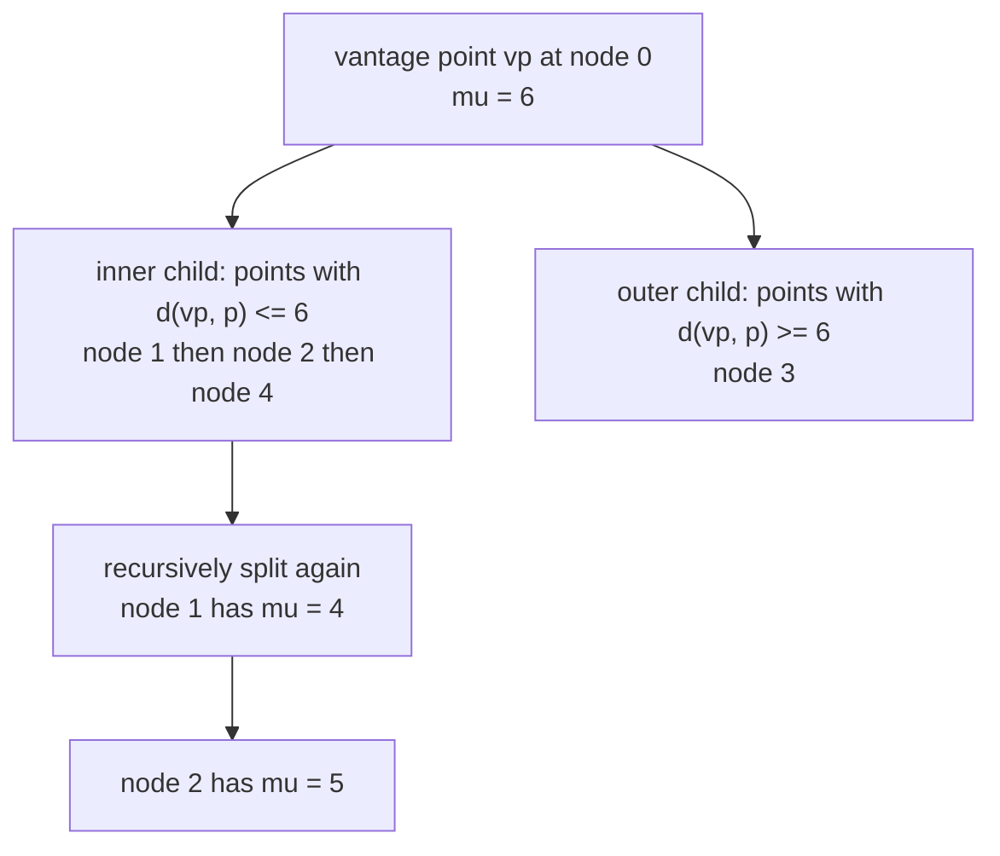
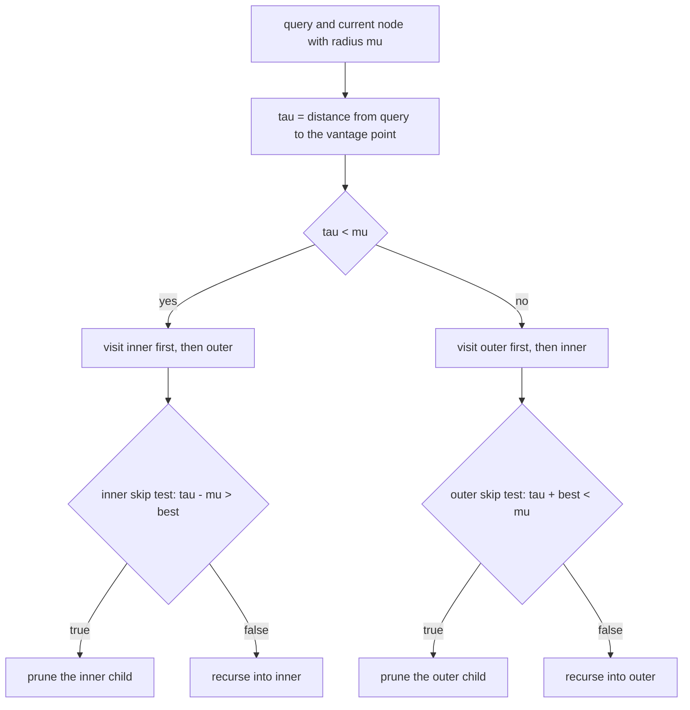
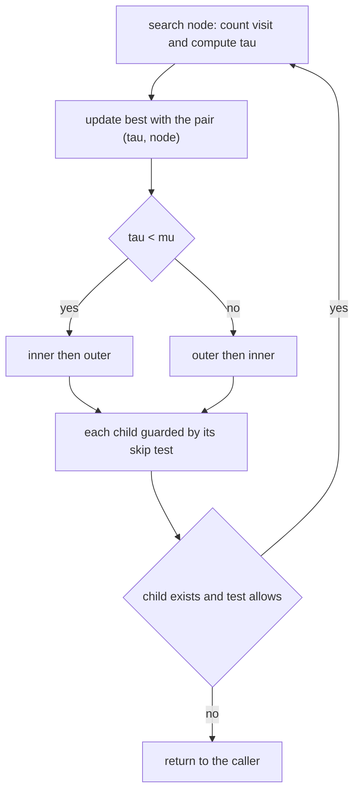
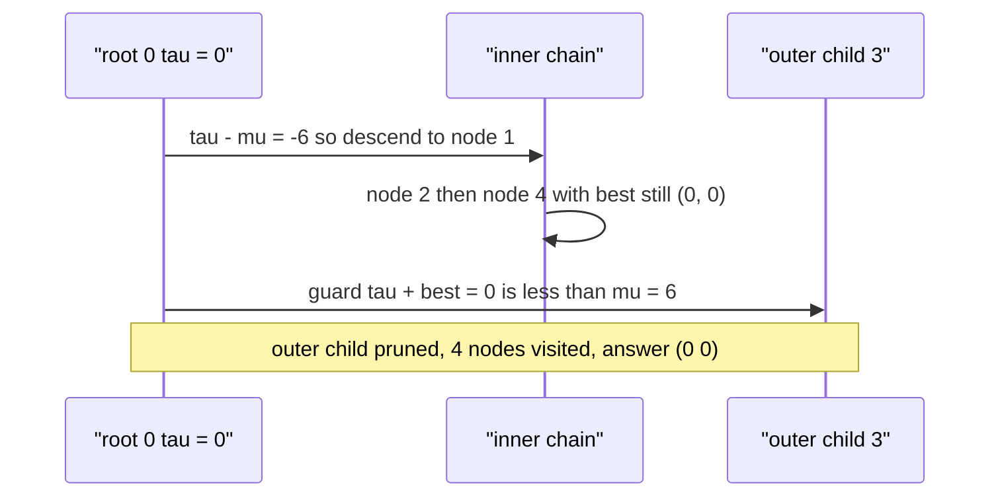

# 462 — Implement vantage-point tree (VP-tree) for metric spaces.

> **Tier:** Advanced · **CTCI chapter:** Beyond — Advanced Data Structures & Algorithms
> **Task spec:** [462-implement-vantage-point-tree-vp-tree-for-metric-spaces.md](../../../tasks/advanced/462-implement-vantage-point-tree-vp-tree-for-metric-spaces.md)
> **Solutions:** [Python](../../../solutions/python/advanced/462-implement-vantage-point-tree-vp-tree-for-metric-spaces/solution.py) ·
> [Java](../../../solutions/java/advanced/462-implement-vantage-point-tree-vp-tree-for-metric-spaces/Solution.java) ·
> [JavaScript](../../../solutions/javascript/advanced/462-implement-vantage-point-tree-vp-tree-for-metric-spaces/solution.js) ·
> [C#](../../../solutions/csharp/advanced/462-implement-vantage-point-tree-vp-tree-for-metric-spaces/Solution.cs)

## 1. Problem restatement

**Input:** a static set of integer 2-D points, a query point, and a **metric** on them. The
solutions use the Manhattan metric `L1: |dx| + |dy|`, which is a true metric, so the pruning rule
below is exact. The fixed workload is `n = 150` points from the LCG
(`seed = (seed * 75 + 74) % 65537`, coordinates in `[-1000, 1000]`) and 150 queries from the same
stream.

**Output:** the index of the nearest point and its `L1` distance, identical to a brute-force scan,
plus the number of tree nodes visited so the pruning can be measured.

The header fixes the structure: "each node stores a vantage point, the median distance `mu` to the
remaining points, and two children: inner (the half with distance `<= mu`) and outer (the half with
distance `>= mu`), which keeps every point in exactly one child and the halves balanced. Search
visits the nearer child first and prunes by the triangle inequality... Tie-break (documented):
equal L1 distance -> smaller point index."

| Call | Result | Why |
| --- | --- | --- |
| `nearest((0, 0))` | `(0, 0)` | exact match, and the outer subtree is pruned |
| `nearest((4, 3))` | `(3, 3)` | `(5,5)` and `(2,4)` both at distance 3 → smaller index |
| `nearest((2, 1))` | `(1, 1)` | distance 1 |
| `nearest((5, 0))` | `(2, 2)` | `(3,0)` is at distance 2 |
| empty tree | `(-1, -1)` | nothing to search |
| 150 LCG queries | equal to `brute_nearest` | asserted per query |
| visited budget | `total_visited < 150 * 150 / 3` | measured average 14.13 nodes per query |

## 2. Intuition

A kd-tree splits on coordinate axes, which assumes coordinates are meaningful and comparable —
see [461 — KD-tree nearest neighbour](../../../tasks/advanced/461-implement-kd-tree-nearest-neighbor-with-pruning-heuristics.md).
A VP-tree asks for less: only a **distance function** that satisfies the triangle inequality. Pick
a point as the node's *vantage point* `vp`, sort the rest by their distance to it, and split at the
median distance `mu`:

- the **inner** child holds the closer half (distance `<= mu`),
- the **outer** child holds the farther half (distance `>= mu`).

That makes the node a pair of concentric balls around `vp`, with radius `mu` separating them.



Searching is where the triangle inequality pays off. Let `tau = d(query, vp)` and `best` the best
distance found so far.

| Child | Can be skipped when | Reason |
| --- | --- | --- |
| inner | `tau - mu > best` | every inner point `p` has `d(query, p) >= tau - mu` |
| outer | `tau + best < mu` | every outer point `p` has `d(query, p) >= mu - tau` |

Both tests are evaluated one-sided: after a prune, the remaining points are all provably farther
than `best`, so nothing is lost. As with the kd-tree, the comparisons are **strict**, so
equal-distance candidates are still visited, and the final answer ties are broken towards the
smaller index.



## 3. Algorithm

1. `VpTree(points)` allocates `mu`, `inner` and `outer` arrays and builds the tree from the id list.
2. `_build(ids)`: take `ids[0]` as the vantage point; if it is alone, return it. Otherwise sort the
   remaining ids by `(distance to the vantage point, index)`, set
   `mu[vp] = distance to the middle entry`, recurse into `ids[:mid + 1]` as the inner child (the
   `<= mu` half, which for even lengths takes the extra point) and into `ids[mid + 1:]` as the
   outer child.
3. `nearest(query)` resets `visited` and the best state, then calls `_search(root, query)`, returning
   `(best_index, best_distance)` — or `(-1, -1)` when the tree is empty.
4. `_search(node, query)` counts the visit, computes `tau`, updates `best` with the pair comparison
   `(tau, node) < best`, and then visits the **nearer child first**: inner before outer when
   `tau < mu`, outer before inner otherwise.
5. `_visit_inner` recurses when `inner != -1 and tau - mu <= best`; `_visit_outer` recurses when
   `outer != -1 and tau + best >= mu`.

```text
procedure vp_nearest(tree, query)
    visited ← 0
    if tree.root = -1 then
        return (-1, -1)
    end
    best ← nothing
    search(tree.root, query)
    return (index of best, distance of best)
end

procedure search(node, query)
    visited ← visited + 1
    tau ← distance(query, tree.points[node])
    if best is nothing or (tau, node) < best then
        best ← (tau, node)
    end
    mu ← tree.mu[node]
    if tau < mu then
        visit_inner(node, query, tau, mu)
        visit_outer(node, query, tau, mu)
    else
        visit_outer(node, query, tau, mu)
        visit_inner(node, query, tau, mu)
    end
end

procedure visit_inner(node, query, tau, mu)
    if tree.inner[node] != -1 and tau - mu <= distance of best then
        search(tree.inner[node], query)
    end
end

procedure visit_outer(node, query, tau, mu)
    if tree.outer[node] != -1 and tau + distance of best >= mu then
        search(tree.outer[node], query)
    end
end
```



## 4. Worked example

The hand set is `[(0,0), (1,1), (3,0), (5,5), (2,4)]` with ids 0 to 4. Building it gives:

| Node | Point | `mu` | Inner | Outer | How `mu` was chosen |
| --- | --- | --- | --- | --- | --- |
| 0 | `(0, 0)` | `6` | 1 | 3 | distances `2, 3, 6, 10` → median 6 |
| 1 | `(1, 1)` | `4` | 2 | — | distances `3, 4` → median 4 |
| 2 | `(3, 0)` | `5` | 4 | — | distance `5` → median 5 |
| 3 | `(5, 5)` | `0` | — | — | leaf |
| 4 | `(2, 4)` | `0` | — | — | leaf |

**Query `(0, 0)` — the outer subtree is pruned.** `tau = 0`, `mu = 6`, and the closer child is
inner, so the search descends the inner chain and only then tests the outer child.

| Event | Node | `tau` | `best` after | Guard evaluated | Outcome |
| --- | --- | --- | --- | --- | --- |
| 1 | 0 | `0` | `(0, 0)` | `tau - mu = -6 <= 0` | recurse inner (node 1) |
| 2 | 1 | `2` | `(0, 0)` | `2 - 4 = -2 <= 0` | recurse inner (node 2) |
| 3 | 2 | `3` | `(0, 0)` | `3 - 5 = -2 <= 0` | recurse inner (node 4) |
| 4 | 4 | `6` | `(0, 0)` | both children absent | return |
| 5 | 0 | — | — | `tau + best = 0 + 0 < mu = 6` | **prune** the outer child |

Four visits out of five points, and node 3 `(5,5)` was never evaluated — the guard
`tau + best >= mu` was false because the query is much closer to the vantage point than `mu`.

**Query `(4, 3)` — the tie-break in action.** Here `tau = 7 > mu = 6`, so the outer child is
visited first and immediately improves `best` to `(3, 3)` at node 3.

| Event | Node | `tau` | `best` after | Guard | Outcome |
| --- | --- | --- | --- | --- | --- |
| 1 | 0 | `7` | `(7, 0)` | `7 + 7 = 14 >= 6` | recurse outer (node 3) |
| 2 | 3 | `3` | `(3, 3)` | no children | return |
| 3 | 1 | `5` | `(3, 3)` | `5 - 4 = 1 <= 3` | recurse inner (node 2) |
| 4 | 2 | `4` | `(3, 3)` | `4 - 5 = -1 <= 3` | recurse inner (node 4) |
| 5 | 4 | `3` | `(3, 3)` | `(3, 4)` is **not** smaller than `(3, 3)` | tie kept on the smaller index |

The final answer is `(3, 3)`, matching `brute_nearest`, even though node 4 is equally close — the
documented tie rule resolves it deterministically. The other hand queries behave the same way:
`(2, 1)` gives `(1, 1)` and `(5, 0)` gives `(2, 2)` because point 2 is `(3, 0)`.

On the fixed 150-point cloud the same code matches the oracle for all 150 queries while visiting
14.13 nodes per query on average (minimum 7, maximum 35) — far below the asserted budget of
`150 * 150 / 3`, i.e. fewer than 50 visits per query against 150 point evaluations for a scan.



## 5. Complexity

Let `n` be the number of points and `k` the number of visited nodes for a query.

| Measure | Bound | Why it holds |
| --- | --- | --- |
| Build | `O(n log^2 n)` | each level sorts its id range by distance to the vantage point |
| Balanced split | guaranteed | the median distance puts `mid + 1` ids inner and the rest outer |
| Query, worst case | `O(n)` | a bound that never prunes |
| Query, typical | `O(log n)` visited nodes | measured 14.13 visits on 150 points |
| Distance evaluations | one per visited node plus the build | `L1` in constant time |
| Space | `O(n)` | points, `mu`, `inner`, `outer` |
| Brute-force oracle | `O(n)` per query | the baseline |
| Visited budget asserted | `< n / 3` per query on average | `total_visited < queries * n // 3` |

Pruning only needs the triangle inequality, so the same code works for `L1`, `L2`, edit distance
or any other metric — that is the structural advantage over a kd-tree, which needs comparable
coordinates. The visited counter makes the pruning falsifiable: the suite fails if the average ever
reaches `n / 3`.

## 6. Pitfalls and edge cases

- **The metric must be a true metric.** The skip tests rely on the triangle inequality; a
  non-metric "distance" would make the pruning unsound and could return a wrong neighbour.
- **Both guards are strict.** `tau - mu > best` and `tau + best < mu` prune only provably worse
  subtrees; using `>=` would drop equal-distance candidates and break the tie rule.
- **The inner child takes the median itself** (`ids[:mid + 1]`), which keeps every point in exactly
  one child and leaves the two halves balanced even for even sizes.
- **Ties in the build are broken by index** (`sorted` on `(distance, point id)`), so the tree shape,
  the `mu` values and the visited counts are reproducible in all four ports.
- **The tie rule in the answer is `(tau, node)`.** The hand query `(4, 3)` finds `(2,4)` at distance
  3 as well, but index 3 wins because `(3, 4) < (3, 3)` is false.
- **Empty input returns `(-1, -1)`**, checked before any search state is touched.
- **Visited counts the node before the guards decide anything**, so the numbers in section 4 include
  the node that later triggers a prune at its parent.
- **A single-point subtree is a leaf** with `mu = 0` and no children; both guards see `-1` children
  and stop immediately.
- **`best` must be updated before the guards use it.** In the `(4, 3)` trace the outer visit at node
  3 lowered `best` from 7 to 3, which is what allows the inner subtree to be explored with a tight
  bound afterwards — and what makes the later `tau - mu <= best` tests meaningful.
- **The nearer child is visited first on purpose.** Visiting the farther child first would not break
  correctness, but it would inflate the visited count because `best` would stay loose longer.
- **The budget assertion is a property, not a fingerprint:** `total_visited > 0` proves work was
  done, and `total_visited < queries * n // 3` proves a wide margin over the linear scan.

## 7. Variants and follow-ups

- **Coordinate-based alternative:** [461 — KD-tree nearest neighbour with pruning heuristics](../../../tasks/advanced/461-implement-kd-tree-nearest-neighbor-with-pruning-heuristics.md)
  prunes with bounding boxes over axes and is usually faster in low dimensions, but needs
  comparable coordinates.
- **Approximate hashing:** [460 — Small epsilon approximate nearest neighbour in high-dim (LSH)](../../../tasks/advanced/460-implement-small-epsilon-approximate-nearest-neighbor-in-high-dim.md)
  gives up exactness to gain sub-linear lookups in high dimension.
- **The hashing idea in isolation:** [463 — Locality sensitive hashing (conceptual demo)](../../../tasks/advanced/463-implement-locality-sensitive-hashing-conceptual-demo.md).
- **Choosing `mu` differently:** some implementations split on the median of the point set while
  others use the mean or a fixed radius per level; a median keeps the tree balanced here, which is
  what makes the depth `O(log n)`.
- **Beyond nearest neighbour:** the same ball structure answers radius queries ("all points within
  `r`") by switching the guards to distance thresholds, and `k`-nearest by keeping a bounded heap.

## 8. Check yourself

**Q1.** Why does the VP-tree need only a distance function while a kd-tree needs coordinates?

<details><summary>Show answer</summary>

Because it partitions by *distance to a vantage point* and prunes with the triangle inequality, both
of which are defined by the metric alone. A kd-tree instead splits and bounds by coordinate values,
which requires the coordinates to be meaningful and comparable.

</details>

**Q2.** Derive the outer skip test `tau + best < mu`.

<details><summary>Show answer</summary>

For any outer point `p` we know `d(vp, p) >= mu`, and the triangle inequality gives
`d(vp, p) <= d(vp, query) + d(query, p) = tau + d(query, p)`. So
`d(query, p) >= mu - tau`. If `mu - tau > best` then every outer point is farther than the best
found, so the subtree can be skipped — the code writes the same condition as `tau + best < mu`.

</details>

**Q3.** In the `(0, 0)` trace, why is the outer child skipped even though it was never examined?

<details><summary>Show answer</summary>

Because `tau + best = 0 + 0 = 0 < mu = 6`. Every point in the outer subtree is at distance at least
`mu - tau = 6` from the query, which is worse than the current best of 0, so none of them can
improve the answer.

</details>

**Q4.** Why is `mu` set to the *median* distance rather than the mean?

<details><summary>Show answer</summary>

The median splits the remaining points into two halves of nearly equal size, so the tree stays
balanced and the search depth is `O(log n)`. A mean (or any unbalanced split point) could put almost
all points in one child and degrade the search towards a linear scan.

</details>

**Q5.** The visited budget is `n / 3` per query on average, while the measurement is 14.13 for
`n = 150`. Why assert such a loose bound?

<details><summary>Show answer</summary>

Because the exact count depends on the point cloud and the query distribution, and the property
that matters is only that the search beats the `n`-evaluation scan by a wide margin. Asserting a
tight number would make the test a fingerprint of one RNG stream instead of a property of the
algorithm.

</details>
