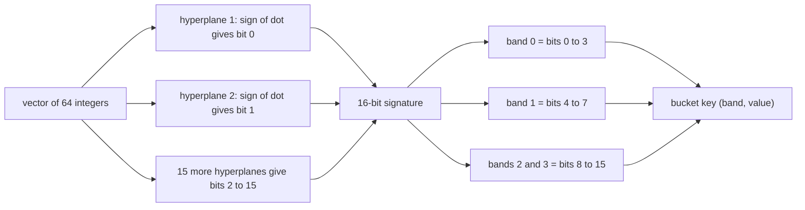
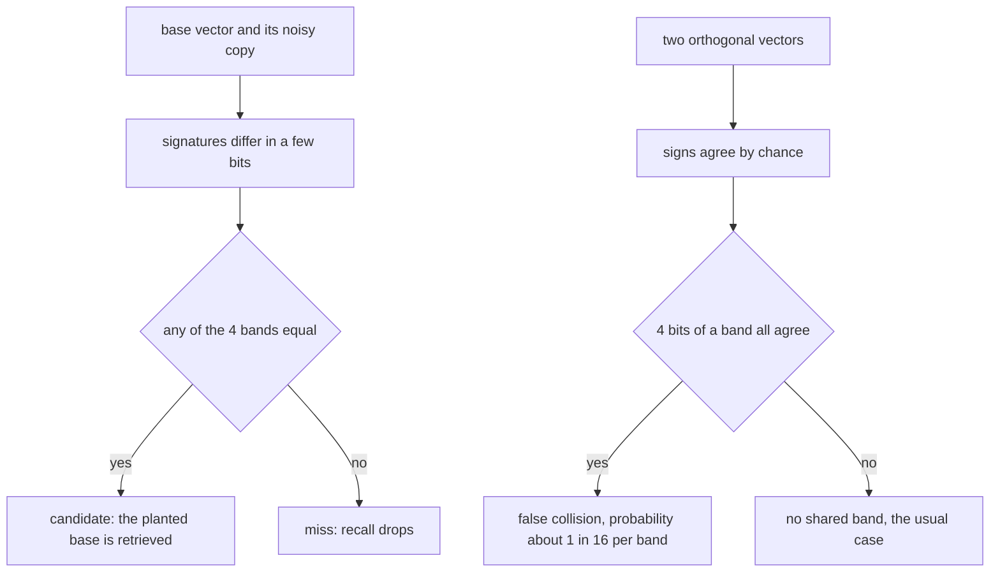
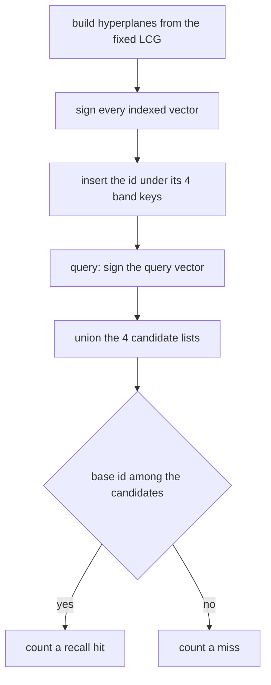
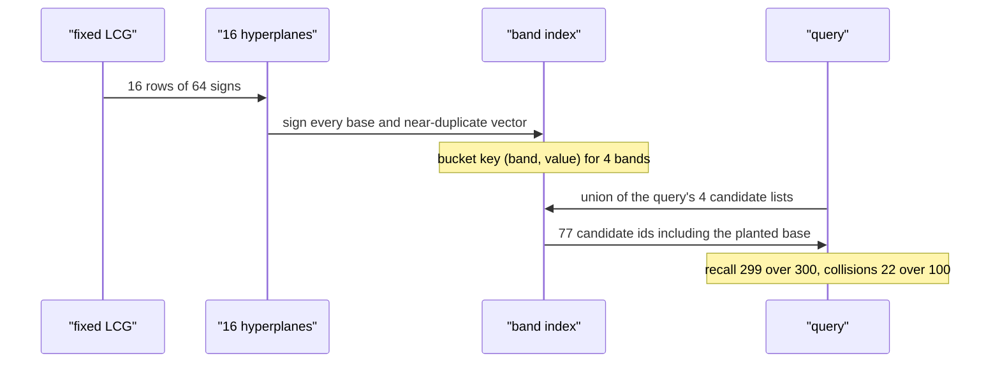

# 463 — Implement locality sensitive hashing (conceptual demo).

> **Tier:** Advanced · **CTCI chapter:** Beyond — Advanced Data Structures & Algorithms
> **Task spec:** [463-implement-locality-sensitive-hashing-conceptual-demo.md](../../../tasks/advanced/463-implement-locality-sensitive-hashing-conceptual-demo.md)
> **Solutions:** [Python](../../../solutions/python/advanced/463-implement-locality-sensitive-hashing-conceptual-demo/solution.py) ·
> [Java](../../../solutions/java/advanced/463-implement-locality-sensitive-hashing-conceptual-demo/Solution.java) ·
> [JavaScript](../../../solutions/javascript/advanced/463-implement-locality-sensitive-hashing-conceptual-demo/solution.js) ·
> [C#](../../../solutions/csharp/advanced/463-implement-locality-sensitive-hashing-conceptual-demo/Solution.cs)

## 1. Problem restatement

**Input:** 64-dimensional integer vectors and a fixed random projection family. The demo uses
`DIMS = 64`, `BITS = 16` random hyperplanes with components in `{-1, +1}`, grouped into
`BANDS = 4` bands of `BITS_PER_BAND = 4` bits, all generated from the documented LCG
`seed = (seed * 75 + 74) % 65537`.

**Output:** an index that maps each vector to `BANDS` bucket keys, and two quality statistics that
the demo asserts:

- **recall** of a planted near-duplicate over the fixed workload, threshold `RECALL_MIN = 0.9`;
- **collision rate** of orthogonal pairs, threshold `ORTHO_COLLISION_MAX = 0.5`.

The header states the construction: "SimHash-style random-hyperplane LSH over 64-dimensional
integer vectors with a FIXED LCG: 16 hyperplanes with components in `{-1,+1}`, grouped into 4 bands
of 4 bits (`sign(dot) >= 0` hashes to bit 1; exact-zero dot counts as positive, as documented).
Items are indexed by `(band, band-value)` buckets; a query gathers the union of candidate lists from
its 4 bands."

| Call | Result | Why |
| --- | --- | --- |
| `signature(vector, planes)` | a 16-bit integer | one bit per hyperplane sign |
| `band_keys(signature)` | 4 pairs `(band, value)` | 4 bits per band, value in `0..15` |
| planted near-duplicate query | recalled for `299 / 300` items | measured recall `0.997 >= 0.9` |
| one sampled orthogonal pair | shares no band | `22 / 100` pairs collide in total, `<= 0.5` |
| 300 base vectors indexed | `>= 1` candidate list per band key | every vector is retrievable |

## 2. Intuition

Two vectors that point in nearly the same direction should land in the same bucket; vectors that
point in unrelated directions should usually land apart. Random hyperplanes give exactly that. Draw
a plane with normal `a`; the sign of the dot product `a . x` says which side of the plane `x` lies
on. One bit of information per plane is enough, because the probability that two vectors disagree
on a random plane is proportional to the angle between them — the SimHash property.



A single signature comparing 16 bits would be brittle: one unlucky plane flips a bit and the keys
no longer match. **Banding** fixes that. The 16 bits are cut into 4 bands of 4, and each band is its
own bucket key, so two vectors are candidates if they agree on *any* band. That is the recall
mechanism, and it is also why unrelated vectors occasionally collide: 4 bits agreeing by chance has
probability `1/16` per band, so with 4 bands the expected collision rate under independent signs is
`1 - (15/16)^4`, about `0.229`.



The demo deliberately measures both sides of that trade-off: recall on planted near-duplicates, and
the collision rate on orthogonal pairs that should not match.

## 3. Algorithm

1. `make_hyperplanes(seed)` builds `BITS` rows of `DIMS` components: `+1` when the LCG value is even,
   `-1` when it is odd.
2. `signature(vector, planes)` computes the dot product with each hyperplane and sets bit `j` when
   the dot product is `>= 0` — exact-zero dots count as positive, as the header documents.
3. `band_keys(bits)` returns `[(b, (bits >> (4 * b)) & 0xF) for b in range(BANDS)]`: band `b` owns
   bits `4b .. 4b + 3` and its value is the 4-bit number.
4. `build_index(vectors, planes)` inserts each item id into `index[(band, value)]` for all four of
   its band keys.
5. `query_candidates(index, vector, planes)` computes the query's band keys and returns the union of
   the corresponding candidate lists as a set.
6. `main()` then measures:
   a. 300 base vectors with coordinates in `[-9, 9]` and a planted near-duplicate each (per
      coordinate noise in `[-2, 2]`); recall counts how often the base id appears among the
      candidates of its noisy copy, and asserts `recall >= RECALL_MIN`.
   b. 100 sampled pairs of disjoint-support basis vectors, asserting `dot == 0` for each pair,
      counting how often the two signatures share any band, and asserting the fraction stays below
      `ORTHO_COLLISION_MAX`.

```text
procedure signature(vector, planes)
    bits ← 0
    for j ← 0 to BITS - 1 do
        dot ← sum over k of planes[j][k] * vector[k]
        if dot >= 0 then
            bits ← bits with bit j set
        end
    end
    return bits
end

procedure band_keys(bits)
    keys ← empty
    for b ← 0 to BANDS - 1 do
        append (b, (bits shifted right by 4 * b) and 15) to keys
    end
    return keys
end

procedure query_candidates(index, vector, planes)
    found ← empty set
    for each key in band_keys(signature(vector, planes)) do
        add every item id stored under key in index to found
    end
    return found
end
```



## 4. Worked example

Two measurements, both from the fixed LCG workload.

**Planted near-duplicate.** Item 0 of the base set and the noisy copy planted for it:

| Vector | Signature | Band keys `(band, value)` | Bands in common |
| --- | --- | --- | --- |
| base[0] | `55549` | `(0, 13), (1, 15), (2, 8), (3, 13)` | — |
| near[0] | `22653` | `(0, 13), (1, 7), (2, 8), (3, 5)` | bands `0` and `2` |

The perturbation in `[-2, 2]` per coordinate moved some signs, so bands 1 and 3 differ — but bands 0
and 2 still match, which is exactly the resilience the banding buys. Querying with `near[0]` returns
a candidate union of 77 item ids (out of 300) and the base id 0 is among them.

| Statistic | Value | Threshold |
| --- | --- | --- |
| recall over the 300 planted duplicates | `299 / 300 = 0.997` | `>= RECALL_MIN = 0.9` |
| candidate union size for the sample query | `77` of `300` ids | no threshold, reported for context |

**Orthogonal pair.** Two basis vectors `e_i` and `e_j` with disjoint support have dot product 0 by
construction (the demo asserts `dot == 0` for all 100 sampled pairs). Their signatures agree on a
bit only when the two hyperplane components at positions `i` and `j` happen to have the same sign,
which is a coin flip per bit.

| Sample pair | Band keys of `e_i` | Band keys of `e_j` | Shared band |
| --- | --- | --- | --- |
| first sampled pair | `(0, 3), (1, 3), (2, 6), (3, 6)` | `(0, 12), (1, 15), (2, 3), (3, 14)` | none |

Over the 100 pairs the demo counts `22` collisions, i.e. `0.22`, below the asserted
`ORTHO_COLLISION_MAX = 0.5`. That number is no accident: a band of 4 independent coin flips agrees
entirely with probability `(1/2)^4 = 1/16`, so the chance that at least one of the 4 bands matches is
`1 - (15/16)^4 ≈ 0.229`, and the measured `0.22` sits right at that expectation.



## 5. Complexity

Let `d = DIMS = 64`, `b = BITS = 16`, `BANDS = 4` and `n` the number of indexed vectors.

| Measure | Bound | Why it holds |
| --- | --- | --- |
| Hyperplane generation | `O(b * d)` | `16 * 64` LCG draws |
| One signature | `O(b * d)` | 16 dot products of length 64 |
| Index build | `O(n * b * d)` | one signature plus 4 bucket insertions per item |
| One query | `O(b * d + c)` | signature plus collecting `c` candidates |
| Candidate union, sample query | `77` ids of `300` | reported by the demo run |
| Recall measurement | `O(n * (b * d + c))` | one query per planted duplicate |
| Space | `O(n * BANDS)` bucket entries | each id appears once per band |
| Orthogonal sampling | `O(pairs * b * d)` | 100 signatures |

The cost model is the same as any LSH scheme: hashing is linear in the dimension, and the query
cost depends on how many ids share the query's buckets. The two thresholds in the demo express the
quality side of that trade-off — recall must stay above `0.9` and the false-collision rate below
`0.5` on the fixed workload.

## 6. Pitfalls and edge cases

- **An exact-zero dot counts as positive.** The header calls this out; the rule `dot >= 0` makes the
  hash deterministic and reproducible across the four ports, where a strict `> 0` would flip the
  bit for zero projections.
- **Both the index and the query use the same hyperplanes.** Reusing a different plane set for
  queries would scramble every bucket key.
- **Bands must be disjoint and exhaustive.** `band_keys` walks `b = 0..3` with a 4-bit shift, so the
  16 bits are covered exactly once; overlapping bands would distort the collision probability.
- **The query returns a set, not a list.** Duplicate ids from several matching bands would otherwise
  be counted twice; `query_candidates` deduplicates with a set.
- **Recall of the *planted* base is what is measured**, not "some neighbour". The demo checks
  `item_id in candidates` for the noisy copy of that very item, which is the strict form of the
  locality property.
- **Orthogonal pairs are constructed, not searched for.** The pairs are basis vectors with disjoint
  support, and the demo asserts `dot == 0` for each one before using it.
- **Avoid duplicate pairs in the sample.** The generator retries until 100 distinct `(i, j)` pairs
  exist, so the collision fraction is over distinct cases.
- **Expect roughly `0.23` collisions, not zero.** Unrelated vectors collide in a band with
  probability `1 - (15/16)^4`; the threshold `0.5` leaves room for this but would catch a
  degenerate hash that collides almost always.
- **Recall is measured over a fixed LCG stream**, which is what makes `299 / 300` reproducible
  rather than a flaky statistical claim.
- **No real nearest-neighbour answer is produced here.** The demo measures the index's quality; the
  task that *uses* bucketing to answer queries and verify an `eps` guarantee is
  [460 — Small epsilon approximate nearest neighbour](../../../tasks/advanced/460-implement-small-epsilon-approximate-nearest-neighbor-in-high-dim.md).
- **Dimension and bit count are constants.** Changing `DIMS` or `BITS` without regenerating the
  hyperplanes would invalidate the measured statistics.

## 7. Variants and follow-ups

- **LSH used to answer real queries:** [460 — Small epsilon approximate nearest neighbour in high-dim](../../../tasks/advanced/460-implement-small-epsilon-approximate-nearest-neighbor-in-high-dim.md)
  adds a candidate scan, an `eps` guarantee and a brute-force fallback on top of this hashing idea.
- **Exact pruning instead of hashing:** [461 — KD-tree nearest neighbour with pruning heuristics](../../../tasks/advanced/461-implement-kd-tree-nearest-neighbor-with-pruning-heuristics.md)
  and [462 — Vantage-point tree for metric spaces](../../../tasks/advanced/462-implement-vantage-point-tree-vp-tree-for-metric-spaces.md)
  trade the probabilistic guarantee for an exact answer.
- **More bands, fewer bits?** The band partition is the main quality knob: more bands raise recall
  and the false-collision rate together, fewer bands do the opposite.
- **Other families:** `p`-stable projections for `L2`, MinHash for sets and Jaccard similarity, and
  random bit sampling for Hamming space — all follow the same "hash, band, union" pattern.
- **Amplification:** sketching several independent signatures per item and intersecting the
  candidate sets is the usual way to push precision up without losing recall.

## 8. Check yourself

**Q1.** Why is a 16-bit signature split into 4 bands instead of being used as one bucket key?

<details><summary>Show answer</summary>

Because a single flipped bit would break the whole key and the near-duplicate would be missed.
Banding lets two vectors be candidates when *any* band matches, so up to three bands can disagree
while the pair is still retrieved — the sample pair of section 4 matches on 2 of 4 bands and is
still found.

</details>

**Q2.** Where does the measured orthogonal collision rate of about `0.22` come from?

<details><summary>Show answer</summary>

Each band has 4 bits, and two orthogonal vectors agree on a bit with probability `1/2` under
random signs, so a whole band agrees with probability `(1/2)^4 = 1/16`. With 4 independent bands,
the chance that at least one matches is `1 - (15/16)^4 ≈ 0.229`, which is what the measured `22/100`
reflects.

</details>

**Q3.** Why does `dot >= 0` decide the bit, rather than `dot > 0`?

<details><summary>Show answer</summary>

Because a zero dot product happens (for example with a component-wise orthogonal vector), and the
tie must be resolved deterministically. The documented choice maps zero to the positive side, which
keeps the hash identical in every language port.

</details>

**Q4.** The demo never computes a nearest neighbour. What exactly is it validating?

<details><summary>Show answer</summary>

The two statistical properties that make the index useful: planted near-duplicates must be
retrievable (recall `>= 0.9`, measured `0.997`), and unrelated orthogonal pairs must mostly *not*
share a bucket (collisions `<= 0.5`, measured `0.22`). Together they show the hash is sensitive to
locality without collapsing everything into one bucket.

</details>

**Q5.** Why can the candidate union be as large as 77 ids out of 300 for one query?

<details><summary>Show answer</summary>

Because each of the 4 bands contributes every id that agrees there, and with 16 bits a band of 4
bits is still a coarse key: about `n / 16` ids share a band by chance, and the union over 4 bands
collects several such groups. That is the price of the recall — a tighter key would produce fewer
candidates and more misses.

</details>
