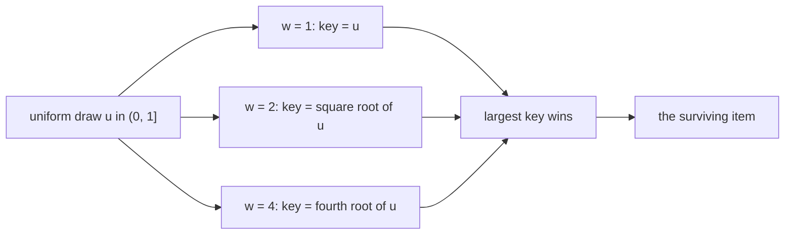
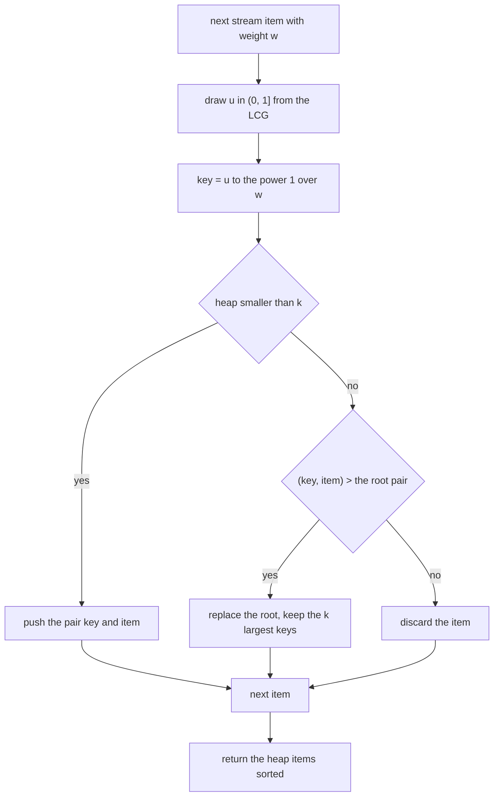
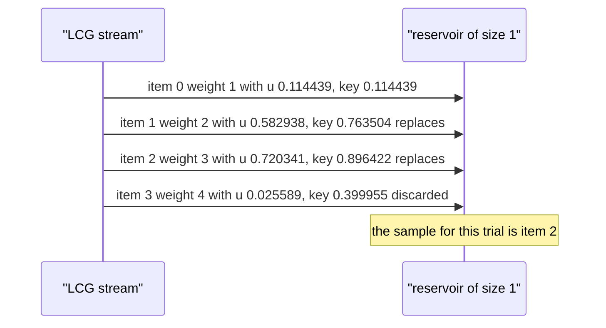

# 464 — Implement reservoir sampling with weighted probabilities.

> **Tier:** Advanced · **CTCI chapter:** Beyond — Advanced Data Structures & Algorithms
> **Task spec:** [464-implement-reservoir-sampling-with-weighted-probabilities.md](../../../tasks/advanced/464-implement-reservoir-sampling-with-weighted-probabilities.md)
> **Solutions:** [Python](../../../solutions/python/advanced/464-implement-reservoir-sampling-with-weighted-probabilities/solution.py) ·
> [Java](../../../solutions/java/advanced/464-implement-reservoir-sampling-with-weighted-probabilities/Solution.java) ·
> [JavaScript](../../../solutions/javascript/advanced/464-implement-reservoir-sampling-with-weighted-probabilities/solution.js) ·
> [C#](../../../solutions/csharp/advanced/464-implement-reservoir-sampling-with-weighted-probabilities/Solution.cs)

## 1. Problem restatement

**Input:** a stream of items, each with a positive weight, and a reservoir size `k`. The demo uses
weights `[1, 2, 3, 4]` with `k = 1` (20000 trials), weights `[1, 1, 1]` with `k = 1` (20000 trials),
and weights `1..10` with `k = 3` (3000 trials).

**Output:** a uniform-at-random-with-probability-proportional-to-weight sample of `k` **distinct**
items, produced by a single pass. The header names the algorithm and its guarantee: "weighted
reservoir sampling, A-Res (Efraimidis & Spirakis): each item is assigned the key `u^(1/w)` with `u`
uniform in `(0, 1]` drawn from a FIXED LCG as `u = (seed + 1) / 65537`, and the reservoir keeps the
`k` largest keys (a min-heap of `(key, item)`; an equal key is displaced only by a smaller item
index, as documented). For `k = 1` an item with weight `w_i` is selected with probability exactly
`w_i / W`."

| Check | Threshold | Measured on the fixed workload |
| --- | --- | --- |
| frequencies vs `w_i / W` for `[1,2,3,4]` | within `TOL = 0.02` | max deviation `0.0022` |
| extra margin | `max_dev <= 0.01` | `0.0022` |
| exactly one item per `k = 1` trial | `len(picked) == 1` | always |
| counts sum to the trial count | `sum(counts) == trials` | `20000` |
| heavier beats lighter | `counts[3] > counts[0]` | `8012 > 1956` |
| equal weights `[1,1,1]` | within `TOL` of `1/3` | `0.3354, 0.3311, 0.3336` |
| `k = 3` gives distinct items | `len(set(picked)) == 3` | always |
| `k = 3` count bookkeeping | `sum(kCounts) == 3000 * 3` | `9000` |

## 2. Intuition

Equal-weight reservoir sampling assigns every item an independent uniform key and keeps the `k`
largest — every item is equally likely to survive. Weighted sampling needs a different key
distribution: heavier items should be able to produce larger keys, but every item must keep some
chance of winning.

The A-Res construction does this in one line: give item `i` the key

```text
key_i = u_i ^ (1 / w_i),   u_i uniform in (0, 1]
```

The exponent `1 / w_i` bends the uniform draw towards 1 as the weight grows. A heavy item with
`w = 4` maps almost any draw into a large key, while a light item with `w = 1` keeps the raw
uniform value. Keeping the `k` largest keys then yields a sample where the probability of a set is
proportional to its weights; for `k = 1` the probability that item `i` wins is exactly `w_i / W`.



```text
u = 0.10 -> keys 0.100 (w=1), 0.316 (w=2), 0.562 (w=4)
u = 0.90 -> keys 0.900 (w=1), 0.949 (w=2), 0.974 (w=4)
```

The spread between the `w = 1` and `w = 4` keys widens as `u` shrinks, which is exactly why a light
item can still win (when its draw is close to 1 and the heavy item's is close to 0) while heavy
items win most of the time.

The reservoir itself is a **min-heap of `(key, item)` of size `k`**, so the smallest surviving key
is always at the root. A new item is admitted when its key beats that root, which costs `O(log k)`
instead of the `O(n)` scan a naive "keep the top `k`" would need. Ties are handled explicitly: an
equal key displaces the incumbent only when the new item has a **smaller index**, so the result is
deterministic for the fixed LCG stream.

## 3. Algorithm

1. `WeightedReservoir(size)` holds a min-heap of `(key, item)` pairs of capacity `size`.
2. `add(item, weight, u)` computes `key = u ** (1.0 / weight)` and then:
   - pushes `(key, item)` while the heap is not full;
   - otherwise, if `(key, item) > heap[0]` — i.e. the key is larger, or the keys are equal and the
     item index is smaller — replaces the root with `heapreplace`.
3. `sample()` returns the item ids of the heap sorted ascending, so the output is a canonical
   ordering rather than a heap order.
4. `draw_u(seed)` advances the LCG (`seed = (seed * 75 + 74) % 65537`) and returns
   `u = (seed + 1) / 65537.0` together with the new seed; `u` therefore lies in
   `(0, 1]` and is never exactly 0.
5. `sample_once(items, weights, size, seed)` feeds the whole stream through one reservoir and
   returns `(sample, new_seed)`, which is what keeps the trials deterministic across languages.
6. `main()` runs the three experiments and asserts the frequency, distinctness, bookkeeping and
   monotonicity properties listed in section 1.

```text
procedure add(reservoir, item, weight, u)
    key ← u raised to the power 1 / weight
    if size of reservoir.heap < reservoir.size then
        push (key, item) onto reservoir.heap
    else if (key, item) > reservoir.heap[root] then
        replace the root of reservoir.heap with (key, item)
        restore the heap order
    end
end

procedure sample_once(items, weights, size, seed)
    reservoir ← new reservoir of capacity size
    for i ← 0 to length(items) - 1 do
        seed ← (seed * 75 + 74) mod 65537
        u ← (seed + 1) / 65537
        add(reservoir, items[i], weights[i], u)
    end
    return (items of reservoir sorted ascending, seed)
end
```



## 4. Worked example

A single trial with `k = 1`, weights `[1, 2, 3, 4]` and starting `seed = 99` makes the mechanics
visible. Each row is one `add` call; the heap always holds at most one entry.

| Item | Weight | Draw `u` | Key `u^(1/w)` | Heap after | Decision |
| --- | --- | --- | --- | --- | --- |
| 0 | 1 | `0.114439` | `0.114439` | `(0.114439, 0)` | pushed, heap not full |
| 1 | 2 | `0.582938` | `0.763504` | `(0.763504, 1)` | key larger than the root, replaced |
| 2 | 3 | `0.720341` | `0.896422` | `(0.896422, 2)` | key larger again, replaced |
| 3 | 4 | `0.025589` | `0.399955` | `(0.896422, 2)` | key smaller than the root, discarded |

The sample for this trial is `[2]`. Item 3 has the largest weight but drew a very small `u`, and
`0.025589^(1/4) = 0.399955` still loses to item 2's `0.720341^(1/3) = 0.896422` — a concrete
illustration that weight biases the odds without guaranteeing a win.

Over 20000 trials with `seed = 99` the empirical frequencies line up with the weight ratios:

| Item | Weight | Expected `w / W` | Observed | Count |
| --- | --- | --- | --- | --- |
| 0 | 1 | `0.1` | `0.0978` | `1956` |
| 1 | 2 | `0.2` | `0.2010` | `4020` |
| 2 | 3 | `0.3` | `0.3006` | `6012` |
| 3 | 4 | `0.4` | `0.4006` | `8012` |

The maximum deviation is `0.0022`, comfortably inside `TOL = 0.02` and inside the extra
`max_dev <= 0.01` assertion the solution adds. Equal weights `[1, 1, 1]` with `seed = 12345` produce
`6708, 6621, 6671` selections — frequencies `0.3354, 0.3311, 0.3336`, all within `TOL` of `1/3`.

The `k = 3` experiment with weights `1..10` over 3000 trials shows both the bookkeeping and the
monotonicity:

| Item | 0 | 1 | 2 | 3 | 4 | 5 | 6 | 7 | 8 | 9 |
| --- | --- | --- | --- | --- | --- | --- | --- | --- | --- | --- |
| Weight | 1 | 2 | 3 | 4 | 5 | 6 | 7 | 8 | 9 | 10 |
| Selections | 207 | 347 | 572 | 693 | 891 | 963 | 1147 | 1237 | 1388 | 1555 |

Every trial returns exactly 3 **distinct** items, the counts sum to `3000 * 3 = 9000`, and the
heaviest item is selected far more often than the lightest (`1555` against `207`) — the documented
monotonicity sanity check.



## 5. Complexity

Let `n` be the stream length and `k` the reservoir size.

| Measure | Bound | Why it holds |
| --- | --- | --- |
| One `add` | `O(log k)` | one heap push or a root replacement |
| One full pass | `O(n log k)` | one `add` per stream item, single pass, no buffering |
| Space | `O(k)` | only the reservoir is retained; the stream is consumed |
| Key computation | `O(1)` | one floating-point power per item |
| Trial bookkeeping | `O(n)` | the seed is threaded through the stream to stay deterministic |
| Frequency check | `O(trials * n log k)` | 20000 trials over 4 items, 3000 trials over 10 |
| Alternative: return top `k` by key | `O(n log n)` | keeping all keys and sorting, which the heap avoids |
| Alternative: sequential `k`-pass rejection sampling | `O(n * k)` worst case | each of the `k` picks scans the stream |

The heap is the reason the reservoir works on a stream of unknown length: memory stays `O(k)`
regardless of `n`, and each item is examined exactly once. The statistical properties are not
approximated either — for `k = 1` the construction selects item `i` with probability exactly
`w_i / W`, which is what the measured frequencies confirm.

## 6. Pitfalls and edge cases

- **`u` must be in `(0, 1]`, never 0.** `u = (seed + 1) / 65537` maps the LCG range `0..65536` to
  `1/65537 .. 1`, so `u^(1/w)` is always defined and positive; a draw of exactly 0 would give a key
  of 0 for every weight.
- **Ties need a rule.** When two keys are equal the comparison `(key, item) > heap[0]` uses the item
  index as a secondary key, so a smaller index displaces the incumbent and the outcome stays
  deterministic.
- **Distinctness comes for free, and is still asserted.** Each item enters the reservoir at most
  once, so a `k`-sample has `k` distinct ids; the `k = 3` block asserts `len(set(picked)) == 3` for
  every trial.
- **`k = 1` is the case with the exact guarantee.** The `w_i / W` probability holds for `k = 1`;
  for `k > 1` the set-level guarantee is proportional-to-weight sampling without replacement, which
  is why the larger experiment checks monotonicity and bookkeeping instead of exact ratios.
- **The heap keeps the `k` *largest* keys but is a *min*-heap.** The root is the weakest survivor,
  which is exactly the entry a new item must beat — a max-heap would force scanning for the minimum.
- **`sample()` sorts the ids.** Heap order is not sorted order; sorting makes the returned sample
  canonical and comparable across languages.
- **The seed is part of the result.** `sample_once` returns the advanced seed so the next trial
  continues the same LCG stream; restarting from a fixed seed per trial would create correlated
  trials.
- **Weights must be positive.** A zero or negative weight would make `1 / w` undefined or flip the
  key ordering; all demo weights are `>= 1`.
- **Floating-point keys are adequate here, not exact.** The A-Res key is a real number; the
  determinism of the demo comes from the fixed integer LCG feeding the same doubles in every port.
- **Tolerance is a property, not a fingerprint.** `TOL = 0.02` encodes "frequencies track the
  ratios"; the additional `max_dev <= 0.01` assertion documents how much slack the fixed stream
  actually leaves (measured `0.0022`).
- **The bookkeeping assertions catch double counting.** `sum(counts) == trials` for `k = 1` and
  `sum(kCounts) == trials * k` for `k = 3` would fail if an item were recorded twice or skipped.

## 7. Variants and follow-ups

- **Classic unweighted reservoir:** [165 — Reservoir sampling for k items from stream](../../../tasks/beginner/165-reservoir-sampling-for-k-items-from-stream.md)
  is the special case where every weight is 1 and the key is just `u`.
- **Stratified sampling:** [521 — Reservoir-sampling-based stratified sampling](../../../tasks/advanced/521-implement-reservoir-sampling-based-stratified-sampling.md)
  runs one reservoir per stratum so each group is represented in proportion.
- **Distributed sampling:** [780 — Distributed sampling reservoir with merge](../../../tasks/expert/780-implement-distributed-sampling-reservoir-with-merge-operation.md)
  merges several reservoirs by key, which works precisely because the key ordering is the whole
  state of the sample.
- **Different weight semantics:** A-ExpJ replaces the per-item power with a skip-based exponential
  jump, which avoids touching every item; the acceptance probability per set is the same.
- **Approximation by sampling:** [646 — Approximate query processing via sampling reservoir](../../../tasks/expert/646-implement-approximate-query-processing-via-sampling-reservoir.md)
  uses a reservoir to answer aggregate queries over a stream that cannot be stored.

## 8. Check yourself

**Q1.** Why does the key `u^(1/w)` bias selection towards heavy items?

<details><summary>Show answer</summary>

Because the exponent `1 / w` shrinks as `w` grows, pushing any draw `u < 1` closer to 1: a large
weight turns nearly every draw into a large key. A light item keeps a key close to its raw uniform
value, so it only wins when its draw is high and the heavy items' draws are low.

</details>

**Q2.** In the single-trial trace, item 3 has weight 4 yet is discarded. Does that contradict the
guarantee?

<details><summary>Show answer</summary>

No. The guarantee is probabilistic for `k = 1`: item `i` is selected with probability `w_i / W`, so
the heaviest item wins about `0.4` of the time, not always. Here its draw `0.025589` produced the key
`0.399955`, smaller than item 2's `0.896422`, so it lost — the mechanism working as designed.

</details>

**Q3.** Why is the reservoir a min-heap rather than a max-heap?

<details><summary>Show answer</summary>

Because the reservoir keeps the `k` *largest* keys among `n` candidates, so the entry most at risk of
being evicted is the *smallest* surviving key. A min-heap puts that entry at the root, making the
insert-or-discard decision an `O(1)` comparison plus an `O(log k)` replacement.

</details>

**Q4.** What would break if `u` could be exactly 0?

<details><summary>Show answer</summary>

`key = 0^(1/w) = 0` for every weight, so a zero draw would produce the minimum possible key and the
item would be dropped regardless of its weight. The formula `(seed + 1) / 65537` avoids this by
construction, mapping the LCG range to `[1/65537, 1]`.

</details>

**Q5.** The `k = 3` experiment asserts monotonicity instead of exact `w_i / W` ratios. Why?

<details><summary>Show answer</summary>

Because the exact `w_i / W` probability is the `k = 1` guarantee. For `k > 1` the algorithm samples
a *set* of `k` distinct items with probability proportional to the product of its weights, so
individual inclusion probabilities no longer need to equal `w_i / W`. The test therefore checks what
still must hold — three distinct items per trial, total counts of `3000 * 3`, and heavier items being
selected more often (`1555` against `207`).

</details>
