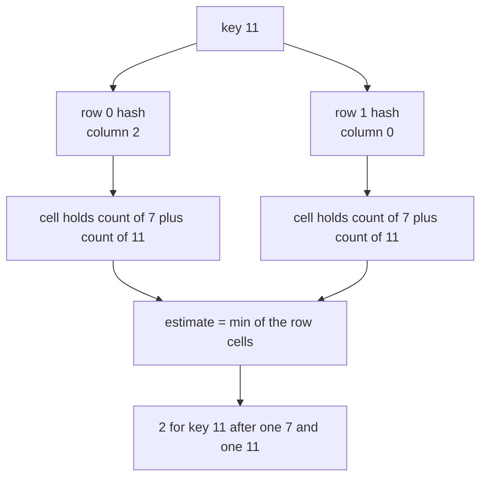
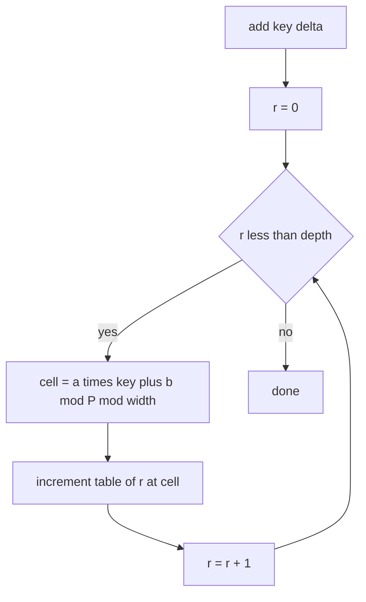
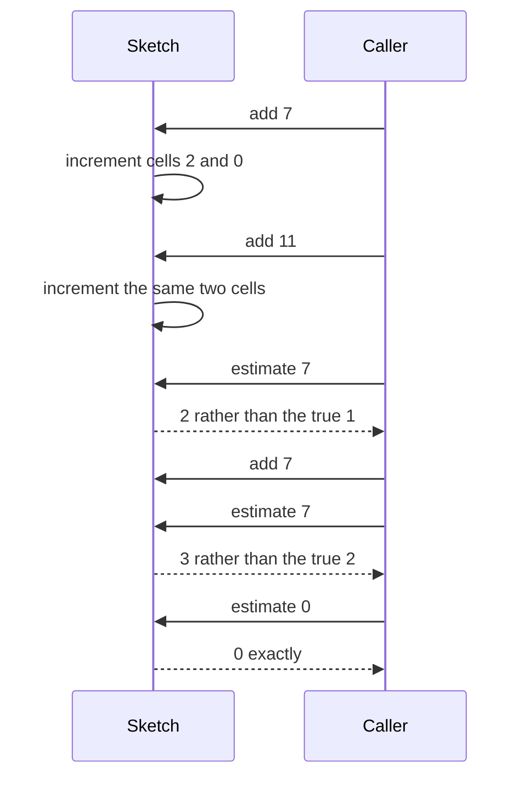

# 465 — Implement count-min sketch for frequency estimation.

> **Tier:** Advanced · **CTCI chapter:** Beyond — Advanced Data Structures & Algorithms
> **Task spec:** [465-implement-count-min-sketch-for-frequency-estimation.md](../../../tasks/advanced/465-implement-count-min-sketch-for-frequency-estimation.md)
> **Solutions:** [Python](../../../solutions/python/advanced/465-implement-count-min-sketch-for-frequency-estimation/solution.py) ·
> [Java](../../../solutions/java/advanced/465-implement-count-min-sketch-for-frequency-estimation/Solution.java) ·
> [JavaScript](../../../solutions/javascript/advanced/465-implement-count-min-sketch-for-frequency-estimation/solution.js) ·
> [C#](../../../solutions/csharp/advanced/465-implement-count-min-sketch-for-frequency-estimation/Solution.cs)

## 1. Problem restatement

**Input:** a stream of `N` integer updates. `add(key)` records one occurrence of `key`, and
`estimate(key)` answers "roughly how many times did `key` appear?" No key is ever removed.

**Output:** an upper bound on the true count. The sketch is built from `depth` rows of `width`
counters, each row hashed independently, and the answer is the **minimum** of the `depth` cells.
The four solution files pin the contract down with these assertions:

| Call | Result | Why |
| --- | --- | --- |
| `columns(7)` on a width-4, depth-2 sketch | `[2, 0]` | `(31·7+17) mod 1000003 mod 4 = 2`, `(131·7+91) mod 1000003 mod 4 = 0` |
| `columns(11)` | `[2, 0]` | `358 mod 4 = 2` and `1532 mod 4 = 0` — the same two cells as key 7 |
| `columns(0)` | `[1, 3]` | `17 mod 4 = 1` and `91 mod 4 = 3` |
| `estimate(7)` after `add(7)` | `1` | one insertion, one collision-free row |
| `estimate(11)` after `add(11)` | `2` | key 11 collides with key 7 in **both** rows |
| `estimate(7)` after `add(7), add(11), add(7)` | `3` | true count is 2, so the estimate overshoots by 1 |
| `estimate(0)` on that sketch | `0` | cells `[1, 3]` were never touched |

The production configuration in the same files is `width = 48`, `depth = 4`, with the fixed
seeds `HASH_A = [31, 131, 2711, 65521]`, `HASH_B = [17, 91, 601, 4099]` and `P = 1000003`.
Column `r` of a key is

```text
column(r, key) = ((HASH_A[r] * key + HASH_B[r]) mod P) mod width
```

Driving a fixed LCG stream of `N = 5000` updates over the keys `0..63` gives the documented
numbers: every one of the 64 ids appears, `sum(true counts) = 5000`, every estimate is `>=` the
true count, and every overshoot stays under `EPS * N = 0.06 * 5000 = 300`. The measured maximum
overshoot on that stream is `101`, and `23` of the 64 ids do over-estimate.

## 2. Intuition

The naive answer is an exact frequency table: one counter per distinct key. That is O(1)
expected time per update but it needs memory proportional to the number of *distinct* keys, which
is exactly the quantity a data-heavy pipeline cannot afford.

Cheaper and still useful: keep a **fixed** array of `width` counters and map every key into it
with one hash function. Memory is now O(width), but any two keys that land in the same cell
share a counter, so a hot key inflates every cold key that collides with it. Give the cold key a
second opinion: use `depth` independent hash functions, keep `depth` rows, and take the minimum.
A collision in one row is invisible to the answer as long as *one* row keeps that key's cell
clean.

The second half of the insight is the direction of the error. Counters only ever increase, so a
cell can hold the true count plus other keys' mass — never less. Every row is therefore an
**upper bound**, and the minimum of several upper bounds is the tightest upper bound available.
That is why the code can assert `estimate >= true count` unconditionally: there is no case where
the sketch under-reports, only cases where it over-reports.



Notice what the picture makes obvious: because keys 7 and 11 collide in *both* rows of the toy
sketch, the minimum cannot separate them — 11 reports 2. One extra row would very likely have
kept them apart, and that is the whole tuning dial.

## 3. Algorithm

1. Allocate `depth` rows of `width` zeroed counters.
2. Precompute the `depth` hash seeds (`HASH_A[r]`, `HASH_B[r]`); they are constants, identical in
   every language port.
3. `columns(key)` evaluates `((HASH_A[r] * key + HASH_B[r]) mod P) mod width` for each row `r`.
4. `add(key, delta)` adds `delta` (default 1) to the cell addressed in every row.
5. `estimate(key)` reads the same `depth` cells and returns their minimum.

```text
procedure add(sketch, key, delta)
    for r ← 0 to sketch.depth - 1 do
        c ← ((HASH_A[r] * key + HASH_B[r]) mod P) mod sketch.width
        sketch.table[r][c] ← sketch.table[r][c] + delta
    end
end

procedure estimate(sketch, key)
    best ← infinity
    for r ← 0 to sketch.depth - 1 do
        c ← ((HASH_A[r] * key + HASH_B[r]) mod P) mod sketch.width
        if sketch.table[r][c] < best then
            best ← sketch.table[r][c]
        end
    end
    return best
end
```

`add` and `estimate` compute exactly the same `depth` column indices, so they always agree on
where a key lives; the only difference is the write versus the read. Both touch `depth` cells,
which is constant work for the fixed `depth = 4`.



`estimate` is the same loop with `min` instead of `+`, which is why the two procedures can share
the `columns` helper.

## 4. Worked example

Start from a `2 x 4` zeroed sketch and replay the assertions of the tiny test. The columns are
`columns(7) = [2, 0]`, `columns(11) = [2, 0]`, `columns(0) = [1, 3]`.

| Step | Action | `table[0]` | `table[1]` | Reading |
| --- | --- | --- | --- | --- |
| start | — | `[0,0,0,0]` | `[0,0,0,0]` | all cells empty |
| 1 | `add(7)` | `[0,0,1,0]` | `[1,0,0,0]` | `estimate(7) = min(1,1) = 1` |
| 2 | `add(11)` | `[0,0,2,0]` | `[2,0,0,0]` | `estimate(11) = 2`, and `estimate(7) = 2` |
| 3 | `add(7)` | `[0,0,3,0]` | `[3,0,0,0]` | `estimate(7) = 3` while the true count is 2 |
| 4 | `estimate(0)` | unchanged | unchanged | `columns(0) = [1, 3]`, both cells 0, true count 0 |

Step 4 is the sanity check that the sketch does not invent mass: key `0` was never added and its
two chosen cells were never touched, so the answer is exactly `0`. Step 2 is the failure mode:
key `11` is genuinely present once, yet the sketch says `2`, because the collision partner `7`
contributed mass to both of its cells.

The sequence of messages between the caller and the table is short and symmetrical:



The same code at the documented scale is the second half of the test: `N = 5000` LCG draws
(`seed ← (seed * 75 + 74) mod 65537`) with `item = seed mod 64`. All 64 keys appear during those
5000 updates, so every `estimate(item)` has a non-zero true count to compare against. The
assertions are `estimate >= true_count` for all 64 ids and `overshoot <= 0.06 * 5000`; the
observed maximum overshoot is `101`, roughly one third of the 300 allowance, and 23 ids are
over-estimated, which the file documents as proof that collisions really occur rather than being
merely theoretical.

## 5. Complexity

Let `d` be the depth, `w` the width, and `N` the number of updates.

| Measure | Bound | Why it holds |
| --- | --- | --- |
| Time, `add` | O(d) | one modular multiply-add and one increment per row; O(1) for the fixed `d = 4` |
| Time, `estimate` | O(d) | the same four cells are read and reduced by `min` |
| Time, construction | O(d · w) | `d * w = 4 * 48 = 192` counters zeroed |
| Space | O(d · w) | 192 counters plus `2d` fixed seeds, independent of `N` and of the number of distinct keys |
| Update throughput | O(N · d) | the 5000-update workload performs `5000 * 4 = 20000` increments |
| Exact frequency table | O(distinct) space | the approach the sketch replaces; exact but unbounded |
| Error bound | `EPS · N` with documented `EPS = 0.06` | classical `e / w ≈ 2.71828 / 48 ≈ 0.0566`, so 0.06 is the honest rounded-up constant for `w = 48` |

Two constants matter and neither is invented here: `w = 48` and `d = 4` are the values the four
ports construct, and `EPS = 0.06` is the constant the assertions use. The measured overshoot of
101 and the 23 over-estimated ids are recorded in the solution docstrings, so they can be quoted
as measurements of this fixed stream — not as a general guarantee. The general statement the
algorithm supports is one-sided: never below the truth, at most `EPS · N` above it.

## 6. Pitfalls and edge cases

- **Never under-estimates.** Because `min` is taken over counters that only increase, the answer
  can only be too high. Do not "fix" the sketch by also tracking a minimum that can decrease.
- **Deletion is not supported.** `add` takes a positive `delta` in every port; there is no
  decrement path, because a negative update would break the one-sided guarantee that makes the
  `estimate >= true_count` assertion valid.
- **Over-estimation is the normal case, not a bug.** On the fixed 5000-update stream 23 of the 64
  ids are over-estimated. Callers that need exact counts must use a hash map, not this sketch.
- **The seeds are part of the contract.** `HASH_A`, `HASH_B` and `P = 1000003` are identical in
  the Python, Java, JavaScript and C# files; changing one of them in one port would break the
  `columns(7) == [2, 0]` style assertions and make the ports disagree.
- **Order of the two moduli.** The documented formula reduces modulo `P` first and modulo `width`
  second. Reducing modulo `width` immediately would drop the mixing step that makes the rows
  behave like independent hash functions.
- **Key type.** The hash multiplies the key by a constant, so the sketch assumes small
  non-negative integers. Strings or tuples need a pre-hash to an integer, and a negative key
  would produce a negative column index in languages without Python-style modulo.
- **Empty sketch.** `estimate` on a key that was never added returns `0` (the asserted case), not
  an error, because the cells are simply zero.
- **Depth versus width.** Raising `d` lowers the chance that *every* row is dirty; raising `w`
  lowers the mass that a single row can accumulate. Both cost memory linearly.

## 7. Variants and follow-ups

- **Count distinct instead of count occurrences.** [466-hyperloglog-sketch-for-cardinality-estimation-outline.md](../../../tasks/advanced/466-implement-hyperloglog-sketch-for-cardinality-estimation-outline.md)
  uses the same "many small registers, one hash" shape but replaces counters with leading-zero
  ranks.
- **A membership-only structure.** [254-implement-bloom-filter-insert-check-probabilistic.md](../../../tasks/intermediate/254-implement-bloom-filter-insert-check-probabilistic.md)
  and [467-implement-bloom-filter-with-double-hashing-and-test-false-positi.md](../../../tasks/advanced/467-implement-bloom-filter-with-double-hashing-and-test-false-positi.md)
  answer yes/no rather than how-many, and therefore need one bit per slot instead of a counter.
- **Sampling as the other approximate primitive.**
  [464-implement-reservoir-sampling-with-weighted-probabilities.md](../../../tasks/advanced/464-implement-reservoir-sampling-with-weighted-probabilities.md)
  keeps a bounded random sample instead of a bounded counter table.
- **A different sketch in the same family.** [463-implement-locality-sensitive-hashing-conceptual-demo.md](../../../tasks/advanced/463-implement-locality-sensitive-hashing-conceptual-demo.md)
  buys approximate similarity, not frequency, from hashed projections.
- **Exact counting when memory is not the constraint.** [089-implement-simple-frequency-histogram-integers.md](../../../tasks/beginner/089-implement-simple-frequency-histogram-integers.md)
  builds the full histogram, and [847-implement-heavy-hitter-detection-with-distributed-sketches-merge.md](../../../tasks/master/847-implement-heavy-hitter-detection-with-distributed-sketches-merge.md)
  puts the sketch behind a merge operation, which this task deliberately does not implement.
- The chapter walkthrough [Advanced topics](../../ctci/x-advanced-topics.md) places sketches next
  to their exact counterparts.

## 8. Check yourself

1. Why can `estimate` never be lower than the true count?

<details><summary>Show answer</summary>

Every `add` increments cells, and nothing ever decrements them. Each row's cell therefore holds
at least the key's own contribution plus any collision mass, so each of the `depth` reads is an
upper bound and the minimum of upper bounds is still an upper bound. The assertion
`estimate >= true_count` on all 64 ids of the 5000-update stream is exactly this argument made
executable.

</details>

2. In the tiny sketch, why does `estimate(11)` return 2 after a single `add(11)`?

<details><summary>Show answer</summary>

Because keys 7 and 11 hash to the same column in both rows: `columns(7) = [2, 0]` and
`columns(11) = [2, 0]`. Both cells already held the mass of key 7, so the minimum of the two
cells is `1 + 1 = 2`. The sketch cannot separate keys that collide in every row; only adding more
rows or more width can.

</details>

3. How much memory does the production sketch use, and does it depend on the number of distinct
   keys in the stream?

<details><summary>Show answer</summary>

`depth * width = 4 * 48 = 192` counters, plus the fixed seeds. It does not depend on the stream
at all: the same 192 cells serve 5000 updates over 64 ids or a billion updates over millions of
ids. That is the entire point of the trade against an exact table's O(distinct) space.

</details>

4. The sketch over-estimated 23 of 64 keys on the documented stream. Is that a bug?

<details><summary>Show answer</summary>

No. Collisions are expected in a 48-cell row, and the docstring records that 23 ids are
over-estimated to make the point that the sketch is approximate. The invariant that must hold —
and that is asserted — is one-sided: estimates never fall below the true counts and never exceed
them by more than `EPS * N = 300`. The measured worst case, 101, sits comfortably inside it.

</details>

5. Why does the code reduce modulo `P = 1000003` before reducing modulo `width`?

<details><summary>Show answer</summary>

The first reduction spreads the product `a * key + b` across a large prime field so that
different keys behave independently inside each row; the second reduction then folds that wide
value into the `width = 48` cells. Reducing modulo 48 first would leave the row-to-row behaviour
correlated and destroy the "independent rows" property that the minimum relies on.

</details>
