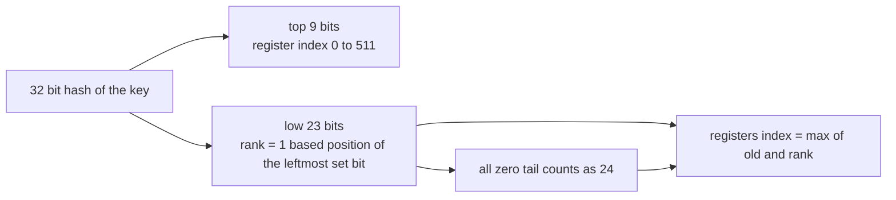
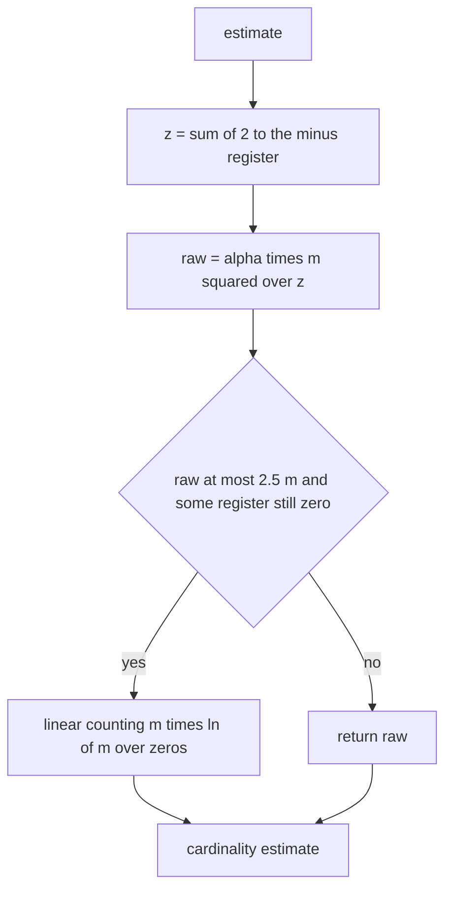
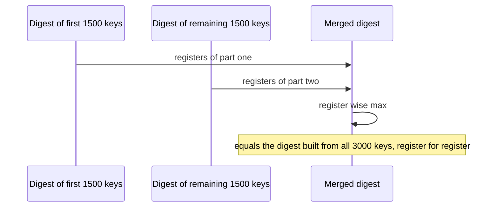

# 466 — Implement hyperloglog sketch for cardinality estimation (outline).

> **Tier:** Advanced · **CTCI chapter:** Beyond — Advanced Data Structures & Algorithms
> **Task spec:** [466-implement-hyperloglog-sketch-for-cardinality-estimation-outline.md](../../../tasks/advanced/466-implement-hyperloglog-sketch-for-cardinality-estimation-outline.md)
> **Solutions:** [Python](../../../solutions/python/advanced/466-implement-hyperloglog-sketch-for-cardinality-estimation-outline/solution.py) ·
> [Java](../../../solutions/java/advanced/466-implement-hyperloglog-sketch-for-cardinality-estimation-outline/Solution.java) ·
> [JavaScript](../../../solutions/javascript/advanced/466-implement-hyperloglog-sketch-for-cardinality-estimation-outline/solution.js) ·
> [C#](../../../solutions/csharp/advanced/466-implement-hyperloglog-sketch-for-cardinality-estimation-outline/Solution.cs)

## 1. Problem restatement

**Input:** a stream of distinct integer keys, one `add(key)` at a time. Nothing is ever removed.

**Output:** an estimate of how many *distinct* keys were seen ("cardinality"), stored in a fixed
512-register sketch instead of a set of all keys.

This is an **outline** task: the docstrings document exactly which parts of the classic
HyperLogLog paper are implemented. The ports keep `m = 2^9 = 512` registers, a 32-bit mixer
`mix32` with the constants `0x45d9f3b`, and the **small-range** correction (linear counting).
The large-range correction for cardinalities far beyond the hash space is not implemented,
because the fixed 32-bit mixer never gets there in these tests.

The contract is fixed by the assertions in the solution files:

| Call | Result | Why |
| --- | --- | --- |
| `mix32(0)` | `0` | the mixer maps zero to zero |
| `rank_of(0, 23)` | `24` | an all-zero tail is the documented `width + 1` case |
| `rank_of(1 << 22, 23)` | `1` | the leftmost tail bit is set |
| `rank_of(1, 23)` | `23` | only the last tail bit is set |
| `rank_of(0b101, 23)` | `21` | the top set bit of a 3-bit value |
| `estimate()` on a fresh digest | `0.0` | linear counting: `512 * ln(512 / 512) = 0` |

The measured behaviour on the fixed workloads is documented too: for each `n` in
`{100, 1000, 5000, 20000}` sixteen independent digests are built from keys `(pool << 17) | value`
so the pools are disjoint, the mean estimate stays inside `1.04 / sqrt(512) ≈ 0.046` of `n`
(measured worst case `0.008`), every single digest stays inside the three-sigma envelope
`3 * 1.04 / sqrt(512) ≈ 0.138` (measured worst case `0.098`), mean estimates grow with `n`, and a
register-wise `max` merge of two complementary digests equals the digest of their union exactly.

## 2. Intuition

Exact cardinality needs a set of everything seen: memory proportional to `n`, the quantity being
measured. The trick that breaks the dependency is to count a property that only ever gets rarer.

Hash each key to 32 bits. A hash that begins with `r - 1` zero bits occurs with probability
`2^-r`, so the *longest* run of leading zeros seen so far is about `log2` of the number of
distinct keys. The estimator is therefore "largest observed rank", and one such register is far
too noisy — so use 512 of them and hash each key into exactly one register. The registers then
behave like 512 independent estimates, and their harmonic mean is the classic HyperLogLog
estimate.

The layout is the key data-structure picture. The top `p = 9` bits of the 32-bit hash choose the
register; the remaining 23 bits supply the rank.



Harmonic mean is what makes the merge cheap and the estimator robust. Adding a key must never be
able to *lower* a register, otherwise the sketch would not be mergeable; `max` is monotone, so a
union of two key sets can be answered by taking the register-wise maximum of the two digests.

The other half of the intuition is why the raw formula fails on tiny inputs. With one distinct
key, 511 of the 512 registers are still zero, `z = sum(2^-M[j]) ≈ 511`, and

```text
raw = alpha * m^2 / z ≈ 0.71978 * 262144 / 511 ≈ 369
```

which is off by a factor of roughly 370. When most registers are untouched the sketch knows
almost nothing, and the right answer is to count the *empty* registers instead: if `V` registers
are still zero, then `V ≈ m * e^(-n/m)`, so `n ≈ m * ln(m / V)`. That is linear counting, and it
returns `1.00` for the one-key case instead of `369`.

## 3. Algorithm

1. Keep `m = 512` registers, all zero, and the derived constants `ALPHA = 0.7213 / (1 + 1.079/m)`
   and `SIGMA = 1.04 / sqrt(m)`.
2. `add(key)`: hash with `mix32`, take the top 9 bits as the register index and the low 23 bits as
   the rank argument.
3. Convert the tail into a rank: `1`-based position of the leftmost set bit, and `24` when the tail
   is zero.
4. Store `registers[index] = max(registers[index], rank)`.
5. `merge(other)`: register-wise `max` of the two register arrays.
6. `estimate()`: compute `z = sum over registers of 2^-M[j]` and `raw = ALPHA * m * m / z`; count
   the zero registers `V`; if `raw <= 2.5 * m` and `V > 0`, return `m * ln(m / V)`, otherwise
   return `raw`.

```text
procedure add(sketch, key)
    h ← mix32(key)
    index ← h >> 23
    tail ← h and ((1 << 23) - 1)
    rank ← rank_of(tail)
    if rank > sketch.registers[index] then
        sketch.registers[index] ← rank
    end
end

function rank_of(tail)
    if tail = 0 then
        return 24
    end
    return 23 - bit_length(tail) + 1
end

procedure merge(sketch, other)
    for j ← 0 to 511 do
        sketch.registers[j] ← max(sketch.registers[j], other.registers[j])
    end
end

function estimate(sketch)
    z ← 0.0
    for j ← 0 to 511 do
        z ← z + 2^(-sketch.registers[j])
    end
    raw ← ALPHA * 512 * 512 / z
    zeros ← count of registers equal to 0
    if raw <= 2.5 * 512 and zeros > 0 then
        return 512 * ln(512 / zeros)
    end
    return raw
end
```

`mix32` is the fixed 32-bit mixer `x ^= x >> 16; x *= 0x45d9f3b; x ^= x >> 16; x *= 0x45d9f3b;
x ^= x >> 16`, masked to 32 bits at every step. Its constants are identical in all four ports, so
the digests, and therefore the expected estimates, are identical too.



The branch is the documented simplification: this outline stops at small-range correction and
does not carry the large-range correction, because the tests never push the 32-bit hash space
that far.

## 4. Worked example

Trace the two documented hand checks first: `mix32(0)` is `0`, so the top 9 bits are `0` (register
`0`) and the tail is `0`, which `rank_of` maps to `24`. The digest after `add(0)` therefore has a
single non-zero register.

| State | Registers | `z = sum 2^-M[j]` | `V` zeros | `raw` | Returned estimate |
| --- | --- | --- | --- | --- | --- |
| fresh digest | all 0 | `512 * 2^0 = 512` | 512 | `0.71978 * 262144 / 512 ≈ 368.5` | `512 * ln(512/512) = 0` |
| after `add(0)` | register 0 holds 24 | `511 + 2^-24 ≈ 511.0000001` | 511 | `≈ 369.25` | `512 * ln(512/511) ≈ 1.00` |

Both rows take the linear-counting branch, because `raw ≈ 369` is far below the `2.5 * m = 1280`
cutoff. The fresh digest reports exactly `0`; the one-key digest reports `1.00`; the raw formula
alone would have claimed `369` in both cases. That contrast is the reason the correction exists.

The second worked example is the merge property, which is asserted exactly rather than
approximately:



Because `add` only ever raises a register and `merge` is a `max`, the two paths cannot disagree:
processing `keys[:1500]` then `keys[1500:]` visits exactly the same set of keys as processing
`keys`, and the order of `max` operations is irrelevant. The file asserts both the register arrays
and the resulting estimates are equal, so the merge is not merely close — it is exact.

The accuracy story is the last table:

| True `n` | 16 digests per pool | Documented envelope | Measured |
| --- | --- | --- | --- |
| 100 | disjoint pools `(pool << 17) \| value` | mean error ≤ `1.04/sqrt(512) ≈ 0.046` | worst mean error `0.008` |
| 1000 | same | same | inside the envelope |
| 5000 | same | same | inside the envelope |
| 20000 | same | same, single digest ≤ `3 * 0.046 ≈ 0.138` | worst single error `0.098` |

The disjoint pools matter: if all sixteen digests hashed the same 16-bit key space they would be
correlated, and averaging correlated digests would understate the error rather than measure it.

## 5. Complexity

Let `m = 512` be the register count and `n` the number of distinct keys added.

| Measure | Bound | Why it holds |
| --- | --- | --- |
| Time, `add` | O(1) | one `mix32` call, one bit extraction, one `max` |
| Time, `merge` | O(m) | one `max` per register, `512` of them |
| Time, `estimate` | O(m) | the `z` sum and the zero count each scan 512 registers |
| Space | O(m) | 512 registers hold ranks in `0..24`, so a byte each is enough; independent of `n` |
| Relative error | `1.04 / sqrt(m) ≈ 0.046` | the classic HLL standard error for `m` registers, used as the documented envelope |
| Exact distinct count | O(n) space | the set-based approach this replaces |
| Full HLL | O(m) space, O(1) update | this outline adds the small-range correction only |

Unlike the count-min sketch, the bound here is statistical rather than one-sided: an HLL estimate
can land above or below `n`, which is why the assertions check `|estimate - n| / n` against an
envelope instead of an inequality. The measured numbers `0.008` and `0.098` are the ones the
solution docstrings record for these fixed pools.

## 6. Pitfalls and edge cases

- **All-zero tail.** `rank_of(0, 23)` must return `24`, not `0`. Returning `0` would leave the
  register unchanged and silently lose the very key whose hash is zero — the asserted `mix32(0) = 0`
  case is exactly this trap.
- **Off-by-one in the rank.** The rank is `23 - bit_length(tail) + 1`, i.e. the 1-based position of
  the leftmost set bit. The asserted values `rank_of(1 << 22, 23) = 1`, `rank_of(1, 23) = 23` and
  `rank_of(0b101, 23) = 21` pin the direction down.
- **Empty digest.** A fresh digest must report `0`, which is what linear counting gives; skipping
  the `V > 0` guard would divide by zero on `ln(m / 0)`.
- **Tiny cardinalities.** With `n` far below `m` the raw estimate is wildly high (about `369` for a
  single key); the linear-counting branch is not optional, it is the only branch that is correct
  there.
- **`max`, never `min` or `sum`.** `add` raises a register and `merge` takes the maximum; anything
  else would make the sketch non-mergeable and would break the asserted equality with the digest of
  the union.
- **Identical constants across ports.** `m = 512`, the `0x45d9f3b` mixer, `ALPHA` and the `2.5 * m`
  cutoff are the same in Python, Java, JavaScript and C#. The estimates are only reproducible
  because the ports share them bit for bit.
- **Large-range correction is absent.** The docstrings call this an outline. If the cardinality ever
  approaches the 32-bit hash space, `raw` saturates and the missing correction becomes a real error
  rather than a rounding detail.
- **Duplicate keys cost nothing.** Register `max` is idempotent, so adding the same key twice leaves
  the digest unchanged — but it also means the sketch cannot tell one key from two.

## 7. Variants and follow-ups

- **The counting cousin.** [465-implement-count-min-sketch-for-frequency-estimation.md](../../../tasks/advanced/465-implement-count-min-sketch-for-frequency-estimation.md)
  uses the same "hash into a small table, then combine" shape to estimate *frequencies* instead of
  cardinality.
- **Merging sketches across machines.**
  [847-implement-heavy-hitter-detection-with-distributed-sketches-merge.md](../../../tasks/master/847-implement-heavy-hitter-detection-with-distributed-sketches-merge.md)
  exercises the merge property this task asserts; [713-implement-secure-aggregation-protocol-sketch-for-federated-avera.md](../../../tasks/expert/713-implement-secure-aggregation-protocol-sketch-for-federated-avera.md)
  pushes it into a privacy-preserving setting.
- **Other bounded-memory primitives.**
  [464-implement-reservoir-sampling-with-weighted-probabilities.md](../../../tasks/advanced/464-implement-reservoir-sampling-with-weighted-probabilities.md)
  keeps a sample instead of registers, and
  [463-implement-locality-sensitive-hashing-conceptual-demo.md](../../../tasks/advanced/463-implement-locality-sensitive-hashing-conceptual-demo.md)
  trades exactness for similarity search.
- **Counting joins and distincts in query plans.**
  [781-implement-distributed-join-planning-with-cardinality-estimation.md](../../../tasks/expert/781-implement-distributed-join-planning-with-cardinality-estimation.md)
  is where a cardinality estimate of exactly this kind gets spent.
- The chapter walkthrough [Advanced topics](../../ctci/x-advanced-topics.md) groups sketches with
  the other memory-bounded approximations.

## 8. Check yourself

1. Why can a single-key digest not be answered with the raw `alpha * m^2 / z` formula?

<details><summary>Show answer</summary>

Because 511 of the 512 registers are still zero, so `z ≈ 511` and the raw formula returns about
`369` for one distinct key. The formula assumes the registers have been populated enough for the
harmonic mean to be meaningful; when most registers are untouched, counting the empty registers
(linear counting, `m * ln(m / V)`) is the correct estimator and gives `≈ 1.00`.

</details>

2. What exactly makes `merge` exact rather than approximate for this data structure?

<details><summary>Show answer</summary>

`add` only raises registers and `merge` takes the register-wise `max`, both of which are
commutative and idempotent. The register array after processing all keys is therefore the `max`
over per-key ranks regardless of how the keys were partitioned across digests, which is why the
assertion compares the merged array with the whole-array digest and expects exact equality.

</details>

3. Why does `rank_of` return `24` for an all-zero tail instead of `0`?

<details><summary>Show answer</summary>

The rank is the 1-based position of the leftmost set bit within a 23-bit tail, so a zero tail means
"no set bit was found within the window", which the implementation documents as `width + 1 = 24`.
Returning `0` would leave the register at its old value and lose the information that the key's
hash was all zeros — which is reachable, since `mix32(0) = 0`.

</details>

4. The test builds sixteen pools with keys `(pool << 17) | value`. What goes wrong with a single
   shared key space?

<details><summary>Show answer</summary>

The sixteen digests would be correlated: they would see overlapping keys, so their errors would
not be independent and averaging them would understate (or overstate) the real spread. Shifting
each pool into its own 17-bit region makes the pools disjoint, so the sixteen estimates are
independent samples of the same `n` and the documented mean-error envelope is meaningful.

</details>

5. If the stream had ten billion distinct keys instead of 20000, which documented simplification
   would become the dominant error?

<details><summary>Show answer</summary>

The missing large-range correction. The mixer produces only 32-bit hashes, so the estimator
saturates as the distinct count approaches that space; the classical fix is a wider hash plus the
correction term, neither of which the outline implements. The small-range correction would
meanwhile stop mattering, because with that many keys no register would still be zero.

</details>
