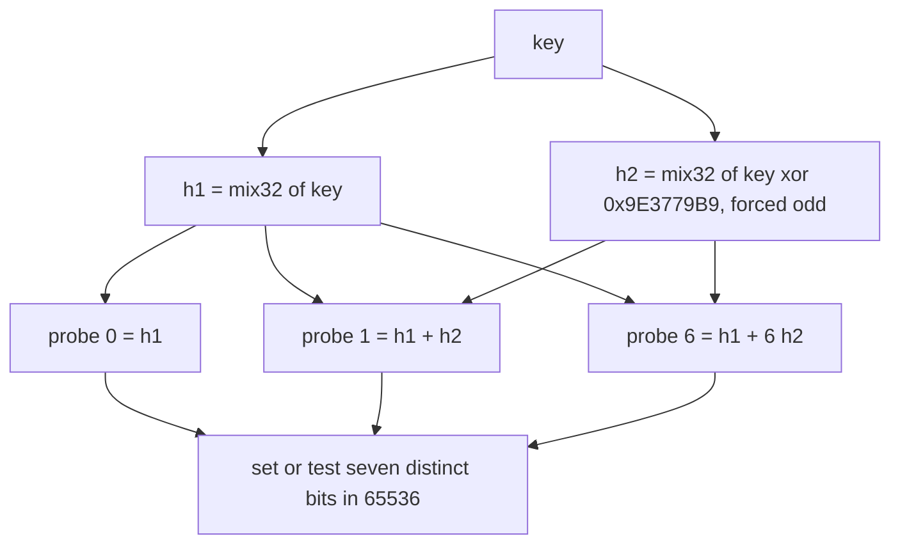
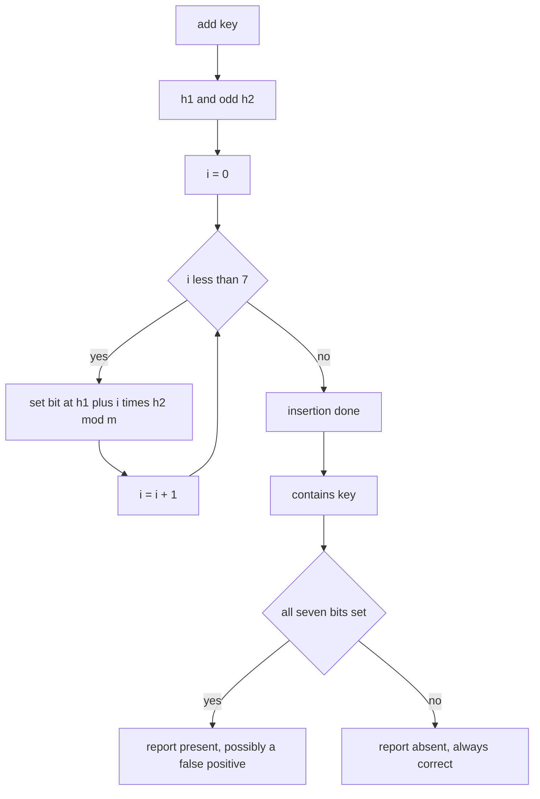
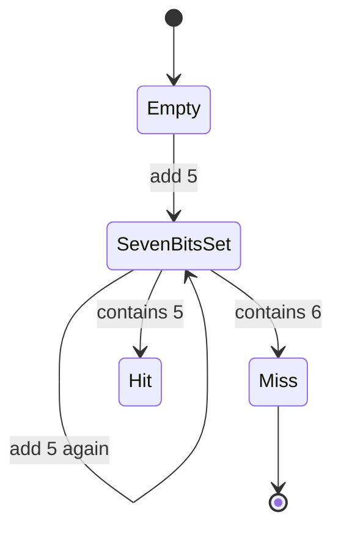

# 467 — Implement bloom filter with double hashing and test false positive.

> **Tier:** Advanced · **CTCI chapter:** Beyond — Advanced Data Structures & Algorithms
> **Task spec:** [467-implement-bloom-filter-with-double-hashing-and-test-false-positi.md](../../../tasks/advanced/467-implement-bloom-filter-with-double-hashing-and-test-false-positi.md)
> **Solutions:** [Python](../../../solutions/python/advanced/467-implement-bloom-filter-with-double-hashing-and-test-false-positi/solution.py) ·
> [Java](../../../solutions/java/advanced/467-implement-bloom-filter-with-double-hashing-and-test-false-positi/Solution.java) ·
> [JavaScript](../../../solutions/javascript/advanced/467-implement-bloom-filter-with-double-hashing-and-test-false-positi/solution.js) ·
> [C#](../../../solutions/csharp/advanced/467-implement-bloom-filter-with-double-hashing-and-test-false-positi/Solution.cs)

## 1. Problem restatement

**Input:** a stream of integer keys. `add(key)` inserts a key, `contains(key)` asks whether a key
was inserted, and `popcount()` reports how many bits are currently set.

**Output:** a membership answer with **no false negatives** and a measurable false-positive rate.
The filter is a bit array of `m = 2^16 = 65536` bits with `k = 7` probes per key, addressed by
double hashing:

```text
h1 = mix32(key)
h2 = mix32(key XOR 0x9E3779B9) OR 1        (forced odd)
probe(i) = (h1 + i * h2) mod m             for i = 0 .. 6
```

The contract is fixed by the assertions in the four solution files:

| Call | Result | Why |
| --- | --- | --- |
| `len(set(positions(5)))` | `7` | odd `h2` is coprime to the power-of-two `m`, so the seven probes are distinct |
| `popcount()` after `add(5)` | `7` | exactly seven bits set, no more |
| `5 in tiny` | `True` | the key's own bits are always set |
| `popcount()` after a second `add(5)` | `7` | insertion is idempotent |
| `6 in tiny` | `False` | a disjoint probe set means a clean miss |
| all 10000 members `in bloom` | `True` | zero false negatives on the workload |
| false positives among 10000 non-members | `<= 800` | the documented bound `FP_MAX`; measured `488` |

The workload inserts 10000 distinct member keys drawn from an LCG in `[0, 65536)` and then tests
10000 disjoint non-members `200000 + i`. The theoretical rate for `n = 10000`, `m = 65536`,
`k = 7` is `(1 - e^(-k*n/m))^k ≈ 0.0524`, so about `524` false positives are expected; the
measured count is `488`, and the file additionally asserts a lower sanity floor of `444` so that a
suspiciously *clean* run (a hash that fails to mix, for example) fails the test too.

## 2. Intuition

An exact set needs one entry per key. A bit array alone needs only one entry per key, but it can
only express presence with a lossy encoding: set `k` bits derived from the key. Testing for
presence then checks the same `k` bits, and a key that was never inserted can still find all of
them already set by other keys. That is a false positive, and it is the price of constant memory.

Two failure modes matter and they are not symmetric:

- A **false negative** would mean a key whose own bits were not set. That cannot happen if `add`
  and `contains` compute the same positions, which is why the workload asserts every member is
  found.
- A **false positive** happens when unrelated keys together light up all `k` probes. Addressing
  this is the whole design exercise.

The design uses `k = 7` independent probes, but computing seven real hash functions is wasteful.
Double hashing derives all seven from two: probe `i` sits at `h1 + i * h2`. That only works if the
seven probes stay distinct — and they do, because `h2` is forced odd and `m` is a power of two, so
`h2` is coprime to `m` and the multiples `i * h2` are distinct modulo `m` for `i < 7 < m`.



Every probe lands somewhere in the 65536-bit array; those seven positions are the key's entire
footprint. Insertion is therefore monotone — bits are only ever set, never cleared — which is why
`add` twice is exactly the same as `add` once, and why the tiny test can assert the population
count is still `7`.

## 3. Algorithm

1. Allocate `m = 2^16` bits, i.e. `m / 8 = 8192` bytes, all zero.
2. `positions(key)` computes `h1 = mix32(key)` and `h2 = mix32(key XOR 0x9E3779B9) OR 1`, then
   returns `(h1 + i * h2) mod m` for `i` in `0 .. k - 1`.
3. `add(key)` sets each of those bits: byte `pos >> 3`, bit `pos & 7`.
4. `contains(key)` reads the same positions and returns `False` at the first zero bit, `True` only
   if all `k` are set.
5. `popcount()` counts the set bits, which is what makes the tiny test's idempotence check
   possible.

```text
procedure positions(key)
    h1 ← mix32(key)
    h2 ← mix32(key XOR 0x9E3779B9) OR 1
    out ← empty list
    for i ← 0 to k - 1 do
        append (h1 + i * h2) mod m to out
    end
    return out
end

procedure add(filter, key)
    for pos in positions(key) do
        filter.bits[pos >> 3] ← filter.bits[pos >> 3] OR (1 << (pos AND 7))
    end
end

function contains(filter, key)
    for pos in positions(key) do
        if bit pos of filter is not set then
            return False
        end
    end
    return True
end
```

`contains` returns on the *first* clear bit, so a miss usually costs far fewer than seven reads.
That early exit is the only branch in the whole structure.



The asymmetry in the last two steps is the entire correctness story: "absent" is a proof, "present"
is a hint.

## 4. Worked example

Start with the hand-verifiable tiny filter. `positions(5)` yields a set of size 7, so the seven
bits are distinct by construction.

| Step | Action | Population count | Answer |
| --- | --- | --- | --- |
| 0 | fresh filter | `0` | — |
| 1 | check `len(set(positions(5))) == 7` | `0` | distinct probes confirmed |
| 2 | `add(5)` | `7` | seven bits set, none shared between probes |
| 3 | `5 in filter` | `7` | `True`, from the key's own bits |
| 4 | `add(5)` again | `7` | idempotent — the same seven bits, no growth |
| 5 | `6 in filter` | `7` | `False`, because key 6 probes a different set |

Step 4 is the check that `positions` is a pure function of the key: if the probe set changed
between calls, the second insertion would raise the count above `7`. Step 5 is the complementary
check: it shows the filter is not simply answering "yes" to everything.



Now the workload, which is the same code at `m = 65536` and `k = 7`:

| Phase | Input | Observed | Documented bound |
| --- | --- | --- | --- |
| insert | 10000 distinct members from the LCG | filter grows from 0 to 488-bit territory | — |
| verify members | the same 10000 keys | all `True` | zero false negatives allowed |
| test non-members | `200000 + i` for `i` in `0 .. 9999` | `488` reported present | `<= 800`, floor `444` |

The three numbers line up: the theoretical expectation `(1 - e^(-7 * 10000 / 65536))^7 ≈ 0.0524`
predicts about `524` false positives, the measured value is `488`, and the asserted window
`[444, 800]` brackets the prediction loosely enough to survive hash variation while still catching
a filter that has stopped working. The `n / m` ratio of about `0.153` keys per bit is what keeps
the rate near 5 percent; loading the same filter with 100000 keys would push it far higher.

## 5. Complexity

Let `n` be the number of inserted keys, `m = 65536` the bit count and `k = 7` the probe count.

| Measure | Bound | Why it holds |
| --- | --- | --- |
| Time, `add` | O(k) = O(1) | seven probe computations and seven bit sets |
| Time, `contains` (miss) | O(1) to O(k) | the first clear bit ends the scan |
| Time, `contains` (hit) | O(k) | every probe must be verified |
| Time, `popcount` | O(m / 8) | 8192 byte reads, used only by the tests |
| Space | O(m) bits = 8192 bytes | independent of `n`; the exact alternative costs `n` keys |
| False-negative rate | `0` | asserted for all 10000 members |
| False-positive rate | `(1 - e^(-k n / m))^k ≈ 0.0524` | the classical formula; measured `488/10000 = 0.0488` against the `800` ceiling |

The memory figure is the whole argument for the structure: 8 KB holds the fingerprint of 10000
keys, where an exact hash set would hold 10000 keys. The probe count is the tuning dial — `k = 7`
is close to the optimum `(m/n) * ln 2 ≈ 4.5` for this `n`, and the four ports all fix `m`, `k` and
the mixer constants so the measured rate is reproducible rather than merely typical.

## 6. Pitfalls and edge cases

- **`h2` must be odd.** Forcing the low bit guarantees `h2` is coprime to the power-of-two `m`, so
  the seven probes are distinct. An even `h2` could collapse two probes into one, which both
  weakens the filter and breaks the asserted `popcount() == 7`.
- **Never clear bits.** There is no delete operation. Clearing a bit for one key would create false
  negatives for every other key that shares it; the standard fix is a counting filter, which this
  task does not build.
- **Empty filter.** A fresh filter answers `False` for every key, and `popcount()` is `0`. There is
  no separate "initialised" state to get wrong.
- **A false positive is not a bug.** `contains` can return `True` for a key that was never added;
  the workload asserts only that this happens at most `800` times in 10000 tries. Code that treats
  `contains` as authoritative needs a second, exact lookup after a hit.
- **Zero false negatives.** Because `add` and `contains` derive positions from the same function,
  every inserted key always answers `True`; the file asserts this over the full 10000-key set.
- **Bit addressing.** Position `pos` lives in byte `pos >> 3` at bit `pos & 7`. Mixing up the shift
  and mask silently aliases bits and destroys the FP bound, which is why the tiny test checks the
  exact population count.
- **Load factor.** The rate depends on `n / m`. Inserting ten times as many keys into the same
  65536 bits pushes `k n / m` from `1.07` to `10.7` and the false-positive rate toward certainty.
- **Hash constants are shared.** `mix32` and the `0x9E3779B9` salt are identical in Python, Java,
  JavaScript and C#, so `positions(5)` has the same size in every port — but the byte-oriented
  storage differs, and the ports keep the same 8192-byte layout to stay comparable.
- **Key space.** The LCG members stay inside `[0, 65536)` while the non-members start at `200000`,
  so the two sets are disjoint by construction and the false-positive count is meaningful.

## 7. Variants and follow-ups

- **The simpler first version.** [254-implement-bloom-filter-insert-check-probabilistic.md](../../../tasks/intermediate/254-implement-bloom-filter-insert-check-probabilistic.md)
  inserts a filter without the double-hashing derivation; this task adds the `h1 + i * h2` probe
  family and the measured false-positive rate.
- **Sliding windows.** [255-implement-rolling-bloom-filter-sliding-window.md](../../../tasks/intermediate/255-implement-rolling-bloom-filter-sliding-window.md)
  rotates several filters to expire old keys, which is the usual answer to "I need deletes".
- **Putting the filter to work.**
  [649-implement-bloom-join-filter-application-and-benchmarking.md](../../../tasks/expert/649-implement-bloom-join-filter-application-and-benchmarking.md)
  uses such a filter to skip join probes, and
  [482-implement-bloom-filter-per-sstable-prototype-and-test.md](../../../tasks/advanced/482-implement-bloom-filter-per-sstable-prototype-and-test.md)
  attaches one to each storage table.
- **Counting instead of membership.** [465-implement-count-min-sketch-for-frequency-estimation.md](../../../tasks/advanced/465-implement-count-min-sketch-for-frequency-estimation.md)
  keeps counters rather than bits, which is what makes deletion and frequency queries possible.
- **Hash function plumbing.** [411-implement-advanced-rolling-hash-with-modular-and-base-tuning.md](../../../tasks/advanced/411-implement-advanced-rolling-hash-with-modular-and-base-tuning.md)
  and [315-rolling-hash-double-hash-to-reduce-collisions.md](../../../tasks/intermediate/315-rolling-hash-double-hash-to-reduce-collisions.md)
  explore the hashing side that decides how well the probes spread.

## 8. Check yourself

1. Why does forcing `h2` to be odd guarantee that the seven probes are distinct?

<details><summary>Show answer</summary>

`m = 2^16` is a power of two, and an odd `h2` shares no factor with it, so `h2` is invertible
modulo `m`. The probes are `h1 + i * h2` for `i = 0 .. 6`; if two of them collided, then
`(i - j) * h2 ≡ 0 (mod m)` with `0 < |i - j| < 7 < m`, which is impossible for an invertible `h2`.
Seven distinct positions is exactly what the tiny test asserts with
`len(set(positions(5))) == 7`.

</details>

2. The workload reports 488 false positives. Why does the test also assert a lower bound of 444?

<details><summary>Show answer</summary>

A lower bound catches the opposite failure: a filter that answers "present" too rarely, for
instance because the mixer degenerates and probes cluster in a few bytes, or because bit addressing
is wrong. The expected count is about 524, so 444 is a loose sanity floor; without it, a filter that
had effectively stopped filling could still pass the `<= 800` ceiling.

</details>

3. What happens if you add the same key twice, and why does the test care?

<details><summary>Show answer</summary>

Nothing changes: the seven positions depend only on the key, and the bits are already set, so
`popcount()` stays at `7`. The test asserts this because it is the cheapest way to prove `add` and
`contains` derive positions from the same pure function — if the probe set varied between calls,
the population count would grow on the second insertion.

</details>

4. Can `contains` ever return `False` for a key that was inserted?

<details><summary>Show answer</summary>

No. `add` sets every bit that `contains` tests, and no operation ever clears a bit, so all seven
probes are still set when the key is queried. The file asserts this over all 10000 members of the
workload, which is the standard guarantee: Bloom filters promise zero false negatives and only
bound false positives.

</details>

5. What would change in the measured false-positive rate if the same 65536 bits were loaded with
   100000 keys instead of 10000?

<details><summary>Show answer</summary>

The rate would explode. The classical formula is `(1 - e^(-k n / m))^k`, so raising `n` from 10000
to 100000 takes `k n / m` from about `1.07` to `10.7`; the fraction of bits set approaches 1 and
queries are answered "present" almost unconditionally. The documented 5 percent holds only for the
`n / m ≈ 0.153` load this task uses.

</details>
