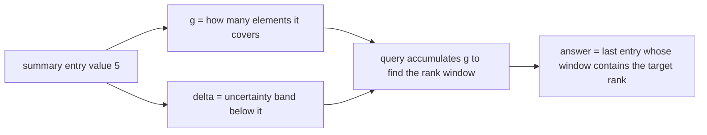
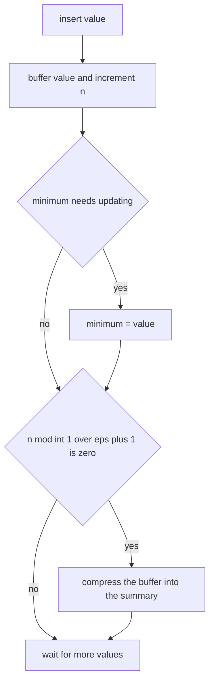
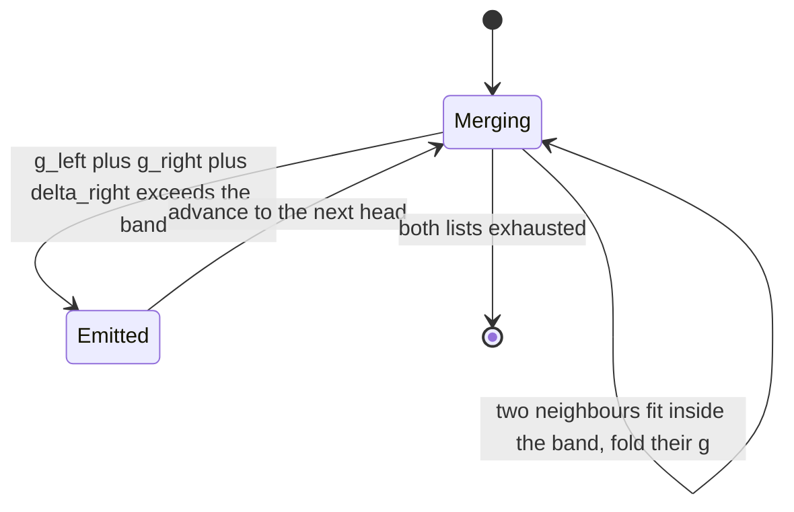

# 468 — Implement streaming quantiles (Greenwald-Khanna outline).

> **Tier:** Advanced · **CTCI chapter:** Beyond — Advanced Data Structures & Algorithms
> **Task spec:** [468-implement-streaming-quantiles-greenwald-khanna-outline.md](../../../tasks/advanced/468-implement-streaming-quantiles-greenwald-khanna-outline.md)
> **Solutions:** [Python](../../../solutions/python/advanced/468-implement-streaming-quantiles-greenwald-khanna-outline/solution.py) ·
> [Java](../../../solutions/java/advanced/468-implement-streaming-quantiles-greenwald-khanna-outline/Solution.java) ·
> [JavaScript](../../../solutions/javascript/advanced/468-implement-streaming-quantiles-greenwald-khanna-outline/solution.js) ·
> [C#](../../../solutions/csharp/advanced/468-implement-streaming-quantiles-greenwald-khanna-outline/Solution.cs)

## 1. Problem restatement

**Input:** a stream of `N` numbers arriving one at a time, plus a target rank fraction `phi` in
`[0, 1]`. `insert(value)` consumes the stream; `query(phi)` returns a value whose rank is close to
`phi`.

**Output:** an `eps`-approximate quantile. Let `v` be the returned value and let
`rl = #{x < v}` and `ru = #{x <= v}` be its ranks in the exact sorted stream. The guarantee is

```text
rl <= phi * N + eps * N        and        ru >= phi * N - eps * N
```

and the value returned is always an element of the stream. The summary is a list of entries
`[value, g, delta]` where `g` is the number of stream elements the entry "covers" and `delta` is
the uncertainty band below it.

This is an **outline** task, and the docstring names the variant: a **batch merge-compress**
implementation. Arrivals are buffered, and every `int(1/eps) + 1` arrivals the buffer is merged
into the summary with band `floor(2 * eps * (n - 1))`. The classic paper maintains the invariant on
every insert; this port trades a slightly looser invariant for a much simpler merge step.

The contract is fixed by the assertions:

| Call | Result | Why |
| --- | --- | --- |
| `query(0.5)` on an empty summary | `None` | there is nothing to report |
| `query(0.0)` on `[5, 1, 9, 3, 7]`, `eps = 0.01` | `1` | the minimum is tracked separately and always exact |
| `query(1.0)` on the same stream | `9` | the maximum falls out of the walk |
| `query(0.5)` on the same stream | in `{3, 5}` | either neighbour is within the `eps` band |
| max summary size over six streams of `N = 2000`, `eps = 0.05` | `82` | the documented bound is 106 tuples |

Documented scale: `eps = 0.05`, `N = 2000`, `phi` sweeping `0, 0.05, ..., 1.0` (21 query points)
over six deterministic stream patterns — random, increasing, decreasing, constant, heavy
duplicates, and sawtooth `i mod 50`.

## 2. Intuition

Keeping every element to answer quantiles exactly costs O(N) memory and O(N log N) time when the
query finally arrives. Keeping a fixed set of sampled quantile points costs far less memory but
gives no error guarantee.

The Greenwald-Khanna idea is to keep a *small sorted list of representative values* and to record,
for each representative, how many stream elements it stands for and how much slack the answer is
allowed to have. A representative that covers a large span is cheap in memory and expensive in
accuracy, so the summary is periodically "compressed": adjacent representatives whose combined
weight fits inside the permitted band are merged.

The permitted band is `floor(2 * eps * (n - 1))`, i.e. a constant fraction of the stream seen so
far. As `n` grows the band grows, so later compressions can fold bigger spans together — which is
why the summary size stays bounded by roughly `(1/(2 eps) + 1) * (log2(2 eps n) + 2)` instead of
growing with `n`. For `eps = 0.05` and `N = 2000` that bound evaluates to `106` tuples.



The second half of the intuition is what the `delta` field buys. Without it, a merged entry would
have an unknown error, and the query could not know whether it had landed close enough to the
target rank. With it, the walk can stop as soon as the accumulated rank plus the band exceeds the
target, and the previous entry is guaranteed to be within `eps * N` of the truth.

## 3. Algorithm

1. Create an empty summary, an empty buffer of pending values, a counter `n`, and a tracked exact
   minimum.
2. `insert(value)`: buffer the value, increment `n`, lower the tracked minimum if needed, and when
   `n mod (int(1/eps) + 1) == 0` run `compress`.
3. `compress`: sort the buffer into fresh entries `[value, 1, 0]`, then merge that stream with the
   existing sorted entries. Two neighbours may be folded together while
   `g_left + g_right + delta_right <= floor(2 eps (n - 1))`. A fresh value landing before an
   existing entry either contributes its `g` to that entry or, when folding is not allowed, takes
   `delta = entry.g + entry.delta - 1` and is emitted as its own entry.
4. `query(phi)`: compress any pending values first, compute `rank = int(phi (n - 1) + 1)` and
   `spread = int(eps (n - 1))`, then walk the entries accumulating `g`. Stop at the first entry
   whose `g_sum + delta` exceeds `rank + spread` and return the previous entry's value; if that
   would be before the first entry, return the tracked minimum.

```text
procedure insert(summary, value)
    append value to summary.pending
    summary.n ← summary.n + 1
    if summary.minimum is unset or value < summary.minimum then
        summary.minimum ← value
    end
    if summary.n mod (int(1 / summary.eps) + 1) = 0 then
        compress(summary)
    end
end

procedure compress(summary)
    band ← int(2 * summary.eps * (summary.n - 1))
    fresh ← sorted copy of summary.pending as entries [value, 1, 0]
    old ← summary.entries
    i ← 0
    j ← 0
    out ← empty list
    while i < length(fresh) or j < length(old) do
        merge the smaller head of fresh and old into out
        fold neighbours while g_left + g_right + delta_right <= band
    end
    summary.entries ← out
    summary.pending ← empty
end

function query(summary, phi)
    if summary.n = 0 then
        return nothing
    end
    if summary.pending is not empty then
        compress(summary)
    end
    rank ← int(phi * (summary.n - 1) + 1)
    spread ← int(summary.eps * (summary.n - 1))
    total ← 0
    i ← 0
    while i < length(summary.entries) do
        total ← total + summary.entries[i].g
        if total + summary.entries[i].delta > rank + spread then
            break
        end
        i ← i + 1
    end
    if i = 0 then
        return summary.minimum
    end
    return summary.entries[i - 1].value
end
```

The `i = 0` guard is the fallback that makes `query(0)` exact: when even the first entry overshoots
the target rank, the answer is the tracked minimum rather than a value from the summary.



Compression itself has exactly two outcomes for each head element, which is worth seeing as a
decision machine:



## 4. Worked example

Trace the tiny stream `[5, 1, 9, 3, 7]` with `eps = 0.01`. The batch threshold is
`int(1/0.01) + 1 = 101`, and only five values arrive, so no compression happens during insertion:
the buffer simply holds `[5, 1, 9, 3, 7]`, `n = 5`, and the tracked minimum is `1`.

The first query forces a compression. The band is `int(2 * 0.01 * 4) = int(0.08) = 0`, so **no
folding is permitted at all** and every buffered value becomes its own entry:

| Step | Action | Result |
| --- | --- | --- |
| 1 | sort the buffer | `[1, 3, 5, 7, 9]` |
| 2 | band `= int(2 * 0.01 * 4)` | `0`, folding disabled |
| 3 | fold test `g_left + g_right + delta_right = 1 + 1 + 0 <= 0` | false, so no absorption |
| 4 | entries | `[[1,1,0], [3,1,0], [5,1,0], [7,1,0], [9,1,0]]` |

Now the three asserted queries, using `rank = int(phi * 4 + 1)` and `spread = int(0.01 * 4) = 0`:

| `phi` | `rank` | Walk `total` | Stop | Returned |
| --- | --- | --- | --- | --- |
| `0.0` | `1` | `1` at entry 0, then `2` at entry 1 | `2 + 0 > 1` at `i = 1` | `entries[0].value = 1` (the minimum) |
| `0.5` | `3` | `1, 2, 3` then `4` at entry 3 | `4 + 0 > 3` at `i = 3` | `entries[2].value = 5` |
| `1.0` | `5` | `1, 2, 3, 4, 5` | never exceeds `5`, so `i = n = 5` | `entries[4].value = 9` |

All three match the assertions, and `phi = 0.5` returning `5` is consistent with the recorded
`in {3, 5}` — the two middle values are equally acceptable inside the error band.

At the documented scale every folding decision becomes live, because the band grows with `n`:

| Stream of `N = 2000`, `eps = 0.05` | Max summary size after queries |
| --- | --- |
| random (`LCG mod 1000`) | inside the bound |
| increasing `0..1999` | inside the bound |
| decreasing `1999..0` | `82` — the measured maximum |
| constant `42` | far below, everything folds into a handful of entries |
| heavy duplicates (`LCG mod 5`) | far below |
| sawtooth `i mod 50` | inside the bound |

The documented size bound for this configuration is
`(1/(2 * 0.05) + 1) * (log2(2 * 0.05 * 2000) + 2) = 11 * (log2(200) + 2) ≈ 106` tuples, and the
measured maximum is `82`, reached by the strictly decreasing stream. The decreasing stream is the
worst case because each new value is smaller than every entry already stored, so it cannot be
absorbed forward as easily as in the increasing case.

## 5. Complexity

Let `N` be the number of inserted values and `eps` the error parameter.

| Measure | Bound | Why it holds |
| --- | --- | --- |
| Time, `insert` | O(1) amortised | a buffer append plus one modulo test; the merge cost is paid every `int(1/eps)+1` arrivals |
| Time, `compress` | O(S log(1/eps)) | sorting a buffer of `int(1/eps)+1` values and a linear merge against the `S` existing entries |
| Time, `query` | O(S) | one linear walk accumulating `g`, plus a compression if the buffer is dirty |
| Space | O((1/eps) log(eps N)) | documented bound `(1/(2 eps) + 1) * (log2(2 eps n) + 2)`, i.e. `106` entries here |
| Measured space, `eps = 0.05`, `N = 2000` | `82` entries | the maximum over the six streams, on the decreasing stream |
| Exact quantiles | O(N) space, O(N log N) time | sort everything, answer any `phi` exactly |
| Sampling | O(1/eps) space | no deterministic error bound, which is what the `delta` field supplies here |

Two different guarantees are worth separating: the *rank* bound `eps * N` is what the tests assert
(`rl <= phi N + eps N` and `ru >= phi N - eps N`), while the *size* bound is the memory promise.
The measured values are the ones the docstring records — `82` entries and the rank checks passing
for all `21` query points on all six streams.

## 6. Pitfalls and edge cases

- **Empty summary.** `query` on zero insertions returns `None`; there is no entry to walk and no
  minimum to report, and the test asserts exactly this.
- **`phi = 0` must be exact.** The minimum is tracked outside the summary precisely so that the
  `i = 0` fallback can return it; folding entries can lose the true minimum, and the assertion
  `query(0.0) == min(data)` catches that.
- **`phi = 1.0` walks off the end.** When no entry ever exceeds `rank + spread`, the loop ends with
  every `i` visited and the answer is `entries[n - 1].value`, so the last slot must not be special
  cased away.
- **The band grows with `n`.** `floor(2 eps (n - 1))` is zero for `n = 1`, so early compressions
  cannot fold anything; a band computed from the buffer size instead of the stream length would let
  the summary drift outside the error bound.
- **Duplicates and constants.** A constant stream collapses to very few entries and heavy duplicate
  streams behave similarly; both are covered by the test, and both are legitimate — the guarantee
  is about rank, not about the number of distinct values.
- **Returned values come from the stream.** The test asserts `value in data` for every query, which
  rules out interpolating between entries.
- **This is a batch variant.** Values sit in the buffer until `int(1/eps) + 1` of them have
  accumulated, so a query on a dirty buffer pays a compression; that is the documented
  simplification relative to the per-insert variant, not a bug.
- **Integer division.** `with eps = 0.05` the batch size is `int(1 / 0.05) + 1 = 21`, and `spread`
  is `int(eps (n - 1))`, which for small `n` is `0`. Using floating-point comparisons without the
  integer truncation would shift the boundary by one rank.

## 7. Variants and follow-ups

- **The exact baseline.** [432-implement-data-structure-for-dynamic-median-order-statistics-tre.md](../../../tasks/advanced/432-implement-data-structure-for-dynamic-median-order-statistics-tre.md)
  answers order-statistic queries exactly over the whole multiset, with matching memory cost.
- **Sampling instead of summarising.**
  [464-implement-reservoir-sampling-with-weighted-probabilities.md](../../../tasks/advanced/464-implement-reservoir-sampling-with-weighted-probabilities.md)
  keeps a uniform sample of the stream, which approximates quantiles without a rank guarantee.
- **Other stream sketches.** [465-implement-count-min-sketch-for-frequency-estimation.md](../../../tasks/advanced/465-implement-count-min-sketch-for-frequency-estimation.md)
  estimates frequencies and
  [466-implement-hyperloglog-sketch-for-cardinality-estimation-outline.md](../../../tasks/advanced/466-implement-hyperloglog-sketch-for-cardinality-estimation-outline.md)
  estimates distinct counts; together with this task they cover the three classic streaming
  questions.
- **Where the estimate is consumed.**
  [646-implement-approximate-query-processing-via-sampling-reservoir.md](../../../tasks/expert/646-implement-approximate-query-processing-via-sampling-reservoir.md)
  and [781-implement-distributed-join-planning-with-cardinality-estimation.md](../../../tasks/expert/781-implement-distributed-join-planning-with-cardinality-estimation.md)
  spend approximate statistics inside a query planner.
- **Mergeable summaries.** The same compression idea appears in merge-based settings such as
  [847-implement-heavy-hitter-detection-with-distributed-sketches-merge.md](../../../tasks/master/847-implement-heavy-hitter-detection-with-distributed-sketches-merge.md).

## 8. Check yourself

1. What does the `delta` field of an entry represent, and why is it needed for the query walk?

<details><summary>Show answer</summary>

`g` is how many stream elements an entry covers, and `delta` is the uncertainty band below it —
the slack accumulated because neighbouring entries may have been folded. The walk accumulates `g`
and stops as soon as `total + delta` exceeds `rank + spread`; without `delta` a merged entry would
have an unknown error and the returned value could not be shown to sit within `eps * N` of the
target rank.

</details>

2. Why is the minimum tracked separately instead of living in the summary?

<details><summary>Show answer</summary>

Because compression can fold the smallest entry into a larger one, after which the exact minimum is
no longer present. Tracking it separately lets the `i = 0` fallback return it exactly, which is
what makes `query(0.0) == min(data)` hold for all six streams — including the decreasing one, where
the minimum arrives last.

</details>

3. In the tiny `[5, 1, 9, 3, 7]` trace the band was `0`. Why?

<details><summary>Show answer</summary>

The band is `floor(2 * eps * (n - 1)) = floor(2 * 0.01 * 4) = floor(0.08) = 0`. With nothing to
spend, no two neighbours may be folded, so the compression emits all five values as separate
entries. That is also why the trace is easy to check by hand: every entry has `g = 1` and
`delta = 0`.

</details>

4. Why does the summary size stop growing with the stream length?

<details><summary>Show answer</summary>

Because the folding band is proportional to `n`: `floor(2 eps (n - 1))` widens as more values
arrive, so later compressions can absorb spans that earlier ones had to keep separate. The
documented bound `(1/(2 eps) + 1) * (log2(2 eps n) + 2)` grows only logarithmically, evaluating to
`106` entries for `eps = 0.05` and `N = 2000`; the measured maximum is `82`.

</details>

5. The returned value for `phi = 0.5` is allowed to be either `3` or `5`. What determines which?

<details><summary>Show answer</summary>

The first entry whose accumulated `g` plus `delta` exceeds `rank + spread`. With
`rank = int(0.5 * 4 + 1) = 3` and `spread = 0`, the walk stops at entry index `3` and returns
`entries[2].value = 5`; a different `eps`, `n`, or folding history could stop one entry earlier and
return `3`. Both are inside the `eps * N` rank band, which is why the test accepts the set `{3, 5}`
rather than a single value.

</details>
