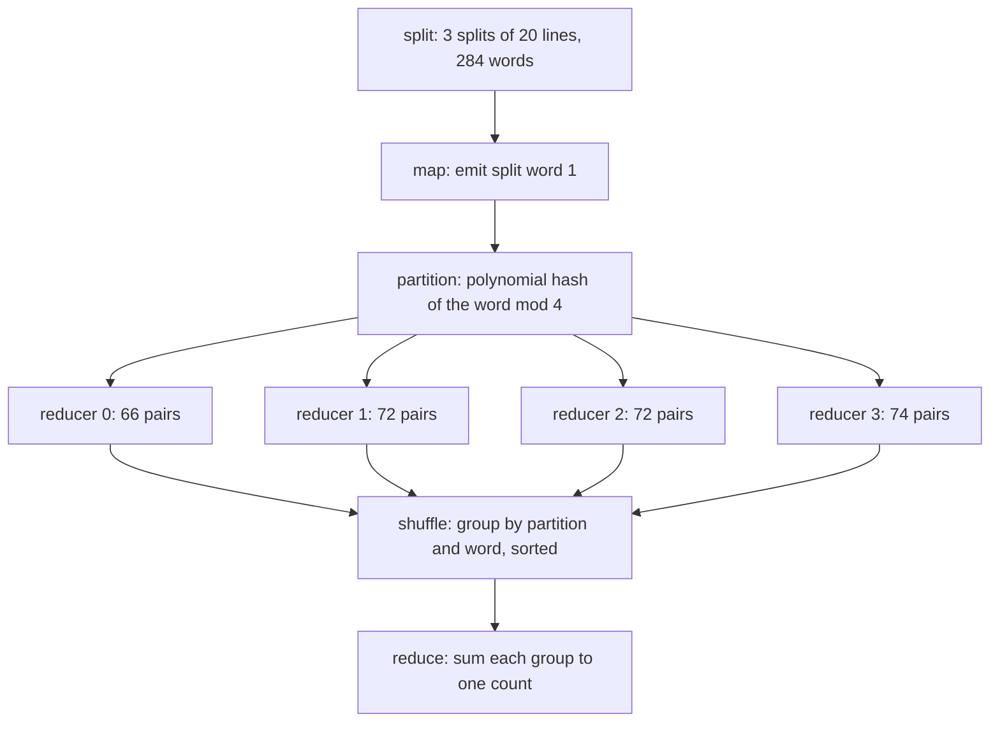
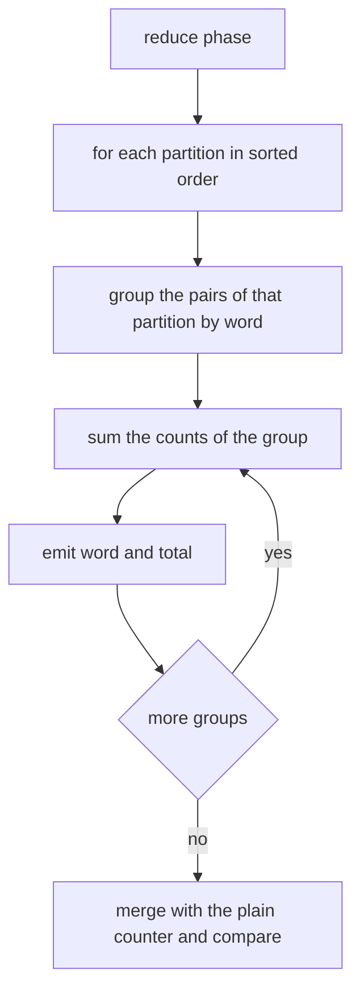
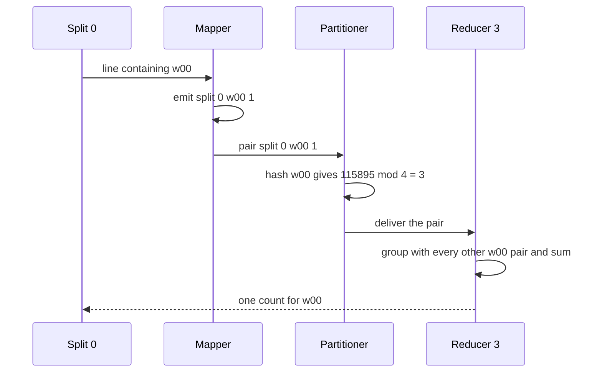

# 469 — Implement distributed aggregations map-reduce toy.

> **Tier:** Advanced · **CTCI chapter:** CTCI §X — Advanced Topics
> **Task spec:** [469-implement-distributed-aggregations-map-reduce-toy.md](../../../tasks/advanced/469-implement-distributed-aggregations-map-reduce-toy.md)
> **Solutions:** [Python](../../../solutions/python/advanced/469-implement-distributed-aggregations-map-reduce-toy/solution.py) ·
> [Java](../../../solutions/java/advanced/469-implement-distributed-aggregations-map-reduce-toy/Solution.java) ·
> [JavaScript](../../../solutions/javascript/advanced/469-implement-distributed-aggregations-map-reduce-toy/solution.js) ·
> [C#](../../../solutions/csharp/advanced/469-implement-distributed-aggregations-map-reduce-toy/Solution.cs)

## 1. Problem restatement

**Input:** three text splits. Each split holds 20 lines, and each line holds 1 to 8 words drawn
from a 40-word vocabulary `w00 ... w39`. The LCG `seed ← (seed * 75 + 74) mod 65537` starting from
`20260116` generates every line length and every word, so the input is fixed and reproducible.

**Output:** the word count for every word, computed through the five MapReduce phases rather than
by a direct loop — `split`, `map`, `partition`, `shuffle`, `reduce`.

This is a **toy**: one process simulates the whole cluster, the number of reducers is fixed at
`R = 4`, and the partition rule is a documented polynomial hash rather than a real partitioner.
The docstring is explicit that the pipeline is deterministic and single-process; there is no
network, no combiner, and no skewed-key handling.

The contract is fixed by the assertions:

| Call | Result | Why |
| --- | --- | --- |
| `partition_of("w00")` | `3` | the polynomial hash is `115895`, and `115895 mod 4 = 3` |
| `partition_of("w")` | `3` | the shorter string hashes to `119`, and `119 mod 4 = 3` |
| reduced counts vs a plain word counter | equal | the pipeline must not lose or duplicate a word |
| per-partition pairs in vs counts out | equal for each of the 4 partitions | conservation of mass per reducer |
| `sum(per_partition_in)` | `len(pairs)` | every mapped pair is delivered exactly once |
| words reduced | each word exactly once | no word appears in two reducer groups |
| `run_pipeline(make_splits(20260116))` twice | identical | the pipeline is deterministic |

For the fixed seed the generated workload is 60 lines, `284` mapped pairs (100 in the first split,
96 in the second, 88 in the third) and all `40` vocabulary words, giving per-partition pair totals
of `66, 72, 72, 74`.

## 2. Intuition

The naive solution is a counter over all words: read everything, increment a dictionary, done. It
is correct and it is what the test uses as its oracle — but it is not a *distributed* aggregation,
and the point of this task is the shape of the pipeline that makes one possible.

The first structural idea is to make the map output addressable. Every emitted pair carries the
word, and the word alone decides which reducer sees it:

```text
partition_of(word) = ((...((0 * 31 + ch0) * 31 + ch1) * 31 + ...) mod 1000003) mod 4
```

Because the partition depends only on the word, all pairs for the same word are guaranteed to meet
in the same reducer, which is exactly what makes "sum the group" a valid aggregation. That is the
whole reason shuffle groups by `(partition, word)` instead of by word alone: the partition is the
routing key, and the word is the grouping key inside it.

The second structural idea is conservation. Map emits one pair per word occurrence, so the number
of pairs entering a partition must equal the number of counts leaving it. That is a cheap invariant
that detects a dropped or double-counted pair far more directly than comparing final dictionaries
does.



Every arrow between `map` and `reduce` moves whole pairs. Nothing is aggregated before shuffle,
which is what the "no combiner" simplification means: a real system would fold identical keys
locally first, and this toy deliberately does not.

## 3. Algorithm

1. `make_splits(seed)` builds three splits of 20 lines; each line's length is `seed mod 8 + 1` and
   each word is `VOCAB[seed mod 40]`, with the LCG advanced once per draw.
2. `map_phase(splits)` walks every line of every split and emits `(split_id, word, 1)`.
3. `partition_phase(pairs)` computes `partition_of(word)` and appends the pair to that bucket.
4. `shuffle_phase(buckets)` visits partitions in sorted order and groups pairs by `(partition, word)`,
   keeping the pairs inside a group in a deterministic order.
5. `reduce_phase(groups)` sums each group's counts into one `(partition, word) -> total` entry.
6. `run_pipeline` composes the four phases, which is what the determinism assertion calls twice.

```text
function partition_of(word)
    h ← 0
    for ch in word do
        h ← (h * 31 + code_point(ch)) mod 1000003
    end
    return h mod 4
end

procedure map_phase(splits)
    pairs ← empty list
    for split_id ← 0 to length(splits) - 1 do
        for line in splits[split_id] do
            for word in line do
                append (split_id, word, 1) to pairs
            end
        end
    end
    return pairs
end

procedure partition_phase(pairs)
    buckets ← empty map from partition to list
    for (split_id, word, count) in pairs do
        append (split_id, word, count) to buckets[partition_of(word)]
    end
    return buckets
end

procedure shuffle_phase(buckets)
    groups ← empty map from (partition, word) to list of counts
    for part in sorted(buckets) do
        for (split_id, word, count) in sorted(buckets[part]) do
            append count to groups[(part, word)]
        end
    end
    return groups
end

procedure reduce_phase(groups)
    reduced ← empty map
    for ((part, word), counts) in groups do
        reduced[(part, word)] ← sum of counts
    end
    return reduced
end
```

The sorting in step 4 is what turns a hash bucket into a deterministic stream: without the
sorted traversal, the grouping would still be correct but the grouping *order* would depend on
dictionary iteration order, and the determinism assertion would be testing the language runtime
rather than the pipeline.



## 4. Worked example

Trace the generated workload, then two words through the pipeline.

| Phase | Input size | Output | Concrete content |
| --- | --- | --- | --- |
| split | — | 3 splits, 20 lines each | line lengths between 1 and 8 words |
| map | 284 words | 284 pairs | `(0, w28, 1)` style triples, 100 from split 0, 96 from split 1, 88 from split 2 |
| partition | 284 pairs | 4 buckets | `66`, `72`, `72`, `74` pairs per partition |
| shuffle | 4 buckets | groups by `(partition, word)` | one group per distinct word |
| reduce | 40 groups | 40 counts | `w28 -> 14`, `w03 -> 12`, `w34 -> 12` are the three most frequent |

The conservation check is the row that matters: `66 + 72 + 72 + 74 = 284`, exactly the number of
pairs `map` emitted, so no pair was dropped or duplicated in flight. The reduced totals are then
flattened and compared with a plain counter over the same words, and the two must be equal — all
40 vocabulary words appear, so the comparison has real content.

Now follow two words by hand to see the routing rule in action:

| Word | Polynomial hash | `mod 4` | Landing partition |
| --- | --- | --- | --- |
| `w00` | `115895` | `3` | reducer 3 |
| `w` | `119` | `3` | reducer 3 |

Both are asserted in the file. The `w00` case is easy to reproduce: `'w' = 119`, then
`h = (0 * 31 + 119) = 119`, `h = (119 * 31 + 48) = 3737`, `h = (3737 * 31 + 48) = 115895`, and
`115895 = 4 * 28973 + 3`. The single-character case shows that the polynomial works on any word
length, including one character: with no multiplications after the first step the hash is just the
code point, so `119 mod 4 = 3`.



Finally the determinism check: building the splits from the same seed and running the four phases
again must produce exactly the same `(partition, word) -> total` map. Because every phase traverses
its inputs in sorted order, this holds even though the phases are implemented with dictionaries.

## 5. Complexity

Let `P` be the number of mapped pairs (284 here), `D` the number of distinct words (40), and `R`
the number of reducers (4). Let `L` be the longest word, here 3 characters.

| Measure | Bound | Why it holds |
| --- | --- | --- |
| Time, generation | O(P + lines) | one LCG step per word and per line length |
| Time, `map` | O(P) | one triple emitted per word occurrence |
| Time, `partition` | O(P · L) | each pair's word is hashed; `L` is constant for this vocabulary |
| Time, `shuffle` | O(P log P) | pairs are sorted inside each partition before grouping |
| Time, `reduce` | O(P + D) | every count is added once into its group |
| Space | O(P + D) | the pair list plus one group per distinct word |
| Determinism | O(1) extra | sorting key traversal, no reliance on hash-map iteration order |
| Real cluster | network cost O(P) | the toy ignores it; shuffle is the expensive phase in practice |

The sorting step is what makes the toy reproducible. It costs `log P` per pair over an unsorted
grouping, which is a real inefficiency in a production pipeline — real systems rely on a
deterministic *partitioner* and stable byte-wise keys rather than on sorting the whole pair list.

## 6. Pitfalls and edge cases

- **Empty input.** A split with no lines produces no pairs; all four partitions stay empty and the
  reduced map is empty, which compares equal to an empty counter. Nothing in the pipeline indexes
  into `buckets[part]` before creating it, so an empty bucket is not an error.
- **A word that lands in no partition.** Impossible by construction: `partition_of` always returns
  a value in `0 .. R - 1`, and the file asserts that every word appears in exactly the partition its
  hash dictates.
- **Losing the partition key.** If reduce grouped by word alone, two words could collide across
  partitions and return a single mixed count. The test's "every word reduced exactly once"
  assertion is precisely the guard against that.
- **Off-by-one in the line length.** The generator draws `seed mod 8 + 1`, so lines hold 1 to 8
  words — never 0 and never 9. Changing the `+ 1` silently changes all 284 pairs and every count in
  the worked trace.
- **Hash arithmetic must match across ports.** The polynomial `h * 31 + code_point` reduced modulo
  `1000003` is identical in Python, Java, JavaScript and C#, which is what makes `partition_of("w00") == 3`
  a portable assertion. A different base or modulus moves words between reducers.
- **Deterministic traversal.** Sorting partitions and pairs is not decoration: relying on
  dictionary order would make the pipeline output depend on the runtime's hashing, and the two-run
  determinism assertion would be flaky rather than meaningful.
- **No combiner.** Map emits one pair per occurrence, so a word appearing 14 times sends 14 pairs
  through the shuffle. A real system would fold them first; the toy documents that it does not,
  which is why the per-partition counts are as large as `74`.
- **Per-partition balance is not guaranteed.** The measured totals `66, 72, 72, 74` happen to be
  even, but nothing enforces balance — with a skewed vocabulary one reducer could receive nearly
  everything.

## 7. Variants and follow-ups

- **Skew and combiners.**
  [682-implement-map-reduce-optimization-for-skewed-keys-combiner-parti.md](../../../tasks/expert/682-implement-map-reduce-optimization-for-skewed-keys-combiner-parti.md)
  adds the two optimisations this toy leaves out, and
  [657-implement-distributed-join-shuffle-simulation-in-map-reduce.md](../../../tasks/expert/657-implement-distributed-join-shuffle-simulation-in-map-reduce.md)
  uses the same shuffle for joins instead of counts.
- **Where the partitioner meets the cluster.** [470-implement-consistent-hashing-ring-virtual-nodes.md](../../../tasks/advanced/470-implement-consistent-hashing-ring-virtual-nodes.md)
  replaces the fixed `mod 4` partitioner with a ring that survives adding and removing reducers.
- **Aggregations that are not counts.**
  [464-implement-reservoir-sampling-with-weighted-probabilities.md](../../../tasks/advanced/464-implement-reservoir-sampling-with-weighted-probabilities.md)
  aggregates a sample, and [465-implement-count-min-sketch-for-frequency-estimation.md](../../../tasks/advanced/465-implement-count-min-sketch-for-frequency-estimation.md)
  aggregates a fixed-size sketch, both of which are associative in the same way a sum is.
- **MapReduce in the database.** [642-implement-join-algorithms-nested-loop-hash-join-sort-merge-join.md](../../../tasks/expert/642-implement-join-algorithms-nested-loop-hash-join-sort-merge-join.md)
  and [781-implement-distributed-join-planning-with-cardinality-estimation.md](../../../tasks/expert/781-implement-distributed-join-planning-with-cardinality-estimation.md)
  show what the planner does around such a pipeline.
- The chapter walkthrough [Advanced topics](../../ctci/x-advanced-topics.md) places MapReduce next
  to the other advanced-paradigm exercises.

## 8. Check yourself

1. Why must the partition be a function of the word alone?

<details><summary>Show answer</summary>

Because aggregation is only valid if every pair for a given word reaches the same reducer. If the
partition depended on the split id or on arrival order, `w00` pairs could be spread over several
reducers and each would return a partial count for a different partition key. Making the partition
a pure function of the word guarantees that all of a word's pairs meet in exactly one group — which
is what the assertion "each word lands in exactly one partition, equal to its hash" checks.

</details>

2. What does the conservation assertion catch that comparing final counts does not?

<details><summary>Show answer</summary>

It catches a pair that was dropped or duplicated in flight *within* a partition. Since the total
`66 + 72 + 72 + 74 = 284` must equal `len(pairs)`, a mapping phase that emitted the wrong number of
pairs, or a shuffle that visited a bucket twice, fails immediately even if the final per-word totals
happened to cancel out against the oracle.

</details>

3. The pipeline sorts partitions and pairs before grouping. Is that necessary for correctness?

<details><summary>Show answer</summary>

Not for correctness of the counts — summing is commutative — but it is necessary for the
determinism assertion. Without the sorted traversal, the grouping order would follow dictionary
iteration order, which differs between languages and even between runs with a randomised hash seed.
Sorting makes `run_pipeline` return byte-identical results across two calls and across all four
language ports.

</details>

4. `partition_of("w")` is `3` because `119 mod 4 = 3`. What does that say about short words?

<details><summary>Show answer</summary>

That the polynomial degenerates gracefully: for a one-character word the only multiplication step
is `0 * 31 + 119`, so the hash is just the code point. The partitioner therefore works for words of
any length without special-casing, and the file asserts this case alongside the three-character
`w00` to prove it.

</details>

5. Where would a combiner fit, and what would change in the measured numbers?

<details><summary>Show answer</summary>

It would run at the end of `map`, folding repeated words within one split into `(word, k)` pairs
before the shuffle. The per-partition pair totals would shrink from `66, 72, 72, 74` to roughly the
number of distinct words per partition, while the reduced counts would be unchanged. The toy omits
it deliberately, which is why `map` emits one triple per occurrence.

</details>
