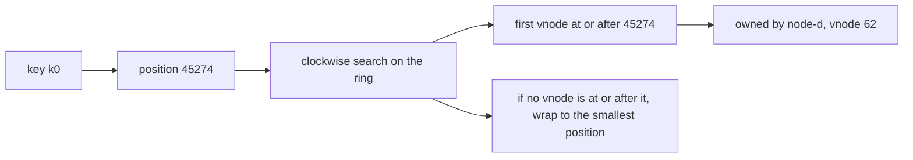
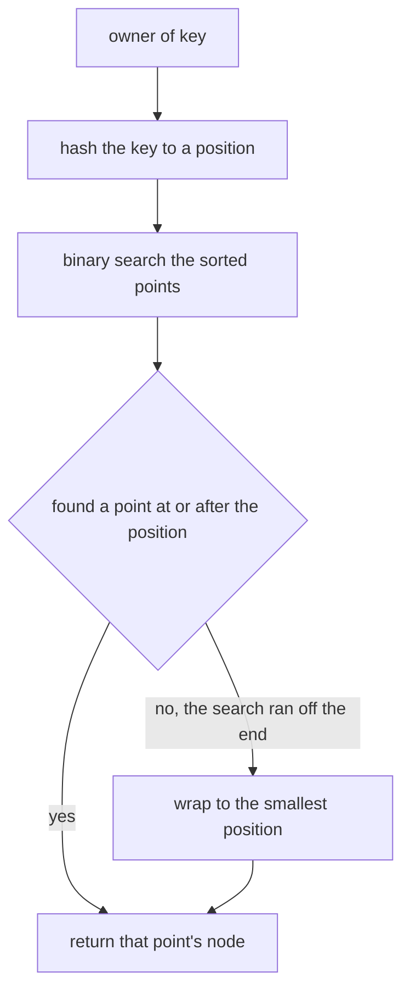
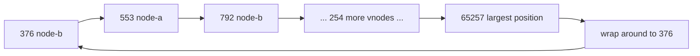
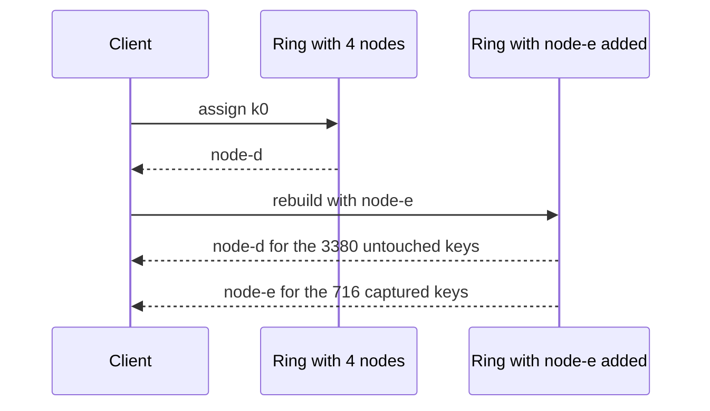

# 470 — Implement consistent hashing ring (virtual nodes).

> **Tier:** Advanced · **CTCI chapter:** Ch 9 — System Design and Scalability
> **Task spec:** [470-implement-consistent-hashing-ring-virtual-nodes.md](../../../tasks/advanced/470-implement-consistent-hashing-ring-virtual-nodes.md)
> **Solutions:** [Python](../../../solutions/python/advanced/470-implement-consistent-hashing-ring-virtual-nodes/solution.py) ·
> [Java](../../../solutions/java/advanced/470-implement-consistent-hashing-ring-virtual-nodes/Solution.java) ·
> [JavaScript](../../../solutions/javascript/advanced/470-implement-consistent-hashing-ring-virtual-nodes/solution.js) ·
> [C#](../../../solutions/csharp/advanced/470-implement-consistent-hashing-ring-virtual-nodes/Solution.cs)

## 1. Problem restatement

**Input:** a set of physical nodes and a set of keys. Every node owns `VNODES = 64` virtual
positions on a ring of size `MODULUS = 65537`; every key hashes to a position on the same ring.

**Output:** for each key, the node that owns the first virtual position at or after the key's
position, wrapping around the end of the ring. `owner_brute` implements the same rule by a
clockwise scan, and the binary-search version must agree with it.

The hash is fixed and documented: fold the bytes with `h = (h * 75 + 74 + ord(ch)) mod 65537` and
then run **two** avalanche steps `h = (h * 75 + 74) mod 65537`. The docstring records why the
avalanche is necessary rather than decorative — the plain fold alone clustered badly, with measured
key shares between `0.02` and `0.48`, while the avalanched hash balances.

The contract is fixed by the assertions, all on 4 nodes × 64 vnodes and the 4096 keys `k0..k4095`:

| Property | Documented bound | Measured |
| --- | --- | --- |
| determinism | two rebuilt rings assign identically | identical |
| lookup rule | binary search equals the brute-force clockwise scan on the sampled keys | equal |
| distinct positions | more than `4 * 64 / 2 = 128` | `256`, i.e. all of them |
| balance | each node's share in `[0.18, 0.32]` | `0.220 .. 0.270`, ideal `0.25` |
| adding `node-e` | at most `0.30` of keys move, and every moved key lands on `node-e` | `716` keys moved, `0.175` |
| removing `node-b` | at most `0.30` move, and only `node-b`'s keys move | `1034` keys moved, `0.252` |

## 2. Intuition

The naive way to spread keys over `R` nodes is `node = hash(key) mod R`. It distributes evenly, and
it fails completely the moment `R` changes: going from 4 to 5 nodes remaps roughly four out of five
keys, so every cache entry and every stored row moves at once.

Consistent hashing fixes the remapping by removing the division. Both nodes and keys are placed on a
fixed circular space, and a key belongs to the first node position *clockwise* from it. Adding a node
inserts new positions; each key then either keeps its old owner or is captured by the new node, and
only the arc of the ring that the new node now covers moves. The measured `716` of `4096` keys is
`0.175` — the ideal for adding a fifth node is `1/5 = 0.2`, and the difference is the natural
variance of a random hash.

One position per node would be far too coarse: with four nodes the four arcs would be wildly uneven,
and a single node removal would hand its entire arc to one neighbour. The fix is **virtual nodes**:
each physical node claims `64` positions, so ownership is decided by a superposition of 64 small
arcs, and no single neighbour inherits everything.



The wrap-around is not a special case bolted on; it is what makes the ring a circle. A key whose
position exceeds every virtual position is owned by the node holding the smallest position, which is
exactly the first position clockwise after the end of the ring.

The quality of the ring depends entirely on the hash. The file documents the measured damage a weak
hash does: the plain fold without the two avalanche steps produced node shares between `0.02` and
`0.48`, i.e. one node owning nearly half the key space and another owning a fiftieth. The avalanche
steps multiply the folded value twice more modulo the prime `65537`, scrambling the low bits so that
neighbouring virtual node labels do not produce neighbouring positions.

## 3. Algorithm

1. For each physical node and each `i` in `0 .. 63`, compute `lcg_hash(node + "#" + i)` and store the
   triple `(position, node, i)`.
2. Sort the triples by `(position, node, i)`, which makes the ring a sorted array and gives a
   deterministic tie-break if two nodes ever share a position.
3. `owner(key)`: hash the key, then binary search for the first triple whose position is `>=` the key
   position; if the search runs off the end, wrap to index `0`.
4. `owner_brute(key)`: scan every triple for the smallest one whose position is `>=` the key position,
   wrapping the same way. This is the reference implementation for the lookup rule.
5. `assign(ring, keys)` returns a map from key to owning node, and is the unit the balance,
   add-node and remove-node assertions are written against.

```text
procedure build_ring(nodes)
    points ← empty list
    for node in nodes do
        for i ← 0 to 63 do
            append (lcg_hash(node + "#" + string(i)), node, i) to points
        end
    end
    sort points by position then node then i
    return points
end

function owner(points, key)
    pos ← lcg_hash(key)
    lo ← 0
    hi ← length(points)
    while lo < hi do
        mid ← (lo + hi) // 2
        if points[mid].position < pos then
            lo ← mid + 1
        else
            hi ← mid
        end
    end
    if lo = length(points) then
        lo ← 0
    end
    return points[lo].node
end

function lcg_hash(text)
    h ← 0
    for ch in text do
        h ← (h * 75 + 74 + code_point(ch)) mod 65537
    end
    h ← (h * 75 + 74) mod 65537
    h ← (h * 75 + 74) mod 65537
    return h
end
```

The two extra lines in `lcg_hash` are the avalanche. Without them the fold alone leaves the ring
badly unbalanced, as the docstring's measured shares `0.02 .. 0.48` record.



## 4. Worked example

Follow the ring construction and one lookup by hand, using the documented hash. The fold for
`"node-a#0"` gives `51534`; each lookup uses `lcg_hash(key)` as the target position.

| Step | Computation | Value |
| --- | --- | --- |
| 1 | fold `"k0"`: `h = (0 * 75 + 74 + 107) mod 65537` | `181` |
| 2 | fold the second character `'0' = 48`: `h = (181 * 75 + 74 + 48) mod 65537` | `13697` |
| 3 | first avalanche: `h = (13697 * 75 + 74) mod 65537` | `44294` |
| 4 | second avalanche: `h = (44294 * 75 + 74) mod 65537` | `45274` |
| 5 | binary search for the first position `>= 45274` | vnode `62` of `node-d` |
| 6 | owner of `k0` | `node-d` |

The first three positions on the sorted ring are `(376, node-b, 5)`, `(553, node-a, 37)` and
`(792, node-b, 29)`, and the extremes are `376` and `65257`. A key hashing below `376` — or above
`65257` — must wrap around and be owned by whichever node holds position `376`, which is exactly the
case the `lo = length(points)` branch handles.

The structural picture is a sorted array with the circle implicit in the wrap:



Rebalancing is where the virtual nodes pay off. Adding a fifth node inserts 64 new positions, and
the assignment map changes only for keys whose nearest clockwise position changed:

| Operation | Keys that moved | Share | Documented bound | Ideal |
| --- | --- | --- | --- | --- |
| add `node-e` to 4 nodes | `716` | `0.175` | `<= 0.30` | `1/5 = 0.2` |
| remove `node-b` from 4 nodes | `1034` | `0.252` | `<= 0.30` | `node-b`'s own share |

The remove case is sharper than the add case: the file asserts not merely that at most `0.30` of keys
move, but that the moved set is *exactly* `node-b`'s previous key set and that no other key changed
owner. A `mod R` scheme cannot make that promise for any `R` change.



## 5. Complexity

Let `R` be the number of physical nodes, `V = 64` the virtual nodes per physical node, and `K` the
number of keys.

| Measure | Bound | Why it holds |
| --- | --- | --- |
| Time, ring build | O(R V log(R V)) | `256` hash computations then one sort of `256` positions |
| Time, single lookup | O(log(R V)) | binary search over the sorted position array |
| Time, assignment of `K` keys | O(K log(R V)) | one lookup per key; `4096` keys × `log 256 = 8` |
| Time, brute-force reference | O(K · R V) | the clockwise scan the assertions use as the oracle |
| Space | O(R V) = `256` positions | the ring itself, independent of `K` |
| Keys moved on adding a node | O(K / R) measured `716 / 4096 = 0.175` | only the new node's arcs change hands |
| Keys moved by `mod R` rehashing | O(K) | almost every key changes owner; this is what consistent hashing avoids |

The complexity that matters is not the lookup — `log 256 = 8` steps is trivial — but the remapping
cost, which drops from "most keys" to "one node's share". The `64` virtual nodes are the constant
trade that buys the balance: with only `R = 4` real positions the arcs would be uneven, so the ring
is built `V` times larger and every lookup pays `log(R V)` instead of `log R`.

## 6. Pitfalls and edge cases

- **A weak hash ruins the ring.** The docstring measures it: the plain fold gives node shares between
  `0.02` and `0.48`, far outside the asserted `[0.18, 0.32]` band. The two avalanche steps are part
  of the algorithm, not a polish step.
- **Wrap-around.** A key hashing above the largest position (`65257` here) has no clockwise position
  left, so it must wrap to index `0`. Forgetting the wrap leaves those keys unowned.
- **Colliding positions.** Two virtual nodes can hash to the same position; sorting by
  `(position, node, vnode)` gives the ring a deterministic order anyway, and the test asserts that
  more than `4 * 64 / 2 = 128` positions are distinct, which holds with all `256` distinct here.
- **Empty ring.** `owner` on a ring with no nodes has nothing to wrap to; the ports never construct
  that case, and a caller that might should check for it.
- **Single node.** With one physical node, every key is owned by it, and the balance band is
  trivially satisfied — the interesting behaviour needs several nodes and enough virtual nodes.
- **Virtual node labels must be unique.** The position is `lcg_hash(node + "#" + i)`, so the label
  separator matters: without it, node `"a"` vnode `"11"` and node `"a1"` vnode `"1"` would collide
  by construction.
- **Removal moves exactly one node's keys.** Removing `node-b` moved `1034` keys — `0.252` of the
  set — and the assertion checks that this is precisely the number of keys `node-b` owned before, and
  that every other key kept its owner. A hash that rearranges unrelated keys would fail this.
- **Shares are a band, not a constant.** The measured per-node shares span `0.220 .. 0.270` around
  the ideal `0.25`; the test allows `[0.18, 0.32]`, so tuning the virtual-node count against the
  measured values rather than the ideal is the right instinct.

## 7. Variants and follow-ups

- **Weighted and replicated rings.**
  [659-implement-consistent-hashing-with-weighted-nodes-and-replication.md](../../../tasks/expert/659-implement-consistent-hashing-with-weighted-nodes-and-replication.md)
  gives a node more virtual positions to make it own more keys, and places each key on several nodes
  for fault tolerance.
- **The partitioner this replaces.** [469-implement-distributed-aggregations-map-reduce-toy.md](../../../tasks/advanced/469-implement-distributed-aggregations-map-reduce-toy.md)
  routes by `hash(word) mod 4`, which is the scheme whose remapping cost motivates the ring.
- **Sharding in a store.** [353-implement-concurrent-hashmap-simplified-sharding.md](../../../tasks/intermediate/353-implement-concurrent-hashmap-simplified-sharding.md)
  and [804-implement-distributed-sql-with-sharding-routing-and-distributed.md](../../../tasks/master/804-implement-distributed-sql-with-sharding-routing-and-distributed.md)
  use shard maps of this kind to send queries to the right node.
- **Membership changes inside a consensus group.** [629-implement-dynamic-reconfiguration-in-raft-joint-consensus.md](../../../tasks/expert/629-implement-dynamic-reconfiguration-in-raft-joint-consensus.md)
  handles the "the node set changed" problem at the protocol layer rather than the routing layer.
- The chapter walkthrough [System Design and Scalability](../../ctci/09-system-design-scalability.md)
  presents consistent hashing as the standard answer to "how do I shard this?".

## 8. Check yourself

1. Why does adding a node move only about `1/R` of the keys, whereas `mod R` moves nearly all of them?

<details><summary>Show answer</summary>

With the ring, ownership depends on which virtual position sits clockwise from a key, so inserting
64 new positions only reassigns the keys that fall in the arcs those positions now cover — the new
node's fair share, `1/5 = 0.2` when going from four nodes to five, measured here as `716 / 4096 =
0.175`. With `hash mod R`, changing `R` from 4 to 5 changes the divisor for every key at once, so
most keys compute a different remainder and move.

</details>

2. What do the 64 virtual nodes per physical node buy?

<details><summary>Show answer</summary>

Balance and graceful removal. With one position per node, the four arcs between them are whatever
the hash happens to produce, so one node can own most of the ring, and removing a node hands its
entire arc to a single neighbour. Superimposing 64 arcs per node averages the variance out — the
measured shares span `0.220 .. 0.270` around the ideal `0.25` — and spreads a departing node's keys
over all survivors.

</details>

3. What does the brute-force `owner_brute` exist for?

<details><summary>Show answer</summary>

It is the executable specification of the ownership rule: a clockwise scan for the smallest position
at or after the key's position, with wrap-around. The binary search must return the same node for the
sampled keys, which is what the test asserts. It also documents the rule more directly than the
bisection does, since the bisection is just an optimisation of the same definition.

</details>

4. The docstring records that the plain fold gave shares of `0.02` to `0.48`. Why is that fatal for a
   ring even though the hash is still deterministic?

<details><summary>Show answer</summary>

Determinism alone is not enough; the ring has to spread keys evenly and must not put all the variance
in one place. A share of `0.48` means one node owns nearly half the data while another owns `0.02`,
which overloads the first and idles the second, and it makes removal catastrophic because that one
node's arc is huge. The two avalanche multiplications scramble the folded value so positions behave
like independent uniform draws.

</details>

5. Why does the test assert that removal moves *exactly* `node-b`'s keys, not merely at most `0.30` of
   them?

<details><summary>Show answer</summary>

Because that is the strong property consistent hashing promises: a key is owned by whichever node
holds the first position clockwise, so deleting one node's positions can only change the owner of
keys whose nearest position belonged to that node. Asserting the exact moved set — and that
`after_remove[key] == first[key]` for every other key — catches an implementation that scrambles
unrelated assignments, which a loose percentage bound would let through.

</details>
