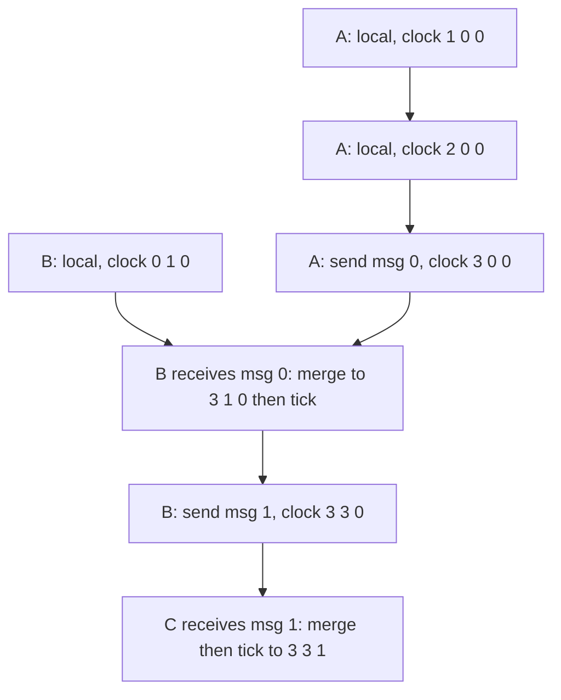
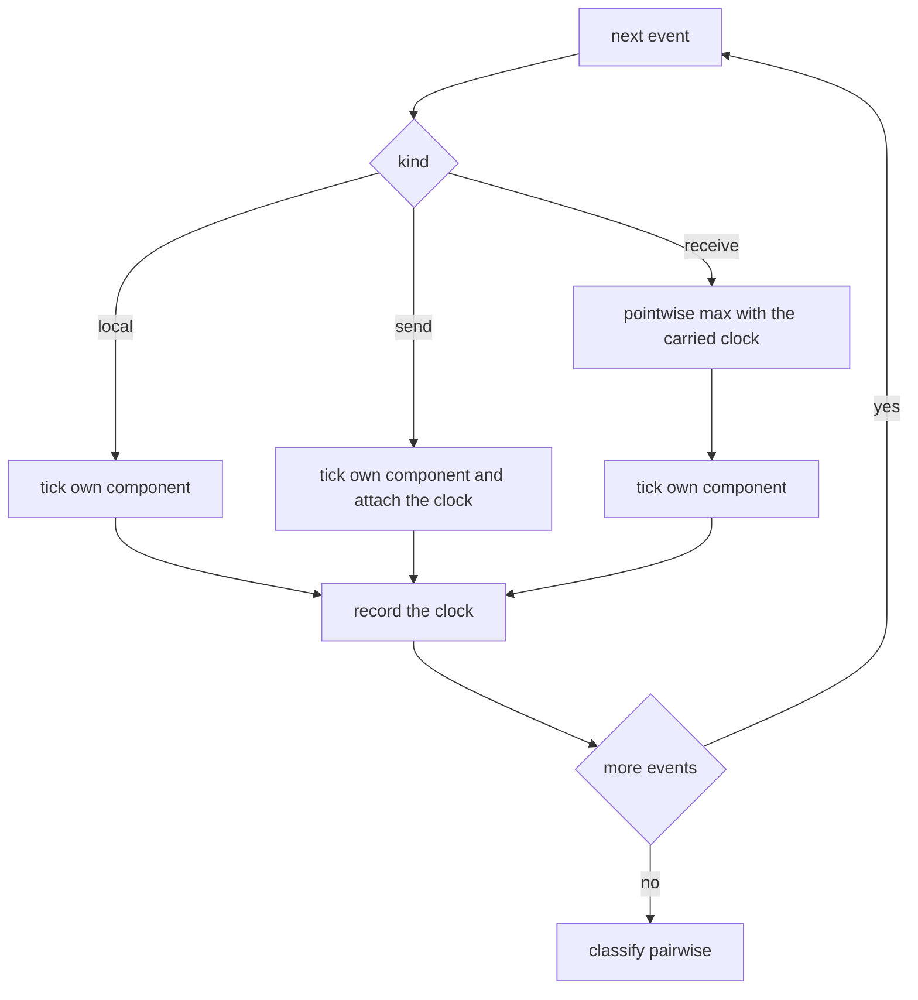
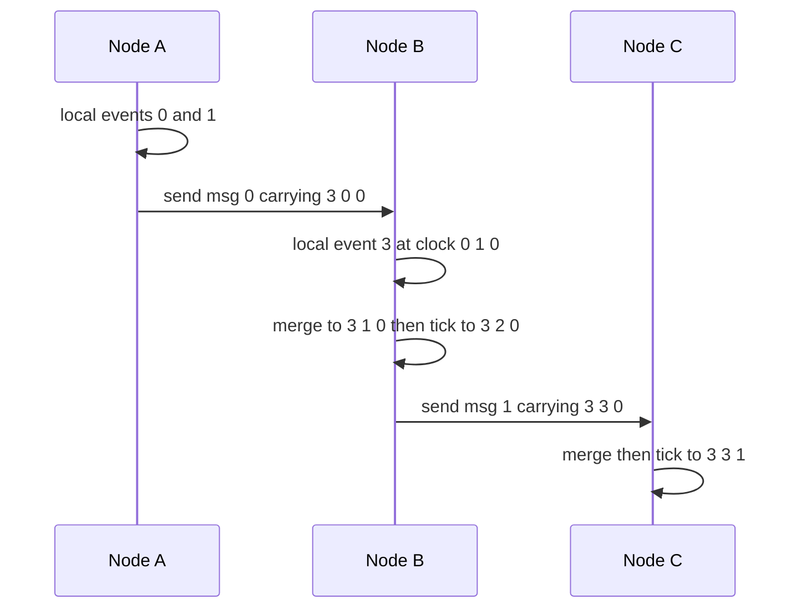

# 471 — Implement vector clock for distributed event ordering.

> **Tier:** Advanced · **CTCI chapter:** Ch 9 — System Design and Scalability
> **Task spec:** [471-implement-vector-clock-for-distributed-event-ordering.md](../../../tasks/advanced/471-implement-vector-clock-for-distributed-event-ordering.md)
> **Solutions:** [Python](../../../solutions/python/advanced/471-implement-vector-clock-for-distributed-event-ordering/solution.py) ·
> [Java](../../../solutions/java/advanced/471-implement-vector-clock-for-distributed-event-ordering/Solution.java) ·
> [JavaScript](../../../solutions/javascript/advanced/471-implement-vector-clock-for-distributed-event-ordering/solution.js) ·
> [C#](../../../solutions/csharp/advanced/471-implement-vector-clock-for-distributed-event-ordering/Solution.cs)

## 1. Problem restatement

**Input:** a scripted trace of events over `NODES = 3` nodes. Each event is a local event, a send,
or a receive of a previously sent message. Every node keeps one counter per node, i.e. a vector of
three integers.

**Output:** for every ordered pair of events, a causal classification: `before`, `after`, `equal`,
or `concurrent`. Two events are ordered if one vector is pointwise at most the other and strictly
smaller somewhere; if neither dominates, they are concurrent.

The rules the four solutions implement are the textbook ones: a local event ticks the node's own
component; a send ticks first and then piggybacks the sender's clock; a receive takes the pointwise
maximum of its own clock and the carried clock, then ticks its own component.

The contract is fixed by the assertions. The featured trace is fully hand-checked:

| Event | Node | Kind | Clock after the event |
| --- | --- | --- | --- |
| 0 | A | local | `[1, 0, 0]` |
| 1 | A | local | `[2, 0, 0]` |
| 2 | A | send msg 0 to B | `[3, 0, 0]` |
| 3 | B | local | `[0, 1, 0]` |
| 4 | B | receive msg 0 | `[3, 2, 0]` |
| 5 | B | send msg 1 to C | `[3, 3, 0]` |
| 6 | C | receive msg 1 | `[3, 3, 1]` |

and the classifications of those seven events include `classify(0, 2) = before`,
`classify(3, 0) = concurrent`, `classify(3, 2) = concurrent`, `classify(3, 4) = before`,
`classify(6, 4) = after`, and no pair equal.

For the larger scripted trace, `gen_script(26, 1234)` produces `26` events: `20` local, `4` send,
`2` receive. Across all `26 * 25 / 2 = 325` event pairs the file asserts `140` ordered pairs and
`185` concurrent pairs, compared against a causal-order oracle built from program order plus
send-to-receive edges closed by transitive closure.

## 2. Intuition

Wall-clock timestamps cannot order distributed events: two machines' clocks disagree, and even
perfect clocks would not tell you whether one event *caused* another or merely happened nearby.
What causality needs is not a timestamp but a **summary of what each node knew** when the event
happened.

That summary is the vector. Component `j` of a clock records how many events of node `j` the local
node has learned about. The three rules follow directly from that reading:

- A local event adds one fact, so tick your own component.
- A send must ship the facts you know, so tick (the send is itself an event) and attach the vector.
- A receive learns everything the message knew, so merge with `max` component-wise, then tick —
  the receive is a new event of your own.

The merge is the heart of it. Taking a component-wise maximum is exactly "learn everything the
message knew, keep everything you already knew", and it is monotone, so a node's knowledge never
shrinks.



Event 3 is the interesting one: B has a local event while A's message is still in flight, so B's
clock knows nothing of A. Comparing `[0, 1, 0]` with `[1, 0, 0]` shows neither is pointwise
smaller, so the two events are **concurrent** — the correct answer, and the one a timestamp would
get wrong if B's clock happened to be ahead.

## 3. Algorithm

1. Every node holds a vector of `NODES` integers, all zero.
2. **Local event:** increment the node's own component, then record the clock.
3. **Send:** increment the node's own component, enqueue the message carrying the post-tick clock,
   and record the clock.
4. **Receive:** for each component, set `clock[i] = max(clock[i], carried[i])`; then increment the
   node's own component and record the clock.
5. `classify(a, b)`: if `a` is pointwise at most `b` and `b` is pointwise at most `a` the events are
   `equal`; if `a` is pointwise at most `b` it is `before`; if `b` is pointwise at most `a` it is
   `after`; otherwise `concurrent`.

```text
procedure local_event(node)
    clock[node][node] ← clock[node][node] + 1
    record (node, local, clock[node])
end

procedure send(node, target, message)
    clock[node][node] ← clock[node][node] + 1
    enqueue (message, copy of clock[node]) to target
    record (node, send, clock[node])
end

procedure receive(node, carried)
    for i ← 0 to NODES - 1 do
        clock[node][i] ← max(clock[node][i], carried[i])
    end
    clock[node][node] ← clock[node][node] + 1
    record (node, receive, clock[node])
end

function classify(a, b)
    le ← every component of a is at most the matching component of b
    ge ← every component of a is at least the matching component of b
    if le and ge then
        return equal
    end
    if le then
        return before
    end
    if ge then
        return after
    end
    return concurrent
end
```

The generated script uses the same three rules with a deterministic LCG: it picks a node, picks a
kind, and for a send picks a target that is never the sender, while a receive pops the oldest
pending message for that node.



## 4. Worked example

Replay the featured three-node trace step by step, always showing the clock after the event:

| Step | Event | Action | Clock |
| --- | --- | --- | --- |
| 0 | A local | `clock[A] += 1` | `[1, 0, 0]` |
| 1 | A local | `clock[A] += 1` | `[2, 0, 0]` |
| 2 | A send msg 0 | tick, then ship `[3, 0, 0]` | `[3, 0, 0]` |
| 3 | B local | B ticks while the message is in flight | `[0, 1, 0]` |
| 4 | B receive msg 0 | `max([0,1,0], [3,0,0]) = [3,1,0]`, then tick | `[3, 2, 0]` |
| 5 | B send msg 1 | tick, then ship `[3, 3, 0]` | `[3, 3, 0]` |
| 6 | C receive msg 1 | `max([0,0,0], [3,3,0]) = [3,3,0]`, then tick | `[3, 3, 1]` |

Step 4 is where the merge does its work: B's own counter was `1` and A's component was `0`; after
merging, B knows about A's three events while keeping its own local fact.



Now the classifications, which are pure vector comparisons:

| Pair | Vectors | Result | Why |
| --- | --- | --- | --- |
| `classify(0, 2)` | `[1,0,0]` vs `[3,0,0]` | `before` | every component of the first is at most the second |
| `classify(3, 0)` | `[0,1,0]` vs `[1,0,0]` | `concurrent` | first is larger in B, second is larger in A |
| `classify(3, 2)` | `[0,1,0]` vs `[3,0,0]` | `concurrent` | neither dominates |
| `classify(3, 4)` | `[0,1,0]` vs `[3,2,0]` | `before` | B's own local event precedes its merge |
| `classify(6, 4)` | `[3,3,1]` vs `[3,2,0]` | `after` | domination in the other direction |

The scripted trace exercises the same logic at scale. It contains `20` local events, `4` sends and
`2` receives, and of the `325` pairs, `140` are causally ordered and `185` are concurrent. The
expected answer for each pair comes from an independent oracle — a reachability matrix over
program-order edges and send-to-receive edges, closed with Floyd–Warshall — so the vector
implementation is checked against graph reachability rather than against itself.

## 5. Complexity

Let `N` be the node count (`3` here), `E` the number of events, and `P` the clock size (`P = N`).

| Measure | Bound | Why it holds |
| --- | --- | --- |
| Time, local event | O(1) | one increment plus a copy of the clock |
| Time, send | O(N) | the clock is copied into the message |
| Time, receive | O(N) | the pointwise `max` touches every component |
| Time, `classify` | O(N) | two pointwise scans over the vectors |
| Time, all pairs | O(E² N) | `325` comparisons × `3` components here |
| Space, clocks | O(N²) | one vector of size `N` per node |
| Space, oracle | O(E²) | the reachability matrix, built only for testing |
| Oracle time | O(E³) | Floyd–Warshall closure over `E = 26` events |

Vector clocks grow linearly with the number of nodes, and this is the practical limit of the
approach: a cluster of a thousand nodes means a thousand counters per message. The oracle is
deliberately more expensive than the thing it checks — `O(E³)` versus `O(E² N)` — because checking
the implementation against graph reachability is far stronger evidence than re-running the same
vector arithmetic.

## 6. Pitfalls and edge cases

- **Tick before shipping, not after.** A send is itself an event, so the carried clock must include
  the send's own tick: A's send carries `[3, 0, 0]`, not `[2, 0, 0]`. Otherwise the message's clock
  would be equal to the preceding local event and the two would classify as `equal`.
- **Receive merges, then ticks.** The order is `max` first, then the local increment, which is why
  B's receive lands on `[3, 2, 0]` and not `[3, 1, 0]` or `[4, 1, 0]`.
- **Equal vectors mean one event.** The featured trace asserts that no two of its seven events
  classify as `equal`, because every event ticks some component. `equal` only arises when the same
  event is compared with itself, and the test only compares distinct pairs.
- **Concurrency is not a failure.** `classify(3, 0)` returning `concurrent` is the correct answer for
  two events with no causal path; a design that forced every pair into `before`/`after` would be
  inventing an order that does not exist.
- **Messages need not arrive in send order.** The generator delivers each message to its own target
  queue and the receive pops the oldest pending one; the algorithm's correctness does not depend on
  global ordering, only on the merge at each receive.
- **A receive with no pending message.** The generator avoids it by turning a receive into a local
  event when the queue is empty, so the scripted trace always has a message to merge.
- **Vector size versus universe size.** Every clock has a slot for every node, even nodes that never
  interact with this one; a sparse or dynamic membership scheme is a different data structure.

## 7. Variants and follow-ups

- **Causality across a wider system.**
  [630-implement-causal-consistency-protocol-simulation-vector-clocks.md](../../../tasks/expert/630-implement-causal-consistency-protocol-simulation-vector-clocks.md)
  uses these clocks as the ordering primitive of a consistency protocol rather than as a
  classification exercise.
- **Consensus instead of clocks.** [472-implement-basic-raft-consensus-pseudo-simulation-leader-election.md](../../../tasks/advanced/472-implement-basic-raft-consensus-pseudo-simulation-leader-election.md)
  and [473-implement-paxos-basic-single-decree-outline.md](../../../tasks/advanced/473-implement-paxos-basic-single-decree-outline.md)
  impose a *total* order on events by agreeing on a log index, which is the complement of the partial
  order built here.
- **Global snapshots.** [616-implement-distributed-snapshot-algorithm-chandy-lamport.md](../../../tasks/expert/616-implement-distributed-snapshot-algorithm-chandy-lamport.md)
  and [852-implement-global-snapshotting-for-distributed-streaming-pipeline.md](../../../tasks/master/852-implement-global-snapshotting-for-distributed-streaming-pipeline.md)
  use message-carried metadata much like a vector clock to decide what happened before a cut.
- **Conflict resolution with causality.** [805-implement-eventual-consistent-multi-master-datastore-with-confli.md](../../../tasks/master/805-implement-eventual-consistent-multi-master-datastore-with-confli.md)
  spends these classifications resolving conflicting concurrent writes.
- The chapter walkthrough [System Design and Scalability](../../ctci/09-system-design-scalability.md)
  frames clocks as one answer to "what is the order of events across machines?".

## 8. Check yourself

1. Why is a send's carried clock taken *after* the sender ticks?

<details><summary>Show answer</summary>

Because the send is an event in its own right. If the clock were shipped before the tick, the
carried vector would be identical to the previous event's vector and the two would classify as
`equal`. Ticking first makes A's send carry `[3, 0, 0]`, one step ahead of the local event at
`[2, 0, 0]`, which is what makes `classify(1, 2) = before` hold.

</details>

2. Both `[0, 1, 0]` and `[1, 0, 0]` are valid clocks. Why are their events concurrent?

<details><summary>Show answer</summary>

Because neither vector dominates: the first is larger in component B, the second is larger in
component A, so neither is pointwise at most the other. That is precisely the definition of
concurrency, and it correctly captures that neither event could have known about the other —
`classify(3, 0)` asserts `concurrent`.

</details>

3. What does the receive rule prove about a node's knowledge over time?

<details><summary>Show answer</summary>

That it never shrinks. The merge is a component-wise `max`, so each component after the merge is at
least what it was before, and the subsequent tick only raises the node's own component further. A
monotone clock is what makes the stored vectors a valid encoding of "everything this node had
learned".

</details>

4. Why does the test compare the vector classification against a reachability oracle instead of only
   asserting the hand-computed featured vectors?

<details><summary>Show answer</summary>

The featured trace covers seven events and a handful of patterns; the scripted `26`-event trace
covers `325` pairs with interleaved local events, four sends and two receives. The oracle derives
expected causality independently — program-order edges plus send-to-receive edges, closed by
Floyd–Warshall — so agreement across all `325` pairs checks the implementation against graph theory
rather than against its own arithmetic.

</details>

5. In the scripted trace `140` pairs are ordered and `185` are concurrent. Why is the concurrent
   share larger than half?

<details><summary>Show answer</summary>

Because the trace is dominated by local events — `20` of the `26` events are local, and only `2` are
receives. Events on different nodes that have no message path between them are concurrent by
definition, so with three nodes and few synchronising messages most pairs are incomparable. The
ratio is a property of this trace, not a general rule.

</details>
