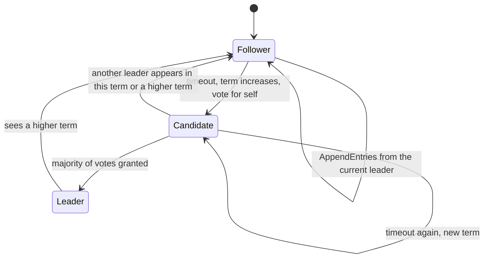
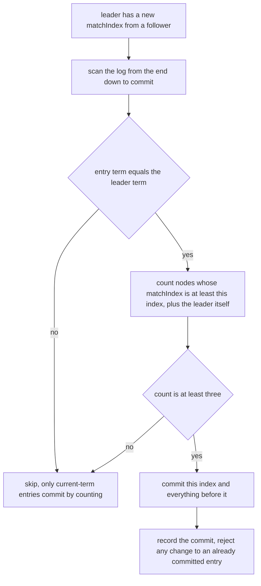
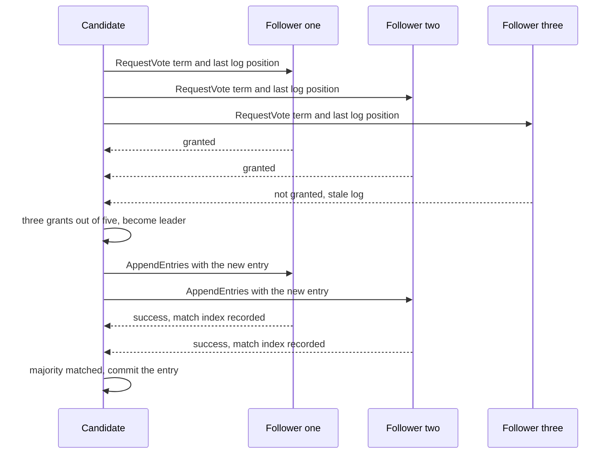
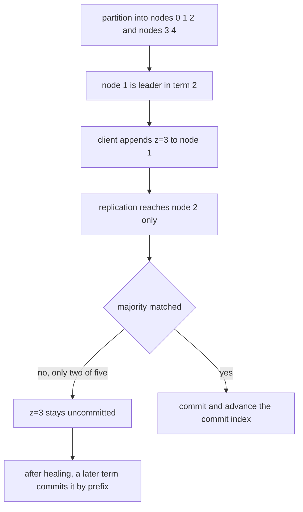

# 472 — Implement basic Raft consensus pseudo-simulation (leader election outline).

> **Tier:** Advanced · **CTCI chapter:** Ch 9 — System Design and Scalability
> **Task spec:** [472-implement-basic-raft-consensus-pseudo-simulation-leader-election.md](../../../tasks/advanced/472-implement-basic-raft-consensus-pseudo-simulation-leader-election.md)
> **Solutions:** [Python](../../../solutions/python/advanced/472-implement-basic-raft-consensus-pseudo-simulation-leader-election/solution.py) ·
> [Java](../../../solutions/java/advanced/472-implement-basic-raft-consensus-pseudo-simulation-leader-election/Solution.java) ·
> [JavaScript](../../../solutions/javascript/advanced/472-implement-basic-raft-consensus-pseudo-simulation-leader-election/solution.js) ·
> [C#](../../../solutions/csharp/advanced/472-implement-basic-raft-consensus-pseudo-simulation-leader-election/Solution.cs)

## 1. Problem restatement

**Input:** a scripted list of actions against a 5-node cluster. The actions are `timeout(node)`,
`client(command)`, `replicate`, `drain`, `partition(groups)`, `heal`, `crash(node)` and
`recover(node)`. There is no wall-clock timing: elections are triggered by the `timeout` action
rather than by an elapsed timer.

**Output:** an engine that maintains a replicated log and a commit index per node, with the usual
Raft safety properties asserted after every action.

This is a **pseudo-simulation (leader election outline)**: the docstring states that message
delivery is scripted, so the interesting behaviour is the protocol's state machine and its safety
invariants rather than real concurrency. Each of the 5 nodes keeps `term`, `voted_for`, a role
(`F` follower, `C` candidate, `L` leader), a log of `(term, command)` entries, `commit`, the set of
granting voters, and the per-follower `next_index` / `match_index` arrays.

The invariants the file asserts continuously are:

| Invariant | Statement |
| --- | --- |
| election safety | at most one leader per term, checked when a candidate wins |
| log matching | if two logs agree on the term at some index, their prefixes up to that index are identical |
| committed entries are immutable | `_record_commit` rejects any index whose entry has changed |
| leader completeness | a newly elected leader already holds every committed entry |
| no regression | a node's term and commit index never decrease |
| commit bound | `commit <= length(log)` for every node |
| quorum | an entry commits only with a majority of `match_index` values, and only if its term is the leader's term |

The scripted sequence in `main` walks exactly these cases:

| Step | Action | Asserted result |
| --- | --- | --- |
| 1 | `timeout(0)`, `drain` | `leaders_by_term == {1: 0}` |
| 2 | `client("x=1")`, replicate/drain twice | `committed_up_to == 1`, `committed[0] == (1, "x=1")` |
| 3 | `crash(0)`, `timeout(1)`, `drain` | `leaders_by_term[2] == 1` — a new term and a new leader |
| 4 | `client("y=2")`, replicate/drain twice | `committed_up_to == 2`, `committed[1] == (2, "y=2")` |
| 5 | partition `[(0,1,2), (3,4)]`, `client("z=3")`, replicate/drain twice | still `committed_up_to == 2`; nodes 1 and 2 hold `(2, "z=3")` |
| 6 | `timeout(3)`, `drain` | `3` never appears in `leaders_by_term` |
| 7 | `heal`, `timeout(1)` then `timeout(1)`, drains | term 3 fails, then `leaders_by_term[4] == 1` |
| 8 | `client("w=4")`, replicate/drain three times | `committed_up_to == 4`, `committed[2] == (2, "z=3")`, `committed[3] == (4, "w=4")` |
| 9 | `random_actions(64, 24680)` | safety holds under arbitrary churn |
| 10 | `heal`, recover all, then timeouts for the most up-to-date node | that node wins and `("end")` commits |

## 2. Intuition

A single leader that appends to a log and ships the log to followers is easy to reason about. The
hard part is that the leader can die at any moment, so the cluster also needs a way to *choose* a
new one without ever choosing two at once, and without losing entries that were already
acknowledged.

Raft splits that into two intertwined mechanisms. Elections use **terms**: a term is a logical
clock, each node votes at most once per term, and a candidate needs a majority of the 5 nodes to
become leader. Because a majority intersects any other majority, two leaders in the same term would
require a node to vote twice, which the `voted_for` field forbids. Terms also make stale messages
harmless: any message from an older term is rejected outright.

Replication uses the leader's log as the truth. The leader tracks, per follower, the next index to
send and the highest index the follower is known to have matched. An `AppendEntries` message carries
the entry *before* the new ones, so the follower can verify consistency; if the check fails, the
follower reports its log length as a hint and the leader walks its `next_index` back until the logs
agree, truncating whatever the follower had beyond the divergence.



The picture makes the safety argument visible: a candidate can only escalate to leader through a
majority, and every transition that sees a higher term drops the node back to follower.

The second half of the intuition is the **commit rule**, which is subtle enough to be worth its own
diagram. A leader cannot commit an entry merely because a majority has *stored* it: a later leader
might overwrite it. Raft therefore commits an entry only when it is of the leader's own term and a
majority has matched it; older entries then commit along with it by prefix. That is exactly what
step 8 in the table demonstrates — `z=3` from term 2 was replicated to a majority but never
committed, and it only becomes committed when the term-4 leader appends `w=4` after it.



## 3. Algorithm

1. Model the network as a queue of `(from, to, message)` triples. `send` drops anything addressed to
   a crashed node or across a partition boundary; `drain` pops messages in order and drops any whose
   endpoints have since become unreachable.
2. `timeout(i)`: if the node is alive, increment its term, vote for itself, become a candidate, and
   send `RequestVote` carrying the index and term of its last log entry.
3. Handling `RequestVote`: reject an older term; adopt a newer term and become a follower; grant the
   vote only if the node has not voted for someone else in this term *and* the candidate's last entry
   is at least as up to date as its own.
4. Handling `RequestVoteResponse`: adopt a newer term and step down; otherwise a candidate counts
   distinct grants and becomes leader at a majority.
5. `client(command)`: append the command to the highest-term live leader's log; return `False` if
   there is no live leader.
6. `replicate()`: every leader sends each follower an `AppendEntries` with `prev_idx`/`prev_term`
   from that follower's `next_index` and the entries after it.
7. Handling `AppendEntries`: reject an older term; adopt a newer one; perform the consistency check;
   truncate conflicting entries and append the new ones; advance `commit` to
   `min(leader_commit, last_new_index)`; reply with success and the new match index, or failure with
   the follower's log length as a hint.
8. Handling `AppendEntriesResponse`: on success record `match_index` and recompute the commit index
   using the current-term rule; on failure walk `next_index` back toward the hint.
9. `check_invariants()` runs after every action and enforces the table from section 1.

```text
procedure request_vote(node, term, candidate, last_index, last_term)
    if term < node.term then
        reply (granted = false, term = node.term)
        return
    end
    if term > node.term then
        node.term ← term
        node.voted_for ← none
        node.state ← Follower
    end
    own_index ← length(node.log) - 1
    own_term ← term of the last log entry, or 0 if the log is empty
    up_to_date ← last_term > own_term or (last_term = own_term and last_index >= own_index)
    granted ← (node.voted_for is none or node.voted_for = candidate) and up_to_date
    if granted then
        node.voted_for ← candidate
    end
    reply (granted, node.term)
end

procedure append_entries(node, term, leader_id, prev_index, prev_term, entries, leader_commit)
    if term < node.term then
        reply (success = false, hint = length(node.log))
        return
    end
    if term > node.term then
        node.term ← term
        node.voted_for ← none
    end
    node.state ← Follower
    if prev_index >= length(node.log) or term of node.log[prev_index] differs from prev_term then
        reply (success = false, hint = length(node.log))
        return
    end
    truncate conflicting entries and append the new ones starting at prev_index + 1
    last_new ← prev_index + length(entries) + 1
    if leader_commit > node.commit then
        advance node.commit to min(leader_commit, last_new), recording each entry
    end
    reply (success = true, hint = last_new)
end

function can_commit(leader, index)
    majority ← (N + 1) // 2
    votes ← count of nodes whose match_index is at least index, counting the leader itself
    return term of leader.log[index - 1] = leader.term and votes >= majority
end
```

Every reply carries the responder's term, so a leader that has fallen behind learns about it on the
next message and steps down — that is the mechanism that keeps at most one leader per term true in
the long run, not just at election time.



## 4. Worked example

Follow the scripted scenario through its three interesting moments.

**Election.** `timeout(0)` makes node 0 a candidate in term 1; the four other nodes have empty logs
and vote, so `leaders_by_term` becomes `{1: 0}`. With the leader established, `client("x=1")`
appends `(1, "x=1")`, and two replicate/drain rounds push it to the followers and then commit it,
giving `committed_up_to == 1`.

**Leader failure.** `crash(0)` removes the leader, and `timeout(1)` starts term 2, which node 1 wins:
`leaders_by_term[2] == 1`. `client("y=2")` plus replication commits `(2, "y=2")`, so
`committed_up_to == 2`.

**Partition.** Now partition the cluster into `[(0, 1, 2), (3, 4)]`. Node 1 is the leader and lives
in the three-node group, so `client("z=3")` succeeds locally and replication reaches node 2:

| Action | Node 1 log | Node 2 log | Nodes 3, 4 | Commit |
| --- | --- | --- | --- | --- |
| before partition | `[(1,"x=1"), (2,"y=2")]` | same | same | `2` |
| `client("z=3")` | `[..., (2,"z=3")]` | unchanged | unchanged | `2` |
| replicate and drain | `[..., (2,"z=3")]` | `[..., (2,"z=3")]` | unreachable, messages dropped | `2` |

The leader plus node 2 is only two of five nodes, one short of a majority, so nothing commits:
`committed_up_to` stays `2` and the assertion checks exactly that. In the minority group,
`timeout(3)` cannot win either — two votes out of five is not a majority — and `3` never appears in
`leaders_by_term`.



**Recovery.** After `heal`, `timeout(1)` first tries term 3 and fails, because the stale voters
decline; a second `timeout(1)` wins term 4 and node 1 becomes leader again. Now
`client("w=4")` appends a *current-term* entry, and the commit rule fires: the term-4 leader with a
majority matching `w=4` commits index 4 and, by prefix, index 3 as well. The assertions confirm
`committed[2] == (2, "z=3")` and `committed[3] == (4, "w=4")`, and every node's log becomes
`[(1,"x=1"), (2,"y=2"), (2,"z=3"), (4,"w=4")]`. This is the payoff of the current-term restriction:
without it, a leader could have committed `z=3` on match counts alone from a term it did not control.

## 5. Complexity

Let `N = 5` be the cluster size, `L` the log length and `A` the number of scripted actions.

| Measure | Bound | Why it holds |
| --- | --- | --- |
| Time, one action | O(N · L) worst case | a leader replication pass builds an `AppendEntries` per follower with the remaining log |
| Time, election round | O(N) messages | one `RequestVote` per peer, one reply each |
| Time, commit scan | O(N · L) | the leader walks candidate indexes and counts `match_index` values |
| Time, fixture | O(A · N · L) | `check_invariants` runs pairwise log comparisons after every action |
| Space, cluster | O(N · L) | one log per node plus `next_index`/`match_index` arrays of size `N` |
| Invariant check | O(N² · L) | compared logs for every pair of nodes, which is cheap at `N = 5` |

The quadratic invariant check is a testing cost, not a production one: it compares node logs pairwise
to catch a log-matching violation the instant it happens, which is worth far more than the cycles at
this scale. The one expensive design consequence is that `replicate` must be driven by explicit
actions rather than by real time, which is the documented simplification of the pseudo-simulation.

## 6. Pitfalls and edge cases

- **Two leaders in one term.** Impossible by construction and asserted in `_become_leader`: a node
  votes at most once per term, stored in `voted_for`, and a majority of two disjoint majorities would
  have to overlap.
- **Older-term messages must be rejected.** Every handler compares the incoming term first and
  replies with its own term when the message is stale. Skipping that check lets a delayed
  `AppendEntries` from a deposed leader truncate a newer log.
- **The up-to-date test.** `up_to_date` compares `last_term` first and only then `last_index`, so a
  longer log with older entries loses to a shorter log with a newer term. Comparing lengths alone
  would elect a node missing committed entries, breaking leader completeness.
- **Commit only current-term entries by counting.** This is the single most commonly mis-implemented
  rule, and step 8 of the scripted sequence is the regression test: `z=3` from term 2 was on a
  majority but uncommitted until a term-4 entry arrived after it.
- **Truncation on conflict.** A follower must delete entries whose term disagrees with the leader's
  before appending; keeping them would break log matching and the pairwise prefix assertion.
- **Partition and crash must drop messages.** `send` and `drain` re-check reachability, so messages
  queued before a partition are *not* delivered afterwards; without that re-check the scripted
  partition test would commit `z=3` and fail its assertion.
- **Minority groups cannot elect.** `timeout(3)` in a two-node group gathers at most two votes against
  a majority of three, so `3` never leads.

## 7. Variants and follow-ups

- **The same problem, different protocol.** [473-implement-paxos-basic-single-decree-outline.md](../../../tasks/advanced/473-implement-paxos-basic-single-decree-outline.md)
  reaches agreement on a single value with two phases, and
  [662-implement-paxos-multi-decree-long-running-simulation-with-leader.md](../../../tasks/expert/662-implement-paxos-multi-decree-long-running-simulation-with-leader.md)
  scales it to a running log.
- **Adversarial networks.** [628-implement-distributed-consensus-simulation-with-network-partitio.md](../../../tasks/expert/628-implement-distributed-consensus-simulation-with-network-partitio.md)
  stresses partitions far harder than this outline, and
  [759-implement-byzantine-fault-tolerant-consensus-small-simulation-pb.md](../../../tasks/expert/759-implement-byzantine-fault-tolerant-consensus-small-simulation-pb.md)
  adds nodes that lie.
- **Changing the membership.** [629-implement-dynamic-reconfiguration-in-raft-joint-consensus.md](../../../tasks/expert/629-implement-dynamic-reconfiguration-in-raft-joint-consensus.md)
  covers adding and removing servers safely, which this outline does not attempt.

## 8. Check yourself

1. Why can two leaders never appear in the same term?

<details><summary>Show answer</summary>

Because a candidate needs a majority of the five nodes, and any two majorities share at least one
node. A node grants at most one vote per term — recorded in `voted_for` — so the shared node would
have had to vote twice. `_become_leader` asserts the property directly by recording
`leaders_by_term[term]` and rejecting a second, different winner.

</details>

2. In step 9 of the scripted sequence, `z=3` was replicated to nodes 1 and 2 but never committed.
   What finally commits it?

<details><summary>Show answer</summary>

The term-4 leader's later entry `w=4`. Raft only commits an entry by counting `match_index` values
when that entry belongs to the leader's own term; `z=3` came from term 2, so it could not be committed
that way. Once `w=4` is stored on a majority of the term-4 cluster, committing index 4 commits index 3
along with it by prefix, which is exactly what `committed[2] == (2, "z=3")` and
`committed[3] == (4, "w=4")` record.

</details>

3. Why does `up_to_date` compare terms before log lengths?

<details><summary>Show answer</summary>

Because a log is only as authoritative as the terms in it. A longer log made of older entries can be
missing committed entries that a shorter log with a newer term already has, so the last *term* must
dominate the comparison and length is only a tie-breaker within the same term. Reversing the check
would let a stale node win an election and violate leader completeness — the assertion that a new
leader already holds every committed entry.

</details>

4. The partition test queues no messages across the boundary, even when messages were sent before the
   partition. Why does the simulation re-check reachability when draining?

<details><summary>Show answer</summary>

Without the re-check a message queued just before the partition would be delivered afterwards, and
node 2 or node 0 would receive an entry across a boundary where the leader had no quorum. The
scenario asserts that only nodes 1 and 2 hold `z=3` and that nothing commits, so dropping
undeliverable messages is what makes the test meaningful rather than a timing accident.

</details>
