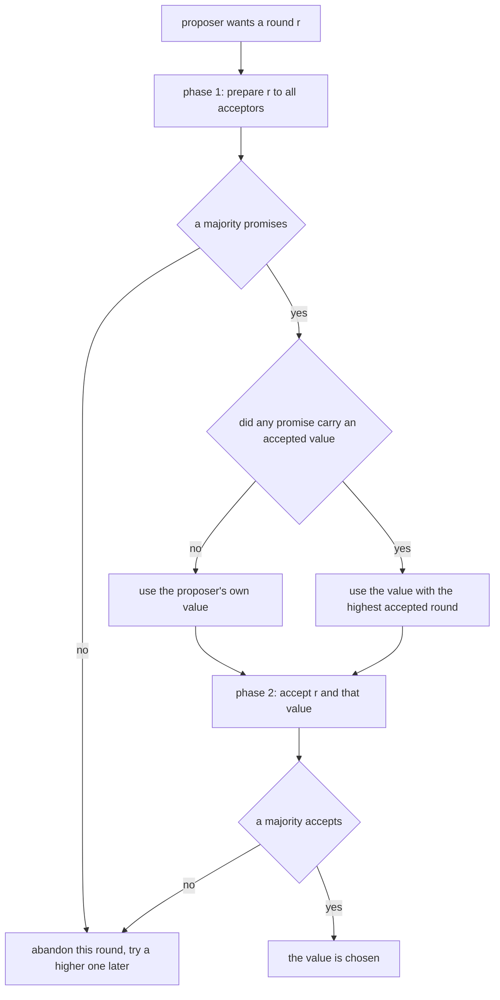
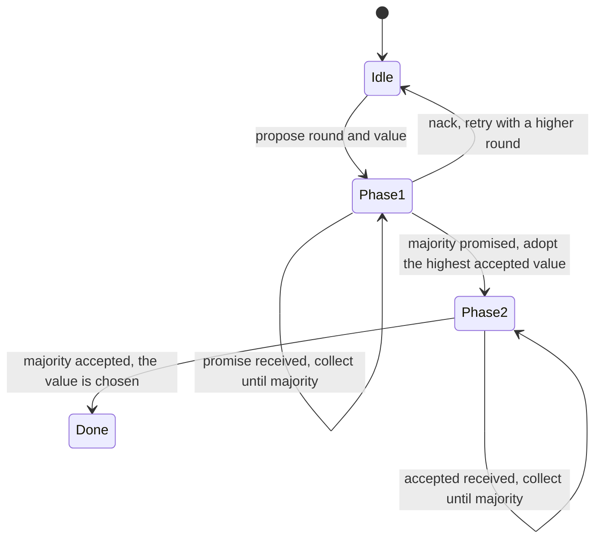
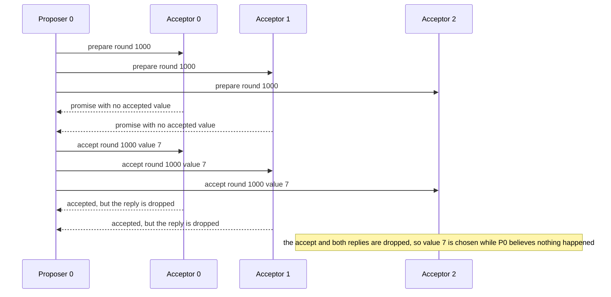
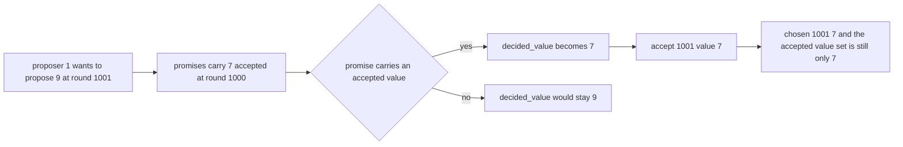

# 473 — Implement Paxos basic single-decree outline.

> **Tier:** Advanced · **CTCI chapter:** Ch 9 — System Design and Scalability
> **Task spec:** [473-implement-paxos-basic-single-decree-outline.md](../../../tasks/advanced/473-implement-paxos-basic-single-decree-outline.md)
> **Solutions:** [Python](../../../solutions/python/advanced/473-implement-paxos-basic-single-decree-outline/solution.py) ·
> [Java](../../../solutions/java/advanced/473-implement-paxos-basic-single-decree-outline/Solution.java) ·
> [JavaScript](../../../solutions/javascript/advanced/473-implement-paxos-basic-single-decree-outline/solution.js) ·
> [C#](../../../solutions/csharp/advanced/473-implement-paxos-basic-single-decree-outline/Solution.cs)

## 1. Problem restatement

**Input:** a scripted sequence of actions against `3` acceptors and `2` proposers. The actions are
`propose(proposer, round, value)`, `deliver(k)` (deliver the next `k` messages), `drain` (deliver
everything), and `drop(k)` (throw the next `k` messages away to model loss).

**Output:** the single value the cluster agrees on, plus a safety check that at most one value is
ever chosen.

This is an **outline** task: the docstring states that the simulation is driven by a scripted message
queue with explicit deliver and drop actions, so there is no real network and no timing model. The
protocol itself is textbook **single-decree Paxos** — one round of agreement on one value, with
`MAJORITY = 2` of the 3 acceptors.

Each acceptor keeps the highest round it has promised (`promised`), the round it last accepted and
the value it accepted (`accepted_round`, `accepted_value`), and the full accept `history`. Each
proposer walks the phases `idle`, `P1`, `P2`, `done` and keeps its round, its own proposed value, the
promises it collected, the set of acceptors that accepted, and the value it believes was chosen.

The contract is fixed by the assertions:

| Action | Asserted result |
| --- | --- |
| `propose(0, 1000, 7)`, deliver 3, deliver 2, deliver 3, drop 3 | acceptors 0 and 1 hold `(1000, 7)`, acceptor 2 empty, `chosen_events == []`, `oracle_chosen == {7}` |
| `propose(1, 1001, 9)`, drain | proposer 1's `decided_value == 7` — not its own `9` |
| the same | `proposers[1].chosen == (1001, 7)`, `chosen_events == [(1001, 7)]` |
| `propose(0, 1002, 8)`, drain | proposer 0 must also re-propose `7`; `chosen_events == [(1001, 7), (1002, 7)]` |
| all acceptors' histories | the set of accepted values is exactly `{7}` — `9` and `8` are never accepted anywhere |
| `random_actions(30, 13579, 2000)` | safety holds under lossy churn |
| fair finale `propose(0, 3000, 5)`, `propose(1, 3001, 6)`, drain | `chosen_events` is non-empty and every chosen value is `7` |

## 2. Intuition

A single acceptor that just stores the first value it hears would be trivial, and it would break as
soon as it crashed or as soon as another proposer used a newer round. Paxos handles both with two
phases and one rule.

**Phase 1 (prepare / promise)** asks a majority to *promise not to accept anything older* than this
round. A promise is a lock: once a majority has promised round `r`, no proposal with a lower round
can gather a majority.

**Phase 2 (accept / accepted)** then proposes an actual value. Because the proposer can only reach a
majority in phase 2 if a majority has not promised anything newer, two different values cannot both
be accepted by a majority — that is the safety property the whole exercise proves.

The rule that makes it work across competing proposers is the **recovery rule**, and it is the part
worth committing to memory: if *any* promise carries an already-accepted value, the proposer must
adopt the value with the **highest accepted round** among the promises, discarding its own. Without
that rule, proposer 1 in the scripted trace would push its own `9` into phase 2, and the cluster
would have two different values accepted by majorities at different rounds.



An acceptor's memory is the other half of the picture. `promised` only ever increases, which is what
makes a promise meaningful, and `history` records every accept in round order, which is what lets the
test compute the chosen value independently of the engine.

## 3. Algorithm

1. Set up `3` acceptors with `promised = -1` and no accepted value, and `2` proposers in phase
   `idle`.
2. `propose(p, round, value)`: put proposer `p` into phase `P1`, record its round and its own value,
   clear the promise and accept records, and enqueue `prepare(round, p)` for every acceptor.
3. Acceptor on `prepare(round, p)`: if `round > promised`, raise `promised` to `round` and reply
   `promise(round, acceptor, accepted_round, accepted_value)`; otherwise reply `nack`.
4. Proposer on `promise`: ignore it unless the proposer is still in `P1` for that exact round. On the
   second promise, choose the value: the one with the highest accepted round among the promises, or
   the proposer's own value if no promise carried one. Enter `P2` and enqueue `accept(round, value, p)`
   for every acceptor.
5. Acceptor on `accept(round, value, proposer)`: if `round >= promised`, raise `promised`, record the
   accepted round and value, append to `history`, and reply `accepted`. Otherwise reply `nack`.
6. Proposer on `accepted`: ignore unless it is in `P2` for that round; on the second acceptance record
   `chosen = (round, value)` and enter phase `done`.
7. `check()` computes the oracle — a value is chosen if some `(round, value)` appears in at least
   `MAJORITY` histories — and asserts that at most one distinct value is ever chosen, that promises
   never regress, and that each acceptor's accept rounds are non-decreasing.

```text
procedure propose(proposer, round, value)
    proposer.phase ← P1
    proposer.round ← round
    proposer.own_value ← value
    proposer.decided_value ← none
    proposer.promises ← empty
    proposer.accepts ← empty
    for each acceptor do
        enqueue (acceptor, prepare(round, proposer))
    end
end

procedure on_prepare(acceptor, round, proposer)
    if round <= acceptor.promised then
        enqueue (proposer, nack(round, acceptor))
        return
    end
    acceptor.promised ← round
    enqueue (proposer, promise(round, acceptor, acceptor.accepted_round, acceptor.accepted_value))
end

procedure on_promise(proposer, round, acceptor, accepted_round, accepted_value)
    if proposer.phase differs from P1 or proposer.round differs from round then
        return
    end
    append (acceptor, accepted_round, accepted_value) to proposer.promises
    if length(proposer.promises) < MAJORITY then
        return
    end
    best_round ← -1
    best_value ← proposer.own_value
    for (each promised acceptor, its accepted round, its accepted value) in proposer.promises do
        if accepted value is not none and accepted round > best_round then
            best_round ← accepted round
            best_value ← accepted value
        end
    end
    proposer.decided_value ← best_value
    proposer.phase ← P2
    for each acceptor do
        enqueue (acceptor, accept(round, best_value, proposer))
    end
end

procedure on_accept(acceptor, round, value, proposer)
    if round < acceptor.promised then
        enqueue (proposer, nack(round, acceptor))
        return
    end
    acceptor.promised ← round
    acceptor.accepted_round ← round
    acceptor.accepted_value ← value
    append (round, value) to acceptor.history
    enqueue (proposer, accepted(round, acceptor, value))
end

procedure on_accepted(proposer, round, acceptor, value)
    if proposer.phase differs from P2 or proposer.round differs from round then
        return
    end
    add acceptor to proposer.accepts
    if length(proposer.accepts) >= MAJORITY then
        proposer.chosen ← (round, value)
        proposer.phase ← done
        record (round, value) in chosen_events
    end
end
```

Both handlers start with the same staleness test — wrong phase or wrong round means the message is
from a superseded attempt and must be ignored. Dropping that test is the classic way to make a
simulation "work" while proving nothing.



## 4. Worked example

**Step 1 — chosen before anyone knows.** `propose(0, 1000, 7)` queues three `prepare` messages. The
scripted deliveries are what make this trace interesting:

| Action | Queue effect | Acceptor state |
| --- | --- | --- |
| `propose(0, 1000, 7)` | three `prepare` messages queued | all `promised = -1` |
| `deliver(3)` | all three prepares processed, three `promise` replies queued | every acceptor promises `1000` |
| `deliver(2)` | two promises reach proposer 0, majority reached | proposer 0 enters `P2`, three `accept(1000, 7)` queued |
| `deliver(3)` | the third (now stale) promise is ignored; acceptors 0 and 1 accept `7` | acceptors 0 and 1 hold `(1000, 7)` |
| `drop(3)` | the accept for acceptor 2 and both `accepted` replies are discarded | acceptor 2 still empty |

The assertion after this step is the memorable one: `chosen_events == []` while `oracle_chosen == {7}`.
The engine's own knowledge says nothing was chosen, because proposer 0 never received a reply — but
two of the three acceptors hold `(1000, 7)`, and two is a majority, so by definition the value is
chosen. Safety is about what a majority accepted, not about what a proposer learned. This is exactly
why `check()` builds its oracle from the acceptor histories rather than trusting `chosen_events`.



**Step 2 — the recovery rule in action.** `propose(1, 1001, 9)` then `drain`: acceptor 0 and acceptor
1 answer the prepare with their accepted `(1000, 7)`, acceptor 2 answers with nothing.

| Promise source | Accepted round carried | Accepted value carried |
| --- | --- | --- |
| acceptors 0 and 1 | `1000` | `7` |
| acceptor 2 | none | none |

On the second promise the proposer applies the rule: the highest accepted round among the promises is
`1000`, its value is `7`, so `decided_value` becomes `7` and the accept phase ships `7` — not the
proposer's own `9`. The file asserts exactly this with `proposers[1].decided_value == 7`, and
`chosen_events` becomes `[(1001, 7)]`.

**Step 3 — the same rule again.** `propose(0, 1002, 8)` then `drain` produces the same outcome:
promises now carry `(1001, 7)` from the previous round, the proposer adopts `7`, and the histories
grow to `[(1000, 7), (1001, 7), (1002, 7)]` for acceptors 0 and 1 and `[(1001, 7), (1002, 7)]` for
acceptor 2. The assertion that matters is the negative one: the set of values ever accepted anywhere
is exactly `{7}`, so `9` and `8` were never accepted at all.



## 5. Complexity

Let `A` be the number of scripted actions, `n = 3` the acceptor count, and `P = 2` the proposer count.

| Measure | Bound | Why it holds |
| --- | --- | --- |
| Messages per proposal | O(n) per phase | one `prepare` and one `accept` per acceptor, plus one reply each |
| Time, one delivered message | O(1) | acceptor handlers are constant work; proposer handlers scan its promises only on reaching a majority |
| Space | O(n + P + A) | acceptor histories, proposer state, and the message queue |
| Rounds to agreement | 2 | phase 1 then phase 2 — this is the classic two-phase message pattern |

The constants that matter are `MAJORITY = 2` of `3` acceptors and the two phases. Note that a
proposer reaches a decision after only *two* promises even though the prepare was sent to all three,
which is why the scripted trace can drop the third reply and still behave identically.

## 6. Pitfalls and edge cases

- **Ignoring stale messages.** Both the promise and accepted handlers bail out when the proposer is
  no longer in the matching phase for that round. Skipping that test lets a superseded attempt's reply
  count toward a new round's majority.
- **Not adopting the highest accepted round.** The recovery rule compares accepted *rounds*, not the
  order in which promises arrived, and only among promises that actually carry a value. Using the
  proposer's own value when a promise carried one is the safety bug the scripted trace is designed to
  expose.
- **Chosen without a proposer knowing.** The step-1 assertions separate `chosen_events` (what the
  engine learned) from `oracle_chosen` (what a majority accepted). A test that only checked
  `chosen_events` would conclude nothing happened while `7` was already chosen.
- **An acceptor must promise only upward.** `promised` is raised on both `prepare` and `accept`, with
  a strict `>` for prepares and `>=` for accepts, and the file asserts `promised` never regresses.
  The asymmetry is intentional: re-accepting at the currently promised round must stay possible.
- **Dropped messages must not be retried silently.** `drop(k)` discards the head of the queue, which
  is how the trace removes both the third accept and the two replies. A proposer that re-sent its
  accept would change the scenario the assertions describe.
- **One decree only.** This is single-decree Paxos: there is no log, no index, and no ordering
  between successive values. Nothing here generalises automatically to a replicated log; that is a
  different algorithm which reuses the same two phases.
- **Liveness needs fairness.** Safety holds even when messages are dropped (the randomized churn
  asserts it), but a value is only *chosen* once a fair run delivers enough messages — which is what
  the final `drain` after two fresh proposals demonstrates.

## 7. Variants and follow-ups

- **The log version.** [662-implement-paxos-multi-decree-long-running-simulation-with-leader.md](../../../tasks/expert/662-implement-paxos-multi-decree-long-running-simulation-with-leader.md)
  runs many decrees with an elected leader, which is how Paxos becomes a replication protocol.
- **The other consensus family.** [472-implement-basic-raft-consensus-pseudo-simulation-leader-election.md](../../../tasks/advanced/472-implement-basic-raft-consensus-pseudo-simulation-leader-election.md)
  reaches the same guarantee with terms, elections and log matching instead of promises and rounds;
  [759-implement-byzantine-fault-tolerant-consensus-small-simulation-pb.md](../../../tasks/expert/759-implement-byzantine-fault-tolerant-consensus-small-simulation-pb.md)
  is the version that tolerates lying nodes.
- **Quorums as a dial.** [660-implement-quorum-consensus-read-write-latency-optimization-trade.md](../../../tasks/expert/660-implement-quorum-consensus-read-write-latency-optimization-trade.md)
  studies what happens when the majority threshold is tuned for latency rather than safety.

## 8. Check yourself

1. Why must a proposer adopt a value it learns in phase 1 instead of proposing its own?

<details><summary>Show answer</summary>

Because a value carried in a promise may already be chosen. If a majority of acceptors has accepted
some value, any later round must not be able to choose a different one, and the only way to guarantee
that is for the new proposer to re-propose that same value. In the trace, proposer 1 wanted `9` but
the promises carried `7` accepted at round `1000`, so it proposed `7` at round `1001`, and the
accepted-value set stayed `{7}`.

</details>

2. What does `oracle_chosen == {7}` with `chosen_events == []` tell you about defining "chosen"?

<details><summary>Show answer</summary>

That a value is chosen when a majority of acceptors has accepted it, regardless of whether any
proposer received the acknowledgements. In step 1 the accept reached acceptors 0 and 1 — a majority —
while both replies were dropped, so the value was chosen but `chosen_events`, which only records what
a proposer learned, stayed empty.

</details>

3. Why do both the promise and the accepted handlers start by checking the proposer's phase and
   round?

<details><summary>Show answer</summary>

Because replies from a superseded attempt must not be counted. After proposer 0 moves to `P2` at
round `1000`, the third, late `promise` from acceptor 2 arrives while the phase is no longer `P1`, and
counting it would corrupt the promise set. The same applies to `accepted` messages whose round no
longer matches, which would otherwise advance a different attempt's majority.

</details>

4. `prepare` requires `round > promised` but `accept` allows `round >= promised`. Why the asymmetry?

<details><summary>Show answer</summary>

A promise must be a strictly stronger claim than any earlier promise, otherwise two proposers could
both believe they hold phase-1 majorities at the same round. An accept, by contrast, must remain legal
at the round that was just promised — the proposer's own accept arrives with exactly the round it
promised — so the comparison has to be inclusive. Raising `promised` again on the accept is harmless
because the value is the same.

</details>
