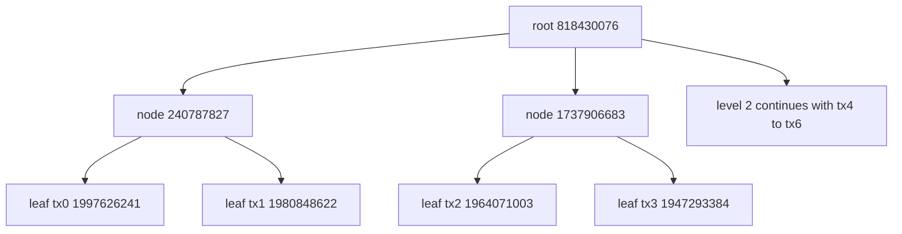
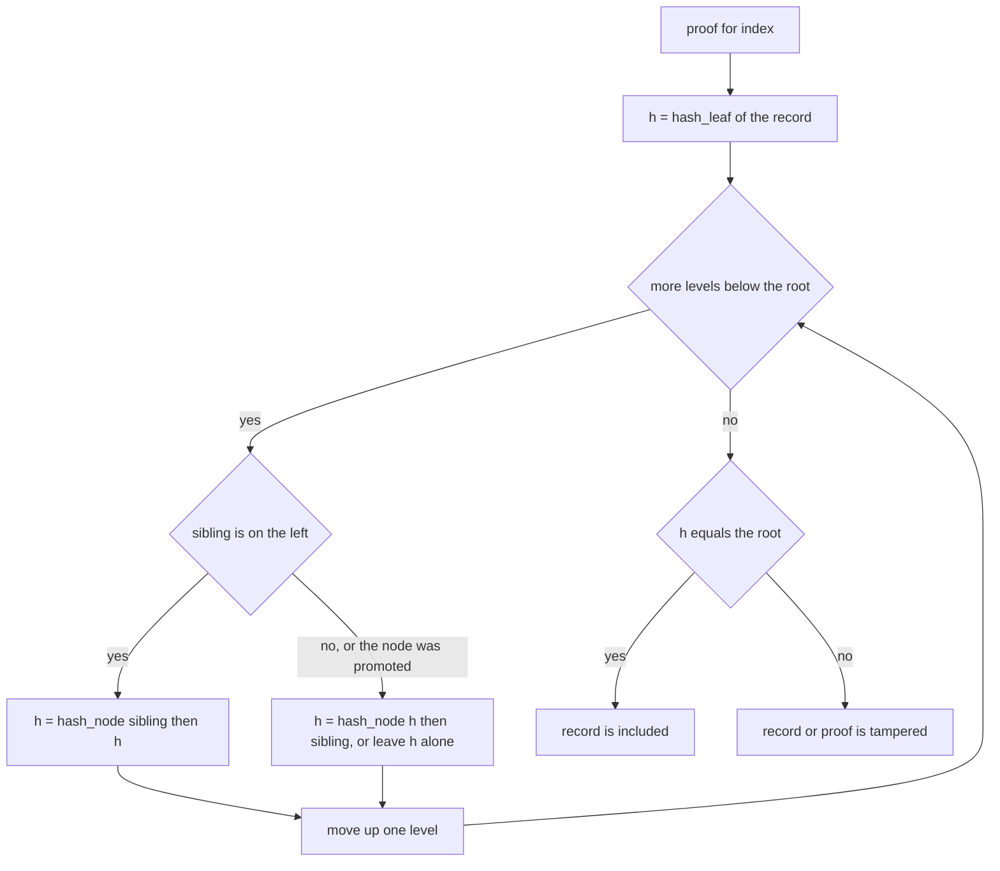
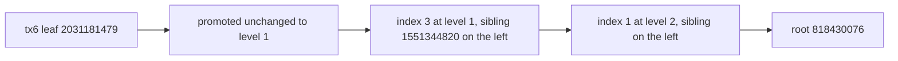

# 474 — Implement Merkle tree for log integrity and proof generation.

> **Tier:** Advanced · **CTCI chapter:** Beyond — Security & Privacy
> **Task spec:** [474-implement-merkle-tree-for-log-integrity-and-proof-generation.md](../../../tasks/advanced/474-implement-merkle-tree-for-log-integrity-and-proof-generation.md)
> **Solutions:** [Python](../../../solutions/python/advanced/474-implement-merkle-tree-for-log-integrity-and-proof-generation/solution.py) ·
> [Java](../../../solutions/java/advanced/474-implement-merkle-tree-for-log-integrity-and-proof-generation/Solution.java) ·
> [JavaScript](../../../solutions/javascript/advanced/474-implement-merkle-tree-for-log-integrity-and-proof-generation/solution.js) ·
> [C#](../../../solutions/csharp/advanced/474-implement-merkle-tree-for-log-integrity-and-proof-generation/Solution.cs)

## 1. Problem restatement

**Input:** an append-only log of records such as `tx0 ... tx6`, held as an array.

**Output:** a single 32-bit **root hash** that commits to the whole log, plus an **inclusion proof**
for any single record: the minimum list of sibling hashes that lets a verifier recompute the root
from that record alone.

The hashing is fixed and documented. The tree uses FNV-1a-32 — offset basis `2166136261`, prime
`16777619`, masked to 32 bits — with **domain separation**:

```text
hash_leaf(value) = fnv1a(0x00 || bytes(value))
hash_node(left, right) = fnv1a(big_endian_4(left) || big_endian_4(right))
```

Leaves are prefixed with `0x00` so that a leaf hash can never be confused with an internal node
hash. Odd levels **promote the last node unchanged** rather than duplicating it or hashing it with
itself.

The contract is fixed by the assertions:

| Call | Result | Why |
| --- | --- | --- |
| `root()` of `tx0..tx6` | `818430076` | the documented root of the 7-record log |
| `len(proof(0))` | `3` | index 0 walks every level |
| `len(proof(6))` | `2` | the promoted odd leaf has no sibling at level 0 |
| `verify(root, "tx3", proof(3))` | `True` | the proof reconstructs the root |
| `verify(root, "tx3x", proof(3))` | `False` | a tampered leaf changes its leaf hash |
| `verify(root XOR 1, leaves[3], proof(3))` | `False` | a wrong root cannot be matched |
| `verify` with a sibling flipped | `False` | a tampered sibling propagates upward |
| `root()` of `tx0..tx7` | `955777637` | the 8-record log is a different commitment |
| `MerkleTree(["only"]).root()` | `hash_leaf("only") = 2780568545` | a single record is its own root |
| `MerkleTree(["only"]).proof(0)` | `[]` | nothing needs to be proven |

## 2. Intuition

Hashing the whole log gives one digest, but it cannot prove anything about a *single* record without
shipping the entire log. Hashing each record separately and concatenating the digests is no better.

The Merkle idea is to build an actual tree over the hashes. Leaves hash the records; every parent
hashes its two children's digests. The root therefore depends on every record, and — this is the
point — a single record's contribution can be recomputed by walking one path from that leaf to the
root, needing only the sibling digest at each level. For `n = 7` that is 3 hashes, not 7 records.



The shape for an odd leaf count is the detail that decides every hash in the tree. With 7 leaves the
levels have sizes `7, 4, 2, 1`: three pairs are formed, and the seventh leaf is **promoted**
unchanged to the next level, where it becomes the fourth node. The alternative conventions — padding
with a zero leaf, or hashing the node with itself — produce a different root for the same log, so the
promotion rule is part of the contract, not an implementation choice.

Two properties fall out of the structure:

- **Tamper evidence.** Changing any record changes its leaf hash, which changes the parent, and so
  on to the root. A verifier that knows the root detects the change without seeing the other records.
- **Proof minimality.** A proof is exactly one sibling per level, i.e. `log2(n)` hashes for the
  perfect case and fewer for a promoted leaf, because the promoted node has no sibling to supply.

## 3. Algorithm

1. Hash every record with `hash_leaf` to build level 0.
2. While the current level has more than one node, pair nodes two at a time and hash each pair with
   `hash_node`; if the level length is odd, append the last node to the next level unchanged.
3. The root is the single node at the top level.
4. `proof(index)`: walk the levels from the bottom up, recording the sibling at each level and the
   side it sits on. If `index` is odd the sibling is to the left; if it is even and a right sibling
   exists, the sibling is to the right; if neither holds, the node was promoted and contributes no
   step. Then `index = index // 2`.
5. `verify(root, value, path)`: start from `hash_leaf(value)` and fold each `(sibling, side)` pair
   with `hash_node`, putting the sibling first when its side is `left`. Compare with the root.

```text
procedure build(records)
    levels ← [hash_leaf(value) for value in records]
    level ← levels[0]
    while length(level) > 1 do
        next ← empty list
        for i ← 0 to length(level) - 2 step 2 do
            append hash_node(level[i], level[i + 1]) to next
        end
        if length(level) is odd then
            append level[length(level) - 1] to next
        end
        append next to levels
        level ← next
    end
    return levels
end

procedure proof(index)
    path ← empty list
    idx ← index
    for level in levels except the top level do
        if idx is odd then
            append (level[idx - 1], left) to path
        else if idx + 1 < length(level) then
            append (level[idx + 1], right) to path
        end
        idx ← idx // 2
    end
    return path
end

function verify(root, value, path)
    h ← hash_leaf(value)
    for (sibling, side) in path do
        if side is left then
            h ← hash_node(sibling, h)
        else
            h ← hash_node(h, sibling)
        end
    end
    return h = root
end
```

The `else if` in `proof` is where the promotion rule shows up in the code: an even index with no
right neighbour is the promoted node, and it must skip the level rather than invent a sibling.



## 4. Worked example

Build the 7-record tree and check the level sizes and the root:

| Level | Size | Contents |
| --- | --- | --- |
| 0 | `7` | leaf hashes of `tx0..tx6`, starting `1997626241`, `1980848622`, `1964071003` |
| 1 | `4` | `240787827`, `1737906683`, `1551344820`, and the promoted `2031181479` |
| 2 | `2` | two hashes over the four level-1 nodes |
| 3 | `1` | root `818430076` |

The last entry of level 1 is exactly the last leaf hash `2031181479` — the promotion, unchanged. That
single fact explains both proof lengths the file asserts.

Now trace `proof(3)` and `verify` on `tx3`:

| Step | `idx` | Level size | Sibling | Side | Hash after folding |
| --- | --- | --- | --- | --- | --- |
| start | `3` | — | — | — | `1947293384` = `hash_leaf("tx3")` |
| 1 | `3` | `7` | `1964071003` | `left` | result of `hash_node(1964071003, h)` |
| 2 | `1` | `4` | `240787827` | `left` | result of `hash_node(240787827, h)` |
| 3 | `0` | `2` | `1313252417` | `right` | result of `hash_node(h, 1313252417)` = root |

Three folds, one per level, and the final hash equals `818430076`. Note the sides: `tx3` is the right
half of its pair, then the right half again one level up, then the left half at the top — the proof
has to know which side the unknown node sits on, which is why the port carries an explicit `side`
label rather than an index.

The promoted leaf takes a shorter path:



That is `2` folds rather than `3`, matching the asserted `len(proof(6)) == 2`. The proof is shorter
because the promoted node skipped a level; it is not a bug or a shortcut.

Finally, the three tampering checks, each of which must fail:

| Tampered item | Effect |
| --- | --- |
| leaf value `"tx3x"` | the starting hash changes, so the folded result no longer matches the root |
| sibling hash flipped | the change propagates through the remaining folds to a different top hash |
| root flipped (`root XOR 1`) | the fold still yields the true root, which no longer equals the claimed one |

And the degenerate case: `MerkleTree(["only"])` has a single leaf, so its root **is** `hash_leaf("only")`
and its proof is the empty list — folding nothing gives the leaf hash, which equals the root.

## 5. Complexity

Let `n` be the number of records and `L` the (constant here) record length.

| Measure | Bound | Why it holds |
| --- | --- | --- |
| Time, build | O(n) hashes | each level halves the node count, so the total is bounded by `2n` |
| Space, stored levels | O(n) | the implementation keeps every level, i.e. fewer than `2n` nodes |
| Time, `proof` | O(log n) | one sibling per level, `3` folds for 7 records |
| Space, `proof` | O(log n) | `3` hashes for `tx0`, `2` for the promoted `tx6` |
| Time, `verify` | O(log n) hashes | one `hash_node` per proof step, independent of `n` |
| Verification bandwidth | O(log n) | this is the property that makes Merkle proofs useful |
| Checking by re-hashing everything | O(n) | what a proof replaces |

The numbers in the last two rows are the whole argument: verifying inclusion of one record in a
7-record log costs `3` hashes, and in a million-record log about `20`. The cost is logarithmic in the
log size, and the verification side never needs the other records — only the sibling hashes and the
root, which is why this structure underpins transparency logs.

## 6. Pitfalls and edge cases

- **Odd-level promotion must match.** Promoting the last node unchanged gives level sizes `7, 4, 2, 1`.
  Duplicating the node or hashing it with itself yields a different root, and the asserted
  `root() == 818430076` would fail.
- **Domain separation.** Leaves are hashed with a `0x00` prefix and internal nodes over fixed-width
  child hashes. Without it, a leaf's hash could coincide with an internal node's hash and a crafted
  log could present a leaf where a subtree belongs.
- **Fixed-width child encoding.** Child hashes are written as 4-byte big-endian values before being
  hashed, so two different pairs cannot produce the same input bytes. Variable-length decimal text
  would be ambiguous.
- **Empty log.** The implementation has no case for it: with zero records level 0 is empty, the loop
  never runs, and asking for the root indexes into an empty list. Callers must reject an empty log
  rather than expect a conventional "empty root".
- **Single record.** The root is the leaf hash itself and the proof is empty; `verify` returns `True`
  because folding nothing leaves the leaf hash, which is the asserted degenerate case.
- **Root binds the length.** The 7-record log hashes to `818430076` and the 8-record log to
  `955777637`; even if the eighth record were somehow a copy of the first, the two roots differ, which
  is why the file asserts `tree8.root() != tree.root()`.
- **A proof is position-specific.** `proof(3)` only verifies `tx3` at index 3; the same siblings used
  for a different index produce a different, wrong root. The side labels exist precisely because the
  position matters.
- **Any tampering must fail.** Leaf, sibling and root are all covered. A verifier that skipped the
  sibling comparison — say, by trusting a hash it was handed — would accept a forged proof.
- **Rebuild determinism.** `MerkleTree(leaves).root()` is recomputed in the test and must equal the
  stored root, which pins the whole build down to the documented hash functions.

## 7. Variants and follow-ups

- **Batch proofs and updates.** [475-implement-authenticated-data-structure-example-merkle-proof.md](../../../tasks/advanced/475-implement-authenticated-data-structure-example-merkle-proof.md)
  builds on this tree with multi-record proofs and update paths, which is what turns integrity
  checking into an authenticated data structure.
- **Reconciliation between replicas.** [632-implement-anti-entropy-merkle-tree-reconciliation-demo.md](../../../tasks/expert/632-implement-anti-entropy-merkle-tree-reconciliation-demo.md)
  compares two trees level by level to find divergent ranges without shipping the records.
- **Distributed log verification.** [902-implement-self-verifying-distributed-logs-with-merkle-trees-and.md](../../../tasks/master/902-implement-self-verifying-distributed-logs-with-merkle-trees-and.md)
  and [760-implement-distributed-snapshot-based-auditing-for-integrity.md](../../../tasks/expert/760-implement-distributed-snapshot-based-auditing-for-integrity.md)
  apply the same root as an audit commitment.
- **Unbalanced trees.** [431-suffix-automaton-for-distinct-substring-queries.md](../../../tasks/advanced/431-implement-suffix-automaton-for-distinct-substring-queries.md)
  is an unrelated structure, but the same "hash the children, promote the odd one" shape recurs in
  [438-implement-external-memory-sort-outline-multiway-merge.md](../../../tasks/advanced/438-implement-external-memory-sort-outline-multiway-merge.md)
  as a merge tree.
- **The hashing primitive.** [411-implement-advanced-rolling-hash-with-modular-and-base-tuning.md](../../../tasks/advanced/411-implement-advanced-rolling-hash-with-modular-and-base-tuning.md)
  and [187-implement-basic-rolling-hash-for-integer-arrays.md](../../../tasks/beginner/187-implement-basic-rolling-hash-for-integer-arrays.md)
  cover the other family of hashes used for integrity and comparison.

## 8. Check yourself

1. Why does `proof(6)` need fewer hashes than `proof(0)` in a 7-record log?

<details><summary>Show answer</summary>

Because the seventh leaf is promoted unchanged to the next level, so it has no sibling at level 0 and
the proof has no step to record there. `proof(0)` walks three levels and returns three siblings,
while `proof(6)` walks only two, which is exactly what `len(proof(0)) == 3` and `len(proof(6)) == 2`
assert.

</details>

2. What exactly does the `0x00` prefix in `hash_leaf` protect against?

<details><summary>Show answer</summary>

Confusion between leaves and internal nodes. Without domain separation, a byte string could be
interpreted either as a record whose hash is a leaf, or as the concatenation of two child hashes, so
an attacker could present a crafted "record" whose hash is a valid internal node hash. Prefixing leaf
inputs with a byte that internal node inputs never start with keeps the two domains apart.

</details>

3. A verifier is given `tx3`, `proof(3)` and the root. What can it conclude?

<details><summary>Show answer</summary>

That `tx3` is the record at index 3 of a log whose root is that value, assuming the hash function is
collision resistant. It cannot learn any other record — the siblings are opaque hashes — and it cannot
forge a different path, because changing any sibling changes the recomputed root. That asymmetry
(detect everything, reveal nothing) is the reason Merkle proofs are used for transparency logs.

</details>

4. Why must the two children be encoded as fixed-width 4-byte values before hashing a parent?

<details><summary>Show answer</summary>

If the child hashes were written adjacently without a fixed width, the pair `(1, 23)` and the pair
`(12, 3)` would produce the same input bytes and hence the same parent, so two different subtrees
would hash to the same node and a proof could be forged. Four bytes are exactly enough to encode
every 32-bit hash value, which makes the concatenation unambiguous.

</details>

5. What happens if two different logs are built and their roots compared?

<details><summary>Show answer</summary>

They differ, and that is the assertion `tree8.root() != tree.root()` — `955777637` versus `818430076`.
The root commits to the exact sequence and length of records, so any change of content, order or
length changes the commitment. The structure does not tell you *which* record changed; finding that is
the job of a reconciliation walk like the one in task 632.

</details>
