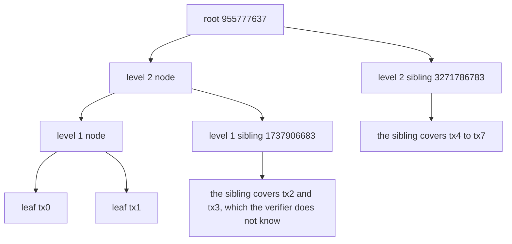
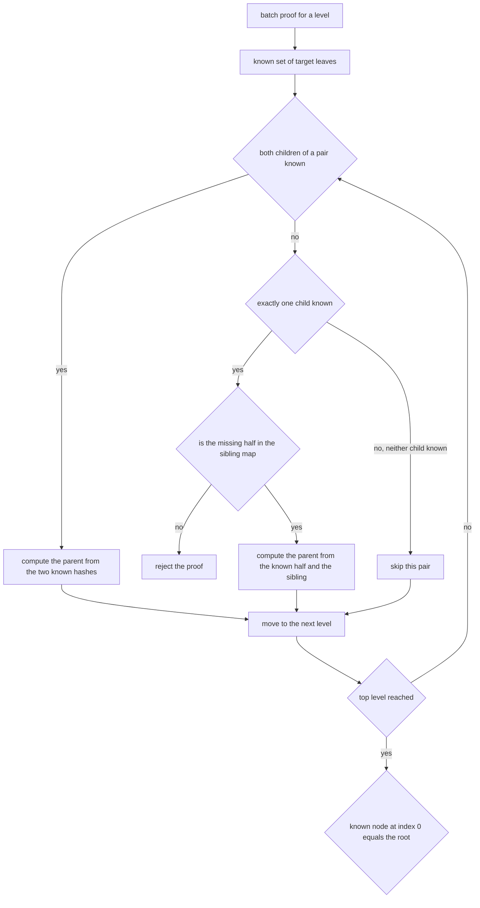
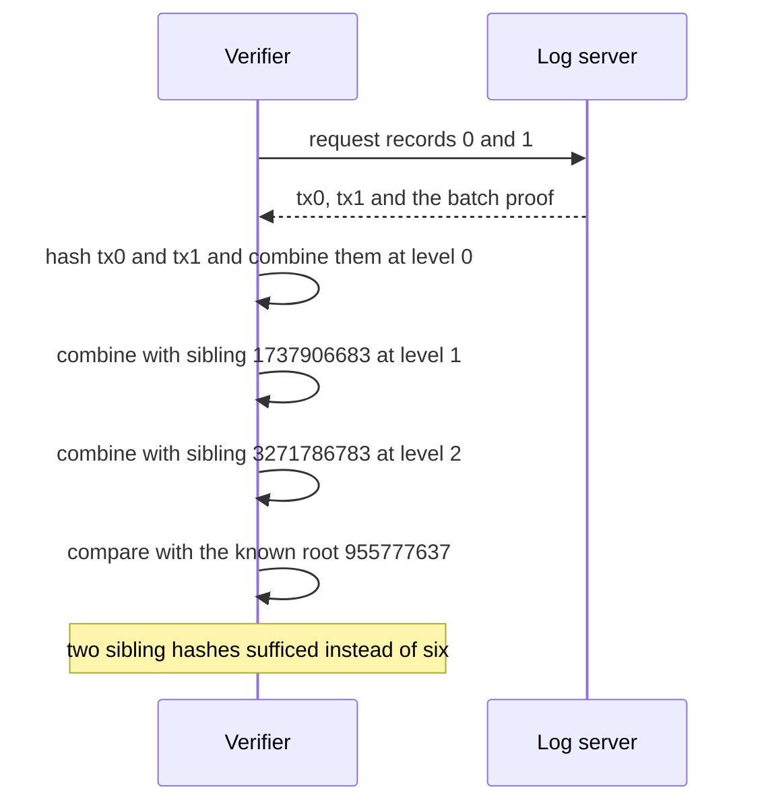

# 475 — Implement authenticated data structure example (Merkle+proof).

> **Tier:** Advanced · **CTCI chapter:** Beyond — Security & Privacy
> **Task spec:** [475-implement-authenticated-data-structure-example-merkle-proof.md](../../../tasks/advanced/475-implement-authenticated-data-structure-example-merkle-proof.md)
> **Solutions:** [Python](../../../solutions/python/advanced/475-implement-authenticated-data-structure-example-merkle-proof/solution.py) ·
> [Java](../../../solutions/java/advanced/475-implement-authenticated-data-structure-example-merkle-proof/Solution.java) ·
> [JavaScript](../../../solutions/javascript/advanced/475-implement-authenticated-data-structure-example-merkle-proof/solution.js) ·
> [C#](../../../solutions/csharp/advanced/475-implement-authenticated-data-structure-example-merkle-proof/Solution.cs)

## 1. Problem restatement

**Input:** an append-only log of records, plus a set of record indices to prove, plus an optional
record replacement.

**Output:** an **authenticated log** with four operations on top of task 474's Merkle tree:

- `root()` — the commitment to the whole log.
- `proof(index)` — the single-record audit path.
- `multi_proof(targets)` — a **batch** proof for a set of indices, which must be smaller than the
  concatenation of the individual audit paths.
- `updated_root(new_value, path)` — the new root obtained after replacing one record, computed from
  the *old* siblings plus the new record.

The hashing is unchanged from task 474: FNV-1a-32 with a `0x00` prefix on leaves, fixed-width
big-endian child hashes for internal nodes, and odd levels promoting their last node unchanged.

The contract is fixed by the assertions, all on the 8-record log `tx0..tx7` whose root is
`955777637`:

| Call | Result |
| --- | --- |
| `root()` | `955777637` |
| `proof(2)` | siblings `[1947293384, 240787827, 3271786783]` with sides `right, left, right` |
| `multi_proof([0, 1])` | per-level counts `[0, 1, 1]`, sibling hashes `[1737906683, 3271786783]` |
| the same batch vs two separate proofs | `2 < 3 + 3` hashes — batching must save |
| `multi_proof([0, 3])` | per-level counts `[2, 0, 1]` |
| `multi_proof(all 8)` | `[0, 0, 0]` — every leaf is known, so no sibling is needed |
| `multi_proof([2, 4, 6])` | `[3, 1, 0]` |
| `multi_proof([5])` | exactly `proof(5)`'s sibling hashes |
| tampered target or tampered sibling | `verify_multi` returns `False` |
| `updated_root("tx2*", proof(2))` | `3100337682`, the root of the log with `tx2` replaced |
| old proofs and old batches against the new root | all fail |

## 2. Intuition

A single-record proof answers "is this record in the log?". A log that supports updates needs two
more things: a way to prove several records at once without shipping one path per record, and a way
to compute the *new* root after a change without rebuilding the tree.

**Batching** exploits shared ancestors. Two adjacent records share every node above their common
parent, so their two audit paths duplicate the upper siblings. A batch proof carries one sibling per
level per *frontier* node instead: the set of nodes that still need a sibling. For targets `{0, 1}`
the two leaves combine at level 0 without any sibling, and the batch then needs exactly the hashes
that route their parent to the root — `[0, 1, 1]` instead of `[3, 3]`.



The frontier is the key concept: the verifier already knows the target leaves, so it can recompute
any node whose *both* children are known, and only needs a sibling where exactly one child is known.
That is precisely how `verify_multi` walks the levels — it combines known pairs and consults the
supplied sibling map only when a pair is half-known.

The second addition is the **update path**. Because the audit path already contains every sibling on
the route from a leaf to the root, replacing that leaf and re-folding the same siblings yields the
new root. Replacing `tx2` by `tx2*` therefore costs `3` hashes plus a new leaf hash, and gives
`3100337682` — the same value a freshly built tree produces, which the file asserts by constructing
`AuthenticatedLog(updated)` and comparing.

## 3. Algorithm

1. Build the levels exactly as in task 474, keeping level 0 for the leaves and the top level for the
   root.
2. `proof(index)`: walk up, recording the sibling at each level and its side; skip the level when the
   node was promoted.
3. `multi_proof(targets)`: start from the target indices as the `needed` set. At each level, for every
   needed index in sorted order, emit the sibling index/hash when that sibling is *not* itself needed;
   then rebuild the level with pairing and odd promotion and map `needed` to `{i // 2}`.
4. `verify_multi(root, n, targets, proof)`: seed `known` with the target leaves' hashes, then for each
   level pair up indices: both children known means the parent is computed directly, exactly one known
   means the missing half must come from that level's sibling map (otherwise fail), and a promoted
   odd node passes through unchanged. The final `known[0]` must equal the root.
5. `updated_root(new_value, path)`: fold `hash_leaf(new_value)` through the recorded sibling hashes in
   the same order `verify` would, and return the result.

```text
procedure multi_proof(targets)
    level ← levels[0]
    needed ← set of targets
    out ← empty list
    while length(level) > 1 do
        siblings ← empty list
        for i in sorted(needed) do
            if i is odd and (i - 1) is not in needed then
                append (i - 1, level[i - 1]) to siblings
            else if i is even and i + 1 < length(level) and (i + 1) is not in needed then
                append (i + 1, level[i + 1]) to siblings
            end
        end
        append siblings to out
        level ← next level built by pairing with odd promotion
        needed ← { i // 2 for i in needed }
    end
    return out
end

function verify_multi(root, n, targets, proof)
    known ← { index: hash_leaf(value) for (index, value) in targets }
    level_len ← n
    for siblings in proof do
        sib_map ← map from index to hash for siblings
        parents ← empty map
        for i ← 0 to level_len - 2 step 2 do
            have_left ← i is in known
            have_right ← (i + 1) is in known
            if not have_left and not have_right then
                continue
            end
            if have_left and have_right then
                parents[i // 2] ← hash_node(known[i], known[i + 1])
            else
                position ← i + 1 if have_left else i
                if position is not in sib_map then
                    return false
                end
                left ← known[i] if have_left else sib_map[i]
                right ← known[i + 1] if have_right else sib_map[i + 1]
                parents[i // 2] ← hash_node(left, right)
            end
        end
        if level_len is odd and (level_len - 1) is in known then
            parents[(level_len - 1) // 2] ← known[level_len - 1]
        end
        known ← parents
        level_len ← (level_len + 1) // 2
    end
    return known[0] = root
end

function updated_root(new_value, path)
    h ← hash_leaf(new_value)
    for (sibling, side) in path do
        if side is left then
            h ← hash_node(sibling, h)
        else
            h ← hash_node(h, sibling)
        end
    end
    return h
end
```

Both `verify` and `updated_root` perform the same fold; the only difference is that one compares the
result with a claimed root and the other returns it. That symmetry is what makes an update provable:
the client that holds an old proof can compute the new root without asking the server for anything
but the new record.



## 4. Worked example

**Single proofs.** For the 8-record log, `proof(2)` returns three siblings whose sides are
`right, left, right`:

| Step | Sibling hash | Side | What it is |
| --- | --- | --- | --- |
| level 0 | `1947293384` | `right` | `hash_leaf("tx3")`, the partner of `tx2` |
| level 1 | `240787827` | `left` | the node over `tx0` and `tx1` |
| level 2 | `3271786783` | `right` | the node over `tx4` to `tx7` |

**Batch proofs.** Derive the sibling counts by hand for three target sets, which is exactly what the
assertions check:

| Targets | `needed` at level 0 | Siblings level 0 | Level 1 | Level 2 | Counts |
| --- | --- | --- | --- | --- | --- |
| `{0, 1}` | `{0, 1}` | none, both halves known | `{0}` needs sibling `1` | `{0}` needs sibling `1` | `[0, 1, 1]` |
| `{0, 3}` | `{0, 3}` | `1` and `2` | `{0, 1}` both needed, none | `{0}` needs sibling `1` | `[2, 0, 1]` |
| `{2, 4, 6}` | `{2, 4, 6}` | `3`, `5`, `7` | `{1, 2, 3}` needs `0` | `{0, 1}` both needed, none | `[3, 1, 0]` |
| all `0..7` | every index | none | none | none | `[0, 0, 0]` |

The first row is the whole motivation: proving two adjacent records costs `2` hashes, where two
separate audit paths cost `3 + 3 = 6`. The last row shows the limit of the idea — when the verifier
already knows every leaf, it needs nothing at all.



**Updates.** Replace `tx2` with `tx2*` and fold the new leaf hash through `proof(2)`'s three siblings:

| Step | Value |
| --- | --- |
| new leaf | `hash_leaf("tx2*")` |
| fold with level-0 sibling `1947293384` on the right | new level-1 node |
| fold with level-1 sibling `240787827` on the left | new level-2 node |
| fold with level-2 sibling `3271786783` on the right | `3100337682` |
| freshly rebuilt tree with `tx2*` | `3100337682` — asserted equal |

After this update, every *old* proof fails against the new root — including the proof of `tx5`, even
though `tx5` itself did not change. That is correct and worth internalising: `tx5`'s audit path
contains the subtree hash that `tx2*` changed, so the path must be regenerated. Stale proofs are
rejected wholesale (`not verify(log_new.root(), "tx5", log.proof(5))`), and a fresh batch for
`{2, 5}` verifies again.

## 5. Complexity

Let `n` be the record count, `k` the number of targets in a batch, and `d = log2(n)` the tree depth.

| Measure | Bound | Why it holds |
| --- | --- | --- |
| Time, build | O(n) | the same `2n`-bounded hash count as the plain tree |
| Time, `proof` | O(d) | one sibling per level, `3` for 8 records |
| Space, `proof` | O(d) = `3` hashes | asserted explicitly for index 2 |
| Space, `k` separate proofs | O(k d) | `6` hashes for `k = 2` adjacent targets |
| Space, batch proof | O(k d) worst case, less in practice | `2` hashes for `{0, 1}`, `3` for `{2, 4, 6}`, `0` for all targets |
| Time, `verify_multi` | O(n + d) | each level scans its pairs, but only the known frontier does hash work |
| Time, `updated_root` | O(d) | exactly the same fold as verification, without the comparison |
| Rebuild after one update | O(n) | what the update path replaces |

The batch bound is data-dependent rather than a clean formula: it is the number of frontier nodes at
each level that still need a sibling, which shrinks as targets become adjacent. The asserted examples
are the honest illustration — `[0, 1, 1]`, `[2, 0, 1]`, `[3, 1, 0]` and `[0, 0, 0]` for the same
8-leaf tree.

## 6. Pitfalls and edge cases

- **The promoted odd node has no sibling.** In a 7-leaf log the batch `{5, 6}` needs `[1, 0, 1]`
  siblings: at level 0 only index 5 has a partner, at level 1 the two targets have already merged,
  and at level 2 one sibling remains. Emitting a phantom sibling for the promoted node breaks the
  count and the verification.
- **A missing sibling must fail loudly.** `verify_multi` returns `False` when a pair is half-known and
  the needed half is absent; without that check the walk would produce a parent from `None` and
  possibly crash or, worse, accept a forged proof.
- **Tampered target or tampered sibling.** Both are asserted as failures. Flipping a target value
  changes the seed hash; flipping a supplied sibling changes a computed parent.
- **Stale proofs after an update.** Any proof computed against the old root fails against the new one,
  including proofs for records that did not change, because the path contains a node whose subtree
  changed. A client must re-fetch rather than reuse.
- **Stale batches too.** The assertion `not verify_multi(new_root, 8, {0: "tx0", 1: "tx1"}, mp01)`
  is the same lesson for batch proofs.
- **`n` is part of the verification input.** `verify_multi` needs the log length to rebuild the level
  sizes, and it applies the same odd-promotion rule. Passing the wrong `n` changes the number of
  levels and the proof cannot match.
- **Every target must be present.** The `known` map is seeded only from the supplied targets, so
  proving a record the verifier has not been given simply fails at the root comparison. There is no
  partial-credit mode.
- **The fold order is the security boundary.** `left` means the sibling goes first; getting the side
  backwards yields a different root and a false negative — which is why the ports return explicit
  side labels instead of a bare list of hashes.
- **One leaf.** With a single record the root is the leaf hash and both proofs are empty, matching the
  degenerate case asserted in task 474.

## 7. Variants and follow-ups

- **The tree underneath.** [474-implement-merkle-tree-for-log-integrity-and-proof-generation.md](../../../tasks/advanced/474-implement-merkle-tree-for-log-integrity-and-proof-generation.md)
  defines the hashing, the promotion rule and the single-record audit path this task extends.
- **Reconciling two logs.** [632-implement-anti-entropy-merkle-tree-reconciliation-demo.md](../../../tasks/expert/632-implement-anti-entropy-merkle-tree-reconciliation-demo.md)
  walks two trees together to find the ranges that differ, which is the batch-proof idea applied to
  comparison rather than inclusion.
- **Auditing and verification at scale.**
  [902-implement-self-verifying-distributed-logs-with-merkle-trees-and.md](../../../tasks/master/902-implement-self-verifying-distributed-logs-with-merkle-trees-and.md)
  and [760-implement-distributed-snapshot-based-auditing-for-integrity.md](../../../tasks/expert/760-implement-distributed-snapshot-based-auditing-for-integrity.md)
  use roots and proofs as the trust anchor of a system.
- **Versioned structures.** [336-design-a-snapshot-array-persisting-versions-basic.md](../../../tasks/intermediate/336-design-a-snapshot-array-persisting-versions-basic.md)
  and [421-implement-persistent-segment-tree-versioned.md](../../../tasks/advanced/421-implement-persistent-segment-tree-versioned.md)
  take the opposite approach to updates: keep every old version instead of recomputing a new root.
- **Proof-friendly hashing.** [411-implement-advanced-rolling-hash-with-modular-and-base-tuning.md](../../../tasks/advanced/411-implement-advanced-rolling-hash-with-modular-and-base-tuning.md)
  covers the other hash family used for content comparison.

## 8. Check yourself

1. Why does batching `{0, 1}` cost two sibling hashes rather than six?

<details><summary>Show answer</summary>

Because the two leaves are siblings: at level 0 the verifier knows both halves of their pair, so it
computes the parent without any sibling at all. From then on the pair behaves as one node, so the
batch needs only the level-1 sibling `1737906683` and the level-2 sibling `3271786783` — `2` hashes
where two separate audit paths would need `3 + 3 = 6`. The file asserts the saving directly.

</details>

2. What is the "frontier" in a batch proof?

<details><summary>Show answer</summary>

The set of nodes at a level that the verifier knows and that still need a sibling in order to be
combined upward. Initially it is the target leaves; after each level the frontier is mapped through
`i // 2`. A sibling is only emitted when the node next to a frontier node is *not* itself on the
frontier, because two known halves can be combined without help.

</details>

3. Why does a proof for `tx5` fail after `tx2` is replaced, even though `tx5` did not change?

<details><summary>Show answer</summary>

Because `tx5`'s audit path contains the subtree hash that covers `tx2`. Replacing `tx2` changes that
subtree, so the old sibling hash no longer contributes correctly and the fold produces the old root
rather than `3100337682`. The assertion `not verify(log_new.root(), "tx5", log.proof(5))` records
exactly this: proofs are only valid against the root they were generated for and must be refreshed.

</details>

4. How does `updated_root` reuse the audit path?

<details><summary>Show answer</summary>

It performs the same fold that verification performs, starting from `hash_leaf(new_value)` instead of
the old value and returning the result instead of comparing it. That is why the new root can be
computed by a client holding an old proof plus the new record: the siblings above the changed leaf are
unchanged, and only the leaf and its ancestors differ.

</details>
