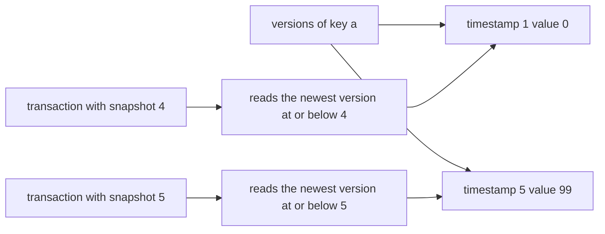
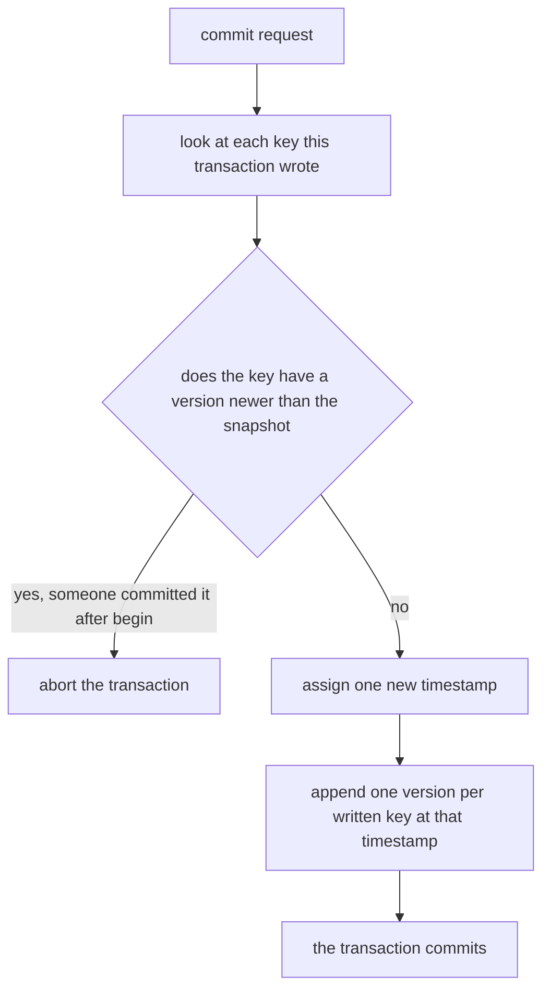
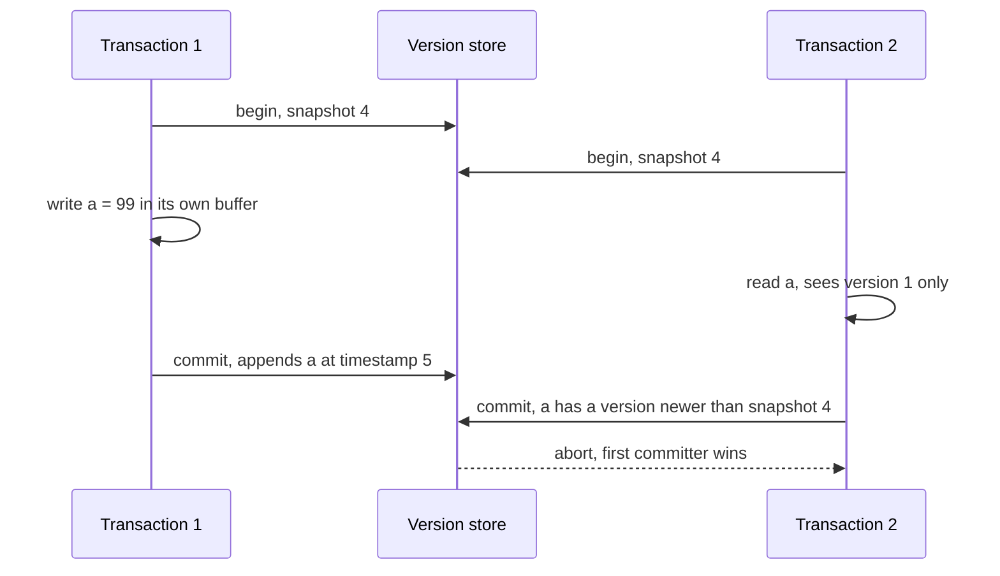
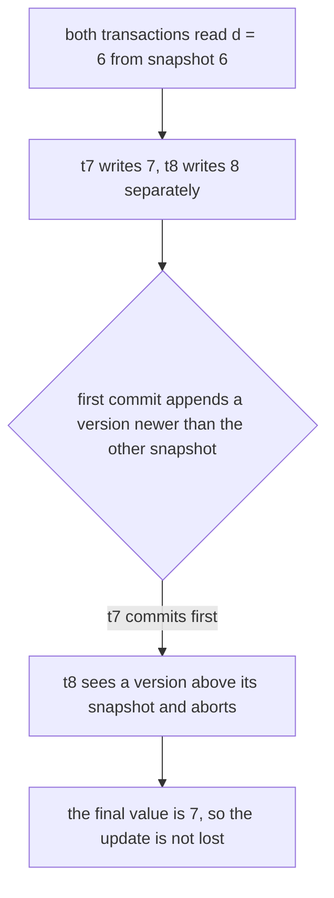

# 476 — Implement snapshot isolation simulator for transactions (conceptual).

> **Tier:** Advanced · **CTCI chapter:** Ch 14 — Databases
> **Task spec:** [476-implement-snapshot-isolation-simulator-for-transactions-conceptu.md](../../../tasks/advanced/476-implement-snapshot-isolation-simulator-for-transactions-conceptu.md)
> **Solutions:** [Python](../../../solutions/python/advanced/476-implement-snapshot-isolation-simulator-for-transactions-conceptu/solution.py) ·
> [Java](../../../solutions/java/advanced/476-implement-snapshot-isolation-simulator-for-transactions-conceptu/Solution.java) ·
> [JavaScript](../../../solutions/javascript/advanced/476-implement-snapshot-isolation-simulator-for-transactions-conceptu/solution.js) ·
> [C#](../../../solutions/csharp/advanced/476-implement-snapshot-isolation-simulator-for-transactions-conceptu/Solution.cs)

## 1. Problem restatement

**Input:** a store of keys, each holding an append-only list of `(commit timestamp, value)` versions,
and a scripted sequence of transaction operations: `begin`, `read`, `write`, `commit`.

**Output:** a simulator of MVCC **snapshot isolation** in which every transaction reads a consistent
snapshot of the database and commits under a first-committer-wins rule. The docstring calls the task
**conceptual**: it is a single-threaded simulation of the isolation level's rules, with no locking, no
garbage collection of old versions and no serialisability.

The store starts from `a=0, b=1, c=2, d=3`, which assigns commit timestamps `1, 2, 3, 4`, so the
commit counter is `4` when the first transaction begins. The rules are:

- `begin()` pins the transaction's `snapshot` to the current commit counter.
- `read(key)` returns the transaction's own buffered write if there is one (read-your-writes), else
  the newest version whose timestamp is `<= snapshot`.
- `write(key, value)` only buffers; nothing reaches the store until commit.
- `commit()` aborts if any key the transaction wrote gained a version after the snapshot; otherwise it
  assigns one new timestamp and appends one version per written key.

The contract is fixed by the assertions:

| Scenario | Asserted behaviour |
| --- | --- |
| `t2` reads `a` while `t1` holds an uncommitted `a=99` | reads `0` — no dirty read |
| `t1` commits, then `t2` (which also wrote `a`) commits | `t1` succeeds, `t2` aborts — write-write conflict |
| `t3`, begun before `t1`'s commit, reads `a` twice | both reads return `0` — repeatable snapshot read |
| read-only `t3` commits | succeeds |
| a fresh transaction after the commit | reads `99` |
| `t5` writes `d=6` then reads `d` | reads `6` — read-your-writes |
| `t7` and `t8` both write `d` | first commits, second aborts — no lost update |
| final materialised state | `{a: 99, b: 1, c: 2, d: 7}` |
| write skew on `{x, y}` | both commit and the "at least one on call" invariant breaks |
| `random_script(60, 97531)` | every read and every commit matches an oracle that keeps snapshot copies |

## 2. Intuition

Readers and writers blocking each other is the problem a lock-based database has to solve. Snapshot
isolation removes the interaction entirely: a transaction reads from a frozen snapshot of the past,
and writes into a private buffer. Neither operation touches the other transaction's data, so readers
never block writers and writers never block readers.

The mechanism is an append-only version chain per key. Every commit appends its values with a
monotonically increasing timestamp, and a read simply picks the newest version at or below its
snapshot. Old versions are kept, which is what makes a long-running read consistent while newer
commits pile up.



The second half of the design is the commit rule. Snapshot isolation does not check reads, only
writes: at commit time, if any key this transaction wrote has been written by someone else since the
snapshot, the transaction aborts. This is **first-committer-wins**, and it is what prevents a lost
update — two transactions that both read `d=6` and write different values can no longer both succeed,
because the loser's written key has a newer version than its snapshot.



The rule is deliberately weaker than serialisability, and the trace proves it: two transactions that
read the same two keys and write *disjoint* keys have no write-write conflict at all, so both commit
and an invariant spanning both rows can be broken. That anomaly — write skew — is documented as an
SI limitation rather than a bug.

## 3. Algorithm

1. Initialise the store: one version per initial key, each with its own timestamp.
2. `begin()`: increment the transaction counter, return a transaction whose `snapshot` is the current
   commit counter.
3. `read(txn, key)`: return the buffered write if present; otherwise scan the key's version list and
   keep the last value whose timestamp is `<= snapshot`.
4. `write(txn, key, value)`: store the value in the transaction's private write buffer.
5. `commit(txn)`: for each written key, abort if any version's timestamp exceeds the snapshot.
   Otherwise bump the commit counter once, append one version per written key at that timestamp, and
   mark the transaction committed.
6. `materialize()`: the newest value per key, used as the visible database state.

```text
function begin(store)
    store.next_tid ← store.next_tid + 1
    return transaction with id store.next_tid and snapshot store.commit_counter
end

function read(store, txn, key)
    if key is in txn.writes then
        return txn.writes[key]
    end
    best ← none
    for (timestamp, value) in store.versions[key] do
        if timestamp <= txn.snapshot then
            best ← value
        end
    end
    return best
end

procedure write(txn, key, value)
    txn.writes[key] ← value
end

function commit(store, txn)
    for key in txn.writes do
        for (timestamp, value) in store.versions[key] do
            if timestamp > txn.snapshot then
                txn.state ← aborted
                return false
            end
        end
    end
    store.commit_counter ← store.commit_counter + 1
    timestamp ← store.commit_counter
    for (key, value) in txn.writes do
        append (timestamp, value) to store.versions[key]
    end
    txn.state ← committed
    return true
end
```

Two details decide the whole behaviour: the read filter uses `<= snapshot`, so a transaction never
sees a commit that happened after it began, and the conflict test uses `> snapshot`, so it looks
exactly for those same commits. The two comparisons are the same boundary seen from both sides.



## 4. Worked example

Replay the scripted assertions with the initial timestamps `a@1, b@2, c@3, d@4`.

| Step | Operation | State | Result |
| --- | --- | --- | --- |
| 1 | `t1 = begin()` | commit counter `4` | `t1.snapshot = 4` |
| 2 | `t1.write(a, 99)` | buffered only | `read(t1, a)` would be `99` |
| 3 | `t2 = begin()`, `t3 = begin()` | counter still `4` | both snapshot `4` |
| 4 | `read(t2, a)` | versions of `a`: `(1, 0)` | `0` — no dirty read of `99` |
| 5 | `t2.write(a, 100)` | buffered | — |
| 6 | `commit(t1)` | `a` gains `(5, 99)` | `True`, counter becomes `5` |
| 7 | `commit(t2)` | `a` has `(5, 99) > 4` | `False`, aborted |
| 8 | `read(t3, a)` twice | `a` has `(1, 0)` and `(5, 99)` | `0` both times |
| 9 | `commit(t3)` | no writes to check | `True` |
| 10 | `t4 = begin()`, `read(t4, a)` | snapshot `5` | `99` |

Step 4 and step 8 are the two halves of the read guarantee: an uncommitted write is invisible
because it is only in a buffer, and a committed write is invisible because its timestamp is above the
snapshot. Step 7 is the write rule: `t1` won, so `t2` cannot commit a value derived from a stale read.

The lost-update case runs the same way and is worth seeing separately:

| Step | Operation | `d` versions | Result |
| --- | --- | --- | --- |
| 1 | `t5.write(d, 6)`, `read(t5, d)` | `(4, 3)` | `6` from the buffer |
| 2 | `commit(t5)` | `(4, 3), (6, 6)` | `True` |
| 3 | `t6.begin()`, `read(t6, d)` | — | `6` |
| 4 | `t7.begin()`, `t8.begin()`, both `read(d)` | — | `6` for both |
| 5 | `t7.write(d, 7)`, `t8.write(d, 8)` | buffered | — |
| 6 | `commit(t7)` | `(4,3), (6,6), (7,7)` | `True` |
| 7 | `commit(t8)` | `d` has `(7, 7) > 6` | `False` |



Finally the documented anomaly. With the initial state `{x: "on", y: "on"}`, two transactions both
read both keys and each writes a *different* one:

| Transaction | Reads | Writes | Commit |
| --- | --- | --- | --- |
| `t9` | `x = "on"`, `y = "on"` | `x = "off"` | `True` |
| `t10` | `x = "on"`, `y = "on"` | `y = "off"` | `True` |

`materialize()` becomes `{x: "off", y: "off"}`, which breaks a business rule like "at least one person
is on call". This is not a bug in the implementation: first-committer-wins only inspects *written*
keys, and the two write sets are disjoint, so no conflict is detected. It is the canonical reason
snapshot isolation is not serialisable, and the file asserts it deliberately.

## 5. Complexity

Let `V` be the number of versions stored for a key, `W` the number of keys a transaction writes, and
`K` the number of keys in the store.

| Measure | Bound | Why it holds |
| --- | --- | --- |
| Time, `begin` | O(1) | one counter read, no copying |
| Time, `read` | O(V) | the version chain is scanned; the design has no time index |
| Time, `write` | O(1) | a buffer assignment, no store access |
| Time, `commit` | O(W · V) | each written key's chain is checked for a newer version |
| Time, `materialize` | O(K · V) | the newest value per key, used by the tests |
| Space | O(total versions) | versions are never removed, which is the documented simplification |
| Oracle cost | O(actions · K) | the test's snapshot copies are compared after every action |

Two honest caveats about this shape. The `O(V)` read is a simulation artefact — a real engine keeps
versions sorted by timestamp and binary-searches them, which would make a read `O(log V)`. And the
unbounded version growth is real: production systems garbage-collect versions older than the oldest
live snapshot, which is exactly the machinery the conceptual simulator documents as absent.

## 6. Pitfalls and edge cases

- **Dirty reads.** A write must never be visible before commit. Because `write` only buffers, the
  assertion that `read(t2, a) == 0` while `t1` holds `a=99` passes by construction; an implementation
  that wrote through would fail it.
- **Dirty writes.** The classic lost update is prevented by the conflict check, not by locking: the
  loser aborts, as asserted for both `t2` and `t8`.
- **Repeatable reads.** The snapshot is pinned at `begin` and never refreshed, so `t3` reads `0` twice
  even though a commit landed in between. Refreshing the snapshot on read would silently produce
  read-committed semantics instead.
- **Read-only transactions.** A transaction with an empty write set has nothing to check and always
  commits, as `t3` does. There is no need for a special case.
- **Read-your-writes.** The buffer is consulted before the version chain, which is why `t5` reads its
  own `6`. Checking the store first would return the old value and break the transaction's own
  expectations.
- **Write skew is allowed.** Two transactions writing disjoint keys never conflict, even though they
  read the same rows and jointly break an invariant. Callers that need serialisability must use a
  stronger level; the file documents this rather than hiding it.
- **Snapshot versus commit counter.** The timestamp a transaction pins is the counter *before* any of
  its own writes; if a transaction could bump the counter at `begin`, its own snapshot would exclude
  the very versions it should see.
- **Keys with no versions.** A key that was never written has no version list; `read` must return "not
  found" rather than crash on an empty list, which is why the implementation iterates over
  `versions.get(key, [])`.
- **Timestamps are commit points, not wall-clock times.** Each commit increments the counter once and
  all its keys share that timestamp, so the consistency of a multi-key commit is automatic: either all
  the versions are visible to a later snapshot or none are.
- **Unbounded version chain growth.** Since versions are never removed, a long-running workload grows
  the store monotonically; the random phase's oracle mirrors this so the simulation stays comparable.

## 7. Variants and follow-ups

- **The anomaly in detail.** [637-implement-snapshot-isolation-anomalies-demonstrator-write-skew.md](../../../tasks/expert/637-implement-snapshot-isolation-anomalies-demonstrator-write-skew.md)
  turns the write-skew case into a dedicated demonstrator, and
  [638-implement-serializable-snapshot-isolation-tester.md](../../../tasks/expert/638-implement-serializable-snapshot-isolation-tester.md)
  adds the read-set tracking that closes the anomaly.
- **Optimistic concurrency without version chains.** [346-implement-optimistic-concurrency-control-sketch-version-numbers.md](../../../tasks/intermediate/346-implement-optimistic-concurrency-control-sketch-version-numbers.md)
  validates a version number instead of a timestamped snapshot.
- **The same problem in a real store.** [802-implement-fully-acid-transactional-key-value-store-with-mvcc-and.md](../../../tasks/master/802-implement-fully-acid-transactional-key-value-store-with-mvcc-and.md)
  is the full MVCC engine with durability and recovery.
- **Durability underneath.** [480-implement-write-ahead-logging-wal-crash-recovery-simulation.md](../../../tasks/advanced/480-implement-write-ahead-logging-wal-crash-recovery-simulation.md)
  supplies the log that makes a commit survive a crash, which is the piece this simulator omits.
- **Versions in other structures.** [336-design-a-snapshot-array-persisting-versions-basic.md](../../../tasks/intermediate/336-design-a-snapshot-array-persisting-versions-basic.md)
  and [421-implement-persistent-segment-tree-versioned.md](../../../tasks/advanced/421-implement-persistent-segment-tree-versioned.md)
  keep versioned data without a store at all.

## 8. Check yourself

1. Why does `read` filter with `<= snapshot` while `commit` rejects with `> snapshot`?

<details><summary>Show answer</summary>

They are the same boundary from two sides. A read must see exactly the versions that were committed at
or before the moment the transaction began, hence `<= snapshot`. A commit must detect whether any
key it wrote has been changed *since* that moment, hence any version with `> snapshot` aborts. A
transaction that used a different comparison on either side would either see a future version or miss
a conflicting one.

</details>

2. What stops the lost update in the `t7`/`t8` example?

<details><summary>Show answer</summary>

First-committer-wins at commit time. Both transactions read `d = 6` from snapshot `6` and buffer
different values; `t7` commits first and appends `(7, 7)`, so when `t8` commits, key `d` has a version
newer than `t8`'s snapshot and the commit is rejected. No locking is involved — the loser simply
aborts, and the final value is `7`.

</details>

3. Why do both transactions in the write-skew example commit?

<details><summary>Show answer</summary>

Because the conflict check only examines the keys a transaction *wrote*. `t9` writes `x` and `t10`
writes `y`, so neither writes a key the other wrote, and there is no version newer than either
snapshot on the respective keys. Both commit and the cross-row invariant breaks — the documented
limitation of snapshot isolation that serialisable isolation exists to fix.

</details>

4. Why is the version timestamp shared by all keys of one commit?

<details><summary>Show answer</summary>

Because a commit is atomic: assigning one timestamp to every version it appends means a later snapshot
either sees all of the commit's keys or none of them. Per-key timestamps could expose a snapshot to
half of a multi-key transaction, which would be a torn read.

</details>

5. Where would a real engine differ from this simulator, and which parts are the "conceptual"
   simplifications?

<details><summary>Show answer</summary>

Three things are simplified. Reads scan the whole version chain instead of binary-searching it; old
versions are never garbage-collected, so the store grows without bound; and crashes are not modelled,
so nothing survives a restart. Read-snapshot selection, read-your-writes, and the first-committer-wins
rule are implemented exactly as a real snapshot-isolation engine applies them.

</details>
