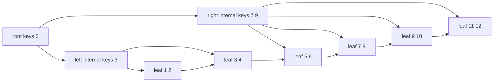
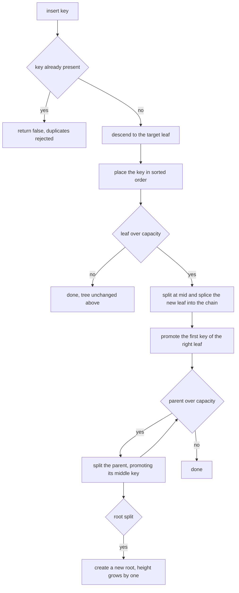
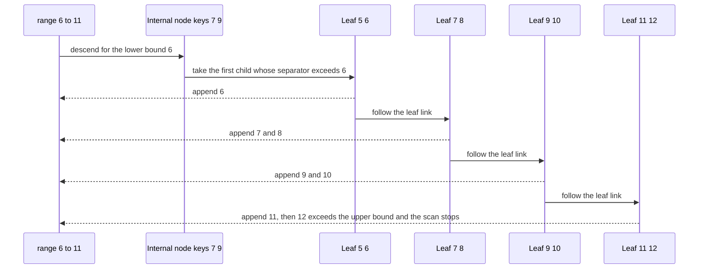

# 477 — Implement B+ tree leaf-range query and insert basics.

> **Tier:** Advanced · **CTCI chapter:** Ch 14 — Databases
> **Task spec:** [477-implement-b-tree-leaf-range-query-and-insert-basics.md](../../../tasks/advanced/477-implement-b-tree-leaf-range-query-and-insert-basics.md)
> **Solutions:** [Python](../../../solutions/python/advanced/477-implement-b-tree-leaf-range-query-and-insert-basics/solution.py) ·
> [Java](../../../solutions/java/advanced/477-implement-b-tree-leaf-range-query-and-insert-basics/Solution.java) ·
> [JavaScript](../../../solutions/javascript/advanced/477-implement-b-tree-leaf-range-query-and-insert-basics/solution.js) ·
> [C#](../../../solutions/csharp/advanced/477-implement-b-tree-leaf-range-query-and-insert-basics/Solution.cs)

## 1. Problem restatement

**Input:** a B+ tree with a configurable leaf capacity `max_keys`, and a sequence of `insert(key)` and
`range(lo, hi)` operations with integer keys.

**Output:** a tree that keeps all keys sorted in linked leaves at equal depth, answering range scans by
descending once and then walking the leaf chain, plus the standard B+ tree invariants.

The split rules are documented and fixed by the assertions:

- A leaf that overflows splits at `mid = len(keys) // 2`; the **first key of the new right leaf** is
  promoted as the separator.
- An internal node that overflows splits at `mid = len(children) // 2`, promoting `keys[mid - 1]` and
  moving the right half of the children with it.
- Separators satisfy `min_key(child[i + 1]) == keys[i]`, all leaves sit at equal depth, and the leaf
  chain visits every leaf in tree order.
- `insert` rejects duplicates and reports `False` for them.

The contract is fixed by the assertions, using `max_keys = 3` for the hand-traced cascades:

| Operation | Result |
| --- | --- |
| ascending inserts `1..12` | root keys `[5]`, `6` leaves, height `3` |
| every `range` after every insert | equals the brute-force filter of the inserted keys |
| descending inserts `12..1` | same key set, mirror-image splits, sorted output |
| `insert(7)` again | `False`, and neither `all_keys()` nor `size` changes |
| random workload, `max_keys = 4`, 40 inserts | more than `25` distinct keys, no duplicates accepted |
| 80 random `range` queries | equal to the sorted-list oracle |
| `range(65, 63)` | `[]` — an inverted range |

## 2. Intuition

A binary search tree answers a range query by walking down once and then climbing back up for every
result, which is why an in-order traversal is O(n) regardless of the range. A B+ tree changes two
things: internal nodes hold many keys (so the tree is shallow), and the leaves are **linked in sorted
order**.

The link is what makes range queries cheap. A scan descends once to the leaf that could hold `lo`, then
walks the sibling chain to the right, stopping as soon as a key exceeds `hi`. The number of visited
leaves is proportional to the answer size, not to the tree size.



That is the state after the asserted ascending cascade, and it shows both structures at once: a
three-level tree of separators, and a chain that stitches the six leaves together.

The second idea is that a separator duplicates a leaf key rather than moving it: the overflowing leaf
`[1, 2, 3, 4]` becomes `[1, 2]` and `[3, 4]`, with `3` **copied** up. Internal splits **move** theirs out.

## 3. Algorithm

1. `contains(key)` descends from the root: at an internal node pick the first child whose separator is
   greater than the key, i.e. advance while `keys[idx] <= key`, then check membership in the leaf.
2. `insert(key)`: reject a key that is already present; otherwise recurse from the root. The recursive
   step returns a promoted separator and a new right node when the node split, or nothing.
3. Leaf insert: place the key in sorted position; if the node now holds more than `max_keys` keys,
   split it at `mid = len(keys) // 2`, give the right half to a new leaf, splice it into the chain
   (`right.next = node.next`, `node.next = right`), and promote `right.keys[0]`.
4. Internal insert: after recursing into the chosen child, insert the promoted separator and the new
   right child at that position; if the node now holds more than `max_keys` keys, split at
   `mid = len(children) // 2`, promote `keys[mid - 1]`, give `children[mid:]` and `keys[mid:]` to the
   new right node, and keep `children[:mid]` and `keys[:mid - 1]`.
5. If the root itself split, build a new root holding one separator and the two halves, which is the
   only way the tree grows taller.
6. `range(lo, hi)`: return `[]` when `lo > hi`; descend to the leaf that could hold `lo`; walk the
   chain left to right, appending keys in `[lo, hi]` and returning immediately at the first key above
   `hi`.
7. `all_keys()` walks the whole chain from the leftmost leaf, which is both a convenience and a check
   that the chain and the tree agree.

```text
function leaf_for(node, key)
    while node is not a leaf do
        idx ← 0
        while idx < length(node.keys) and node.keys[idx] <= key do
            idx ← idx + 1
        end
        node ← node.children[idx]
    end
    return node
end

function insert(node, key)
    if node is a leaf then
        place key in sorted position inside node.keys
        if length(node.keys) <= max_keys then
            return nothing
        end
        mid ← length(node.keys) // 2
        right ← new leaf holding node.keys[mid:]
        node.keys ← node.keys[0 : mid]
        right.next ← node.next
        node.next ← right
        return (right.keys[0], right)
    end
    idx ← position of the child that must contain key
    result ← insert(node.children[idx], key)
    if result is nothing then
        return nothing
    end
    (separator, right) ← result
    insert separator at node.keys[idx] and right at node.children[idx + 1]
    if length(node.keys) <= max_keys then
        return nothing
    end
    mid ← length(node.children) // 2
    promoted ← node.keys[mid - 1]
    right_node ← new internal node
    right_node.children ← node.children[mid :]
    right_node.keys ← node.keys[mid :]
    node.children ← node.children[0 : mid]
    node.keys ← node.keys[0 : mid - 1]
    return (promoted, right_node)
end

procedure insert_key(tree, key)
    if contains(tree, key) then
        return false
    end
    result ← insert(tree.root, key)
    if result is not nothing then
        (separator, right) ← result
        tree.root ← new internal node with keys [separator] and children [old root, right]
    end
    tree.size ← tree.size + 1
    return true
end

function range(tree, lo, hi)
    if lo > hi then
        return empty list
    end
    leaf ← leaf_for(tree.root, lo)
    out ← empty list
    while leaf is not nothing do
        for key in leaf.keys do
            if key > hi then
                return out
            end
            if key >= lo then
                append key to out
            end
        end
        leaf ← leaf.next
    end
    return out
end
```

The `return out` inside the loop is the early exit that makes the scan proportional to the answer: the
moment a key exceeds `hi`, the rest of the chain is out of range.



## 4. Worked example

Insert `1..12` into a tree with `max_keys = 3` and watch the structure change. Every row is the state
after that insert:

| Key | Root keys | Leaves, left to right | Height |
| --- | --- | --- | --- |
| `1` | `[1]` | `[1]` | `1` |
| `2` | `[1, 2]` | `[1, 2]` | `1` |
| `3` | `[1, 2, 3]` | `[1, 2, 3]` | `1` |
| `4` | `[3]` | `[1, 2] [3, 4]` | `2` |
| `5` | `[3]` | `[1, 2] [3, 4, 5]` | `2` |
| `6` | `[3, 5]` | `[1, 2] [3, 4] [5, 6]` | `2` |
| `8` | `[3, 5, 7]` | `[1, 2] [3, 4] [5, 6] [7, 8]` | `2` |
| `9` | `[3, 5, 7]` | `[1, 2] [3, 4] [5, 6] [7, 8, 9]` | `2` |
| `10` | `[5]` | `[1, 2] [3, 4] [5, 6] [7, 8] [9, 10]` | `3` |
| `12` | `[5]` | `[1, 2] [3, 4] [5, 6] [7, 8] [9, 10] [11, 12]` | `3` |

Three moments are worth reading closely.

**Insert 4 — the first leaf split.** The root is a leaf holding `[1, 2, 3]`, one key over capacity after
the insert. It splits at `mid = 4 // 2 = 2` into `[1, 2]` and `[3, 4]`, and `3` — the first key of the
right leaf — is copied up. A new root with keys `[3]` and those two leaves appears, so the height grows
to `2`.

**Insert 10 — the first internal split.** Adding `10` splits the rightmost leaf `[9, 10]` and promotes
`9`, but the root already holds `[3, 5, 7]`, which is at capacity. The internal split uses
`mid = 5 // 2 = 2`, promotes `keys[1] = 5`, gives the right node keys `[7, 9]` and the last four
children, and leaves the left node with keys `[3]`. The promoted `5` becomes the new single-key root,
and the height grows to `3`.

**Duplicate insert.** `insert(7)` on the finished tree returns `False`; `all_keys()` is still
`1..12` and `size` is still `12`. The check uses the same descent as `contains`, so a duplicate never
reaches a split.

Now trace a range scan on the final tree, say `range(6, 11)`:

| Step | Action | Result so far |
| --- | --- | --- |
| 1 | descend for `6`: root key `5 <= 6`, so go right | at internal node keys `[7, 9]` |
| 2 | `7 > 6`, so take child 0 | leaf `[5, 6]` |
| 3 | `6 >= 6`, append | `[6]` |
| 4 | follow the chain to leaf `[7, 8]`, both in range | `[6, 7, 8]` |
| 5 | follow the chain to leaf `[9, 10]`, both in range | `[6, 7, 8, 9, 10]` |
| 6 | follow the chain to leaf `[11, 12]`, `11 > 11` is false so `11` appends, then `12 > 11` | `[6, 7, 8, 9, 10, 11]` and stop |



Four leaves were touched for six results, and the descent cost three comparisons — the scan never
looked at the leaves holding `1` to `4`.

## 5. Complexity

Let `n` be the number of keys, `h` the tree height, `M = max_keys` the node capacity, and `k` the size
of a range answer.

| Measure | Bound | Why it holds |
| --- | --- | --- |
| Time, `contains` | O(h · M) | at most `M` key comparisons per level; `h = log_M(n)` |
| Time, `insert` | O(h · M + M) | a descent plus an in-node insert and, on split, one node copy |
| Time, `range` | O(h · M + k) | one descent plus one pass over the visited leaves |
| Height, `max_keys = 3`, 12 keys | `3` | the asserted cascade; `h` grows only through a root split |

The `M` factor inside the height term is the constant the capacity buys. A larger capacity means more
comparisons per node but a shorter tree, which is why real databases size a page to hold one node
exactly. Range scans are the reason the leaf chain matters: without it the query would cost O(n) — the
height term plus `k` is the improvement.

## 6. Pitfalls and edge cases

- **Promote, do not move, in leaves.** A leaf split copies the right leaf's first key upward; the key
  stays in the leaf. An internal split *moves* its middle key out. Mixing the two conventions breaks the
  asserted invariant `min_key(child[i + 1]) == keys[i]`.
- **Chain splicing order.** `right.next` must be assigned before `node.next`, or the rest of the leaf
  chain is lost and `range` stops early.
- **Inverted ranges.** `range(65, 63)` must return `[]`; the guard at the top of the procedure is
  asserted.
- **Duplicates are rejected.** `insert` returns `False` and neither the tree nor `size` changes, which
  is asserted for `7` after the cascade.
- **The range boundary is inclusive on both ends.** Keys equal to `lo` or `hi` are included, so the
  early exit must trigger on `key > hi` and not on `key >= hi`.

## 7. Variants and follow-ups

- **Node-level insert and delete.** [437-implement-b-tree-node-insert-delete-basics.md](../../../tasks/advanced/437-implement-b-tree-node-insert-delete-basics.md)
  covers rebalancing on the way out — borrowing and merging neighbours — which this task deliberately
  omits because it only inserts.
- **Persistent versions.** [614-implement-persistent-b-tree-for-versioned-db-index.md](../../../tasks/expert/614-implement-persistent-b-tree-for-versioned-db-index.md)
  adds versioning by copying nodes along the modified path.
- **The write-optimised alternative.** [478-implement-log-structured-merge-tree-lsm-basic-flush-merge-simula.md](../../../tasks/advanced/478-implement-log-structured-merge-tree-lsm-basic-flush-merge-simula.md)
  trades the in-place tree for append-only runs, giving up cheap range scans for cheaper writes.

## 8. Check yourself

1. Why can `range` ignore the internal nodes after it has descended?

<details><summary>Show answer</summary>

Because leaves store every key and are linked in sorted order. Internal nodes hold separators only —
copies of the smallest key of a right subtree — so they route the descent but contain no data. Once the
scan has reached the leaf that could hold `lo`, walking `next` pointers visits exactly the keys in
order, and the internal nodes are irrelevant until the next query.

</details>

2. In the cascade, the root keys change from `[3, 5, 7]` to `[5]` when `10` is inserted. What happened?

<details><summary>Show answer</summary>

Both a leaf and the root split. The leaf `[7, 8, 9]` overflowed with `10`, becoming `[7, 8]` and
`[9, 10]` and promoting `9`, which left the root holding four keys — one over capacity. The root then
split at `mid = 5 // 2 = 2`, promoting its middle key `5`: the left node kept keys `[3]`, the right node
took keys `[7, 9]` with the last four children, and the promoted `5` became a new single-key root, so
the height went from `2` to `3`.

</details>

3. Why does a leaf split copy a key upward while an internal split moves one?

<details><summary>Show answer</summary>

Because leaf keys are the data and internal keys are routing hints. Copying the right leaf's first key
up keeps every key reachable in the leaves — which the linked chain and `all_keys()` depend on — while
the internal split can safely remove its middle key from the node because that key is only needed to
decide which child to visit next.

</details>

4. How does the tree guarantee the same key is never stored twice?

<details><summary>Show answer</summary>

`insert` first calls `contains`, which descends to the leaf that would hold the key and checks
membership there. If the key is present, the insert returns `False` without touching the structure, so
no split is triggered. The file asserts this with `not tree.insert(7)` and by re-checking that
`all_keys()` and `size` are unchanged.

</details>
