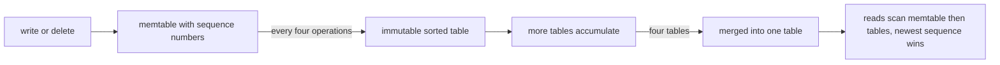
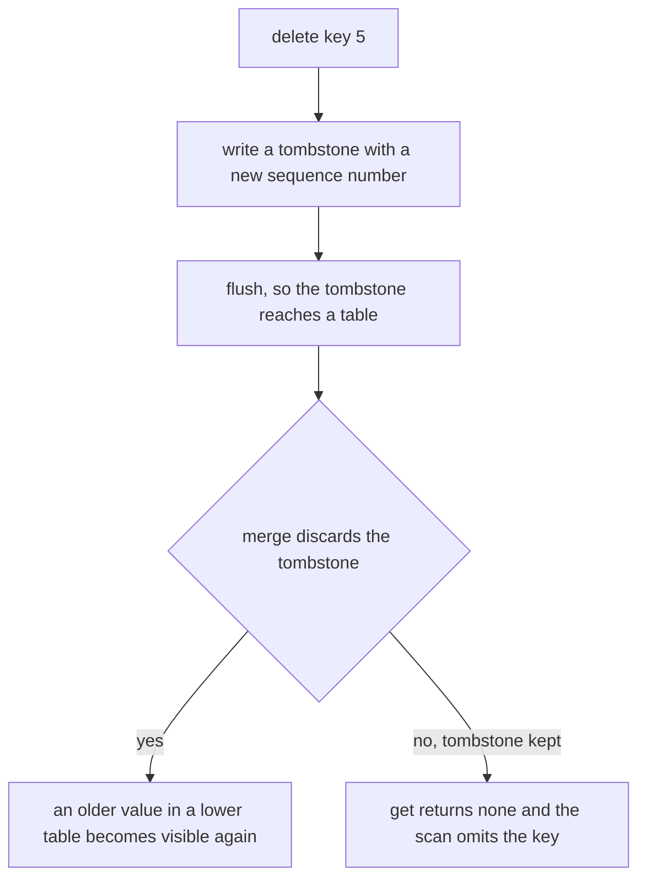
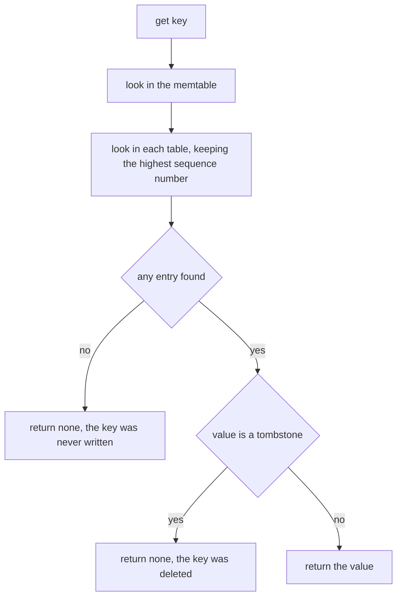
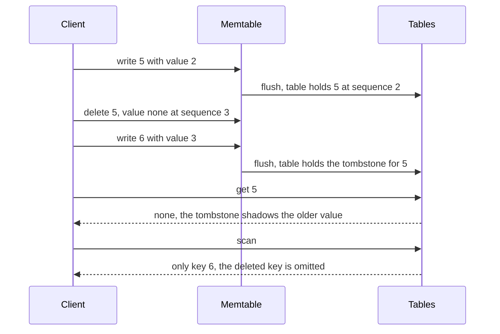

# 478 — Implement log-structured merge tree (LSM) basic flush/merge simulation.

> **Tier:** Advanced · **CTCI chapter:** Ch 14 — Databases
> **Task spec:** [478-implement-log-structured-merge-tree-lsm-basic-flush-merge-simula.md](../../../tasks/advanced/478-implement-log-structured-merge-tree-lsm-basic-flush-merge-simula.md)
> **Solutions:** [Python](../../../solutions/python/advanced/478-implement-log-structured-merge-tree-lsm-basic-flush-merge-simula/solution.py) ·
> [Java](../../../solutions/java/advanced/478-implement-log-structured-merge-tree-lsm-basic-flush-merge-simula/Solution.java) ·
> [JavaScript](../../../solutions/javascript/advanced/478-implement-log-structured-merge-tree-lsm-basic-flush-merge-simula/solution.js) ·
> [C#](../../../solutions/csharp/advanced/478-implement-log-structured-merge-tree-lsm-basic-flush-merge-simula/Solution.cs)

## 1. Problem restatement

**Input:** a stream of `set` and `delete` operations over a 16-key space, with `FLUSH_AFTER = 4`
operations per memtable and `MERGE_FANOUT = 4` tables per merge.

**Output:** a log-structured merge engine: writes land in an in-memory memtable keyed by a globally
increasing sequence number, the memtable is flushed to an immutable sorted table when it reaches the
flush threshold, and four accumulated tables are merged into one, keeping the highest sequence number
per key. Reads and scans merge the memtable with every table the same way.

The key design decision is how deletes are represented: as **tombstones**, i.e. entries whose value
is `None`. A tombstone is a normal entry with a sequence number, so it shadows older values in lower
tables — and, crucially, it must *survive* flushing and merging, because dropping it would resurrect
the deleted key.

The contract is fixed by the assertions:

| Check | Result |
| --- | --- |
| after 3 writes, then a 4th | no table yet, then exactly one table and an empty memtable |
| `get(0)` before the flush | `10` — the memtable serves reads |
| `delete(1)` then `write(1, 99)` | `None` then `99`; the scan shows `[(0,10),(1,99),(2,12),(3,13)]` |
| tombstone after `flush_after = 2` flushes | `get(5) is None` even though the flush happened |
| `merge_tables` over those tables | `get(5)` is still `None` and the scan is `[(6, 3)]` — no resurrection |
| the same key written again | `get(5) == 7` and the scan is `[(5,7),(6,3),(8,8)]` |
| 80-operation workload, seed `31337` | `20` flushes, `6` merges, `2` tables left, empty memtable |
| after every operation | `get(k)` matches a last-write-per-key oracle for all 16 keys, and `scan()` matches |
| merge points | flushes `4, 7, 10, 13, 16, 19` |

## 2. Intuition

Updating a page inside a B+ tree means finding the page, modifying it, and writing it back, with a
split possibly rewriting several pages. An LSM engine takes the opposite approach: never update in
place. Every write becomes a new entry in a buffer, and that buffer is periodically written out whole
as a new, immutable, sorted table.

That makes writes sequential and cheap, and it moves the cost to the read path: a key may have copies
in the memtable and in several tables, so a read must look at all of them and pick the newest. A
**sequence number** assigned to every write is what makes "newest" well defined, and it is also what
lets a merge deduplicate safely — the copy with the highest sequence number wins.



The picture shows the two thresholds at once: the flush threshold bounds the memtable, and the merge
fanout bounds the number of tables a read has to consult. Without the second threshold, the read path
would degrade one table at a time.

The subtlety that makes deletes work is worth its own picture. A delete cannot simply remove a key
from a table — the older value may still be in a lower table. Instead it writes a tombstone, which is
an entry like any other except that its value is `None`. `get` returns `None` for such an entry, and
`scan` drops it, but the merge keeps it precisely because it must keep shadowing the older value.



## 3. Algorithm

1. `write(key, value)`: bump the global sequence counter, store `(seq, value)` in the memtable, count
   the operation, and flush when the count reaches the threshold.
2. `delete(key)`: exactly a write whose value is the tombstone `None`.
3. `flush()`: if the memtable is non-empty, append it as a new immutable table with a fresh id, clear
   the memtable, reset the operation counter, count the flush, and then merge while at least
   `MERGE_FANOUT` tables exist.
4. `merge_tables(tables)`: for each key, keep the entry with the highest sequence number, tombstones
   included.
5. `get(key)`: take the best entry among the memtable and every table by highest sequence number, and
   return its value — `None` means deleted.
6. `scan()`: merge all sources the same way, then return the sorted list of entries whose value is not
   `None`.

```text
procedure write(store, key, value)
    store.seq ← store.seq + 1
    store.memtable[key] ← (store.seq, value)
    store.ops_since_flush ← store.ops_since_flush + 1
    if store.ops_since_flush >= store.flush_after then
        flush(store)
    end
end

procedure flush(store)
    if store.memtable is empty then
        return
    end
    store.next_table_id ← store.next_table_id + 1
    append table with id store.next_table_id and entries copy of store.memtable to store.tables
    store.memtable ← empty
    store.ops_since_flush ← 0
    store.flush_count ← store.flush_count + 1
    while length(store.tables) >= MERGE_FANOUT do
        merged ← merge_tables(store.tables[0 : MERGE_FANOUT])
        store.tables ← [merged] followed by store.tables[MERGE_FANOUT :]
        store.merge_count ← store.merge_count + 1
    end
end

function merge_tables(tables)
    merged ← empty map
    for table in tables do
        for (key, (seq, value)) in table.entries do
            if key is not in merged or seq > merged[key].seq then
                merged[key] ← (seq, value)
            end
        end
    end
    return table holding merged
end

function get(store, key)
    best ← store.memtable.get(key)
    for table in store.tables do
        entry ← table.entries.get(key)
        if entry is not nothing and (best is nothing or entry.seq > best.seq) then
            best ← entry
        end
    end
    if best is nothing then
        return nothing
    end
    return best.value
end
```

`get` never assumes that a later table is newer — the sequence number settles it. That is what allows
a merge to place its output at the front of the table list without reordering anything else.



## 4. Worked example

**Flush timing.** The first table appears on the fourth operation, not before:

| Operation | Memtable | Tables | Flushes | `get(0)` |
| --- | --- | --- | --- | --- |
| `write(0, 10)` | `{0: (1, 10)}` | `0` | `0` | `10` |
| `write(1, 11)` | `{0, 1}` | `0` | `0` | `10` |
| `write(2, 12)` | `{0, 1, 2}` | `0` | `0` | `10` |
| `write(3, 13)` | `{}` | `1` | `1` | `10` |

The scan after the fourth write is `[(0, 10), (1, 11), (2, 12), (3, 13)]`, and it is served entirely
from the table because the memtable has just been drained.

**Delete, then rewrite.** With `flush_after = 2`:

| Operation | Effect on tables | `get(5)` | `scan()` |
| --- | --- | --- | --- |
| `write(5, 1)`, `write(5, 2)` | flush `{5: (2, 2)}` | `2` | `[(5, 2)]` |
| `delete(5)`, `write(6, 3)` | flush `{5: (3, None), 6: (4, 3)}` | `None` | `[(6, 3)]` |
| `merge_tables(tables)` | one table, tombstone kept | `None` | `[(6, 3)]` |
| `write(5, 7)`, `write(8, 8)` | flush `{5: (5, 7), 8: (6, 8)}` | `7` | `[(5,7),(6,3),(8,8)]` |

The third row is the whole point of tombstones: after the merge, key `5` still reads as deleted, even
though the merge combined the table that holds the tombstone with nothing that could revive it. If the
merge had dropped entries with `None` values, the older `(2, 2)` in the first table would become
visible again — a resurrection bug.



**The full workload.** With `FLUSH_AFTER = 4` and 80 operations (`seed = 31337`, a delete whenever
`seed mod 5 == 4`):

| Metric | Value | Why |
| --- | --- | --- |
| flushes | `20` | one per four operations |
| merges | `6` | the table count reaches four after flushes `4, 7, 10, 13, 16, 19` |
| tables at the end | `2` | one merged table plus the final flush |
| memtable at the end | empty | the twentieth flush drained it |
| correctness | every `get` and every `scan` matches the oracle after every operation | the merge preserves the newest sequence per key |

Note the periodic pattern: a merge leaves one table, and the next two flushes bring the count back to
three, so a merge fires every third flush rather than every fourth.

## 5. Complexity

Let `n` be the number of operations, `F` the flush threshold, `M` the merge fanout, and `T` the number
of tables.

| Measure | Bound | Why it holds |
| --- | --- | --- |
| Time, `write` | O(1) | one map assignment plus a counter check |
| Time, `flush` | O(F) | the memtable holds at most the threshold's worth of entries |
| Time, merge | O(M · F) | `M` tables of at most `F` entries each are combined in one pass |
| Time, `get` | O(T) | the memtable plus one lookup per table, with no index |
| Time, `scan` | O((T + 1) · F + K log K) | merge all sources then sort the `K` live keys |
| Space | O(T · F) plus the memtable | the engine never overwrites in place |
| Fixture work | O(n · KEYS) | the workload compares all 16 keys after every one of the 80 operations |
| Write amplification | merges rewrite their input entries | the cost this design trades for sequential writes |

The `O(T)` read cost is the real price of the design, and the merge fanout is what bounds it: without
merging, `T` would grow with `n`. Production engines go further with per-table bloom filters and a
leveled layout, which reduces the number of tables a miss must probe — exactly the knob the next task
studies.

## 6. Pitfalls and edge cases

- **Tombstones must survive the merge.** Dropping `None` values during `merge_tables` resurrects keys
  deleted in an older table; the file asserts `get(5) is None` both before and after the merge.
- **`get` must return `None` for both "absent" and "deleted".** Both cases are indistinguishable from
  the caller's point of view, and the oracle comparisons rely on that: the oracle stores `None` for a
  deleted key and the engine must agree.
- **Sequence numbers, not table order, decide freshness.** A merge output is inserted at the front of
  the table list, but `get` still compares sequence numbers, so correctness does not depend on
  position.
- **Empty flush is a no-op.** Flushing an empty memtable must not create an empty table or increment
  `flush_count`; the guard is what makes the counts in the workload meaningful.
- **Delete of a missing key.** `delete` is just a write of a tombstone, so deleting a key that was
  never written leaves a tombstone that `get` reports as `None` — the same answer as "never written".
- **The operation counter resets only on a real flush.** Counting an empty flush would drift the
  flush schedule and break the asserted `20` flushes.
- **Scan drops tombstones but not order.** The scan result must be sorted by key and exclude deleted
  keys, which is why the implementation merges first and filters afterwards — filtering before
  merging would let an older value slip through.
- **Overwrite within one memtable.** Two writes to the same key before a flush keep only the later one
  in the memtable, but the earlier one still exists in a table if there was a previous flush; the
  sequence comparison resolves it.
- **Merge loop, not a single merge.** After merging four tables into one, the count can still be at or
  above the fanout, so the merge runs in a `while` loop. A single `if` would leave the count too high
  in busier workloads.

## 7. Variants and follow-ups

- **Choosing how to compact.** [479-implement-compaction-strategies-for-lsm-levelled-vs-size-tiered.md](../../../tasks/advanced/479-implement-compaction-strategies-for-lsm-levelled-vs-size-tiered.md)
  compares size-tiered against leveled compaction on a fixed workload, which is the tuning question
  this task's fixed fanout sidesteps.
- **Tuning for read/write trade-offs.**
  [777-implement-write-optimized-lsm-tuning-simulation-for-read-write-t.md](../../../tasks/expert/777-implement-write-optimized-lsm-tuning-simulation-for-read-write-t.md)
  explores the same parameters with an explicit cost model.
- **Making the write path durable.** [480-implement-write-ahead-logging-wal-crash-recovery-simulation.md](../../../tasks/advanced/480-implement-write-ahead-logging-wal-crash-recovery-simulation.md)
  adds the log that a real memtable needs before it can be acknowledged.
- **Probabilistic filters per table.** [482-implement-bloom-filter-per-sstable-prototype-and-test.md](../../../tasks/advanced/482-implement-bloom-filter-per-sstable-prototype-and-test.md)
  attaches a Bloom filter to each table so a miss does not probe every one, and
  [467-implement-bloom-filter-with-double-hashing-and-test-false-positi.md](../../../tasks/advanced/467-implement-bloom-filter-with-double-hashing-and-test-false-positi.md)
  builds the filter itself.
- **The in-place alternative.** [477-implement-b-tree-leaf-range-query-and-insert-basics.md](../../../tasks/advanced/477-implement-b-tree-leaf-range-query-and-insert-basics.md)
  keeps keys sorted in place and pays for it on writes.

## 8. Check yourself

1. Why does a delete write a tombstone instead of removing the key?

<details><summary>Show answer</summary>

Because the key's older value may live in another table. Removing the key from one table would leave
the older copy visible, so a delete has to record a *newer* fact about the key — an entry with a
higher sequence number whose value is `None` — which then shadows every older copy. That is why the
tombstone must survive flushing and merging: dropping it during the merge would resurrect the key, as
the `flush_after = 2` example demonstrates.

</details>

2. Why do 20 flushes produce only `6` merges?

<details><summary>Show answer</summary>

Because a merge resets the table count to one, and it takes three more flushes to reach the fanout of
four again. Starting from the first merge at flush `4`, the merges fall at flushes `4, 7, 10, 13, 16,
19` — that is `6` merges, and afterwards the two remaining tables are the merged output plus the
twentieth flush.

</details>

3. Where does the design pay for its cheap writes?

<details><summary>Show answer</summary>

On reads and on merges. A read has to consult the memtable and every table, which is `O(T)` lookups
with no index, and every merge rewrites its input entries, which is write amplification. The fanout
threshold bounds `T`, and a real engine adds per-table Bloom filters so a miss can skip tables
entirely.

</details>

4. In the trace, both the tombstone and the value `2` for key `5` exist in tables. Which one wins?

<details><summary>Show answer</summary>

The tombstone, because it carries the higher sequence number — `3` versus `2`. The rule is purely
"highest sequence number per key", applied identically by `get`, `scan` and `merge_tables`. The table
holding the tombstone is not necessarily consulted first, so no ordering shortcut can replace the
sequence comparison.

</details>

5. What would go wrong if `flush()` incremented `flush_count` even for an empty memtable?

<details><summary>Show answer</summary>

The schedule would drift. The counter is what makes "one flush per four operations" true, and the
workload asserts exactly `20` flushes and `6` merges. An extra counted flush would also enqueue an
empty table, which increases the table count, triggers an early merge, and changes `merge_count` — a
small leak in the accounting that the assertions are designed to catch.

</details>
